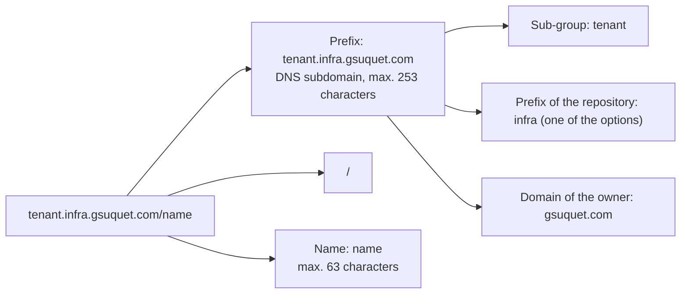
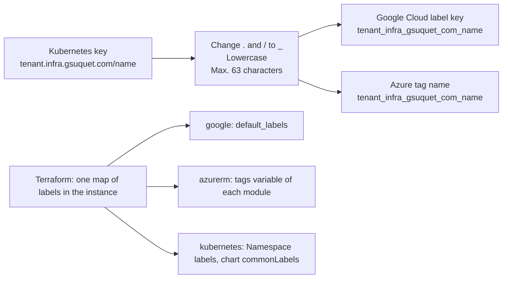

# RFC 0004: Kubernetes labels and annotations reference

## Summary

This RFC proposes one set of rules for the labels and the annotations of the Kubernetes objects in this repository. It also covers the labels and tags of the cloud resources. It collects the syntax rules of Kubernetes, the recommended `app.kubernetes.io/*` labels, and the keys that Helm, Argo CD, Cilium, cert-manager and Gateway API use. It proposes a custom prefix of the form `<subgroup>.<prefix>.gsuquet.com/<name>` for the keys of the repository, but it gives options and does not select the prefix. It also proposes a mapping from the Kubernetes keys to Google Cloud labels and Azure tags, and the Conftest checks that enforce the rules. A reference table at the end can become a Diátaxis reference page later.

## Motivation

The repository uses labels and annotations today, but it has no rule for them. Each upstream chart sets its own keys. The hand-written manifests in `kubernetes/` copy the recommended labels by hand. Only two Conftest rules check keys: the Pod Security labels on a `Namespace`, and the `argocd.argoproj.io/sync-wave` annotation on a `Namespace` and on a `CustomResourceDefinition`. Refer to [Inventory of the keys in use](#inventory-of-the-keys-in-use).

Later work needs a stable set of keys:

- **A zero-trust network policy.** Cilium makes a security identity from the labels of a pod. A policy selects pods by these labels. A label that changes at each upgrade gives a new identity. A label that an attacker can change can move a pod into a different policy. The later zero-trust RFC must know which labels are stable.
- **Tenants.** The repository will host applications of more than one tenant. A tenant key on each `Namespace` lets policies, quotas and reports select the objects of one tenant.
- **Cloud instances.** The demo and test instances on GKE and Azure create cloud resources. The owner must find, count and delete them. Cloud labels and tags do this, but their syntax is different from Kubernetes labels.
- **Argo CD.** Argo CD records which `Application` owns each object. A wrong tracking setting can make Argo CD delete objects that another tool owns.

Use cases:

- **An author adds a component in `gitops/`.** The author reads one reference table and knows which keys to set, on which kinds, with which values. `mise run lint` tells the author when a key is missing or wrong.
- **The owner writes a `CiliumNetworkPolicy`.** The owner selects pods with keys that do not change at an upgrade, and that only the repository sets.
- **The owner deletes a demo instance.** A query on one cloud label finds all the resources of that instance.

## Proposal

### Label or annotation

A label identifies an object. Selectors, queries and policies use labels. An annotation holds other metadata: tool settings, URLs, notes. Use this rule from the [Helm best practices](https://helm.sh/docs/chart_best_practices/labels/). If no tool and no person selects or queries objects by a key, the key is an annotation.

| Need | Use |
| --- | --- |
| A selector, a network policy, a query, a report | A label |
| A setting for a controller, for example Argo CD sync options | An annotation |
| A URL, a contact, a long text, JSON | An annotation |

### Anatomy of a key

A key has an optional prefix and a name, with a `/` between them. The prefix is a DNS subdomain. Kubernetes reserves the prefixes `kubernetes.io/` and `k8s.io/` for its core components. A key without a prefix belongs to the user, but automated components must use a prefix ([Kubernetes: labels](https://kubernetes.io/docs/concepts/overview/working-with-objects/labels/)).

In text: the key `tenant.infra.gsuquet.com/name` has the prefix `tenant.infra.gsuquet.com` and the name `name`. The prefix has three parts: the sub-group `tenant`, the prefix of the repository `infra`, and the domain `gsuquet.com`. The example uses `infra` only to show the structure. Refer to [Q2](#q2-the-prefix-of-the-repository).

Many projects use sub-groups in the same way. Kubernetes has `node.kubernetes.io`, `topology.kubernetes.io` and `pod-security.kubernetes.io`. Argo CD has `link.argocd.argoproj.io`, `notice.argocd.argoproj.io` and `pref.argocd.argoproj.io` ([Argo CD: annotations and labels](https://argo-cd.readthedocs.io/en/stable/user-guide/annotations-and-labels/)). cert-manager has `acme.cert-manager.io` and `venafi.cert-manager.io` ([cert-manager: annotations](https://cert-manager.io/docs/reference/annotations/)).

### Families of keys

Each key in the repository belongs to one family. The family tells who owns the key.

| Family | Prefixes | Owner | The repository sets it |
| --- | --- | --- | --- |
| Kubernetes core | `kubernetes.io/`, `k8s.io/` and their subdomains, for example `pod-security.kubernetes.io/` | Kubernetes | Only the keys that Kubernetes documents for users, for example the Pod Security labels |
| Recommended labels | `app.kubernetes.io/` | Shared convention | Yes, in the hand-written charts. The upstream charts set them too |
| Tools | `helm.sh/`, `argocd.argoproj.io/`, `cert-manager.io/`, `gateway.networking.k8s.io/`, Cilium keys | The tool | Only the documented settings, for example sync options |
| Repository | `<subgroup>.<prefix>.gsuquet.com/` | This repository | Yes. This RFC defines them |
| No prefix | None | The user | No. This RFC proposes to forbid new keys without a prefix |

### The custom prefix

The owner wants keys of the form `<subgroup>.<prefix>.gsuquet.com/<name>`. This follows the Kubernetes model. This RFC does not select `<prefix>`. [Q1](#q1-control-of-the-domain), [Q2](#q2-the-prefix-of-the-repository) and [Q3](#q3-rename-the-repository) give the options.

The repository already uses `infra.gsuquet.com` as an API group. The files `cluster.yaml`, `instance.yaml` and `module.yaml` have `apiVersion: infra.gsuquet.com/v1alpha1`, and the schemas in `schemas/` check this value. Projects often use the same domain for their API group and for their keys. Argo CD has the API group `argoproj.io` and the keys `argocd.argoproj.io/*`. cert-manager has the API group `cert-manager.io` and the keys `cert-manager.io/*`.

### Proposed sub-groups

Each sub-group has one subject. A key goes into a sub-group only when a tool, a policy or a report reads it. [Q4](#q4-the-sub-groups) asks which sub-groups to add first.

| Sub-group | Subject | Possible keys | Type | Reader |
| --- | --- | --- | --- | --- |
| `tenant` | The tenant that owns the object | `name` | Label | Network policies, quotas, reports |
| `ownership` | The person or the team to contact | `owner` (label), `contact` (annotation) | Both | Persons, alerts |
| `network` | The trust zone and the exposure, for the zero-trust RFC | `zone`, `exposure` | Label | `CiliumNetworkPolicy`, Conftest |
| `backup` | The backup policy of a volume or a namespace | `policy` (label), `retention` (annotation) | Both | The backup tool |
| `cost` | The cost center, for the cloud instances | `center` | Label | Cloud billing reports |
| `lifecycle` | The environment and the end date of an object | `environment` (label), `expires` (label, `YYYY-MM-DD`) | Label | Clean-up jobs, reports |

The sub-group names are singular nouns, as `node`, `topology` and `notice` in the examples above.

### Required keys

This RFC proposes these required keys. [Q9](#q9-the-scope-of-the-required-keys) asks where the checks apply.

| Kind | Required labels | Required annotations |
| --- | --- | --- |
| `Namespace` in `gitops/` | `pod-security.kubernetes.io/enforce`, `audit` and `warn` (a check exists), `tenant.
/name`, `lifecycle.
/environment` | `argocd.argoproj.io/sync-wave: "-2"` (a check exists) |
| `CustomResourceDefinition` in `gitops/` | None | `argocd.argoproj.io/sync-wave: "-1"` (a check exists) |
| Pod template of a workload in a hand-written chart | `app.kubernetes.io/name`, `app.kubernetes.io/instance`, `app.kubernetes.io/part-of` | None |
| Other objects of a hand-written chart | `app.kubernetes.io/name`, `app.kubernetes.io/instance`, `app.kubernetes.io/managed-by` | None |
| Cloud resource that supports labels or tags | The cloud form of `tenant.
/name`, `lifecycle.
/environment` and the instance name | Not applicable |

`
` is the full prefix of the repository, for example `infra.gsuquet.com`.

## Detailed design

### Syntax rules

Kubernetes applies the same key rules to labels and to annotations ([labels](https://kubernetes.io/docs/concepts/overview/working-with-objects/labels/), [annotations](https://kubernetes.io/docs/concepts/overview/working-with-objects/annotations/)).

| Part | Rule |
| --- | --- |
| Key prefix | Optional. A DNS subdomain: DNS labels with dots between them, max. 253 characters, then `/`. A DNS subdomain contains only lowercase letters, digits, `-` and `.`, and starts and ends with a letter or a digit ([Kubernetes: names](https://kubernetes.io/docs/concepts/overview/working-with-objects/names/)). |
| Key name | Mandatory. Max. 63 characters. It starts and ends with a letter or a digit (`[a-z0-9A-Z]`). Between them: letters, digits, `-`, `_` and `.`. |
| Reserved prefixes | `kubernetes.io/` and `k8s.io/` are for the Kubernetes core components. |
| Label value | Max. 63 characters, or empty. If not empty, it starts and ends with a letter or a digit. Between them: letters, digits, `-`, `_` and `.`. |
| Annotation value | Any string. The total size of all the annotation keys and values on one object is max. 256 KiB. |
| Type | Keys and values are strings. Quote numbers and booleans in YAML, for example `"-2"` or `"true"`. |

This RFC adds rules for the keys of the repository:

- The key name uses lowercase letters, digits and `-` only. No `_` and no `.`. Thus the mapping to cloud keys in [Cloud labels and tags](#cloud-labels-and-tags) has no collision.
- The label values of the repository use lowercase letters, digits and `-` only. Thus the values are valid Google Cloud label values too.

### Recommended labels and Helm labels

Kubernetes recommends six labels with the shared prefix `app.kubernetes.io` ([Kubernetes: recommended labels](https://kubernetes.io/docs/concepts/overview/working-with-objects/common-labels/)). Helm recommends `helm.sh/chart` too ([Helm: labels and annotations](https://helm.sh/docs/chart_best_practices/labels/)).

| Key | Meaning | Example | Helm | Stable at an upgrade |
| --- | --- | --- | --- | --- |
| `app.kubernetes.io/name` | The name of the application | `argocd-server` | Recommended | Yes |
| `app.kubernetes.io/instance` | A unique name of the instance of the application. Helm uses the release name. | `argocd` | Recommended | Yes |
| `app.kubernetes.io/version` | The version of the application | `v3.5.6` | Optional | No |
| `app.kubernetes.io/component` | The component in the architecture | `server` | Optional | Yes |
| `app.kubernetes.io/part-of` | The higher-level application | `argocd` | Optional | Yes |
| `app.kubernetes.io/managed-by` | The tool that manages the operation of the application | `Helm` | Recommended | Yes |
| `helm.sh/chart` | The chart name and version: `{{ .Chart.Name }}-{{ .Chart.Version }}` | `argo-cd-10.11.6` | Recommended | No |

This repository uses the rendered manifests pattern. `mise run manifests:render` runs `helm template`, and Argo CD applies the output. Helm never runs in the cluster. Thus the rendered objects have `app.kubernetes.io/managed-by: Helm`, but Argo CD applies them. [Q5](#q5-the-value-of-appkubernetesiomanaged-by) asks which value to keep.

The selector of a `Deployment`, a `StatefulSet` or a `DaemonSet` is immutable. A selector must use only stable keys: `app.kubernetes.io/name` and `app.kubernetes.io/instance`. The upstream charts and the hand-written manifests already do this.

Helm also uses annotations: `helm.sh/hook`, `helm.sh/hook-weight`, `helm.sh/hook-delete-policy` and `helm.sh/resource-policy`. Argo CD maps the Helm hooks to its own hook phases, and `helm.sh/hook-weight` to `argocd.argoproj.io/sync-wave`. When an object has an Argo CD hook, Argo CD ignores all the Helm hooks ([Argo CD: Helm](https://argo-cd.readthedocs.io/en/stable/user-guide/helm/)).

### Argo CD keys

**Tracking.** Argo CD records the owner `Application` of each object. It has three tracking methods: `label`, `annotation` and `annotation+label`. The setting is `application.resourceTrackingMethod` in the `argocd-cm` ConfigMap ([Argo CD: resource tracking](https://argo-cd.readthedocs.io/en/stable/user-guide/resource_tracking/)).

| Method | Key | Problem |
| --- | --- | --- |
| `label` | `app.kubernetes.io/instance` | Max. 63 characters. Helm and operators also write this label, thus Argo CD can find the wrong owner. |
| `annotation` | `argocd.argoproj.io/tracking-id`, value `<app>:<group>/<kind>:<namespace>/<name>` | None of the label problems. |
| `annotation+label` | Both | The label is for information only. |

Since Argo CD 3.0, the default method is `annotation` ([Argo CD: upgrade from 2.14 to 3.0](https://argo-cd.readthedocs.io/en/stable/operator-manual/upgrading/2.14-3.0/)). The values in `gitops/infrastructure/argocd/sources/values.yaml` do not set the method, thus the repository uses the default. [Q6](#q6-the-argo-cd-tracking-method) asks if the repository must set it explicitly.

**Sync options.** The annotation `argocd.argoproj.io/sync-options` holds a list of options with `,` between them, for example `Prune=false,Delete=false` ([Argo CD: sync options](https://argo-cd.readthedocs.io/en/stable/user-guide/sync-options/)).

| Option | Effect | Use in the repository |
| --- | --- | --- |
| `Prune=false` | Argo CD does not prune the object. | The `argocd` Namespace, the Argo CD CRDs, `argocd-secret` |
| `Delete=false` | Argo CD keeps the object when it deletes the `Application`. | The `argocd` Namespace, `argocd-secret` |
| `Prune=confirm`, `Delete=confirm` | A person must confirm the prune or the delete. | None |
| `ServerSideApply=true` | Argo CD uses server-side apply for the object. | The Argo CD CRDs, and each `Application` at the `Application` level |
| `SkipDryRunOnMissingResource=true` | Argo CD skips the dry run when the CRD is not in the cluster yet. | None |
| `Replace=true`, `Force=true` | Argo CD replaces or deletes and creates the object again. These options can destroy data. | None. This RFC proposes to forbid them in hand-written files. |
| `PruneLast=true` | Argo CD prunes the object at the end of the sync. | None |
| `Validate=false` | Argo CD skips the validation of the object. | None |

**Sync waves and hooks.** The annotation `argocd.argoproj.io/sync-wave` holds an integer as a string. It can be negative. The default is `"0"`. Argo CD sorts by phase, then wave, then kind, then name ([Argo CD: sync waves](https://argo-cd.readthedocs.io/en/stable/user-guide/sync-waves/)). The repository uses `"-2"` for a `Namespace`, `"-1"` for a CRD, `"0"` for the other objects and `"1"` or more for the `Application` objects. The annotation `argocd.argoproj.io/hook` holds the phase of a hook: `PreSync`, `Sync`, `Skip`, `PostSync`, `SyncFail`, `PreDelete` or `PostDelete`.

**Other Argo CD keys.** `argocd.argoproj.io/compare-options`, `argocd.argoproj.io/refresh`, `argocd.argoproj.io/skip-reconcile`, the `link.argocd.argoproj.io/*` and `notice.argocd.argoproj.io/*` annotations, and the label `argocd.argoproj.io/secret-type` on the repository and cluster Secrets.

### Cilium identity and stable labels

Cilium gives a security identity to each set of pods with the same identity-relevant labels. By default, all the labels of a pod are relevant, except a default list of exclusions ([Cilium: identity-relevant labels](https://docs.cilium.io/en/stable/operations/performance/scalability/identity-relevant-labels/)). The exclusions include `kubernetes.io`, `k8s.io`, `topology.kubernetes.io`, `pod-template-hash`, `controller-revision-hash` and `controller-uid`. The `labels` setting of the `cilium-config` ConfigMap, or the `labels` Helm value, adds patterns to the defaults. A pattern with `!` excludes keys. When the setting has one pattern without `!`, Cilium keeps only the matching keys and a default list: `reserved:.*`, `io.kubernetes.pod.namespace`, `io.cilium.k8s.namespace.labels`, `io.cilium.k8s.policy.cluster`, `io.cilium.k8s.policy.serviceaccount` and `app.kubernetes.io`.

A Cilium policy selects pods by their labels, by their namespace (`k8s:io.kubernetes.pod.namespace`), by the labels of their namespace (`io.cilium.k8s.namespace.labels.<key>`) and by their service account (`io.cilium.k8s.policy.serviceaccount`) ([Cilium: Kubernetes policies](https://docs.cilium.io/en/stable/security/policy/kubernetes/)).

The zero-trust RFC needs these facts:

| Label on a pod | Stable | Effect on Cilium |
| --- | --- | --- |
| `app.kubernetes.io/name`, `instance`, `component`, `part-of` | Yes | Good for policy selectors. |
| `app.kubernetes.io/version` | No. It changes at each upgrade. | A new identity at each upgrade. Do not select on it. |
| `helm.sh/chart` | No. It changes at each chart upgrade. | A new identity at each chart upgrade. Do not select on it. |
| `tenant.
/name`, `network.
/zone` | Yes | Good for policy selectors. On the `Namespace`, Cilium reads them through `io.cilium.k8s.namespace.labels.*`. |
| `pod-template-hash`, `controller-revision-hash` | No | Excluded by default. |

The rendered Argo CD pods carry `app.kubernetes.io/version` and `helm.sh/chart` in their pod template. The legacy manifests in `kubernetes/applications/` carry `app.kubernetes.io/version` in the pod template too. [Q7](#q7-volatile-labels-on-pod-templates) asks what to do.

If the zero-trust RFC adds an inclusive pattern to the Cilium `labels` setting, it must also add the custom prefix of the repository. Else Cilium ignores the `tenant` and `network` keys on the pods.

Only the persons and the agents with write access to an object can change its labels. Thus a policy that trusts a label also trusts each identity that can change the label. Namespace labels are safer than pod labels: an application team can change its pod labels, but the `Namespace` comes from `gitops/` through the `infrastructure` AppProject.

### Node labels

The kubelet sets some labels on its own `Node` object. The NodeRestriction admission plugin lets a kubelet change `kubernetes.io/hostname`, `kubernetes.io/arch`, `kubernetes.io/os`, `node.kubernetes.io/instance-type`, `topology.kubernetes.io/region` and `topology.kubernetes.io/zone`, and the keys with the prefix `kubelet.kubernetes.io/` or `node.kubernetes.io/`. The prefix `node-restriction.kubernetes.io/` is for administrators, to label nodes for workload isolation, and kubelets cannot change it ([Kubernetes: admission controllers](https://kubernetes.io/docs/reference/access-authn-authz/admission-controllers/)).

Thus a node label for isolation, for example the nodes that can run the internet-facing pods, uses `node-restriction.kubernetes.io/`, not the custom prefix. Talos and Kind set the node labels from their configuration.

### Other keys of the stack

| Key | Type | Owner | Use |
| --- | --- | --- | --- |
| `pod-security.kubernetes.io/enforce`, `audit`, `warn` | Label on `Namespace` | Kubernetes | Pod Security level: `privileged`, `baseline` or `restricted`. A check exists. |
| `pod-security.kubernetes.io/enforce-version`, `audit-version`, `warn-version` | Label on `Namespace` | Kubernetes | The version of the Pod Security Standards: `latest` or a Kubernetes minor version. Not used. |
| `kubernetes.io/metadata.name` | Label on `Namespace` | Kubernetes | The API server sets it to the name of the namespace. Network policies select namespaces with it. |
| `kubernetes.io/os` | Node label, used in `nodeSelector` | Kubernetes | The upstream charts select `linux` nodes. |
| `kubectl.kubernetes.io/default-container` | Annotation on a pod | kubectl | The default container for `kubectl logs` and `kubectl exec`. |
| `cert-manager.io/cluster-issuer`, `cert-manager.io/issuer` | Annotation on `Gateway` or `Ingress` | cert-manager | The issuer of the certificate. Refer to [cert-manager: annotations](https://cert-manager.io/docs/reference/annotations/). |
| `gateway.networking.k8s.io/bundle-version`, `gateway.networking.k8s.io/channel` | Annotation on the Gateway API CRDs | Gateway API | The version and the release channel of the CRD bundle. The [CRD management guide](https://gateway-api.sigs.k8s.io/guides/crd-management/) tells why to use the standard channel. |
| `controller-gen.kubebuilder.io/version` | Annotation on CRDs | Kubebuilder | Information only. |
| `io.cilium/app` | Label on Cilium pods | Cilium | Used in the anti-affinity of the Cilium operator. |

### Cloud labels and tags

Google Cloud labels and Azure tags have rules that are different from Kubernetes labels.

| Rule | Kubernetes label | Google Cloud label | Azure tag |
| --- | --- | --- | --- |
| Max. count on one resource | No limit in the label documentation | 64 | 50 (15 on some resource types) |
| Key length | Prefix 253, name 63 | 1 to 63 | 512 (128 on storage accounts) |
| Key characters | Letters, digits, `-`, `_`, `.`, one `/` | Lowercase letters, digits, `_`, `-`, international characters | All except `<`, `>`, `%`, `&`, `\`, `?`, `/` |
| Key start | Letter or digit | Lowercase letter or international character | Some types refuse a digit, for example Azure DNS and Traffic Manager |
| Case | Keys and values are case-sensitive | Lowercase only | Names are not case-sensitive in operations, values are case-sensitive |
| Value length | 63, can be empty | 63, can be empty | 256 |
| Value characters | Letters, digits, `-`, `_`, `.` | Lowercase letters, digits, `_`, `-`, international characters | All |
| Sensitive data | Not for secrets | Do not put sensitive data | Tags are plain text. Do not put sensitive values. |

Sources: [Google Cloud: labels](https://docs.cloud.google.com/resource-manager/docs/labels-overview), [Azure: tags](https://learn.microsoft.com/en-us/azure/azure-resource-manager/management/tag-resources). The Google Cloud page does not list `/` or `.` as permitted characters. Azure forbids `/` in tag names, and Azure Front Door and Traffic Manager refuse `:` and `#`.

Google Cloud also has Resource Manager tags. Tags can set conditions on IAM policies, and labels cannot. This RFC covers only labels.

**Terraform mechanisms.**

| Provider | Mechanism | Notes |
| --- | --- | --- |
| `hashicorp/google` | `default_labels` in the `provider` block | Applies to each resource with a top-level `labels` field, or a `labels` field in a top-level `metadata` field. A label on the resource overrides the default. The plan shows them in `terraform_labels` and `effective_labels`. The provider also adds `goog-terraform-provisioned = true` by default (`add_terraform_attribution_label`). Source: [provider reference](https://registry.terraform.io/providers/hashicorp/google/latest/docs/guides/provider_reference). |
| `hashicorp/azurerm` | None at the provider level | The [provider documentation](https://registry.terraform.io/providers/hashicorp/azurerm/latest/docs) of version 5.12.0 has no default tags. Each module takes a `tags` variable and gives it to each resource. Resources do not get the tags of their resource group. Azure Policy can copy them. |
| `hashicorp/kubernetes` | None | The provider has `ignore_labels` and `ignore_annotations` to ignore keys that other tools add ([provider documentation](https://registry.terraform.io/providers/hashicorp/kubernetes/latest/docs)). The modules `bootstrap-cilium` and `bootstrap-cert-manager` have a `common_labels` variable for the chart values. |

On GKE, two sets of labels exist. The Google Cloud labels of the cluster and the node pools go on the cloud resources. The Kubernetes labels of a node pool go on the `Node` objects. This RFC applies the Kubernetes rules to the second set.

**Mapping.** This RFC proposes one mechanical rule from a Kubernetes key to a cloud key. [Q8](#q8-the-mapping-to-cloud-keys) gives the other options.

1. Change each `.` and `/` to `_`.
2. Change all letters to lowercase.
3. The result must have max. 63 characters. A Conftest check refuses a longer key.
4. The value stays the same. The value rules of the repository already give valid Google Cloud values. A value that is not valid, for example `2.0.22`, does not go to the cloud.

In text: the rule changes `tenant.infra.gsuquet.com/name` to `tenant_infra_gsuquet_com_name`. Google Cloud and Azure use the same key. Each instance holds one map of labels. Terraform gives it to `default_labels` on Google Cloud, to the `tags` variables on Azure, and to the Kubernetes labels.

| Kubernetes key | Cloud key |
| --- | --- |
| `app.kubernetes.io/part-of` | `app_kubernetes_io_part-of` |
| `tenant.
/name` | `tenant_
_name`, for example `tenant_infra_gsuquet_com_name` |
| `lifecycle.
/environment` | `lifecycle_
_environment` |
| `lifecycle.
/expires` | `lifecycle_
_expires` |
| `cost.
/center` | `cost_
_center` |

The key rule of the repository forbids `_` in key names. Thus two different Kubernetes keys cannot give the same cloud key.

### Enforcement

Rule 8 of `AGENTS.md` asks for a check for each rule. This RFC describes the checks. It does not implement them. All the checks go in `policy/kubernetes/kubernetes.rego` and `policy/terraform/terraform.rego`, with a test for each case that must pass and each case that must fail. Conftest supports `deny` rules, which fail the check, and `warn` rules, which do not fail it ([Conftest](https://www.conftest.dev/)).

A data file, for example `policy/data/labels.yaml`, holds the reference table: the sub-groups, the keys, their type, their kinds and their permitted values. `conftest --data` loads it, and the policies read it as `data.labels`. Thus the table and the checks have one source.

| Check | Input | Rule | Level |
| --- | --- | --- | --- |
| K1 Syntax | Each object in `gitops/` and `kubernetes/` | Each label key, label value and annotation key matches the syntax rules. `regex.match` checks the patterns ([OPA: regex](https://www.openpolicyagent.org/docs/policy-reference/builtins/regex)). | `deny` |
| K2 Reserved prefixes | Hand-written files (not in `rendered/` or `manifests/`) | No key with the prefix `kubernetes.io/`, `k8s.io/` or one of their subdomains, except an allowlist: the Pod Security labels, `kubectl.kubernetes.io/default-container` and `node-restriction.kubernetes.io/`. | `deny` |
| K3 No prefix | Hand-written files | No new key without a prefix. | `deny` |
| K4 Custom keys | All files | Each key with the custom prefix uses a sub-group and a name from `data.labels`, on a permitted kind, with a permitted value. | `deny` |
| K5 Required keys | `Namespace` objects in `gitops/` | The required labels of the table in [Required keys](#required-keys). | `deny` |
| K6 Required keys of workloads | Pod templates and objects of hand-written charts | The required `app.kubernetes.io/*` labels. | `deny` |
| K7 Required keys in upstream charts | Rendered upstream objects | The same keys as K6. Upstream charts do not always let the repository set them. | `warn` |
| K8 Stable selectors | `spec.selector.matchLabels` of workloads, and `spec.selector` of a `Service` | No `app.kubernetes.io/version` and no `helm.sh/chart`. | `deny` |
| K9 Argo CD tracking | The rendered `argocd-cm` ConfigMap | `application.resourceTrackingMethod` is `annotation`, if the owner selects this in Q6. | `deny` |
| K10 Sync options | Hand-written files | `argocd.argoproj.io/sync-options` has no `Replace=true` and no `Force=true`. | `deny` |
| K11 Cloud defaults | `provider "google"` blocks in `instances/` | The block sets `default_labels` with the required keys. | `deny` |
| K12 Cloud tags | `azurerm` resources in `modules/` with a `tags` argument | The argument comes from the `tags` variable of the module. | `deny` |
| K13 Cloud key length | Keys of `default_labels` and `tags` | The cloud form of each key has max. 63 characters, and each value is a valid Google Cloud value. | `deny` |

The existing checks stay: the Pod Security labels on a `Namespace`, the sync waves, and no `resources-finalizer.argocd.argoproj.io` finalizer.

### Inventory of the keys in use

The inventory comes from `main` at commit `07e975b`, from `gitops/`, `modules/`, `instances/` and `kubernetes/`.

| Key | Where | Set by |
| --- | --- | --- |
| `app.kubernetes.io/name`, `instance`, `version`, `component`, `part-of`, `managed-by` | Rendered Argo CD objects in `gitops/clusters/kind-local/rendered/argocd/`, chart sources in `modules/`, legacy manifests in `kubernetes/` | Upstream charts. The legacy manifests set them by hand, with `managed-by: argocd`. |
| `helm.sh/chart` | Rendered Argo CD objects, also in pod templates | Upstream charts |
| `helm.sh/hook`, `helm.sh/hook-weight`, `helm.sh/hook-delete-policy` | The Argo CD Redis secret job, the module charts | Upstream charts |
| `helm.sh/resource-policy: keep` | The three Argo CD CRDs | Upstream chart |
| `argocd.argoproj.io/sync-wave` | The `argocd` Namespace, the Argo CD CRDs, each `Application` | `gitops/infrastructure/argocd/sources/` |
| `argocd.argoproj.io/sync-options` | The `argocd` Namespace and `argocd-secret` (`Prune=false,Delete=false`), the Argo CD CRDs (`ServerSideApply=true,Prune=false`) | `gitops/infrastructure/argocd/sources/` |
| `pod-security.kubernetes.io/enforce`, `audit`, `warn` | The `argocd` Namespace, all `restricted` | `gitops/infrastructure/argocd/sources/templates/namespace.yaml` |
| `kubernetes.io/os` | `nodeSelector` of upstream workloads | Upstream charts |
| `gateway.networking.k8s.io/bundle-version`, `channel`, `policy` | Gateway API CRDs in `modules/bootstrap-gateway-api/manifests/` | Upstream bundle |
| `controller-gen.kubebuilder.io/version` | Agent sandbox CRDs | Upstream chart |
| `io.cilium/app` | Cilium operator anti-affinity | Cilium values |
| `checksum/*` | Pod template annotations of Argo CD | Upstream chart |
| `common_labels` (Terraform variable) | `modules/bootstrap-cilium`, `modules/bootstrap-cert-manager` | Default `{}`. `instances/kind-local` does not set it. |
| `infra.gsuquet.com/v1alpha1` (API group, not a key) | `cluster.yaml`, `instance.yaml`, `module.yaml` and `schemas/` | The repository |

No cloud provider exists in the code yet. No `default_labels` and no `tags` exist. No key uses a custom prefix. The repository does not set `application.resourceTrackingMethod`, thus Argo CD uses the default `annotation` method and writes `argocd.argoproj.io/tracking-id` in the cluster.

### Reference table

This table is the draft of a future reference page, `docs/reference/labels-and-annotations.md`. `
` is the prefix of the repository. The custom keys stay proposals until the owner answers the unresolved questions.

| Key | Type | Kinds | Values | Set by | Required | Stable |
| --- | --- | --- | --- | --- | --- | --- |
| `app.kubernetes.io/name` | Label | All | Name of the application | Chart | Yes | Yes |
| `app.kubernetes.io/instance` | Label | All | Release name | Chart | Yes | Yes |
| `app.kubernetes.io/part-of` | Label | All | Higher-level application | Chart | Pod templates | Yes |
| `app.kubernetes.io/component` | Label | All | Role in the architecture | Chart | No | Yes |
| `app.kubernetes.io/managed-by` | Label | All | Refer to Q5 | Chart | Yes | Yes |
| `app.kubernetes.io/version` | Label | All | Version of the application | Chart | No | No |
| `helm.sh/chart` | Label | All | `<chart>-<version>` | Chart | No | No |
| `pod-security.kubernetes.io/enforce`, `audit`, `warn` | Label | `Namespace` | `privileged`, `baseline`, `restricted` | Repository | Yes | Yes |
| `node-restriction.kubernetes.io/<name>` | Label | `Node` | Lowercase, digits, `-` | Talos or Kind configuration | No | Yes |
| `tenant.
/name` | Label | `Namespace` | Tenant name | Repository | Yes | Yes |
| `ownership.
/owner` | Label | `Namespace` | Owner name | Repository | No | Yes |
| `ownership.
/contact` | Annotation | `Namespace` | URL or address | Repository | No | Not applicable |
| `network.
/zone` | Label | `Namespace`, pod template | Refer to the zero-trust RFC | Repository | No | Yes |
| `network.
/exposure` | Label | `Namespace`, pod template | Refer to the zero-trust RFC | Repository | No | Yes |
| `backup.
/policy` | Label | `Namespace`, `PersistentVolumeClaim` | Refer to a later backup RFC | Repository | No | Yes |
| `backup.
/retention` | Annotation | `Namespace`, `PersistentVolumeClaim` | Refer to a later backup RFC | Repository | No | Not applicable |
| `cost.
/center` | Label | Cloud resources, `Namespace` | Lowercase, digits, `-` | Instance | No | Yes |
| `lifecycle.
/environment` | Label | `Namespace`, cloud resources | For example `production`, `demo`, `test` | Instance | Yes | Yes |
| `lifecycle.
/expires` | Label | `Namespace`, cloud resources | `YYYY-MM-DD` | Instance | No | Yes |
| `argocd.argoproj.io/sync-wave` | Annotation | All | Integer as a string | Repository | `Namespace`, CRD | Not applicable |
| `argocd.argoproj.io/sync-options` | Annotation | All | Options with `,` between them | Repository | No | Not applicable |
| `argocd.argoproj.io/tracking-id` | Annotation | All | `<app>:<group>/<kind>:<namespace>/<name>` | Argo CD | Not applicable | Not applicable |
| `helm.sh/hook`, `helm.sh/hook-weight`, `helm.sh/hook-delete-policy` | Annotation | Hook objects | Helm values | Chart | No | Not applicable |
| `cert-manager.io/cluster-issuer` | Annotation | `Gateway` | Name of a `ClusterIssuer` | Repository | No | Not applicable |

## Security considerations

- Labels, annotations, cloud labels and cloud tags are plain text. Persons with read access, cost reports and logs can see them. They must not hold secrets, credentials or personal data. Google Cloud and Azure give the same warning.
- A network policy that selects pods by a label trusts each identity that can change the label. The required keys on a `Namespace` come from `gitops/`, and Argo CD applies them through the `infrastructure` AppProject. The `apps` AppProject can create a `Namespace` too (`clusterResourceWhitelist`), thus an application can set its own namespace labels. The zero-trust RFC must close this path, for example with a check of the namespace labels or with a separate AppProject.
- A node label for isolation must use `node-restriction.kubernetes.io/`. A kubelet cannot change this prefix. Thus a compromised node cannot attract the pods of another trust zone with this label.
- The custom prefix uses a domain. If the owner does not control the domain, another party can use the same keys with a different meaning. Refer to Q1.
- The Argo CD `annotation` tracking method stops a chart or an operator from changing the owner of an object through `app.kubernetes.io/instance`. Thus Argo CD does not prune objects of another tool by mistake.
- The sync options `Replace=true` and `Force=true` can delete objects and their data. Check K10 forbids them in hand-written files.

## Rollout

1. The owner answers the unresolved questions in this PR. When the owner asks, the author sets the final status, and the owner merges this PR.
2. The author derives the ADRs in a new PR. Possible ADRs:
   - "Use the custom prefix `<subgroup>.<prefix>.gsuquet.com`".
   - "Use the required keys and the sub-groups of the reference table".
   - "Use the `annotation` tracking method of Argo CD".
   - "Map Kubernetes keys to cloud labels and tags with one rule".
3. An author adds `policy/data/labels.yaml` and the checks K1 to K10, with tests, in a separate PR. The checks start as `warn` for one PR if the existing files fail them. Then they change to `deny`.
4. An author adds the reference page `docs/reference/labels-and-annotations.md` from the reference table, and updates `docs/reference/policies.md`.
5. An author adds the required labels to the `argocd` Namespace and to the later components, through the chart sources and `mise run manifests:render`.
6. The checks K11 to K13 come with the first GKE or Azure instance.
7. The legacy manifests in `kubernetes/` do not change. The migration removes them.

To go back, revert the PRs of steps 3 to 5. Labels and annotations do not change the behavior of the workloads, except for the Argo CD tracking method and the Cilium policies. After a change of the tracking method, Argo CD writes new tracking keys at the next sync. Refer to the [Argo CD 3.0 upgrade notes](https://argo-cd.readthedocs.io/en/stable/operator-manual/upgrading/2.14-3.0/).

## Drawbacks

- The required keys add lines to each `Namespace` and each hand-written chart.
- The custom prefix is long. A key such as `lifecycle.infra.gsuquet.com/environment` has 39 characters.
- The cloud keys are long and not easy to read, for example `tenant_infra_gsuquet_com_name`.
- The upstream charts do not always let the repository add labels to all their objects. Thus check K7 is only a warning.
- A data file and its checks are more code to maintain.

## Rationale and alternatives

- **No custom prefix, keys without a prefix.** Kubernetes lets users do this, but each automated tool must use a prefix. Agents and Argo CD are tools of this type. Keys without a prefix can collide with the keys of upstream charts, for example `app` or `component`.
- **One flat prefix, for example `infra.gsuquet.com/tenant`.** It is shorter. But each new subject adds names to one flat list, and a selector cannot match one subject by its prefix. The sub-groups follow Kubernetes and Argo CD.
- **Only the recommended labels.** `app.kubernetes.io/*` has no key for a tenant, a trust zone or an environment.
- **Annotations for the tenant and the zone.** Selectors and Cilium policies cannot select by annotations.
- **One cloud key form for each cloud.** Azure accepts `.` in tag names, thus it can keep more of the Kubernetes key. But two forms need two checks, and a query that covers both clouds needs two keys. Refer to Q8.
- **No rules.** Each chart and each agent continues to use different keys. The zero-trust RFC then has no stable base.

## Prior art

- **Kubernetes.** The [labels and selectors](https://kubernetes.io/docs/concepts/overview/working-with-objects/labels/) and [annotations](https://kubernetes.io/docs/concepts/overview/working-with-objects/annotations/) pages give the syntax rules. [Recommended labels](https://kubernetes.io/docs/concepts/overview/working-with-objects/common-labels/) gives the `app.kubernetes.io` labels. [Well-known labels, annotations and taints](https://kubernetes.io/docs/reference/labels-annotations-taints/) lists the core keys, with sub-groups such as `node.kubernetes.io`, `topology.kubernetes.io` and `pod-security.kubernetes.io`. [Object names](https://kubernetes.io/docs/concepts/overview/working-with-objects/names/) defines a DNS subdomain. The [NodeRestriction](https://kubernetes.io/docs/reference/access-authn-authz/admission-controllers/) plugin reserves `node-restriction.kubernetes.io/` for administrators.
- **Helm.** [Labels and annotations](https://helm.sh/docs/chart_best_practices/labels/) gives the standard labels, and the rule: a key that nobody queries is an annotation.
- **Argo CD.** [Resource tracking](https://argo-cd.readthedocs.io/en/stable/user-guide/resource_tracking/) compares the tracking methods. [Annotations and labels](https://argo-cd.readthedocs.io/en/stable/user-guide/annotations-and-labels/) lists the keys, with the sub-groups `link`, `notice` and `pref`. [Sync options](https://argo-cd.readthedocs.io/en/stable/user-guide/sync-options/), [sync waves](https://argo-cd.readthedocs.io/en/stable/user-guide/sync-waves/) and [Helm](https://argo-cd.readthedocs.io/en/stable/user-guide/helm/) give the behavior of the annotations. The [3.0 upgrade notes](https://argo-cd.readthedocs.io/en/stable/operator-manual/upgrading/2.14-3.0/) change the default tracking method to `annotation`.
- **Cilium.** [Identity-relevant labels](https://docs.cilium.io/en/stable/operations/performance/scalability/identity-relevant-labels/) tells how labels give identities, and warns that labels with hashes or timestamps give one identity for each pod. [Kubernetes policies](https://docs.cilium.io/en/stable/security/policy/kubernetes/) gives the namespace and service account selectors.
- **cert-manager.** [Annotations](https://cert-manager.io/docs/reference/annotations/) uses the sub-groups `acme`, `experimental` and `venafi`.
- **Gateway API.** The [CRD management guide](https://gateway-api.sigs.k8s.io/guides/crd-management/) explains the release channels.
- **Google Cloud.** [Labels overview](https://docs.cloud.google.com/resource-manager/docs/labels-overview) gives the label rules and the difference from tags.
- **Azure.** [Use tags](https://learn.microsoft.com/en-us/azure/azure-resource-manager/management/tag-resources) gives the tag rules.
- **Terraform.** The [Google provider reference](https://registry.terraform.io/providers/hashicorp/google/latest/docs/guides/provider_reference) gives `default_labels` and the attribution label. The [AzureRM provider](https://registry.terraform.io/providers/hashicorp/azurerm/latest/docs) and the [Kubernetes provider](https://registry.terraform.io/providers/hashicorp/kubernetes/latest/docs) have no default labels or tags.
- **GitHub.** [Renaming a repository](https://docs.github.com/en/repositories/creating-and-managing-repositories/renaming-a-repository) tells what GitHub redirects after a rename.
- **Conftest and OPA.** [Conftest](https://www.conftest.dev/) runs the policies. [OPA regex built-ins](https://www.openpolicyagent.org/docs/policy-reference/builtins/regex) give `regex.match`.

## Unresolved questions

### Q1: Control of the domain

A prefix must be a domain that the owner controls. Else another party can use the same keys. The API group `infra.gsuquet.com` has the same need.

- **A.** The owner controls `gsuquet.com`. Use it.
- **B.** The owner does not control `gsuquet.com`, but can register it. Register it before the ADR.
- **C.** The owner controls a different domain. Use that domain, and change the API group in `schemas/` too.
- **D.** Use `gsuquet.github.io`. GitHub gives this domain to the account `gsuquet`. But GitHub controls it, and it can change with the account name.

Recommendation: A, if the owner controls the domain. Else B. The owner must answer before Q2.

### Q2: The prefix of the repository

The form is `<subgroup>.<prefix>.gsuquet.com/<name>`.

| Option | Example key | For | Against |
| --- | --- | --- | --- |
| **A.** `homelab.gsuquet.com` | `tenant.homelab.gsuquet.com/name` | Same name as the repository. | The repository also holds GKE and Azure instances, which are not a homelab. Different from the API group. |
| **B.** `infra.gsuquet.com` | `tenant.infra.gsuquet.com/name` | Same as the existing API group `infra.gsuquet.com`. Covers all the instances. | Different from the name of the repository. |
| **C.** `gsuquet.com` (no middle part) | `tenant.gsuquet.com/name` | Shortest keys. | Other projects of the owner can use the same domain with a different meaning. |
| **D.** `platform.gsuquet.com` | `tenant.platform.gsuquet.com/name` | Fits a later internal developer platform, for example OpenChoreo. | A new name. Different from the API group and the repository. |

Recommendation: B. It has one domain for the API group and the keys, as Argo CD and cert-manager do.

### Q3: Rename the repository

The owner asked if the repository name must match the prefix.

- **A.** Keep `homelab`. No work. The prefix and the name stay different, if the owner selects B, C or D in Q2.
- **B.** Rename the repository to match the prefix, for example `infra`. GitHub redirects the web pages and the Git operations. But GitHub does not redirect calls to actions in a renamed repository, and the old name must stay free. The rename also changes `gitops.repoURL`, the Argo CD repository settings, the badges and the links in `docs/`.
- **C.** Decide in RFC 0003, which covers the structure of the repository.

Recommendation: C. The name of the repository is a subject of RFC 0003. Labels do not need the same name.

### Q4: The sub-groups

- **A.** Add all six sub-groups now: `tenant`, `ownership`, `network`, `backup`, `cost`, `lifecycle`.
- **B.** Add only the sub-groups with a reader now: `tenant` and `lifecycle`. Reserve `network` for the zero-trust RFC, `backup` for a backup RFC, `cost` for the first cloud instance, and `ownership` for RFC 0002.
- **C.** A different list.

Recommendation: B. A key without a reader has no check that proves its use.

### Q5: The value of `app.kubernetes.io/managed-by`

The rendered objects have `Helm`, because `helm template` makes them. Argo CD applies them. The legacy manifests have `argocd`.

- **A.** Keep the value of the chart (`Helm`). The label tells which tool makes the manifest. The tracking annotation tells which `Application` applies it.
- **B.** Set `argocd` on all objects. The upstream charts do not always let the repository change this label.
- **C.** Remove the label from the hand-written charts.

Recommendation: A. It needs no change of upstream charts, and the tracking annotation already tells the owner.

### Q6: The Argo CD tracking method

- **A.** Keep the default. Argo CD 3.0 and later use `annotation`.
- **B.** Set `application.resourceTrackingMethod: annotation` explicitly in the values, and add check K9.
- **C.** Use `annotation+label`, to see the owner in label queries.

Recommendation: B. An explicit value stays the same if a later version changes the default, and a check can test it.

### Q7: Volatile labels on pod templates

`app.kubernetes.io/version` and `helm.sh/chart` change at each upgrade. On a pod template, they give a new Cilium identity at each upgrade.

- **A.** Do nothing now. The zero-trust RFC decides.
- **B.** Add exclusive patterns to the Cilium `labels` setting now, for example `!app\.kubernetes\.io/version` and `!helm\.sh/chart`.
- **C.** Remove the two labels from the rendered pod templates, for example with a post-render step.

Recommendation: A. The network policy design is out of the scope of this RFC. This RFC only records that policies must not select on these labels (check K8 for selectors).

### Q8: The mapping to cloud keys

- **A.** One mechanical rule for both clouds: `.` and `/` to `_`, lowercase, max. 63 characters.
- **B.** One rule for each cloud. Azure keeps `.` and changes only `/`.
- **C.** A short alias for each key in `data.labels`, for example `tenant` for `tenant.
/name`.

Recommendation: A. One rule gives one check, and the same query works on both clouds. C gives shorter keys, but the aliases can collide with the keys of other tools in the same cloud project.

### Q9: The scope of the required keys

- **A.** Check only the hand-written files and the `Namespace` objects. Warn on the rendered upstream objects.
- **B.** Check all objects, also the rendered upstream objects. Use chart values (`commonLabels`) to add the keys.
- **C.** Check only the `Namespace` objects. Cilium and the reports read the namespace labels.

Recommendation: A. The `Namespace` holds the tenant and the environment for all its objects. Many upstream charts cannot add labels to all their objects, thus B fails on charts that the repository cannot change.

## Future possibilities

- The zero-trust RFC uses the `network` sub-group, the stable labels and the namespace labels to write `CiliumNetworkPolicy` objects.
- A Kubernetes admission policy, for example a `ValidatingAdmissionPolicy`, can check the required keys in the cluster too, not only in Git.
- A clean-up job can delete the cloud resources and the namespaces after their `lifecycle.
/expires` date.
- Google Cloud Resource Manager tags can control IAM policies on the cloud instances. A later RFC can add them.
- The same prefix and the same data file can go to a template repository for the other repositories of the owner.
