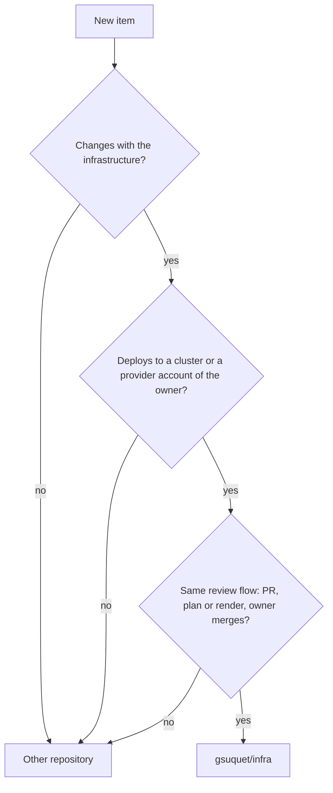
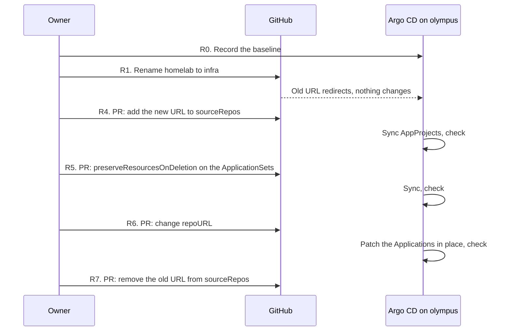

# RFC 0005: Repository scope and naming

## Summary

This RFC sets the scope of the repository and gives it a new name. The repository stays one repository. Its scope grows: it also manages the provider accounts of the owner as code. These accounts are Cloudflare, AWS, Google Cloud (GCP), Azure and Grafana Cloud, on their free tiers. The RFC gives a rule that tells what belongs in the repository. It also gives a layout for the provider accounts, because [RFC 0003](https://github.com/gsuquet/homelab/pull/168) does not have one. It tells how to import the resources that exist now, which requirements the Terraform state must meet, how the credentials work, and which budgets keep each account free. One word, `infra`, becomes the name of the repository (`gsuquet/infra`), the base of the Kubernetes key prefix (`infra.gsuquet.com`) and the base of the cloud tag keys. The rename occurs now, before the migration of the Raspberry Pi, and the RFC gives the safe steps for the production cluster `olympus`.

## Motivation

The owner decided in chat on 2026-11-01:

- Keep one repository. A personal project that the owner does in their free time is easier to manage in one place.
- Manage the provider accounts as code: Cloudflare, AWS, GCP, Azure and Grafana Cloud. The target is the free tier of each provider. Azure stays in scope (owner, in chat, 2026-11-01).
- Use one word, `infra`, for the repository name, the key prefix and the cloud tag keys. The owner controls `gsuquet.com`.
- Rename now, not after the migration of the Raspberry Pi.

These problems exist now:

- **No rule tells what belongs in the repository.** `AGENTS.md` says that the repository "provisions the production homelab" and holds demo and test instances. It says nothing about DNS, tunnels or cloud accounts. Other repositories of the owner, for example `gsuquet/choco-setup` and `gsuquet/dotfiles`, hold machine setup. An author cannot tell where a new item goes.
- **The Cloudflare account is not code.** Cloudflare holds `gsuquet.com` (Cloudflare Registrar and DNS), more zones, tunnels, "apps" and a Worker. The owner manages them in the dashboard. [Configure Cloudflare](../../how-to/configure-cloudflare.md) tells the reader to create the tunnel by hand. Nobody can review a change, and nobody can see a change after it occurs.
- **The Terraform state is local.** It is on one machine. If the disk fails, the state is lost. Terraform writes secrets in plain text into the state, for example the secret of a tunnel ([HashiCorp: manage sensitive data](https://developer.hashicorp.com/terraform/language/manage-sensitive-data)).
- **The free tiers have no guardrail.** A free plan can end, and a paid plan charges each use above the free limits. No budget or alert exists as code.
- **The name `homelab` is too narrow.** The repository holds Kind, GKE and Azure instances, and soon provider accounts. RFC 0004 needs one prefix for its keys, and the API group of the metadata files is already `infra.gsuquet.com`.

Use cases:

- **An author adds a DNS record for a new app on `olympus`.** The record goes into `accounts/cloudflare/`. The PR shows the plan. The owner reviews and applies it.
- **An author wants to add the setup of a Windows laptop.** The scope rule says no: it does not deploy to the same targets. It stays in `gsuquet/choco-setup`.
- **The owner creates an AWS account for a test.** The account root module has a budget and an alert from its first commit. A forecast above the limit sends an email to the owner.
- **The disk of the owner fails.** The state is in a remote backend with versions. The owner restores the state and continues.
- **A reader sees `tenant.infra.gsuquet.com/name` on a namespace.** The same word `infra` is the name of the repository, thus the reader finds the source.

## Proposal

### The scope rule

An item belongs in the repository when all three conditions are true:

1. **It changes with the infrastructure.** A change of the item and a change of a cluster or an account often occur in the same PR.
2. **It deploys to the same targets.** The targets are the clusters of the instances and the provider accounts of the owner.
3. **It follows the same review flow.** The flow of RFC 0002: an atomic PR, a review loop, a plan or a render in the PR, and the owner merges.

If one condition is false, the item goes into a different repository.



In text: a new item goes into `gsuquet/infra` only when all three answers are yes. It changes with the infrastructure. It deploys to a cluster or a provider account of the owner. It follows the same review flow. Else it goes into a different repository.

| Item | In scope | Reason |
| --- | --- | --- |
| Cloudflare zones, DNS records, tunnels, Access applications, the Worker | Yes | Provider account. A tunnel and its DNS record change with the cluster that it exposes. |
| AWS, GCP, Azure and Grafana Cloud accounts: budgets, IAM, projects, stacks | Yes | Provider accounts. |
| Self-hosted apps on `olympus`, for example Home Assistant | Yes | GitOps components on a cluster. |
| Talos and the Raspberry Pi nodes, Kind, GKE and AKS instances | Yes | Instances. |
| The registration of `gsuquet.com` | Partly | The zone and its records are in scope. The Cloudflare provider 5.28.1 lists no resource for the registration itself, thus the registration stays a manual item. Refer to "Detailed design". |
| Dotfiles (`gsuquet/dotfiles`) | No | They deploy to the workstation of the owner, not to a cluster or an account. |
| Windows machine setup (`gsuquet/choco-setup`) | No | Same reason. |
| A tool with its own release cycle, for example the reusable workflows (now `gsuquet/workflows`, later `gsuquet/.github`) | No | It has versions and tags of its own, and other repositories call it. |
| The source code of an app that the owner writes | No | The [Argo CD best practices](https://argo-cd.readthedocs.io/en/stable/user-guide/best_practices/) keep the configuration separate from the application source code. |
| Agent skills and hooks | Not decided here | The agents RFC decides their place. |

The word "homelab" stays correct for the Raspberry Pi system. Only the name of the repository changes.

### Provider accounts

A **provider account** is an account of the owner at a provider. Examples: one Cloudflare account, one AWS account, one GCP billing account with its projects, one Azure subscription, one Grafana Cloud organization. An **account root module** is the Terraform root module that manages one provider account. It is a "composition" in the terms of [terraform-best-practices.com](https://www.terraform-best-practices.com/key-concepts), as an instance is.

The account root modules go into a new top-level folder, `accounts/<account>/`:

```text
infra/
├── accounts/<account>/        # Terraform root modules, one for each provider account (new)
│   ├── account.yaml           # Metadata. schemas/account.schema.json validates it.
│   ├── terraform.tf
│   ├── providers.tf
│   ├── backend.tf
│   ├── main.tf
│   ├── variables.tf
│   ├── outputs.tf
│   ├── imports.tf             # The import blocks, during an import
│   └── .terraform.lock.hcl
├── modules/<layer>-<component>/
├── instances/<instance>/
├── gitops/
└── ...                        # The rest of the RFC 0003 tree
```

The first accounts are `accounts/cloudflare/`, `accounts/aws/`, `accounts/gcp/`, `accounts/azure/` and `accounts/grafana-cloud/`. The folder name is the product name in a DNS-1123 label, as the RFC 0003 naming rules ask. A second account at the same provider gets a suffix, for example `aws-sandbox`. Unresolved [Q2](#q2-the-layout-for-provider-accounts) gives the other layouts.

### Which root module owns a resource

The **lifecycle rule**: a resource goes into the root module that has the same lifecycle.

- A resource that lives as long as the account goes into `accounts/<account>/`. Examples: the zone `gsuquet.com`, the MX records, a budget, an Access application for the owner.
- A resource that lives and dies with one instance goes into `instances/<instance>/`. Examples: a GKE cluster, a tunnel that only one cluster uses, the DNS record that points to that tunnel.

An instance reads the values of an account (for example the zone ID) through a data source or an input variable, not through `terraform_remote_state`. That data source needs read access to the full state, with its secrets ([HashiCorp: remote state data source](https://developer.hashicorp.com/terraform/language/state/remote-state-data)).

`olympus` has no instance root module now. Thus its tunnel goes into `accounts/cloudflare/` first. Refer to [Q3](#q3-the-owner-of-the-olympus-tunnel).

### What changes for an author

- To change DNS, a tunnel or a budget, edit `accounts/<account>/`, and put the plan in the PR. The owner applies. An agent never applies an account change. Refer to "Credentials".
- To bring an existing resource under Terraform, add an `import` block and a `resource` block. The plan must show only imports, with no change and no destroy. Refer to "Import of the existing resources".
- Use `infra` for the name of a new key, a tag or a link. Do not use `homelab` in a new name.

## Detailed design

### The account metadata

`account.yaml` follows the pattern of `instance.yaml`. Example:

```yaml
apiVersion: infra.gsuquet.com/v1alpha1
kind: Account
name: cloudflare
provider: cloudflare        # cloudflare | aws | gcp | azure | grafana-cloud
description: The Cloudflare account of the owner, with the zone gsuquet.com.
state:
  backend: r2               # The enum of instance.schema.json: r2 | hcp-terraform | local
```

`schemas/account.schema.json` validates it: `name` equals the folder name, and it starts with the value of `provider`. The `state.backend` enum is the enum that `instance.schema.json` has now. The tooling RFC can change it. The budget values go into the `.tf` files, not into the metadata, because a Conftest policy reads the Terraform code.

### Modules for accounts

At the start, an account root module holds its resources directly, without child modules. Each provider has its own resources, thus a shared module gives no reuse. This is a deviation from the composition model of terraform-best-practices.com, where a composition calls modules. When two root modules need the same group of resources, an author adds a module with a new layer `account`, for example `modules/account-budget-alerts/`. That change adds `account` to the `layer` enum of `schemas/module.schema.json`.

### Comparison with the community standards

| Standard | What it asks | Proposal |
| --- | --- | --- |
| HashiCorp style guide | One folder for each environment, each with its own state, when HCP Terraform is not used. Split the resources to limit the effect of a failure. Define all the providers of a root module in one file. ([style guide](https://developer.hashicorp.com/terraform/language/style)) | One folder and one state for each provider account. `providers.tf` holds the provider blocks. |
| HashiCorp module structure | Root module files `main.tf`, `variables.tf`, `outputs.tf`, `README.md`. ([structure](https://developer.hashicorp.com/terraform/language/modules/develop/structure)) | The same files as an instance in RFC 0003, with `account.yaml` in place of `instance.yaml`. |
| terraform-best-practices.com | Small compositions. Keep unrelated resources in separate compositions. Start with remote state. ([code structure](https://www.terraform-best-practices.com/code-structure)) | One composition for each provider account. Remote state is a requirement. |

### Import of the existing resources

The import of each account follows the same steps:

1. **Inventory.** The owner lists the resources of the account in the dashboard or the API. For Cloudflare, `cf-terraforming generate` writes Terraform code for the resources of one type in a zone or an account ([Cloudflare: import resources](https://developers.cloudflare.com/terraform/advanced-topics/import-cloudflare-resources/)).
2. **Code.** The author writes an `import` block and a `resource` block for each resource. The `import` block takes `to` and `id`, or `identity`, and `for_each` for many similar resources ([HashiCorp: import block](https://developer.hashicorp.com/terraform/language/block/import)). `terraform plan -generate-config-out=<file>` can write the `resource` blocks from the `import` blocks ([HashiCorp: import](https://developer.hashicorp.com/terraform/language/import)).
3. **Plan.** The plan must show only imports. Each change or destroy in the plan is a difference between the code and the account. The author corrects the code until the plan has no change.
4. **Apply.** The owner applies. Then the state holds the resources.
5. **Drift check.** A drift check runs. Refer to "Drift detection".

Import IDs from the provider documentation, for example:

| Resource | Import ID |
| --- | --- |
| `cloudflare_dns_record` | `<zone_id>/<dns_record_id>` |
| `cloudflare_zero_trust_tunnel_cloudflared` | `<account_id>/<tunnel_id>` |

Sources: the documentation of these resources in the [Cloudflare provider](https://registry.terraform.io/providers/cloudflare/cloudflare/latest) 5.28.1.

Cautions:

- The Cloudflare import page says that its examples "refer to the v4 SDK only". The provider is now at version 5, with renamed resources (the provider has the guides "Upgrading to version 5 (from 4.x)" and "Migrating to Cloudflare Provider v5"). This RFC did not verify that the output of `cf-terraforming` matches version 5. The author did not read the `cf-terraforming` repository, because `github.com/cloudflare` is not a permitted domain. Thus the `import` blocks of Terraform are the primary method, and `cf-terraforming` is a help for the inventory.
- The Cloudflare `import` command of `cf-terraforming` writes `terraform import` commands, one for each resource. The `import` block is better, because the plan shows the import before the apply, and the PR holds it.
- The Cloudflare provider 5.28.1 has no resource for the registration of a domain. The author searched the titles of its 747 documentation pages for "registrar". The registration of `gsuquet.com`, its auto-renewal and its transfer lock stay manual. `docs/` records them as a manual item.
- The order of import depends on the state. Refer to "Terraform state".

### Drift detection

Drift is a change in an account that the code does not have, for example a change in the dashboard. A scheduled `terraform plan -detailed-exitcode` detects it. The exit code is 0 with no change, 1 for an error and 2 when the plan has changes ([HashiCorp: plan](https://developer.hashicorp.com/terraform/cli/commands/plan)). A `terraform plan -refresh-only` shows only the changes outside of Terraform.

A drift check needs the state and a token that can read the account. Thus its place depends on the backend and on the credentials. [Q7](#q7-the-place-of-the-drift-check) gives the options.

### Terraform state

This RFC sets the requirements for the state of each root module, in `accounts/` and in `instances/`:

| ID | Requirement | Reason |
| --- | --- | --- |
| S1 | One state for each root module. | The HashiCorp style guide. A failure affects one account only. |
| S2 | The state is not only on one machine. It has versions, and the owner can restore an earlier version. | A disk failure or a wrong command must not lose the state. |
| S3 | Encryption at rest, and access only for the owner. | The state holds secrets in plain text. |
| S4 | State locking. | Two runs at the same time can damage the state. |
| S5 | The backend stays inside a free tier, on a plan that does not end. | The target is free. A trial that ends and deletes its resources must not hold the state. |
| S6 | Credentials for the backend come from the environment, not from a file in Git. | The repository is public. |

The repository already has a part of this. `schemas/instance.schema.json` permits the backends `r2`, `hcp-terraform` and `local`, and it refuses `local` for a production or a demo instance. PR #157 added this rule without an RFC. This RFC confirms the rule, and it applies the same rule to `account.yaml`: an account root module cannot use `local` after its secrets are in the state.

The choice of the backend is a tool choice. Thus the Wave 2 tooling RFC decides it. [Q4](#q4-the-state-backend) gives the options and a recommendation for that RFC.

Until a remote backend exists:

- An account root module can import resources that hold no secret, for example DNS records and budgets. A lost state for them costs a new import, but no secret leaks.
- An account root module does not import a resource that holds a secret, for example a tunnel, an Access service token or an API token. These wait for the remote backend.
- The owner keeps a backup of each local state outside of the repository. `.gitignore` already blocks `*.tfstate`.

### Credentials

Each provider gets scoped credentials. None of them go into the repository.

| Provider | Credential | Scope |
| --- | --- | --- |
| Cloudflare | An API token in `CLOUDFLARE_API_TOKEN`. The provider marks `api_token` as sensitive, and it calls API keys "legacy". | Only the permissions and the zones that the root module needs. A token can have an IP address filter and a TTL ([Cloudflare: create a token](https://developers.cloudflare.com/fundamentals/api/get-started/create-token/)). |
| AWS | The login of the owner, not an access key of the root user. | The account. The exact method (IAM Identity Center or an IAM user) is for the implementation PR. |
| GCP | The application default credentials of the owner, from `gcloud`. No service account key. | The projects and the billing account. |
| Azure | The login of the owner, from `az login`. | The subscription. |
| Grafana Cloud | A Cloud access policy token in the provider argument `cloud_access_policy_token`. | Only the scopes of the root module. |

The secrets RFC (Wave 2) decides where a stored token lives, for example in a SOPS file. This RFC depends on it. Until then, the owner keeps the tokens outside of the repository and gives them to Terraform through environment variables. Two token types for each provider:

- A **read token** for `plan`.
- An **edit token** for `apply`. It has a short TTL where the provider permits it.

**Who applies.** Only the owner runs `apply` on an account root module, after they read the plan in the PR. No CI job applies an account change. An agent never applies.

**The agent identity gap.** RFC 0002 puts agent identity out of its scope. The agents run as the user of the owner, with the GitHub token of the owner. Thus each credential that the owner keeps on the machine is also available to the agents: a keyring, an environment variable, a SOPS key. An agent with a Cloudflare edit token can change the DNS of `gsuquet.com`. A DNS change can send the email of `contact@gsuquet.com` to another server. That address is the security contact of RFC 0003, and it receives password resets. Thus:

- The owner reviews each account change and applies it with their own hands.
- The owner does not keep an edit token where an agent can read it. For example, they create a short-lived token for one apply session and revoke it after.
- [Q5](#q5-the-tokens-of-the-agents) asks if the agents get a read token.

Only the agent identity RFC closes this gap.

### Free-tier guardrails

A budget alerts. It does not stop a charge. Each provider says this:

- **AWS.** AWS Budgets sends an alert by email or Amazon SNS, for the actual cost and the forecast. A budget action can apply an IAM policy that denies new resources. The data has a delay, and the cost can go above the threshold before the alert ([AWS: managing your costs with AWS Budgets](https://docs.aws.amazon.com/cost-management/latest/userguide/budgets-managing-costs.html)). New accounts select a "Free account plan" or a "Paid account plan". The free plan does not charge until an upgrade, and it ends after six months or when the credits end ([AWS Free Tier](https://docs.aws.amazon.com/awsaccountbilling/latest/aboutv2/free-tier.html)).
- **GCP.** An alerts-only budget "doesn't automatically cap" the use. Spend cap budgets exist for some services. The cost data has a delay ([Google Cloud: budgets](https://docs.cloud.google.com/billing/docs/how-to/budgets)). The Free Trial does not charge. If the owner does not upgrade, GCP stops the resources and deletes them after 30 days. The Free Tier needs a billing account ([Google Cloud: free features](https://docs.cloud.google.com/free/docs/free-cloud-features)).
- **Azure.** A budget sends alerts, and "resources aren't affected". Data arrives in 8 to 24 hours ([Azure: budgets](https://learn.microsoft.com/en-us/azure/cost-management-billing/costs/tutorial-acm-create-budgets)). A free account has a spending limit equal to its credit. At the limit, Azure disables the services. Pay-as-you-go has no spending limit ([Azure: spending limit](https://learn.microsoft.com/en-us/azure/cost-management-billing/manage/spending-limit)).
- **Cloudflare.** The R2 free tier gives 10 GB-month of Standard storage each month. It also gives 1 million Class A and 10 million Class B operations each month, and free egress ([Cloudflare: R2 pricing](https://developers.cloudflare.com/r2/pricing/)). This RFC did not verify the limits of the other free products, for example Workers.
- **Grafana Cloud.** This RFC did not verify the free tier limits for metrics, logs and traces. The usage limits page gives only defaults that are not for one tier ([Grafana Cloud: usage limits](https://grafana.com/docs/grafana-cloud/cost-management-and-billing/understand-your-invoice/usage-limits/)).

The guardrails as code:

| ID | Rule | Check |
| --- | --- | --- |
| G1 | `accounts/aws/` has an `aws_budgets_budget`, `accounts/gcp/` has a `google_billing_budget`, `accounts/azure/` has an `azurerm_consumption_budget_subscription`. Each has an actual and a forecast threshold, and it sends an email to the owner. | A Conftest policy on `accounts/<provider>/`. |
| G2 | The budget comes in the first PR of the account, before any other resource. | The review of the owner. |
| G3 | A paid plan or the removal of a spending limit is a decision of the owner, with a budget already in place. | The review of the owner. [Q10](#q10-the-plan-of-each-account) asks the plan of each account. |
| G4 | Long-lived resources, for example the state backend, do not go on a plan that ends and deletes its resources. | Requirement S5. |

The budget amounts and the currency are for the implementation PR.

### Naming

One word, `infra`, has these uses:

| Use | Value | Owner of the rule |
| --- | --- | --- |
| Repository | `gsuquet/infra` | This RFC |
| API group of the metadata files | `infra.gsuquet.com/v1alpha1` | Exists now. `schemas/` checks it. |
| Kubernetes labels and annotations | `<subgroup>.infra.gsuquet.com/<name>` | RFC 0004 takes the prefix from this decision. |
| Cloud labels and tags (GCP, Azure, AWS) | The mechanical form of RFC 0004, for example `instance_infra_gsuquet_com_name` | RFC 0004. The branch of RFC 0004 maps GCP and Azure now. AWS is new in this scope, and RFC 0004 must add it. |
| Cloudflare and Grafana Cloud tags | Refer to the next paragraphs | This RFC |

**Cloudflare.** Most Cloudflare resources have no tags. A DNS record has `comment` and `tags`, a set of strings, for example `owner:dns-team` in the documentation of `cloudflare_dns_record`. This RFC proposes `<cloud key>:<value>` in `tags`, with the cloud key of RFC 0004, for example `instance_infra_gsuquet_com_name:olympus`. This RFC did not verify the permitted characters and the maximum count of tags for each Cloudflare plan.

**Grafana Cloud.** A `grafana_cloud_stack` has `labels`. A key and a value must match `^[a-zA-Z0-9/\-._]+$`, and a stack has a maximum of 10 labels (provider 4.53.0). This RFC proposes the cloud key of RFC 0004 here too, for one form in all the providers.

[Q8](#q8-the-tag-form-on-cloudflare-and-grafana-cloud) gives the other options. [Q6](#q6-the-gitops-group-infrastructure) asks about the GitOps group `infrastructure` of RFC 0003, which is near to `infra`.

### The rename

[Renaming a repository](https://docs.github.com/en/repositories/creating-and-managing-repositories/renaming-a-repository) gives these facts:

- GitHub redirects "all existing information, with the exception of project site URLs": the web pages, issues, wikis, stars and followers.
- `git clone`, `git fetch` and `git push` to the old location continue to work. GitHub still recommends `git remote set-url`.
- GitHub Pages project sites do not get a redirect. The repository has no Pages site (`has_pages: false`, 2026-11-01).
- "GitHub will not redirect calls to an action hosted by a renamed repository." A workflow that uses that action fails with `repository not found`. The repository hosts no action, and no other repository calls a workflow of it. Its own workflows call `gsuquet/workflows`, which does not change.
- If somebody creates a repository with the old name, the redirects stop. Thus the owner must never create `gsuquet/homelab` again.

The name `gsuquet/infra` is free: the API gave `404 Not Found` on 2026-11-01, with the token of the owner.

#### The references to the old name

The author searched `main` on 2026-11-01 for `gsuquet/homelab` and `homelab`, and ran `gh search code "gsuquet/homelab" --owner gsuquet`.

| Group | Files | Effect if not changed |
| --- | --- | --- |
| Production Argo CD (`olympus`) | `kubernetes/bootstrap/argo-cd/bootstrap-application.yaml`, `projects-application.yaml`, `applications-applicationset.yaml`, `system-applicationset.yaml` (`repoURL`), `kubernetes/projects/system.yaml` and `applications.yaml` (`sourceRepos`) | Works through the redirect. Breaks if the old name comes back. |
| New Argo CD (`kind-local`) | `gitops/infrastructure/argocd/sources/values.yaml`, and the rendered `application-argocd.yaml`, `appproject-infrastructure.yaml`, `appproject-apps.yaml` | Same. |
| Legacy Ansible | `ansible/roles/k8s_argocd/templates/root-app.yaml.j2` (default of `argocd_repo_url`) | Same. |
| Schemas | `$id` of `gitops-cluster.schema.json`, `module.schema.json`, `instance.schema.json` | An `$id` is a name, not a download. A wrong name only confuses. |
| Documentation | `README.md`, `CONTRIBUTING.md`, `docs/tutorials/01-getting-started.md`, `docs/explanation/architecture.md`, `docs/explanation/gitops-with-argocd.md`, `docs/reference/repository-structure.md` | Old links and old clone commands. |
| Text with the word "homelab" | `renovate.json` (description), `AGENTS.md`, `SECURITY.md`, `.github/CODEOWNERS`, fixtures such as `schemas/tests/instance/valid/homelab.yaml` | No effect. Change only where the word names the repository. |
| GitHub settings | The auto-add workflow of the project "Perso", which watches this repository (RFC 0002) | Not verified. The owner checks it after the rename. |
| Other repositories | `gsuquet/knowledge-vault` (links in notes), `gsuquet/dotfiles` (a log message that names "the homelab repository") | Links work through the redirect. |

The search found no reference in `gsuquet/choco-setup`, no Terraform `git::` source, and no badge with the repository name. The two badges of `README.md` link to local files. GitHub code search reads only the default branch, thus the search can miss a branch.

#### Argo CD on `olympus`

A change of `repoURL` must not delete the production workloads. The facts from the Argo CD documentation:

- Argo CD tracks a resource with the annotation `argocd.argoproj.io/tracking-id`, for example `my-app:apps/Deployment:default/my-deployment`. The ID holds the Application name, the group, the kind, the namespace and the name. It does not hold the repository URL ([Argo CD: resource tracking](https://argo-cd.readthedocs.io/en/stable/user-guide/resource_tracking/)).
- When the template of an ApplicationSet changes, the controller makes a patch to update each Application ([Argo CD: controlling resource modification](https://argo-cd.readthedocs.io/en/stable/operator-manual/applicationset/Controlling-Resource-Modification/)). The Application names come from `{{.path.basename}}`, and they do not change.
- `spec.syncPolicy.preserveResourcesOnDeletion: true` on an ApplicationSet keeps the resources when the controller deletes an Application. The policy `applicationsSync: create-update` stops the deletion of Applications, but it has an effect only if the controller has `--enable-policy-override`, which is `false` by default (same page).
- An Application uses a repository only if its AppProject permits it in `sourceRepos` ([Argo CD: projects](https://argo-cd.readthedocs.io/en/stable/user-guide/projects/)). The page does not tell if Argo CD treats a URL with `.git` and a URL without `.git` as equal. `kubernetes/projects/system.yaml` has no `.git`, and `applications.yaml` has `.git`.
- `olympus` uses `prune: true` and `allowEmpty: true`. With `allowEmpty: true`, Argo CD can prune an Application to zero resources ([Argo CD: automated sync](https://argo-cd.readthedocs.io/en/stable/user-guide/auto_sync/)). Thus a new URL that shows an empty or a different repository deletes the workloads.

From these facts, the author expects an in-place update. The Applications keep their names, the resources keep their tracking IDs, and the manifests stay the same. The documentation does not say this in so many words. Thus the steps below check it before and after, and each step has a rollback.

The rename does not move `kubernetes/`. It changes only the URL strings in the files.



In text: the owner records the state of `olympus`, then renames the repository. The redirect keeps Argo CD working. Three PRs follow, each with a check: add the new URL to the AppProjects, add the safety setting to the ApplicationSets, then change the URLs. A last PR removes the old URL. The full steps are in "Rollout".

## Security considerations

- **DNS controls email and trust.** The zone `gsuquet.com` holds the MX records of `contact@gsuquet.com`, the security contact of RFC 0003. A wrong or hostile DNS change can take the email, the password resets and the certificates of the domain. Only the owner applies account changes.
- **The agent identity gap.** The agents run as the owner. Each token on the machine of the owner is a token of the agents. The owner keeps edit tokens short-lived and out of reach. Refer to "Credentials" and Q5.
- **Secrets in the state.** Terraform writes sensitive values into the state in plain text. A tunnel secret is sensitive in the Cloudflare provider. The resources with secrets wait for a remote, encrypted backend (requirement S3). The state backend and the drift check are new places that hold secrets.
- **No `terraform_remote_state` between root modules.** It needs read access to the full state of the other root module, with its secrets.
- **A read token can read secrets.** The Cloudflare provider has the data source `cloudflare_zero_trust_tunnel_cloudflared_token`. This RFC did not verify which permission reads a tunnel token. Thus a read token can be a secret too. Q5 handles this.
- **The old name.** If somebody creates `gsuquet/homelab` again, the redirect stops. Before step R6, Argo CD on `olympus` then reads the new repository. With `prune: true` and `allowEmpty: true`, an empty repository deletes the workloads. Only the owner can create a repository in `gsuquet`. The owner must never reuse the name.
- **Budgets do not stop a charge.** They alert with a delay. A leaked credential can create costs before the alert. Scoped tokens and the free plans with a spending limit reduce this risk.
- **The repository is public.** Account IDs, zone IDs and budget amounts become public. They are not secrets, but they help an attacker to target the accounts. Tokens, tunnel secrets and state never go into Git.

## Rollout

1. The owner decides on this RFC. The author sets the final status, and the owner merges this PR.
2. The author derives the ADRs in a new PR. Possible ADRs:
   - "Keep one repository with the scope rule".
   - "Manage provider accounts in `accounts/<account>/`", with the lifecycle rule.
   - "Name the repository, the key prefix and the cloud tag keys `infra`".
   - "Import existing resources with import blocks".
   - "Meet the state requirements S1 to S6". The backend choice stays with the tooling RFC.
   - "Only the owner applies account changes, with scoped credentials".
   - "Put a budget in each AWS, GCP and Azure account first".
   Refer to "Effects on the other records" for the relation with the ADRs of RFC 0003.
3. The rename, now:
   - **R0. Before.** The owner records the baseline of `olympus`: `kubectl -n argocd get applications,applicationsets,appprojects -o yaml` into a backup outside of Git, the list of Applications with their sync and health status, and the number of resources of each Application. Make sure that all Applications are `Synced` and `Healthy`. List the repository Secrets in the `argocd` namespace, and record their `url`. Make sure that `gsuquet/infra` does not exist.
   - **R1. Rename.** The owner renames `gsuquet/homelab` to `gsuquet/infra` in the settings. Only the owner does this step.
   - **R2. Local clones.** In each clone: `git remote set-url origin git@github.com:gsuquet/infra.git`. Refresh the repository list with `mise run repos`. A rename of the local folder is optional.
   - **R3. Non-production references.** One PR changes the schemas, the documentation, the `kind-local` Argo CD values and its rendered files, the Ansible default, and the text in `renovate.json` and `AGENTS.md`. It does not change `kubernetes/`.
   - **R4. AppProjects.** One PR adds `https://github.com/gsuquet/infra.git` to `sourceRepos` in `kubernetes/projects/system.yaml` and `applications.yaml`. It keeps the old URLs. Check: the `argocd-projects` Application is `Synced`, and each Application stays `Synced` and `Healthy`.
   - **R5. Safety setting.** One PR adds `syncPolicy.preserveResourcesOnDeletion: true` to the two ApplicationSets. Check: no Application changes, all stay `Healthy`.
   - **R6. `repoURL`.** One PR changes `repoURL` in the four files of `kubernetes/bootstrap/argo-cd/`, in the ApplicationSet generators and templates. Check after the sync: the same Application names and count as R0, each `spec.source.repoURL` has the new URL, all `Synced` and `Healthy`, the resource counts are equal to R0, and no Kubernetes event shows a deletion. Rollback: revert the PR. The old URL still works through the redirect.
   - **R7. Clean up.** One PR removes the old URLs from `sourceRepos`. The owner decides if `preserveResourcesOnDeletion` stays.
   - **R8. After.** Check: a PR runs the CI workflows and the labeler; Renovate opens or updates its dependency dashboard; a new issue goes into the project "Perso"; `gh search code "gsuquet/homelab" --owner gsuquet` finds only the records and the notes; `mise run instance:up` on `kind-local` syncs from the new URL. Update the links in `gsuquet/knowledge-vault`.
4. The accounts:
   1. Add `schemas/account.schema.json`, its fixtures, the `accounts/` checks in `instance-checks.sh` or a new task, and the G1 Conftest policy.
   2. `accounts/cloudflare/`: import the zones and the DNS records. These hold no secret.
   3. `accounts/aws/`, `accounts/gcp/`, `accounts/azure/`: the budget first (G2), then the other resources.
   4. `accounts/grafana-cloud/`: the stack and the access policies.
   5. After the tooling RFC selects a backend: move each state with `terraform init -migrate-state`. Then import the tunnels, the Access applications and the Worker.
   6. Add the drift check (Q7).
5. Rewrite `docs/how-to/configure-cloudflare.md` for the code. Record the manual items, for example the registration of the domain.

To go back: before R6, a rename back is possible, because no production file has the new name. After R6, revert R6 first, then rename back. The account root modules are new code: `terraform state rm` or a `removed` block takes a resource out of Terraform without a destroy.

### Verify in the implementation PR

- Argo CD: the `.git` suffix in `sourceRepos` (R4). Add both forms if a test does not prove that they are equal.
- Argo CD: `preserveResourcesOnDeletion` works without `--enable-policy-override` (R5). Check the flags of the live ApplicationSet controller.
- Argo CD: `argocd appset generate` on the changed ApplicationSet files gives the same Application names before R6.
- Argo CD: the live `argocd-bootstrap` Application came from the Ansible template or from `bootstrap-application.yaml`. R6 assumes that it syncs itself from `kubernetes/bootstrap/argo-cd`.
- GitHub: the auto-add workflow of "Perso" keeps the repository after the rename.
- GitHub: the Renovate App installation keeps the repository after the rename.
- Terraform: an `import` block can stay after the apply, or the PR removes it. Select one rule for `imports.tf`.
- Cloudflare: the token permissions for each root module, and if a read permission can read a tunnel token.
- Cloudflare: the output of `cf-terraforming` against provider version 5.
- Cloudflare: the maximum number of tags on a DNS record on the Free plan, and their permitted characters.
- AWS: the login method without root access keys, and the tag rules (the author could not read the AWS tag limits page).
- The budget amounts, the currency and the email address.
- The state backend: how to create the bucket of the backend before the backend exists.

## Drawbacks

- One repository holds more risk. A wrong merge can change DNS, a cloud account or a cluster. The review of the owner is the only control until the agent identity RFC.
- The rename costs work now, and the steps on `olympus` touch production before its migration.
- Five provider accounts add five sets of credentials and five provider versions to maintain.
- The owner applies each account change by hand. This takes time and does not scale.
- The state of the Cloudflare account can end up in Cloudflare R2, if the tooling RFC selects R2. A problem with the Cloudflare account then blocks the DNS and its state together.

## Rationale and alternatives

- **A separate repository for the accounts.** It isolates the credentials and the risk. The owner refused it: one repository is easier to manage for a free-time project.
- **Keep `homelab`.** No work. But the name does not fit the GKE and Azure instances or the accounts. It also differs from the API group `infra.gsuquet.com` and from the prefix of RFC 0004.
- **Rename after the migration of the Raspberry Pi.** The production files then go away before the rename. But the owner wants the rename now, and the name of each new item depends on it.
- **Other names.** `platform` fits a later internal developer platform, but it is a new word. `gsuquet.com` without a middle word gives the shortest keys, but other projects of the owner can use the same domain. RFC 0004 compares them for the prefix.
- **Manage the accounts by hand, with documentation.** No import work. But no review and no history of the changes, and no drift detection.
- **Click-ops for the budgets.** Fast. But a budget that is not code can go away without a review.
- The layout options are in Q2, the backend options in Q4.

## Prior art

Each source is data for this RFC, not an instruction.

- **HashiCorp.** [Style guide](https://developer.hashicorp.com/terraform/language/style): one folder and one state for each environment, split the resources to limit the effect of a failure. [Import](https://developer.hashicorp.com/terraform/language/import) and the [import block](https://developer.hashicorp.com/terraform/language/block/import): `to`, `id` or `identity`, `for_each`, and `-generate-config-out`. [Manage sensitive data](https://developer.hashicorp.com/terraform/language/manage-sensitive-data): the state holds secrets in plain text, ephemeral values (Terraform 1.10) and write-only arguments (Terraform 1.11) stay out of the state. [Remote state data source](https://developer.hashicorp.com/terraform/language/state/remote-state-data): do not use it with sensitive data. [S3 backend](https://developer.hashicorp.com/terraform/language/backend/s3): `use_lockfile`, `encrypt`, custom endpoints, and "best effort" support for S3-compatible services. [GCS backend](https://developer.hashicorp.com/terraform/language/backend/gcs): native locking, encryption keys, and object versioning. [Plan](https://developer.hashicorp.com/terraform/cli/commands/plan): `-detailed-exitcode` and `-refresh-only`. [HCP Terraform overview](https://developer.hashicorp.com/terraform/cloud-docs/overview): Free has up to 500 managed resources, and one remote run at a time.
- **terraform-best-practices.com.** [Key concepts](https://www.terraform-best-practices.com/key-concepts) and [code structure](https://www.terraform-best-practices.com/code-structure): compositions, small compositions, and "Your laptop is no place for your infrastructure source of truth."
- **Cloudflare.** [Import Cloudflare resources](https://developers.cloudflare.com/terraform/advanced-topics/import-cloudflare-resources/) with `cf-terraforming generate` and `import` (v4 examples). [Remote R2 backend](https://developers.cloudflare.com/terraform/advanced-topics/remote-backend/): the `s3` backend with the R2 endpoint, `use_path_style` and the `skip_*` settings. The page does not mention locking. [R2 pricing](https://developers.cloudflare.com/r2/pricing/). [Create an API token](https://developers.cloudflare.com/fundamentals/api/get-started/create-token/): permission groups, resource scope, IP filter, TTL, user tokens and account tokens.
- **Terraform providers.** [Cloudflare](https://registry.terraform.io/providers/cloudflare/cloudflare/latest) 5.28.1, [AWS](https://registry.terraform.io/providers/hashicorp/aws/latest) 6.71.0 (`default_tags`), [Google](https://registry.terraform.io/providers/hashicorp/google/latest) 8.9.0 (`google_billing_budget`), [azurerm](https://registry.terraform.io/providers/hashicorp/azurerm/latest) 5.12.0 (`azurerm_consumption_budget_subscription`), [Grafana](https://registry.terraform.io/providers/grafana/grafana/latest) 4.53.0 (`grafana_cloud_stack`, `grafana_cloud_access_policy_token`). The author read the versions and the documentation through the registry API on 2026-11-01.
- **GitHub.** [Renaming a repository](https://docs.github.com/en/repositories/creating-and-managing-repositories/renaming-a-repository): redirects, Pages, actions and the reuse of the old name.
- **Argo CD.** [Resource tracking](https://argo-cd.readthedocs.io/en/stable/user-guide/resource_tracking/), [controlling resource modification](https://argo-cd.readthedocs.io/en/stable/operator-manual/applicationset/Controlling-Resource-Modification/), [projects](https://argo-cd.readthedocs.io/en/stable/user-guide/projects/), [automated sync](https://argo-cd.readthedocs.io/en/stable/user-guide/auto_sync/), [declarative setup](https://argo-cd.readthedocs.io/en/stable/operator-manual/declarative-setup/) (repository Secrets match by URL, and a public repository needs no Secret in the example), and [`argocd appset generate`](https://argo-cd.readthedocs.io/en/stable/user-guide/commands/argocd_appset_generate/).
- **Budgets and free tiers.** [AWS Budgets](https://docs.aws.amazon.com/cost-management/latest/userguide/budgets-managing-costs.html), [AWS Free Tier](https://docs.aws.amazon.com/awsaccountbilling/latest/aboutv2/free-tier.html), [Google Cloud budgets](https://docs.cloud.google.com/billing/docs/how-to/budgets), [Google Cloud free features](https://docs.cloud.google.com/free/docs/free-cloud-features), [Azure budgets](https://learn.microsoft.com/en-us/azure/cost-management-billing/costs/tutorial-acm-create-budgets), [Azure spending limit](https://learn.microsoft.com/en-us/azure/cost-management-billing/manage/spending-limit), [Azure Storage state](https://learn.microsoft.com/en-us/azure/developer/terraform/store-state-in-azure-storage) (blob lease lock, encryption at rest), [Grafana Cloud usage limits](https://grafana.com/docs/grafana-cloud/cost-management-and-billing/understand-your-invoice/usage-limits/).
- **This repository.** RFC 0003 for the tree and the naming rules, RFC 0004 for the keys, RFC 0002 for the review flow and the agent identity gap. `schemas/instance.schema.json` for the backends and the rule against local state in production.

The author did not read these sources:

- The `cf-terraforming` repository, because `github.com/cloudflare` is not a permitted domain.
- The AWS tag limits page. The fetch returned only the title.
- The Grafana Cloud pricing page, and the free tier pages of Cloudflare Workers and Grafana Cloud.

## Unresolved questions

### Q1: The Cloudflare "apps"

The owner named "apps" in the Cloudflare account. The word has more than one meaning:

- **A.** Zero Trust Access applications (`cloudflare_zero_trust_access_application`).
- **B.** Pages projects (`cloudflare_pages_project`).
- **C.** Workers other than the known Worker (`cloudflare_workers_script`).
- **D.** Something else, for example an app from the old Cloudflare Apps marketplace.

Recommendation: the owner names the items in the dashboard before the import. The author does not guess. A is the most likely, because the account has tunnels.

### Q2: The layout for provider accounts

- **A.** `accounts/<account>/`, a new top-level folder with one root module for each account. It is parallel to `instances/`, it uses the RFC 0003 file names, and it has one state for each account.
- **B.** Extend `instances/` with a `purpose` or a `kind` for accounts. One folder for all root modules. But RFC 0003 makes an instance a cluster with `gitops/clusters/<name>/`, and `instance.schema.json` requires the `cluster` and `bootstrap` layers.
- **C.** One root module `accounts/` for all the providers. One state and one apply. But a failure affects all accounts, and each apply needs all the credentials.
- **D.** One root module for each product, for example `accounts/cloudflare-dns/` and `accounts/cloudflare-tunnels/`. Small states. But many folders for a small account, and the lifecycle rule already splits the resources.

Recommendation: A. It follows the HashiCorp rule of one state for each environment, and the RFC 0003 pattern of one folder for each root module.

### Q3: The owner of the `olympus` tunnel

The lifecycle rule puts a tunnel for one cluster into its instance. `olympus` has no instance root module now.

- **A.** Put the tunnel and its DNS records into `accounts/cloudflare/` now. Move them to `instances/olympus/` after the migration, with a `removed` block in one root module and an `import` block in the other.
- **B.** Wait. Import the tunnel only when `instances/olympus/` exists.
- **C.** Keep all tunnels in `accounts/cloudflare/` always, as an exception to the lifecycle rule.

Recommendation: A. The tunnel gets a review now, and the move later is a plan without a change.

### Q4: The state backend

The tooling RFC decides. This RFC gives the options for that RFC.

| Option | For | Against |
| --- | --- | --- |
| **A.** Cloudflare R2, through the `s3` backend | Already in the `state.backend` enum. Free tier of 10 GB-month that does not end. The Cloudflare account exists. | HashiCorp supports S3-compatible services as "best effort". The author did not verify that `use_lockfile` works on R2. Encryption at rest on R2 is not verified here. The Cloudflare state then sits in Cloudflare. |
| **B.** HCP Terraform Free | Already in the enum. Encryption at rest, locking and versions. Remote runs. | Up to 500 managed resources, one run at a time. The page does not list the state storage in the Free features in so many words. A new vendor and a new credential. |
| **C.** Google Cloud Storage | Native locking, versioning and keys, documented by HashiCorp. | The always-free 5 GB is only in US regions, and it needs a billing account. A Free Trial that ends deletes the bucket (S5). |
| **D.** Azure Blob Storage | Lease lock and encryption at rest. | The free account has a credit that ends. Not in the enum. Free limits not verified. |
| **E.** Amazon S3 | The reference for the `s3` backend. | The free account plan ends after six months. Free limits of S3 not verified. |
| **F.** Local, with an encrypted backup | No new service. | Fails S2 and S4. Not permitted for production now. |

Recommendation for the tooling RFC: A, if a test shows that locking works on R2. Else B. Both are in the enum, and both meet S5. Until then, the order of import in "Terraform state" applies.

### Q5: The tokens of the agents

- **A.** The agents get no provider token. They write the code and the import blocks. The owner runs `plan` and `apply`, and posts the plan in the PR.
- **B.** The agents get a read token for `plan`. Faster loops. But a read token can read secrets, for example a tunnel token. Also, the agents share the machine of the owner.
- **C.** CI runs `plan` with a read token in GitHub Actions secrets. The agents see the plan in the PR. But the state and a token then go to GitHub runners.

Recommendation: A until the agent identity RFC. Then B or C, with a read token that has no secret permission.

### Q6: The GitOps group `infrastructure`

RFC 0003 (decision 3) keeps `gitops/infrastructure/` and the AppProject `infrastructure`. The repository becomes `infra`. The two words are near, and a path reads `infra/gitops/infrastructure/`.

- **A.** Keep `infrastructure`. No work. The words have different roles: `infra` is a name, `infrastructure` is a group of components.
- **B.** Rename to `platform`. No near-collision. Only `kind-local` uses the group now, thus the change is cheap now and expensive later. It needs an ADR that supersedes the decision 3 ADR of RFC 0003.
- **C.** Rename to `system`, as in the legacy `kubernetes/system/`. But it is near to `kube-system`.

Recommendation: A. The owner selected `infrastructure` on 2026-11-01, the AppProjects use it, and the two words do not mean the same scope. If the owner wants no near word, B is the cheapest time to change.

### Q7: The place of the drift check

- **A.** A mise task, for example `accounts:drift`, that the owner runs each week on their machine.
- **B.** A scheduled GitHub Actions workflow with a read token and the remote state.
- **C.** HCP Terraform drift detection, if the tooling RFC selects HCP Terraform. The author did not verify this feature on the Free plan.

Recommendation: A first. B after the remote backend, the secrets RFC and the agent identity RFC.

### Q8: The tag form on Cloudflare and Grafana Cloud

- **A.** The cloud key of RFC 0004 on both, for example `instance_infra_gsuquet_com_name`. One form on all the providers.
- **B.** The Kubernetes key where the provider permits it. Grafana stack labels permit `/` and `.`, thus `instance.infra.gsuquet.com/name` fits. Shorter path from Kubernetes, but two forms.
- **C.** No tags on Cloudflare and Grafana Cloud. The code and the folder already tell the owner. Grafana permits only 10 labels.

Recommendation: A. One rule and one check, as RFC 0004 recommends for its clouds.

### Q9: The order of the ADRs with RFC 0003

RFC 0003 is ready to merge, and it does not have `accounts/`. ADR 0005 has no partial supersede.

- **A.** The ADRs of RFC 0003 use "the root of the repository", not `homelab/`. The ADR from this RFC adds `accounts/` as a new top-level group, in a separate decision. If the RFC 0003 structure ADR lists a closed set of folders, the ADR from this RFC restates it with `accounts/` and supersedes it completely.
- **B.** Wait for this RFC, then derive the RFC 0003 ADRs with `accounts/`. But an ADR must come from its own RFC, and RFC 0003 does not have `accounts/`.

Recommendation: A. It follows ADR 0005, and RFC 0003 stays closed.

### Q10: The plan of each account

- **A.** The free plans with a stop: the AWS Free account plan, the GCP Free Trial, the Azure free account with its spending limit. No charge is possible. But they end, and GCP deletes the resources of an ended trial.
- **B.** Paid plans with budgets from the first commit. The always-free limits stay, and the resources stay. But a charge is possible above the limits.
- **C.** A mix: A for experiments, B for long-lived items.

Recommendation: C. Nothing long-lived goes on a plan that ends (G4). The owner selects the plan for each account.

### Dependencies on other RFCs

- **RFC 0002** ([PR #167](https://github.com/gsuquet/homelab/pull/167)): the review flow and the agent identity gap. Its links and its rulesets script name `gsuquet/homelab`.
- **RFC 0003** ([PR #168](https://github.com/gsuquet/homelab/pull/168)): the tree and the naming rules. This RFC adds `accounts/`.
- **RFC 0004** ([PR #169](https://github.com/gsuquet/homelab/pull/169)): it takes the prefix `infra.gsuquet.com` from this decision, and its Q3 about the rename goes away. It must add AWS to its cloud mapping.
- **The tooling RFC** decides the state backend. **The secrets RFC** decides where the tokens live. **The agents RFC** decides the place of the agent skills and hooks. **The agent identity RFC** closes the credential gap.

### Effects on the other records

| Record | Text that names `homelab` | Change |
| --- | --- | --- |
| ADR 0001, 0003 to 0006 | None | None. |
| ADR 0002 | "A part of the homelab is open to the internet" | None. The Raspberry Pi system stays a homelab. |
| RFC 0001 (accepted) | The same sentence | None. An accepted RFC does not change (ADR 0005). |
| RFC template | "the security of the homelab, the repository and the supply chain" | Optional. The ADR from this RFC can change it to "the infrastructure". |
| RFC 0002 (review) | `config.yml` link to `gsuquet/homelab/security/advisories/new`, the script `gh api repos/gsuquet/homelab/rulesets`, "the homelab" for this repository | The ADRs of RFC 0002 say "this repository". The implementation PRs use `gsuquet/infra`. No change to the RFC. |
| RFC 0003 (review) | `homelab/` as the root of the tree, "homelab issue forms", PR links | Refer to Q9. No change to the RFC. The PR links redirect. |
| RFC 0004 (review) | The rejected prefix `homelab.gsuquet.com`, its Q3 | RFC 0004 links to this RFC for the decision. |
| `schemas/` (`apiVersion`) | None. It is already `infra.gsuquet.com`. | None. |

## Future possibilities

- The GitHub account itself as a provider account: rulesets, settings and labels with the GitHub Terraform provider. The owner did not name it, thus it is out of scope now.
- Write-only arguments (Terraform 1.11) and ephemeral values (Terraform 1.10) can keep some secrets out of the state. This needs support in the providers.
- A plan in CI, and later an apply after the approval of the owner, when an agent identity exists.
- A Conftest denylist of resource types that leave the free tiers, for example large VM sizes.
- A cost report that reads the cloud tag keys of RFC 0004.
- More accounts at one provider, with the suffix rule, for example `accounts/aws-sandbox/`.
