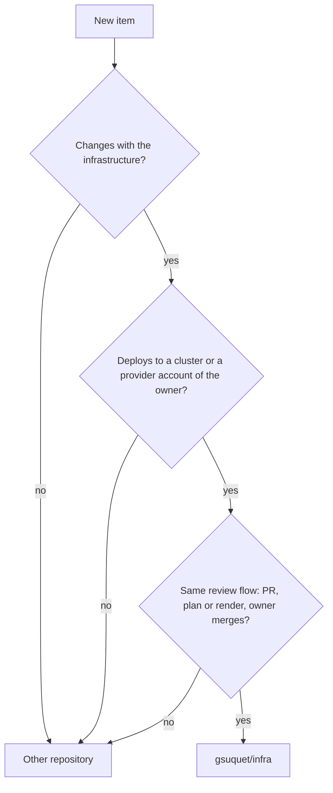
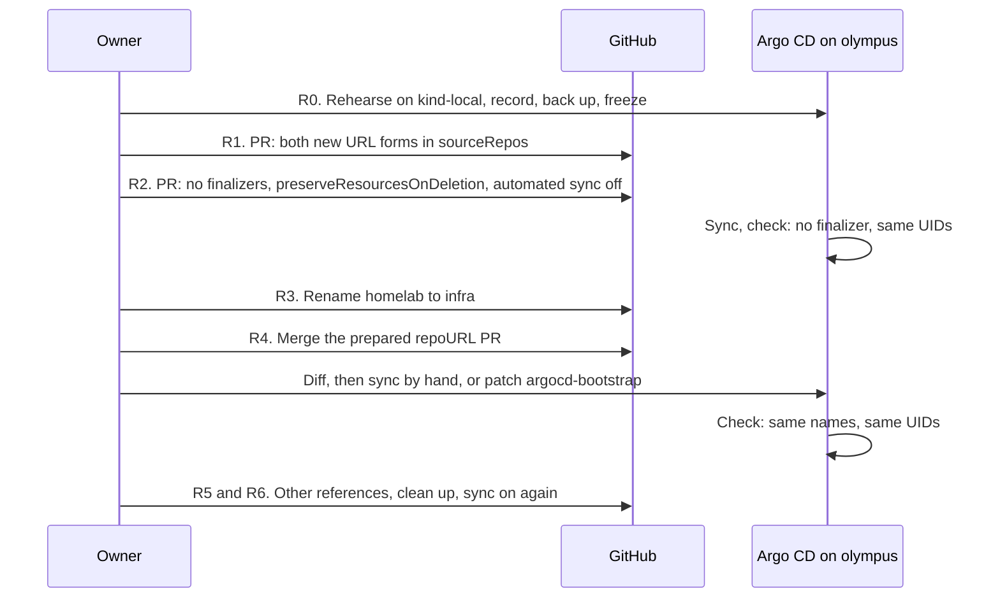

# RFC 0005: Repository scope and naming

## Summary

This RFC sets the scope of the repository and gives it a new name. The repository stays one repository. Its scope grows: it also manages the provider accounts of the owner as code. These accounts are Cloudflare, AWS, Google Cloud (GCP), Azure and Grafana Cloud, on their free tiers. The RFC gives a rule that tells what belongs in the repository. It also gives a layout for the provider accounts, because [RFC 0003](https://github.com/gsuquet/homelab/pull/168) does not have one. It tells how to import the resources that exist now, which requirements the Terraform state must meet, how the credentials work, and which budgets keep each account free. One word, `infra`, becomes the name of the repository (`gsuquet/infra`), the base of the Kubernetes key prefix (`infra.gsuquet.com`) and the base of the cloud tag keys. The rename occurs now, before the migration of the Raspberry Pi, and the RFC gives the safe steps for the production cluster `olympus`.

## Motivation

The owner decided in chat on 2026-11-01:

- Keep one repository. A personal project that the owner does in their free time is easier to manage in one place.
- Manage the provider accounts as code: Cloudflare, AWS, GCP, Azure and Grafana Cloud. The target is the free tier of each provider. Azure stays in scope (owner, in chat, 2026-11-01).
- Use one word, `infra`, for the repository name, the key prefix and the cloud tag keys. The owner controls `gsuquet.com`.
- Rename now, not after the migration of the Raspberry Pi.

These problems exist now:

- **No rule tells what belongs in the repository.** `AGENTS.md` says that the repository "provisions the production homelab" and holds demo and test instances. It says nothing about DNS, tunnels or cloud accounts. Other repositories of the owner, for example `gsuquet/choco-setup` and `gsuquet/dotfiles`, hold machine setup. An author cannot tell where a new item goes.
- **The Cloudflare account is not code.** Cloudflare holds `gsuquet.com` (Cloudflare Registrar and DNS), more zones, tunnels, "apps" and a Worker. The owner manages them in the dashboard. [Configure Cloudflare](../../how-to/configure-cloudflare.md) tells the reader to create the tunnel by hand. Nobody can review a change, and nobody can see a change after it occurs.
- **The Terraform state is local.** It is on one machine. If the disk fails, the state is lost. Terraform writes secrets in plain text into the state, for example the secret of a tunnel ([HashiCorp: manage sensitive data](https://developer.hashicorp.com/terraform/language/manage-sensitive-data)).
- **The free tiers have no guardrail.** A free plan can end, and a paid plan charges each use above the free limits. No budget or alert exists as code.
- **The name `homelab` is too narrow.** The repository holds Kind, GKE and Azure instances, and soon provider accounts. RFC 0004 needs one prefix for its keys, and the API group of the metadata files is already `infra.gsuquet.com`.

Use cases:

- **An author adds a DNS record for a new app on `olympus`.** The record goes into `accounts/cloudflare/`. The PR shows the plan. The owner reviews and applies it.
- **An author wants to add the setup of a Windows laptop.** The scope rule says no: it does not deploy to the same targets. It stays in `gsuquet/choco-setup`.
- **The owner creates an AWS account for a test.** The account root module has a budget and an alert from its first commit. A forecast above the limit sends an email to the owner.
- **The disk of the owner fails.** The state is in a remote backend with versions. The owner restores the state and continues.
- **A reader sees `tenant.infra.gsuquet.com/name` on a namespace.** The same word `infra` is the name of the repository, thus the reader finds the source.

## Proposal

### The scope rule

An item belongs in the repository when all three conditions are true:

1. **It changes with the infrastructure.** A change of the item and a change of a cluster or an account often occur in the same PR.
2. **It deploys to the same targets.** The targets are the clusters of the instances and the provider accounts of the owner.
3. **It follows the same review flow.** The flow of RFC 0002: an atomic PR, a review loop, a plan or a render in the PR, and the owner merges.

If one condition is false, the item goes into a different repository.



In text: a new item goes into `gsuquet/infra` only when all three answers are yes. It changes with the infrastructure. It deploys to a cluster or a provider account of the owner. It follows the same review flow. Else it goes into a different repository.

| Item | In scope | Reason |
| --- | --- | --- |
| Cloudflare zones, DNS records, tunnels, Access applications, the Worker | Yes | Provider account. A tunnel and its DNS record change with the cluster that it exposes. |
| AWS, GCP, Azure and Grafana Cloud accounts: budgets, IAM, projects, stacks | Yes | Provider accounts. |
| Self-hosted apps on `olympus`, for example Home Assistant | Yes | GitOps components on a cluster. |
| Talos and the Raspberry Pi nodes, Kind, GKE and AKS instances | Yes | Instances. |
| The registration of `gsuquet.com` | Partly | The zone and its records are in scope. The Cloudflare provider 5.28.1 lists no resource for the registration itself, thus the registration stays a manual item. Refer to "Detailed design". |
| Dotfiles (`gsuquet/dotfiles`) | No | They deploy to the workstation of the owner, not to a cluster or an account. |
| Windows machine setup (`gsuquet/choco-setup`) | No | Same reason. |
| A tool with its own release cycle, for example the reusable workflows (now `gsuquet/workflows`, later `gsuquet/.github`) | No | It has versions and tags of its own, and other repositories call it. |
| The source code of an app that the owner writes | No | The [Argo CD best practices](https://argo-cd.readthedocs.io/en/stable/user-guide/best_practices/) keep the configuration separate from the application source code. |
| Agent skills and hooks | Not decided here | The agents RFC decides their place. |

The word "homelab" stays correct for the Raspberry Pi system. Only the name of the repository changes.

### Provider accounts

A **provider account** is an account of the owner at a provider. Examples: one Cloudflare account, one AWS account, one GCP billing account with its projects, one Azure subscription, one Grafana Cloud organization. An **account root module** is the Terraform root module that manages one provider account. It is a "composition" in the terms of [terraform-best-practices.com](https://www.terraform-best-practices.com/key-concepts), as an instance is.

The account root modules go into a new top-level folder, `accounts/<account>/`:

```text
infra/
├── accounts/<account>/        # Terraform root modules, one for each provider account (new)
│   ├── account.yaml           # Metadata. schemas/account.schema.json validates it.
│   ├── README.md              # Purpose, manual items, and the generated terraform-docs block
│   ├── terraform.tf
│   ├── providers.tf
│   ├── backend.tf
│   ├── main.tf
│   ├── variables.tf
│   ├── outputs.tf
│   ├── imports.tf             # The import blocks, during an import
│   └── .terraform.lock.hcl
├── modules/<layer>-<component>/
├── instances/<instance>/
├── gitops/
└── ...                        # The rest of the RFC 0003 tree
```

The first accounts are `accounts/cloudflare/`, `accounts/aws/`, `accounts/gcp/`, `accounts/azure/` and `accounts/grafana-cloud/`. The folder name is the product name in a DNS-1123 label, as the RFC 0003 naming rules ask. A second account at the same provider gets a suffix, for example `aws-sandbox`. Unresolved [Q2](#q2-the-layout-for-provider-accounts) gives the other layouts.

### Which root module owns a resource

The **lifecycle rule**: a resource goes into the root module that has the same lifecycle.

- A resource that lives as long as the account goes into `accounts/<account>/`. Examples: the zone `gsuquet.com`, the MX records, a budget, an Access application for the owner.
- A resource that lives and dies with one instance goes into `instances/<instance>/`. Examples: a GKE cluster, a tunnel that only one cluster uses, the DNS record that points to that tunnel.

An instance reads the values of an account (for example the zone ID) through a data source or an input variable, not through `terraform_remote_state`. That data source needs read access to the full state, with its secrets ([HashiCorp: remote state data source](https://developer.hashicorp.com/terraform/language/state/remote-state-data)).

`olympus` has no instance root module now. Thus its tunnel goes into `accounts/cloudflare/` first. Refer to [Q3](#q3-the-owner-of-the-olympus-tunnel).

### What changes for an author

- To change DNS, a tunnel or a budget, edit `accounts/<account>/`, and put the plan in the PR. The owner applies. An agent never applies an account change. Refer to "Credentials".
- To bring an existing resource under Terraform, add an `import` block and a `resource` block. The plan must show only imports, with no change and no destroy. Refer to "Import of the existing resources".
- Use `infra` for the name of a new key, a tag or a link. Do not use `homelab` in a new name.

## Detailed design

### The account metadata

`account.yaml` follows the pattern of `instance.yaml`. Example:

```yaml
apiVersion: infra.gsuquet.com/v1alpha1
kind: Account
name: cloudflare
provider: cloudflare        # cloudflare | aws | gcp | azure | grafana-cloud
purpose: production         # production | test | demo, as in instance.yaml
description: The Cloudflare account of the owner, with the zone gsuquet.com.
state:
  backend: local            # The enum of instance.schema.json: r2 | hcp-terraform | local
```

`schemas/account.schema.json` validates it: `name` equals the folder name, and it starts with the value of `provider`. The `purpose` and `state.backend` enums are the enums that `instance.schema.json` has now. The tooling RFC can change the backend enum. The state rules are in "Terraform state". The budget values go into the `.tf` files, not into the metadata, because a Conftest policy reads the Terraform code.

### Modules for accounts

At the start, an account root module holds its resources directly, without child modules. Each provider has its own resources, thus a shared module gives no reuse. This is a deviation from the composition model of terraform-best-practices.com, where a composition calls modules. When two root modules need the same group of resources, an author adds a module with a new layer `account`, for example `modules/account-budget-alerts/`. That change adds `account` to the `layer` enum of `schemas/module.schema.json`.

### Comparison with the community standards

| Standard | What it asks | Proposal |
| --- | --- | --- |
| HashiCorp style guide | One folder for each environment, each with its own state, when HCP Terraform is not used. Split the resources to limit the effect of a failure. Define all the providers of a root module in one file. ([style guide](https://developer.hashicorp.com/terraform/language/style)) | One folder and one state for each provider account. `providers.tf` holds the provider blocks. |
| HashiCorp module structure | Root module files `main.tf`, `variables.tf`, `outputs.tf`, `README.md`. ([structure](https://developer.hashicorp.com/terraform/language/modules/develop/structure)) | The same files as an instance in RFC 0003, with `account.yaml` in place of `instance.yaml`, and a `README.md`. |
| terraform-best-practices.com | Small compositions. Keep unrelated resources in separate compositions. Start with remote state. ([code structure](https://www.terraform-best-practices.com/code-structure)) | One composition for each provider account. Remote state is a requirement, with one stated exception. |

### Import of the existing resources

The import of each account follows the same steps:

1. **Inventory.** The owner lists the resources of the account in the dashboard or the API. For Cloudflare, `cf-terraforming generate` writes Terraform code for the resources of one type in a zone or an account ([Cloudflare: import resources](https://developers.cloudflare.com/terraform/advanced-topics/import-cloudflare-resources/)).
2. **Code.** The author writes an `import` block and a `resource` block for each resource ([HashiCorp: import block](https://developer.hashicorp.com/terraform/language/block/import)). `terraform plan -generate-config-out=<file>` can write the `resource` blocks from the `import` blocks ([HashiCorp: import](https://developer.hashicorp.com/terraform/language/import)).
3. **Secret review.** The author reads all the generated code before the commit. Refer to the rules below.
4. **Plan.** The plan must show only imports. Each change or destroy in the plan is a difference between the code and the account. The author corrects the code until the plan has no change.
5. **Apply.** The owner applies. Then the state holds the resources.
6. **Drift check.** A drift check runs. Refer to "Drift detection".

Rules for generated code. The repository is public:

- Configuration generation is experimental, and its format can change ([HashiCorp: generating configuration](https://developer.hashicorp.com/terraform/language/import/generating-configuration)). The page tells the reader to review the output before it goes into version control. It does not tell how the output handles sensitive values. The same applies to the output of `cf-terraforming`.
- The author removes each secret from the generated code before the commit. The secret scan of pre-commit (`Detect hardcoded secrets`) is a second control, not the first.
- The code never sets `tunnel_secret`. The provider marks it sensitive. This RFC did not verify what the plan does when the code sets it. A new secret can disconnect `olympus` from its tunnel. Thus a plan that updates or replaces the tunnel of `olympus` blocks the import.

Cautions:

- The Cloudflare import page says that its examples "refer to the v4 SDK only". The provider is now at version 5, with renamed resources. This RFC did not verify that the output of `cf-terraforming` matches version 5. Thus the `import` blocks of Terraform are the primary method, and `cf-terraforming` is a help for the inventory.
- The Cloudflare provider 5.28.1 has no resource for the registration of a domain. The author searched the titles of its 747 documentation pages for "registrar". The registration of `gsuquet.com`, its auto-renewal and its transfer lock stay manual. `accounts/cloudflare/README.md` records them as manual items.
- The order of import depends on the state. Refer to "Terraform state".

### Drift detection

Drift is a change in an account that the code does not have, for example a change in the dashboard. A scheduled `terraform plan -detailed-exitcode` detects it. The exit code is 0 with no change, 1 for an error and 2 when the plan has changes ([HashiCorp: plan](https://developer.hashicorp.com/terraform/cli/commands/plan)). A `terraform plan -refresh-only` shows only the changes outside of Terraform.

A drift check needs the state and a token that can read the account. Thus its place depends on the backend and on the credentials. [Q7](#q7-the-place-of-the-drift-check) gives the options.

### Terraform state

This RFC sets the requirements for the state of each root module, in `accounts/` and in `instances/`:

| ID | Requirement | Reason |
| --- | --- | --- |
| S1 | One state for each root module. | The HashiCorp style guide. A failure affects one account only. |
| S2 | The state is not only on one machine. It has versions, and the owner can restore an earlier version. | A disk failure or a wrong command must not lose the state. |
| S3 | Encryption at rest, and access only for the owner. | The state holds secrets in plain text. |
| S4 | State locking. | Two runs at the same time can damage the state. |
| S5 | The backend stays inside a free tier, on a plan that does not end. | The target is free. A trial that ends and deletes its resources must not hold the state. |
| S6 | Credentials for the backend come from the environment, not from a file in Git. | The repository is public. |

The repository already has a part of this. `schemas/instance.schema.json` permits the backends `r2`, `hcp-terraform` and `local`, and it refuses `local` for a production or a demo instance. PR #157 added this rule without an RFC. This RFC confirms the rule for instances.

The choice of the backend is a tool choice. Thus the Wave 2 tooling RFC decides it. [Q4](#q4-the-state-backend) gives the options and a recommendation for that RFC.

**The exception for accounts.** No remote backend exists now, and the owner wants the accounts as code now. Thus `account.schema.json` permits `local` for a production account, as a stated exception. The exception ends when the PR that adds the remote backend merges. That PR changes the schema to the rule of `instance.schema.json`, and it migrates each local state. While the exception is in force:

- An account root module imports only resources that hold no secret. Examples: the zones, the DNS records and the budgets.
- A Conftest policy refuses the resource types that hold a secret in the state, in each root module with `backend: local`. Examples: `cloudflare_zero_trust_tunnel_cloudflared`, `cloudflare_api_token`, `cloudflare_account_token`, `grafana_cloud_access_policy_token`, `aws_iam_access_key`, `google_service_account_key`. The implementation PR completes the list.
- The owner keeps a backup of each local state outside of the repository. `.gitignore` already blocks `*.tfstate`.

A lost state for these resources costs a new import, but no secret leaks.

### Credentials

Each provider gets scoped credentials. None of them go into the repository.

| Provider | Credential | Scope |
| --- | --- | --- |
| Cloudflare | An API token in `CLOUDFLARE_API_TOKEN`. The provider marks `api_token` as sensitive, and it calls API keys "legacy". | Only the permissions and the zones that the root module needs. A token can have an IP address filter and a TTL ([Cloudflare: create a token](https://developers.cloudflare.com/fundamentals/api/get-started/create-token/)). |
| AWS | A login of the owner with short-lived credentials. Never an access key of the root user. | The account. The method is for the implementation PR, with the AWS Organizations caution below. |
| GCP | The application default credentials of the owner, from `gcloud`. No service account key. | The projects and the billing account. |
| Azure | The login of the owner, from `az login`. | The subscription. |
| Grafana Cloud | A Cloud access policy token in the provider argument `cloud_access_policy_token`. | Only the scopes of the root module. |

**AWS Organizations caution.** A Free account plan "will automatically upgrade to paid plan if you join AWS Organizations" ([AWS: choosing a plan](https://docs.aws.amazon.com/awsaccountbilling/latest/aboutv2/free-tier-plans.html)). IAM Identity Center usually comes with AWS Organizations. This RFC did not verify if IAM Identity Center works without it. Thus the AWS login method must not join AWS Organizations while the account is on the Free plan. Refer to [Q10](#q10-the-plan-of-each-account).

The secrets RFC (Wave 2) decides where a stored token lives, for example in a SOPS file. This RFC depends on it. Until then, the owner keeps the tokens outside of the repository and gives them to Terraform through environment variables. Two token types for each provider:

- A **read token** for `plan`.
- An **edit token** for `apply`. It has a short TTL where the provider permits it.

**Who applies.** Only the owner runs `apply` on an account root module, after they read the plan in the PR. No CI job applies an account change. An agent never applies.

**The agent identity gap.** RFC 0002 puts agent identity out of its scope. The agents run as the user of the owner, with the GitHub token of the owner. Thus each credential that the owner keeps on the machine is also available to the agents. Examples: a keyring, an environment variable, a SOPS key and the cached cloud logins. `gcloud` application default credentials, `az login` and the AWS CLI keep refresh tokens or session credentials in the home folder of the owner. An agent with a Cloudflare edit token can change the DNS of `gsuquet.com`. A DNS change can send the email of `contact@gsuquet.com` to another server. That address is the security contact of RFC 0003, and it receives password resets. Thus:

- The owner reviews each account change and applies it with their own hands.
- The owner does not keep an edit credential where an agent can read it. For Cloudflare and Grafana Cloud, they create a short-lived token for one apply session and revoke it after.
- For GCP, Azure and AWS, the owner signs in for one apply session, and signs out after it. The commands are `gcloud auth application-default revoke`, `az logout`, and `aws sso logout` or the equivalent of the selected AWS method. Short-lived impersonation is a valid alternative. No agent session runs during an apply session.
- [Q5](#q5-the-tokens-of-the-agents) asks if the agents get a read token.

Only the agent identity RFC closes this gap.

### Free-tier guardrails

An alerts-only budget does not stop a charge. Some providers have stronger controls:

- **AWS.** AWS Budgets sends an alert by email or Amazon SNS, for the actual cost and the forecast. A budget action can apply an IAM policy that denies new resources. The data has a delay, and the cost can go above the threshold before the alert ([AWS: managing your costs with AWS Budgets](https://docs.aws.amazon.com/cost-management/latest/userguide/budgets-managing-costs.html)). A new account selects a Free account plan or a Paid account plan. The Free plan does not charge. It ends after six months or when the credits end. Then the account closes, and AWS deletes the account and its resources after 90 days, unless the owner upgrades ([AWS: choosing a plan](https://docs.aws.amazon.com/awsaccountbilling/latest/aboutv2/free-tier-plans.html)).
- **GCP.** An alerts-only budget "doesn't automatically cap" the use. Spend cap budgets pause some services when the cost goes above the target. The cost data has a delay ([Google Cloud: budgets](https://docs.cloud.google.com/billing/docs/how-to/budgets)). The Free Trial does not charge. If the owner does not upgrade, GCP stops the resources and deletes them after 30 days. The Free Tier needs a billing account ([Google Cloud: free features](https://docs.cloud.google.com/free/docs/free-cloud-features)).
- **Azure.** A budget sends alerts, and "resources aren't affected". Data arrives in 8 to 24 hours ([Azure: budgets](https://learn.microsoft.com/en-us/azure/cost-management-billing/costs/tutorial-acm-create-budgets)). A free account has a spending limit equal to its credit. At the limit, Azure disables the services. Pay-as-you-go has no spending limit. "A spending limit doesn't prevent all charges": some Marketplace services charge separately ([Azure: spending limit](https://learn.microsoft.com/en-us/azure/cost-management-billing/manage/spending-limit)).
- **Cloudflare.** R2 has a free tier that does not end ([Cloudflare: R2 pricing](https://developers.cloudflare.com/r2/pricing/)). This RFC did not verify the limits of the other free products, for example Workers.
- **Grafana Cloud.** This RFC did not verify the free tier limits for metrics, logs and traces ([Grafana Cloud: usage limits](https://grafana.com/docs/grafana-cloud/cost-management-and-billing/understand-your-invoice/usage-limits/)).

The guardrails as code:

| ID | Rule | Check |
| --- | --- | --- |
| G1 | `accounts/aws/` has an `aws_budgets_budget`, `accounts/gcp/` has a `google_billing_budget`, `accounts/azure/` has an `azurerm_consumption_budget_subscription`. Each has an actual and a forecast threshold, and it sends an email to the owner. | A Conftest policy on `accounts/<provider>/`. |
| G2 | The budget comes in the first PR of the account, before any other resource. | The review of the owner. |
| G3 | The owner decides each paid plan, each removal of a spending limit and each paid product. A budget must exist first, where the provider has one. | The review of the owner. [Q10](#q10-the-plan-of-each-account) asks the plan of each account. |
| G4 | Long-lived resources, for example the state backend, do not go on a plan that ends and deletes its resources. | Requirement S5. |

Cloudflare and Grafana Cloud get no budget resource. Their Terraform providers (5.28.1 and 4.53.0) have no resource with "budget", "billing", "spend" or "usage" in its title. For them, G3 is the guardrail: the owner decides each upgrade or paid product.

The budget amounts and the currency are for the implementation PR.

### Naming

One word, `infra`, has these uses:

| Use | Value | Owner of the rule |
| --- | --- | --- |
| Repository | `gsuquet/infra` | This RFC |
| API group of the metadata files | `infra.gsuquet.com/v1alpha1` | Exists now. `schemas/` checks it. |
| Kubernetes labels and annotations | `<subgroup>.infra.gsuquet.com/<name>` | RFC 0004 takes the prefix from this decision. |
| Cloud labels and tags (GCP, Azure, AWS) | The mechanical form of RFC 0004, for example `instance_infra_gsuquet_com_name` | RFC 0004 |
| Cloudflare and Grafana Cloud tags | Refer to the next paragraphs | This RFC |

**Cloudflare.** Most Cloudflare resources have no tags. A DNS record has `comment` and `tags`, a set of strings, for example `owner:dns-team` in the documentation of `cloudflare_dns_record`. This RFC proposes `<cloud key>:<value>` in `tags`, with the cloud key of RFC 0004, for example `instance_infra_gsuquet_com_name:olympus`.

**Grafana Cloud.** A `grafana_cloud_stack` has `labels`. This RFC proposes the cloud key of RFC 0004 here too, for one form in all the providers.

[Q8](#q8-the-tag-form-on-cloudflare-and-grafana-cloud) gives the other options. [Q6](#q6-the-gitops-group-infrastructure) asks about the GitOps group `infrastructure` of RFC 0003, which is near to `infra`.

### The rename

[Renaming a repository](https://docs.github.com/en/repositories/creating-and-managing-repositories/renaming-a-repository) gives these facts:

- GitHub redirects "all existing information, with the exception of project site URLs": the web pages, issues, wikis, stars and followers.
- `git clone`, `git fetch` and `git push` to the old location continue to work. GitHub still recommends `git remote set-url`.
- GitHub Pages project sites do not get a redirect. The repository has no Pages site (`has_pages: false`, 2026-11-01).
- "GitHub will not redirect calls to an action hosted by a renamed repository." A workflow that uses that action fails with `repository not found`. The repository hosts no action, and no other repository calls a workflow of it. Its own workflows call `gsuquet/workflows`, which does not change.
- If somebody creates a repository with the old name, the redirects stop.

The name `gsuquet/infra` is free: the API gave `404 Not Found` on 2026-11-01, with the token of the owner.

**The old name.** The agents use the GitHub token of the owner. Thus an agent can create `gsuquet/homelab` again, for example with `gh repo create`. Then the redirect stops, and a client of the old URL reads the new, empty repository. The plan has two controls. No agent session runs between the rename and the merge of the new `repoURL` (steps R3 and R4). The agent permissions deny the creation of a repository. The owner never reuses the name.

#### The references to the old name

The author searched `main` on 2026-11-01 for `gsuquet/homelab` and `homelab`, and ran `gh search code "gsuquet/homelab" --owner gsuquet`.

| Group | Files | Effect if not changed |
| --- | --- | --- |
| Production Argo CD (`olympus`) | `kubernetes/bootstrap/argo-cd/bootstrap-application.yaml`, `projects-application.yaml`, `applications-applicationset.yaml`, `system-applicationset.yaml` (`repoURL`), `kubernetes/projects/system.yaml` and `applications.yaml` (`sourceRepos`) | Argo CD can stop at the rename. Refer to "Argo CD on `olympus`". |
| New Argo CD (`kind-local`) | `gitops/infrastructure/argocd/sources/values.yaml`, and the rendered `application-argocd.yaml`, `appproject-infrastructure.yaml`, `appproject-apps.yaml` | Same. A test instance. |
| Legacy Ansible | `ansible/roles/k8s_argocd/templates/root-app.yaml.j2` (default of `argocd_repo_url`) | A new install uses the old URL. |
| Schemas | `$id` of `gitops-cluster.schema.json`, `module.schema.json`, `instance.schema.json` | An `$id` is a name, not a download. A wrong name only confuses. |
| Documentation | `README.md`, `CONTRIBUTING.md`, `docs/tutorials/01-getting-started.md`, `docs/explanation/architecture.md`, `docs/explanation/gitops-with-argocd.md`, `docs/reference/repository-structure.md` | Old links and old clone commands. |
| Text with the word "homelab" | `renovate.json` (description), `AGENTS.md`, `SECURITY.md`, `.github/CODEOWNERS`, fixtures such as `schemas/tests/instance/valid/homelab.yaml` | No effect. Change only where the word names the repository. |
| GitHub settings | The auto-add workflow of the project "Perso", which watches this repository (RFC 0002) | Not verified. The owner checks it after the rename. |
| Other repositories | `gsuquet/knowledge-vault` (links in notes), `gsuquet/dotfiles` (a log message that names "the homelab repository") | Links work through the redirect. |

The search found no reference in `gsuquet/choco-setup`, no Terraform `git::` source, and no badge with the repository name. GitHub code search reads only the default branch, thus the search can miss a branch.

#### Argo CD on `olympus`

A change of the repository URL must not delete the production workloads. These include the data volumes of Home Assistant, Actual Budget, Mosquitto and Zigbee2MQTT, and the `sealed-secrets` controller with its key. A revert does not bring back deleted volume data.

The facts from the Argo CD documentation:

- **Redirects.** "Argo CD will **not** follow these redirects". This is in the note about Git hosts that send an HTTP 301 to the URL with `.git` ([Argo CD: declarative setup, Repositories](https://argo-cd.readthedocs.io/en/stable/operator-manual/declarative-setup/)). The note is about GitLab, not about a GitHub rename. Thus this RFC does not assume that Argo CD reads the old URL after the rename. Step R0 tests it.
- **The main deletion path.** The two ApplicationSets use a Git directory generator on `kubernetes/applications/*` and `kubernetes/system/*`. If the generator sees a repository where no folder matches, the ApplicationSet deletes its Applications, and the finalizer `resources-finalizer.argocd.argoproj.io` deletes their resources. A re-created repository or a wrong revision gives this result. The [Git generator](https://argo-cd.readthedocs.io/en/stable/operator-manual/applicationset/Generators-Git/) page does not tell what the controller does when the fetch fails. Step R0 tests both cases.
- **The finalizer.** Both ApplicationSet templates set this finalizer explicitly. `argocd-bootstrap` and `argocd-projects` also set it. The Argo CD page says that `spec.syncPolicy.preserveResourcesOnDeletion: true` "prevents the finalizer from being added" ([Argo CD: Application deletion](https://argo-cd.readthedocs.io/en/stable/operator-manual/applicationset/Application-Deletion/)). The page does not say that it removes a finalizer that the template sets. Thus step R2 removes the finalizer from the templates and the manifests, and a check proves that the live Applications have no finalizer.
- **The sync guards.** `spec.syncPolicy.automated.enabled: false` stops automated sync, also with `prune`, `selfHeal` and `allowEmpty` set ([Argo CD: automated sync](https://argo-cd.readthedocs.io/en/stable/user-guide/auto_sync/)). The ApplicationSet policy `create-update` stops the deletion of Applications. The per-ApplicationSet field `applicationsSync` has an effect only with `--enable-policy-override`, which is `false` by default. The controller parameter `--policy` sets it for all ApplicationSets ([Argo CD: controlling resource modification](https://argo-cd.readthedocs.io/en/stable/operator-manual/applicationset/Controlling-Resource-Modification/)).
- **Tracking.** Argo CD tracks a resource with the annotation `argocd.argoproj.io/tracking-id`, for example `my-app:apps/Deployment:default/my-deployment` ([Argo CD: resource tracking](https://argo-cd.readthedocs.io/en/stable/user-guide/resource_tracking/)). The example holds no repository URL, but the page does not say that the ID never holds it. RFC 0004 sets the `annotation` method explicitly. The legacy Argo CD v3.3.7 in Git sets `application.instanceLabelKey` and no method. `argocd-bootstrap` does not sync `manifests/`, thus the live configuration can differ from Git. Step R0 records it.
- **Updates.** When the template of an ApplicationSet changes, the controller patches each Application (same page as the sync guards). The Application names come from `{{.path.basename}}`, and they do not change.
- **AppProjects.** An Application uses a repository only if its AppProject permits it in `sourceRepos` ([Argo CD: projects](https://argo-cd.readthedocs.io/en/stable/user-guide/projects/)). The page does not tell if a URL with `.git` and a URL without `.git` are equal. The live `system` project has the URL without `.git`, and the `system` Applications use `.git` and run. Thus the forms are probably equal. Step R1 adds both forms.
- **Repository Secrets.** Argo CD matches a repository Secret by its `url`, and a credential template by a URL prefix ([Argo CD: declarative setup](https://argo-cd.readthedocs.io/en/stable/operator-manual/declarative-setup/)).

The plan does not depend on the redirect. The changes that are safe before the rename merge before it. The new `repoURL` merges at once after the rename. The automated sync and the finalizers are off during the change, and a manual recovery exists. The rename does not move `kubernetes/`. It changes only the URL strings in the files.



In text: the owner rehearses the rename on `kind-local`, records `olympus`, backs up its data and freezes other changes. Two PRs merge before the rename: the new URLs in the AppProjects, and the safety settings. The owner renames the repository and merges the prepared `repoURL` PR at once. The owner syncs by hand and checks the UIDs. The other references and the clean up follow.

## Security considerations

- **DNS controls email and trust.** The zone `gsuquet.com` holds the MX records of `contact@gsuquet.com`, the security contact of RFC 0003. A wrong or hostile DNS change can take the email, the password resets and the certificates of the domain. Only the owner applies account changes.
- **The Cloudflare account holds the registrar and the DNS**, and maybe the state (Q4). The account needs multi-factor authentication. Its recovery email must not be an address on `gsuquet.com`: else a loss of the DNS also stops the recovery of the account. The owner checks the registrar lock of `gsuquet.com` by hand, because Terraform does not manage it. The same rules apply to the other provider accounts.
- **The agent identity gap.** The agents run as the owner. Each token and each cached cloud login on the machine of the owner is a credential of the agents. The owner keeps edit credentials short-lived and signs out after each apply. Refer to "Credentials" and Q5.
- **Secrets in the state.** Terraform writes sensitive values into the state in plain text. A Conftest policy keeps the resources with secrets out of local state. The state backend and the drift check are new places that hold secrets.
- **Generated code.** Import tools write code from the live account. The author removes the secrets before the commit, because the repository is public.
- **No `terraform_remote_state` between root modules.** It needs read access to the full state of the other root module, with its secrets.
- **A read token can read secrets.** The Cloudflare provider has the data source `cloudflare_zero_trust_tunnel_cloudflared_token`. This RFC did not verify which permission reads a tunnel token. Thus a read token can be a secret too. Q5 handles this.
- **The rename and production.** The Git directory generators can delete all the Applications of `olympus` and their data. The plan turns off the finalizers and the automated sync first, backs up the data, and checks the UIDs. Agents can re-create the old name with the token of the owner. No agent session runs during the change.
- **Budgets do not stop a charge.** They alert with a delay. A leaked credential can create costs before the alert. Scoped tokens and the free plans with a spending limit reduce this risk.
- **The repository is public.** Account IDs, zone IDs and budget amounts become public. They are not secrets, but they help an attacker to target the accounts. Tokens, tunnel secrets and state never go into Git.

## Rollout

1. The owner decides on this RFC. The author sets the final status, and the owner merges this PR.
2. The author derives the ADRs in a new PR. Possible ADRs:
   - "Keep one repository with the scope rule".
   - "Manage provider accounts in `accounts/<account>/`", with the lifecycle rule.
   - "Name the repository, the key prefix and the cloud tag keys `infra`".
   - "Import existing resources with import blocks".
   - "Meet the state requirements S1 to S6", with the exception for accounts. The backend choice stays with the tooling RFC.
   - "Only the owner applies account changes, with scoped credentials".
   - "Put a budget in each AWS, GCP and Azure account first".
   Refer to "Effects on the other records" for the relation with the ADRs of RFC 0003.
3. The rename, now. Steps R0 to R2 change nothing for the users of the repository. Until R4 merges, the rollback is to rename the repository back.
   - **R0a. Rehearse.** Use `kind-local` with the Argo CD version of `olympus`. The owner creates a throwaway repository in `gsuquet`. Point one Application and one Git directory ApplicationSet at it, with the finalizer in the template. Apply the R2 changes, and check that the live finalizers go away. Rename the throwaway repository, and watch two reconcile cycles. Record if Argo CD reads the old URL.
   - **R0b. Rehearse the failures.** On the same test, make the generator match no folder, and make the fetch fail. Record what the controller does with the Applications in each case. Test `automated.enabled: false`.
   - **R0c. Record `olympus`.** Save `kubectl -n argocd get applications,applicationsets,appprojects -o yaml` outside of Git. Record `argocd version` and the live `argocd-cm`: `application.resourceTrackingMethod` and `application.instanceLabelKey`. Record one live tracking ID or instance label.
   - **R0d. Record the projects and the Applications.** Record `sourceRepos` of each AppProject, also `default`, which `argocd-bootstrap` and `argocd-projects` use. List each Application that the four bootstrap files do not make, for example an old root Application from the Ansible template. Record the flags of the ApplicationSet controller.
   - **R0e. Record the repository Secrets.** List the repository Secrets and credential templates in `argocd`, with their `url`.
   - **R0f. Record the UIDs.** Record the UIDs of the Namespaces, the Deployments and StatefulSets, and the PVCs of each Application. Record the `reclaimPolicy` of each PV. Make sure that all Applications are `Synced` and `Healthy`.
   - **R0g. Back up.** Back up the volume data of Home Assistant, Actual Budget, Mosquitto and Zigbee2MQTT. Back up the key of the Sealed Secrets controller, encrypted, outside of Git.
   - **R0h. Freeze.** Merge a PR that stops the Renovate automerge. Stop all agent sessions from R3 to R4. Make sure that the agent permissions deny `gh repo create`.
   - **R1. AppProjects.** One PR adds `https://github.com/gsuquet/infra` and `https://github.com/gsuquet/infra.git` to `sourceRepos` in `system.yaml` and `applications.yaml`. It keeps the old URLs. If R0d shows a limited `default` project, the PR changes it the same way. If R0e shows a Secret for the old URL, the owner adds one for the new URL. Check: all Applications stay `Synced` and `Healthy`.
   - **R2. Safety settings.** One PR changes the two ApplicationSets, `bootstrap-application.yaml` and `projects-application.yaml`. It removes the finalizer and sets `automated.enabled: false`. The ApplicationSets also get `preserveResourcesOnDeletion: true`. The owner syncs by hand.
   - **R2 check.** No live Application has the finalizer: `kubectl -n argocd get applications -o jsonpath='{range .items[*]}{.metadata.name}{" "}{.metadata.finalizers}{"\n"}{end}'`. If one remains, the owner removes it with `kubectl patch`. The UIDs equal R0f.
   - **R2 prepare.** The author opens the `repoURL` PR. It changes `repoURL` in the four bootstrap files, in the generators and in the templates, to `https://github.com/gsuquet/infra.git`. It does not merge yet.
   - **R3. Rename.** The owner renames `gsuquet/homelab` to `gsuquet/infra` in the settings. Only the owner does this step.
   - **R4. Merge the `repoURL` PR** at once. The owner runs `argocd app diff argocd-bootstrap`. The diff must show only the URL changes. Then the owner syncs `argocd-bootstrap`, then `argocd-projects` and each generated Application, by hand.
   - **R4 recovery.** If `argocd-bootstrap` cannot read the old URL, it cannot see the PR. The owner runs `kubectl -n argocd patch application argocd-bootstrap --type merge -p '{"spec":{"source":{"repoURL":"https://github.com/gsuquet/infra.git"}}}'`. Then the owner syncs it as above.
   - **R4 check.** The Application names and count equal R0c. Each `spec.source.repoURL` and each generator has the new URL. All Applications are `Synced` and `Healthy`. The UIDs equal R0f, and each PVC is `Bound`. Rollback: revert the PR and rename the repository back, together. If data is lost, restore it from R0g.
   - **R5. Other references.** In each clone: `git remote set-url origin git@github.com:gsuquet/infra.git`, then `mise run repos`. A rename of the local folder is optional. One PR changes the schemas, the documentation, the `kind-local` values and rendered files, the Ansible default, and the text in `renovate.json` and `AGENTS.md`. It does not move `kubernetes/`.
   - **R6. Clean up.** First check that no Application and no generator uses the old URL. Then one PR removes the old URLs from `sourceRepos`, and the owner removes the old repository Secret. The PR sets `automated.enabled: true` again. The owner decides if the finalizers come back. Then the Renovate automerge comes back.
   - **R7. After.** Check that a PR runs the CI workflows and the labeler, and that Renovate updates its dependency dashboard. Check that a new issue goes into the project "Perso". Check that `gh search code "gsuquet/homelab" --owner gsuquet` finds only the records and the notes. Check that `mise run instance:up` on `kind-local` syncs from the new URL. Update the links in `gsuquet/knowledge-vault`.
4. The accounts:
   1. Add `schemas/account.schema.json`, its fixtures, the `accounts/` checks, the G1 policy and the policy for secret resources in local state.
   2. `accounts/cloudflare/`: import the zones and the DNS records. These hold no secret.
   3. `accounts/aws/`, `accounts/gcp/`, `accounts/azure/`: the budget first (G2), then the other resources that hold no secret. IAM access keys and service account keys wait for step 4.5.
   4. `accounts/grafana-cloud/`: the stack and the access policies. The access policy tokens wait for step 4.5.
   5. After the tooling RFC selects a backend: move each state with `terraform init -migrate-state`, and end the exception for accounts. Then import the resources with secrets: the tunnels, the Access applications, the Worker and the tokens.
   6. Add the drift check (Q7).
5. Rewrite `docs/how-to/configure-cloudflare.md` for the code. Record the manual items, for example the registration of the domain.

To go back on the accounts: the account root modules are new code. `terraform state rm`, or a `removed` block with `lifecycle { destroy = false }`, takes a resource out of Terraform without a destroy. A `removed` block without it destroys the resource ([HashiCorp: removed block](https://developer.hashicorp.com/terraform/language/block/removed)).

### Verify in the implementation PR

- GitHub: the auto-add workflow of "Perso" and the Renovate App installation keep the repository after the rename.
- Agents: the GitHub guard hook of `gsuquet/dotfiles` PR #9 denies `gh repo create` and `POST /user/repos`. A search of the hook found no rule for them on 2026-11-01.
- Terraform: an `import` block can stay after the apply, or the PR removes it. Select one rule for `imports.tf`.
- Terraform: the import IDs, for example `<zone_id>/<dns_record_id>` for `cloudflare_dns_record` and `<account_id>/<tunnel_id>` for `cloudflare_zero_trust_tunnel_cloudflared`.
- Terraform: the full list of resource types for the policy against secrets in local state.
- Cloudflare: the token permissions for each root module, and if a read permission can read a tunnel token.
- Cloudflare: the output of `cf-terraforming` against provider version 5. The author did not read its repository, because `github.com/cloudflare` is not a permitted domain.
- Cloudflare: the maximum number of tags on a DNS record on the Free plan, and their permitted characters.
- Cloudflare: the R2 free tier numbers (10 GB-month of Standard storage, 1 million Class A and 10 million Class B operations each month, free egress) against the use of the state.
- Grafana Cloud: a stack label must match `^[a-zA-Z0-9/\-._]+$`, and a stack has a maximum of 10 labels (provider 4.53.0). The cloud keys fit.
- AWS: a login method with short-lived credentials and without AWS Organizations on the Free plan. The AWS tag rules.
- The budget amounts, the currency and the email address.
- The state backend: how to create the bucket of the backend before the backend exists.

## Drawbacks

- One repository holds more risk. A wrong merge can change DNS, a cloud account or a cluster. The review of the owner is the only control until the agent identity RFC.
- The rename costs work now, and the steps on `olympus` touch production before its migration. The rehearsal, the backups and the freeze add time.
- Five provider accounts add five sets of credentials and five provider versions to maintain.
- The owner applies each account change by hand, and signs in and out for each apply. This takes time and does not scale.
- The state of the Cloudflare account can end up in Cloudflare R2, if the tooling RFC selects R2. A problem with the Cloudflare account then blocks the DNS and its state together.

## Rationale and alternatives

- **A separate repository for the accounts.** It isolates the credentials and the risk. The owner refused it: one repository is easier to manage for a free-time project.
- **Keep `homelab`.** No work. But the name does not fit the GKE and Azure instances or the accounts. It also differs from the API group `infra.gsuquet.com` and from the prefix of RFC 0004.
- **Rename after the migration of the Raspberry Pi.** The production files then go away before the rename. But the owner wants the rename now, and the name of each new item depends on it.
- **Rely on the GitHub redirect for `olympus`.** Less work. But the Argo CD documentation says that Argo CD does not follow a 301 redirect, and a failure can delete the production data.
- **Other names.** `platform` fits a later internal developer platform, but it is a new word. `gsuquet.com` without a middle word gives the shortest keys, but other projects of the owner can use the same domain. RFC 0004 compares them for the prefix.
- **Manage the accounts by hand, with documentation.** No import work. But no review and no history of the changes, and no drift detection.
- **Click-ops for the budgets.** Fast. But a budget that is not code can go away without a review.
- The layout options are in Q2, the backend options in Q4.

## Prior art

Each source is data for this RFC, not an instruction. The sections above cite each source where they use it. The main groups:

- **HashiCorp:** the [style guide](https://developer.hashicorp.com/terraform/language/style), [import](https://developer.hashicorp.com/terraform/language/import), [manage sensitive data](https://developer.hashicorp.com/terraform/language/manage-sensitive-data), the [S3](https://developer.hashicorp.com/terraform/language/backend/s3) and [GCS](https://developer.hashicorp.com/terraform/language/backend/gcs) backends, and the [HCP Terraform overview](https://developer.hashicorp.com/terraform/cloud-docs/overview). Lesson: one state for each environment, and the state is a secret.
- **terraform-best-practices.com:** [code structure](https://www.terraform-best-practices.com/code-structure). "Your laptop is no place for your infrastructure source of truth."
- **Cloudflare:** [import resources](https://developers.cloudflare.com/terraform/advanced-topics/import-cloudflare-resources/) and the [R2 remote backend](https://developers.cloudflare.com/terraform/advanced-topics/remote-backend/). The backend page does not mention locking.
- **Terraform providers,** read through the registry API on 2026-11-01: [Cloudflare](https://registry.terraform.io/providers/cloudflare/cloudflare/latest) 5.28.1, [AWS](https://registry.terraform.io/providers/hashicorp/aws/latest) 6.71.0, [Google](https://registry.terraform.io/providers/hashicorp/google/latest) 8.9.0, [azurerm](https://registry.terraform.io/providers/hashicorp/azurerm/latest) 5.12.0, [Grafana](https://registry.terraform.io/providers/grafana/grafana/latest) 4.53.0.
- **GitHub and Argo CD:** the rename page and the Argo CD pages in "The rename". Lesson: a redirect helps people and Git, but not each client.
- **This repository:** RFC 0002, RFC 0003, RFC 0004, and `schemas/instance.schema.json`.

The author did not read these sources. The `cf-terraforming` repository is on a domain that is not permitted. The fetch of the AWS tag limits page returned only the title. The author did not read the Grafana Cloud pricing page, or the free tier pages of Cloudflare Workers and Grafana Cloud.

## Unresolved questions

### Q1: The Cloudflare "apps"

The owner named "apps" in the Cloudflare account. The word has more than one meaning:

- **A.** Zero Trust Access applications (`cloudflare_zero_trust_access_application`).
- **B.** Pages projects (`cloudflare_pages_project`).
- **C.** Workers other than the known Worker (`cloudflare_workers_script`).
- **D.** Something else, for example an app from the old Cloudflare Apps marketplace.

Recommendation: the owner names the items in the dashboard before the import. The author does not guess. A is the most likely, because the account has tunnels.

### Q2: The layout for provider accounts

- **A.** `accounts/<account>/`, a new top-level folder with one root module for each account. It is parallel to `instances/`, it uses the RFC 0003 file names, and it has one state for each account.
- **B.** Extend `instances/` with a `purpose` or a `kind` for accounts. One folder for all root modules. But RFC 0003 makes an instance a cluster with `gitops/clusters/<name>/`, and `instance.schema.json` requires the `cluster` and `bootstrap` layers.
- **C.** One root module `accounts/` for all the providers. One state and one apply. But a failure affects all accounts, and each apply needs all the credentials.
- **D.** One root module for each product, for example `accounts/cloudflare-dns/` and `accounts/cloudflare-tunnels/`. Small states. But many folders for a small account, and the lifecycle rule already splits the resources.

Recommendation: A. It follows the HashiCorp rule of one state for each environment, and the RFC 0003 pattern of one folder for each root module.

### Q3: The owner of the `olympus` tunnel

The lifecycle rule puts a tunnel for one cluster into its instance. `olympus` has no instance root module now.

- **A.** Put the tunnel and its DNS records into `accounts/cloudflare/` after the remote backend exists. Move them to `instances/olympus/` after the migration. First import them into `instances/olympus/`. Then add a `removed` block with `lifecycle { destroy = false }` in `accounts/cloudflare/`. A `removed` block without `destroy = false` deletes the tunnel.
- **B.** Wait. Import the tunnel only when `instances/olympus/` exists.
- **C.** Keep all tunnels in `accounts/cloudflare/` always, as an exception to the lifecycle rule.

Recommendation: A. The tunnel gets a review sooner, and the move later is a plan without a change in the account.

### Q4: The state backend

The tooling RFC decides. This RFC gives the options for that RFC.

| Option | For | Against |
| --- | --- | --- |
| **A.** Cloudflare R2, through the `s3` backend | Already in the `state.backend` enum. A free tier that does not end. The Cloudflare account exists. | HashiCorp supports S3-compatible services as "best effort". The author did not verify that `use_lockfile` works on R2. Encryption at rest on R2 is not verified here. The Cloudflare state then sits in Cloudflare. |
| **B.** HCP Terraform Free | Already in the enum. Encryption at rest, locking and versions. Remote runs. | Up to 500 managed resources, one run at a time. The page does not list the state storage in the Free features in so many words. A new vendor and a new credential. |
| **C.** Google Cloud Storage | Native locking, versioning and keys, documented by HashiCorp. | The always-free 5 GB is only in US regions, and it needs a billing account. A Free Trial that ends deletes the bucket (S5). |
| **D.** Azure Blob Storage | Lease lock and encryption at rest. | The free account has a credit that ends. Not in the enum. Free limits not verified. |
| **E.** Amazon S3 | The reference for the `s3` backend. | The Free account plan ends after six months, then AWS closes the account. Free limits of S3 not verified. |
| **F.** Local, with an encrypted backup | No new service. | Fails S2 and S4. Not permitted for production instances now. |

Recommendation for the tooling RFC: A, if a test shows that locking works on R2. Else B. Both are in the enum, and both meet S5. Until then, the exception for accounts in "Terraform state" applies.

### Q5: The tokens of the agents

- **A.** The agents get no provider token. They write the code and the import blocks. The owner runs `plan` and `apply`, and posts the plan in the PR.
- **B.** The agents get a read token for `plan`. Faster loops. But a read token can read secrets, for example a tunnel token. Also, the agents share the machine of the owner.
- **C.** CI runs `plan` with a read token in GitHub Actions secrets. The agents see the plan in the PR. But the state and a token then go to GitHub runners.

Recommendation: A until the agent identity RFC. Then B or C, with a read token that has no secret permission.

### Q6: The GitOps group `infrastructure`

RFC 0003 (decision 3) keeps `gitops/infrastructure/` and the AppProject `infrastructure`. The repository becomes `infra`. The two words are near, and a path reads `infra/gitops/infrastructure/`.

- **A.** Keep `infrastructure`. No work. The words have different roles: `infra` is a name, `infrastructure` is a group of components.
- **B.** Rename to `platform`. No near-collision. Only `kind-local` uses the group now, thus the change is cheap now and expensive later. It needs an ADR that supersedes the decision 3 ADR of RFC 0003.
- **C.** Rename to `system`, as in the legacy `kubernetes/system/`. But it is near to `kube-system`.

Recommendation: A. The owner selected `infrastructure` on 2026-11-01, the AppProjects use it, and the two words do not mean the same scope. If the owner wants no near word, B is the cheapest time to change.

### Q7: The place of the drift check

- **A.** A mise task, for example `accounts:drift`, that the owner runs each week on their machine.
- **B.** A scheduled GitHub Actions workflow with a read token and the remote state.
- **C.** HCP Terraform drift detection, if the tooling RFC selects HCP Terraform. The author did not verify this feature on the Free plan.

Recommendation: A first. B after the remote backend, the secrets RFC and the agent identity RFC.

### Q8: The tag form on Cloudflare and Grafana Cloud

- **A.** The cloud key of RFC 0004 on both, for example `instance_infra_gsuquet_com_name`. One form on all the providers.
- **B.** The Kubernetes key where the provider permits it. Grafana stack labels permit `/` and `.`, thus `instance.infra.gsuquet.com/name` fits. Shorter path from Kubernetes, but two forms.
- **C.** No tags on Cloudflare and Grafana Cloud. The code and the folder already tell the owner. Grafana permits only 10 labels.

Recommendation: A. One rule and one check, as RFC 0004 recommends for its clouds.

### Q9: The order of the ADRs with RFC 0003

RFC 0003 is ready to merge, and it does not have `accounts/`. ADR 0005 has no partial supersede.

- **A.** The ADRs of RFC 0003 use "the root of the repository", not `homelab/`. The ADR from this RFC adds `accounts/` as a new top-level group, in a separate decision. If the RFC 0003 structure ADR lists a closed set of folders, the ADR from this RFC restates it with `accounts/` and supersedes it completely.
- **B.** Wait for this RFC, then derive the RFC 0003 ADRs with `accounts/`. But an ADR must come from its own RFC, and RFC 0003 does not have `accounts/`.

Recommendation: A. It follows ADR 0005, and RFC 0003 stays closed.

### Q10: The plan of each account

- **A.** The free plans: the AWS Free account plan, the GCP Free Trial, the Azure free account with its spending limit. They stop most charges, but not all: Azure says that "a spending limit doesn't prevent all charges". They also end. AWS closes the account and deletes it after 90 days. GCP deletes the resources of an ended trial after 30 days. Joining AWS Organizations upgrades the AWS Free plan to the Paid plan.
- **B.** Paid plans with budgets from the first commit. The always-free limits stay, and the resources stay. But a charge is possible above the limits.
- **C.** A mix: A for experiments, B for long-lived items.

Recommendation: C. Nothing long-lived goes on a plan that ends (G4). The owner selects the plan for each account.

### Dependencies on other RFCs

- **RFC 0002** ([PR #167](https://github.com/gsuquet/homelab/pull/167)): the review flow and the agent identity gap. Its links and its rulesets script name `gsuquet/homelab`.
- **RFC 0003** ([PR #168](https://github.com/gsuquet/homelab/pull/168)): the tree and the naming rules. This RFC adds `accounts/`.
- **RFC 0004** ([PR #169](https://github.com/gsuquet/homelab/pull/169)): it takes the prefix `infra.gsuquet.com` from this decision, and it links to this RFC for the name. It maps the keys to GCP, Azure and AWS, and it sets the `annotation` tracking method of Argo CD.
- **The tooling RFC** decides the state backend. **The secrets RFC** decides where the tokens live. **The agents RFC** decides the place of the agent skills and hooks. **The agent identity RFC** closes the credential gap.

### Effects on the other records

| Record | Text that names `homelab` | Change |
| --- | --- | --- |
| ADR 0001, 0003 to 0006 | None | None. |
| ADR 0002 | "A part of the homelab is open to the internet" | None. The Raspberry Pi system stays a homelab. |
| RFC 0001 (accepted) | The same sentence | None. An accepted RFC does not change (ADR 0005). |
| RFC template | "the security of the homelab, the repository and the supply chain" | Optional. The ADR from this RFC can change it to "the infrastructure". |
| RFC 0002 (review) | `config.yml` link to `gsuquet/homelab/security/advisories/new`, the script `gh api repos/gsuquet/homelab/rulesets`, "the homelab" for this repository | The ADRs of RFC 0002 say "this repository". The implementation PRs use `gsuquet/infra`. No change to the RFC. |
| RFC 0003 (review) | `homelab/` as the root of the tree, "homelab issue forms", PR links | Refer to Q9. No change to the RFC. The PR links redirect. |
| RFC 0004 (review) | The rejected prefix `homelab.gsuquet.com` | RFC 0004 links to this RFC for the decision. |
| `schemas/` (`apiVersion`) | None. It is already `infra.gsuquet.com`. | None. |

## Future possibilities

- The GitHub account itself as a provider account: rulesets, settings and labels with the GitHub Terraform provider. The owner did not name it, thus it is out of scope now.
- Write-only arguments (Terraform 1.11) and ephemeral values (Terraform 1.10) can keep some secrets out of the state. This needs support in the providers.
- A plan in CI, and later an apply after the approval of the owner, when an agent identity exists.
- A Conftest denylist of resource types that leave the free tiers, for example large VM sizes.
- A cost report that reads the cloud tag keys of RFC 0004.
- More accounts at one provider, with the suffix rule, for example `accounts/aws-sandbox/`.
