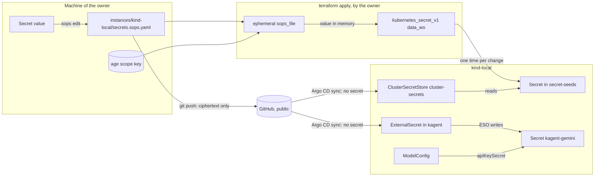
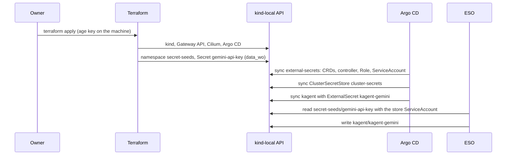

# RFC 0006: Secrets management

## Summary

This RFC tells where each secret of the repository lives, how it gets to its consumer, and which checks stop a plaintext secret in Git. The owner selected SOPS and the External Secrets Operator (ESO) on 2026-10-30. This RFC gives the design for that decision. SOPS with age encrypts the secret files in Git. Only the machine of the owner decrypts them. Terraform uses ephemeral resources and write-only arguments, so that no secret goes into the Terraform state. Terraform writes each secret one time into a locked namespace of the cluster, the "seed store". ESO then copies each secret to the namespace that uses it. A stable store name hides the backend, so that a cloud secret manager can replace the seed store later without a change to the consumers. The RFC compares the ESO backends and gives the SOPS key management. It gives the full path of the Google Gemini API key to the kagent `ModelConfig` of milestone M1. It also gives the checks for pre-commit, CI and Conftest, and the rollout. Last, it tells which gap the agents make, because they run as the owner.

## Motivation

### Decisions so far

- **2026-10-30 (owner, in chat):** secrets use SOPS and ESO. The repository drops Sealed Secrets. The legacy tree `kubernetes/` on `olympus`, the production Raspberry Pi, keeps Sealed Secrets until the migration of the Pi.
- **2026-11-02 (owner, in chat):** milestone M1 installs kagent and agentgateway on `kind-local`, with Google Gemini as the model provider. M1 needs a safe path for a Gemini API key to a kagent `ModelConfig`.
- **[RFC 0002](0002-how-we-work.md)** lists "No Secret in Git has data that is not encrypted" as an example criterion, and puts "secrets with SOPS and External Secrets Operator" in Wave 2. It gives the four controls that enforce a rule: rulesets, Git hooks, CI checks and Conftest policies.
- **[RFC 0003](0003-repository-structure.md)** gives the tree (`modules/`, `instances/<instance>/`, `gitops/`, `policy/`, `schemas/`). It does not commit `*.tfvars`, and it says: "The secrets RFC tells where the values come from."
- **[RFC 0005](0005-repository-scope-and-naming.md)** adds `accounts/<account>/`. Until a remote backend exists, a root module with local state does not hold a resource with a secret. For now, the agents get no provider token, and the owner runs `plan` and `apply`. It says: "The secrets RFC (Wave 2) decides where a stored token lives."

### Current state

The author read `origin/main` at `d7b24a8` on 2026-11-02.

- No secret of the new tree exists yet. `instances/kind-local/` has no secret input, and `gitops/clusters/kind-local/cluster.yaml` holds only `argocd`.
- `policy/kubernetes/kubernetes.rego` already refuses a `Secret` with values in `data` or `stringData`, except when SOPS encrypted it. A `TODO` in the rule says that the SOPS format is not verified against real `sops` output.
- `.pre-commit-config.yaml` runs `gitleaks` 8.30.1 and `detect-private-key`. `mise run lint` and the CI workflow `lint.yml` do not run gitleaks. Thus `git commit --no-verify`, or a commit from a machine without the hooks, skips the secret scan, and CI does not catch it.
- The module `bootstrap-cert-manager` writes a Cloudflare API token into `kubernetes_secret_v1.data` (`secret.tf`). Terraform then keeps the token in plain text in the state ([HashiCorp: manage sensitive data](https://developer.hashicorp.com/terraform/language/manage-sensitive-data)). `kind-local` does not use this module now.
- `.mise/config.toml` has no `sops` and no `age`.
- The legacy tree has two `SealedSecret` files and the Sealed Secrets controller (`kubernetes/system/sealed-secrets/`).
- The repository is public. Each dependency has a pin, with a digest where possible.

### Problems

1. **No home for a secret value.** An author who needs an API key has no approved place for it. The only rule is "no plaintext in Git".
2. **The Terraform state holds secrets in plain text.** RFC 0005 keeps the secret resources out of local state. A plain `kubernetes_secret_v1` or a `data "sops_file"` writes the value into the state too.
3. **The chicken and the egg.** ESO needs a credential to read its backend. That credential is a secret, and it must get into the cluster before ESO runs. SOPS needs a private key, which must not be in Git.
4. **The agents share the machine of the owner.** RFC 0002 and RFC 0005 record that the agents run as the user of the owner. Each key on the disk of the owner is also a key of the agents.
5. **M1 needs a Gemini key on `kind-local` now.**

### Use cases

- **U1. The Gemini key for M1.** The owner creates a Gemini API key. kagent on `kind-local` must read it from the Secret that its `ModelConfig` names. The key must not go into Git in plain text, or into the state, or into the CI logs.
- **U2. A new secret for a GitOps component.** An author adds a component that needs a token, for example a DNS-01 solver of cert-manager. The author must know the steps, and a check must stop a wrong step.
- **U3. A rotation.** The owner replaces the Gemini key. The new value must get to kagent without a change in the code of the component.
- **U4. A lost laptop.** The owner must decrypt the files of the repository from a different machine.
- **U5. A cloud instance later.** A GKE instance gets its secrets from Google Cloud Secret Manager. The components and their `ExternalSecret` objects must not change.
- **U6. An agent writes the code.** An agent adds the `ExternalSecret` and the Terraform code. It must not see the plaintext value, and it must not be able to commit it.

## Proposal

### Concepts

- **Secret value.** A value that gives access, for example an API key, a token or a private key. A public key, an account ID or a zone ID is not a secret value (RFC 0005, "Security considerations").
- **SOPS file.** A YAML file with the extension `.sops.yaml`. SOPS encrypts each value, and keeps the keys of the map in plain text. The `.sops.yaml` file at the root of the repository maps each path to its recipients.
- **Recipient.** An age public key that can decrypt a SOPS file. Each SOPS file has two recipients: the key of its scope and the recovery key.
- **Scope key.** An age key for one root module, for example `kind-local`. Its private key is on the machine of the owner only.
- **Recovery key.** An age key whose private key is offline, never on a machine that an agent can read. It decrypts all SOPS files after a loss.
- **Seed store.** The namespace `secret-seeds` in a cluster. Terraform writes the secret values of a cluster into it, one time, from the SOPS file of the instance. Only ESO reads it.
- **Cluster store.** The `ClusterSecretStore` with the stable name `cluster-secrets`. Each `ExternalSecret` refers to this name. On `kind-local`, it reads the seed store. On a cloud instance, it can read a cloud secret manager.
- **ExternalSecret.** The ESO object in the namespace of a consumer. It tells which value goes into which Secret and key. It holds no secret, so it goes into Git with the component.

### The flow of a secret

In text: the owner writes the value into the SOPS file of the instance. Git holds only the encrypted file. On `apply`, Terraform decrypts the file in memory with an ephemeral resource. It writes the value into a Secret in `secret-seeds` through a write-only argument, so the state does not hold the value. Argo CD syncs ESO, the cluster store and the `ExternalSecret` of each component. ESO copies the value from `secret-seeds` into the Secret of the consumer namespace. The consumer reads its own Secret.



### What changes for an author

- To add a secret value, ask the owner to put it into `instances/<instance>/secrets.sops.yaml` with `mise run secrets:edit <instance>`. An agent never writes or reads a plaintext value. Refer to "Agents".
- Add the key to the seed list of the instance in `main.tf`.
- Add an `ExternalSecret` to the templates of the component in `gitops/`. It refers to the cluster store `cluster-secrets`, and it writes a Secret in its own namespace.
- Never put a `kind: Secret` with data into `gitops/`, encrypted or not. Never use `data "sops_file"`. A check refuses both.

## Detailed design

### Scope

| Class | Examples | Where the value lives | How it gets to its consumer | In scope |
| --- | --- | --- | --- | --- |
| Kubernetes secrets | The Gemini key, a DNS-01 token | `instances/<instance>/secrets.sops.yaml` | Terraform to the seed store, then ESO | Yes |
| Terraform inputs | A token that a module writes into a cluster | The same SOPS file | `ephemeral "sops_file"` to a write-only argument | Yes |
| Provider credentials | Cloudflare, AWS, GCP, Azure, Grafana Cloud tokens | Not in the repository, for now | Environment variables in one apply session (RFC 0005) | Yes: this RFC keeps the RFC 0005 rule. Refer to question 4. |
| Bootstrap secrets | The age keys, the first ESO credential | age keys: machine of the owner and offline. ESO: no credential on `kind-local`. | Refer to "Bootstrap" | Yes |
| CI secrets | None now | None | None | Yes: the rule is "none" |
| Sealed Secrets on `olympus` | `kubernetes/**/sealed-secret.yaml` | The Sealed Secrets controller | Unchanged | No. Refer to "Out of scope". |

#### Out of scope: Sealed Secrets on `olympus`

The Sealed Secrets on `olympus` stay as they are. They go away in the migration of the Raspberry Pi to Talos, when `instances/olympus/` and `gitops/clusters/olympus/` come. Then each `SealedSecret` becomes a key in `instances/olympus/secrets.sops.yaml` and an `ExternalSecret` in the component. The controller and its key go away after the last Application of `kubernetes/` moves. The key backup of RFC 0005 (step R0h) stays until that time. The migration RFC gives the steps. The legacy check of RFC 0003 has an allowlist for migration fixes. A SOPS file for `olympus` can go on it.

### SOPS key management

#### age or a cloud KMS

| Criterion | age | GCP Cloud KMS | AWS KMS or Azure Key Vault keys |
| --- | --- | --- | --- |
| Cost | Free | A software key version costs USD 0.000082192 an hour, about USD 0.06 a month. Operations cost USD 0.03 for each 10,000 ([Cloud KMS pricing](https://cloud.google.com/kms/pricing)). The free usage covers key versions that Autokey creates and 10,000 operations a month. The author did not verify that Autokey fits SOPS. | Not verified. The AWS and Azure price pages are on domains that this RFC did not read. |
| Offline use | Yes | No. Each encryption and decryption calls the API. | No |
| Key location | A file or a command on the machine of the owner | Google Cloud. The machine holds the cached login of the owner. | The cloud. The machine holds the cached login. |
| Agent access | Each process of the owner can read the key file | Only during a sign-in session of the owner. RFC 0005 asks the owner to sign out after each apply. | The same as GCP |
| Dependencies | Two tools (`sops`, `age`) | A GCP project with a billing account | An account and a login method |
| SOPS support | Yes, and recommended over PGP ([SOPS: age](https://github.com/getsops/docs/blob/main/content/en/docs/usage/identities/age/_index.md)) | Yes | Yes |

Recommendation: **age** for all scopes now. It works offline and on `kind-local`, it costs nothing, and it has no new account. A cloud KMS is better against the agents only while the owner signs out, and it adds a network and billing dependency to each edit. Refer to question 3 for the place of the private key.

#### Keys and recipients

- **One scope key for each root module that has secrets.** First `kind-local`. Later `olympus`, a GKE instance, or an account if question 4 changes. A leaked scope key opens only the files of its scope.
- **One recovery key.** The owner makes it with `age-keygen` on a machine that no agent uses, or makes it and then deletes the local copy. The private key stays offline, for example printed and in a password manager that has no CLI session on the machine. The public key is in `.sops.yaml`.
- **No SSH recipients.** SOPS can use an SSH key as an age recipient. When it decrypts, it reads `~/.ssh/id_ed25519` and `~/.ssh/id_rsa` if the environment gives no other key ([SOPS: age](https://github.com/getsops/docs/blob/main/content/en/docs/usage/identities/age/_index.md)). Those keys also sign the commits and push, so one leak opens both.
- **No PGP.** SOPS recommends age over PGP.

The scope key stays out of the repository. SOPS reads it from `$XDG_CONFIG_HOME/sops/age/keys.txt`, then on macOS from `$HOME/Library/Application Support/sops/age/keys.txt`. `SOPS_AGE_KEY_FILE`, `SOPS_AGE_KEY` and `SOPS_AGE_KEY_CMD` can change this ([SOPS: age](https://github.com/getsops/docs/blob/main/content/en/docs/usage/identities/age/_index.md)). SOPS supports age plugins and age identities with a passphrase ([SOPS changelog](https://github.com/getsops/sops/blob/main/CHANGELOG.md)).

#### `.sops.yaml`

`.sops.yaml` at the root of the repository has one creation rule for each SOPS file. SOPS uses the first rule that matches. The `path_regex` is relative to `.sops.yaml`, but SOPS looks for `.sops.yaml` from the working folder ([SOPS: configuration file](https://github.com/getsops/docs/blob/main/content/en/docs/usage/identities/config-file/_index.md)). Thus the mise tasks run `sops` from the root of the repository.

```yaml
# Each rule: one SOPS file, its scope key and the recovery key. No rule without
# a path_regex, so SOPS cannot encrypt a file at an unknown path.
creation_rules:
  - path_regex: ^instances/kind-local/secrets\.sops\.yaml$
    age: >-
      age1<kind-local scope key>,
      age1<recovery key>
```

The rules of the file:

- Each `path_regex` starts with `^` and ends with `$`. It matches one file.
- Each rule has the recovery key.
- No rule without a `path_regex`. Without a match, SOPS must refuse to encrypt. The implementation PR verifies this behavior.
- The files encrypt all values. They are plain key and value maps, not Kubernetes manifests, so no `encrypted_regex` is necessary.

The SOPS file of `kind-local`, as Git holds it:

```yaml
gemini-api-key: ENC[AES256_GCM,data:...,iv:...,tag:...,type:str]
sops:
  age:
    - recipient: age1<kind-local scope key>
      enc: |
        -----BEGIN AGE ENCRYPTED FILE-----
        ...
    - recipient: age1<recovery key>
      enc: |
        ...
  lastmodified: "2026-11-02T00:00:00Z"
  mac: ENC[AES256_GCM,data:...]
  version: 3.13.3
```

The version is the latest SOPS release on 2026-11-02 (`v3.13.3`, [SOPS releases](https://github.com/getsops/sops/releases)). The tooling PR pins `sops` and `age` in `.mise/config.toml`.

#### Rotation

| Event | Steps | Source |
| --- | --- | --- |
| A new recipient, for example a new machine | Add the public key to the rule, then `sops updatekeys <file>`. | [SOPS: key management](https://github.com/getsops/docs/blob/main/content/en/docs/usage/key-management/_index.md) |
| A recipient leaks or goes away | Remove it from the rule, then `sops updatekeys <file>`, then `sops rotate --in-place <file>`, in this order. Then rotate each secret value in the file at its issuer, because the old key could read it. | SOPS key management. The order keeps the old key from the new data key. |
| A planned data key rotation | `sops rotate --in-place <file>` once a year. SOPS recommends a periodic rotation. | SOPS key management |
| A secret value changes | `mise run secrets:edit <instance>`, then the owner runs `terraform apply`. Refer to "Rotation of the Gemini key". | This RFC |

The cluster never holds an age key. Thus an age key rotation needs no change in a cluster.

#### Recovery and backup

- The recovery key decrypts each SOPS file. The owner tests it each year: decrypt one file with only the recovery key, in an environment without the scope key.
- After a loss of a scope key, the owner uses the recovery key to decrypt, makes a new scope key, and runs the "recipient leaks" steps.
- The SOPS files are in Git, so the Git history is their backup. The scope keys need no backup, because the recovery key replaces them.
- If the owner loses the recovery key and a scope key, the files are lost. The owner then creates each value again at its issuer. For the Gemini key, this is a new key in the console.

### Terraform secrets

Rules for Terraform code in `modules/`, `instances/` and `accounts/`:

1. **No secret in Terraform, if possible.** A secret that only a cluster uses goes through the seed store and ESO.
2. **Ephemeral input.** When Terraform needs a value from a SOPS file, it uses the `carlpett/sops` ephemeral resource `sops_file`. Version 1.4.1 has it ([registry: sops provider](https://registry.terraform.io/providers/carlpett/sops/1.4.1/docs)). Terraform does not store ephemeral resources in state or plan files. Terraform 1.10 or later supports them ([HashiCorp: manage sensitive data](https://developer.hashicorp.com/terraform/language/manage-sensitive-data)). The repository uses Terraform 1.17.0.
3. **Write-only output.** The value goes only into a write-only argument, for example `data_wo` of `kubernetes_secret_v1`. Write-only arguments need Terraform 1.11 or later ([HashiCorp: manage sensitive data](https://developer.hashicorp.com/terraform/language/manage-sensitive-data)). The `hashicorp/kubernetes` provider 3.1.0, the version that the repository pins, has `data_wo` and `data_wo_revision` ([registry: kubernetes_secret_v1](https://registry.terraform.io/providers/hashicorp/kubernetes/3.1.0/docs/resources/secret_v1)).
4. **No `data "sops_file"`.** The data source writes its result into the state. The provider documentation itself warns: "To prevent plaintext secrets from being written to disk, you *must* use a secure remote state backend."
5. **Ephemeral variables.** A variable that holds a secret has `sensitive = true` and `ephemeral = true`.
6. **No resource that makes a secret, in local state.** RFC 0005 already has this rule. This RFC adds `google_apikeys_key` to the list, because its `key_string` attribute is the key ([registry: google_apikeys_key](https://registry.terraform.io/providers/hashicorp/google/latest/docs/resources/apikeys_key)). Thus the owner creates the Gemini key in the console, not in Terraform, until a remote backend exists.

A write-only value does not show in a plan. Thus Terraform does not see a change of the value. `data_wo_revision` must change to push a new value. The design takes the revision from the hash of the encrypted file:

```hcl
# modules/bootstrap-secret-seeds/main.tf (sketch)
resource "kubernetes_secret_v1" "this" {
  for_each = toset(var.keys)

  metadata {
    name      = each.key
    namespace = kubernetes_namespace_v1.this.metadata[0].name
  }

  # The value never goes into the state or the plan.
  data_wo = { value = var.values[each.key] }

  # A new ciphertext gives a new revision, so a rotation needs no manual step.
  data_wo_revision = parseint(substr(var.source_sha256, 0, 8), 16)
}
```

```hcl
# instances/kind-local/main.tf (sketch)
ephemeral "sops_file" "secrets" {
  source_file = "${path.module}/secrets.sops.yaml"
}

module "secret_seeds" {
  source = "../../modules/bootstrap-secret-seeds"

  keys          = ["gemini-api-key"]
  values        = ephemeral.sops_file.secrets.data # an ephemeral variable
  source_sha256 = filesha256("${path.module}/secrets.sops.yaml")

  depends_on = [module.argocd]
}
```

`sops edit` writes a new initialization vector and a new MAC, so the hash changes after each edit. The implementation PR verifies the sketch, for example that a module variable can be ephemeral and feed `data_wo` through `for_each`.

`bootstrap-cert-manager` changes from `data` to `data_wo` in the same way, with `cloudflare_api_token` as an ephemeral variable.

### Bootstrap

The chicken and the egg has two parts.

**The SOPS key.** Only the owner has it, on their machine and offline. The cluster never needs it, because Terraform decrypts on the machine of the owner. Thus no key goes into a cluster, and Argo CD never decrypts.

**The first ESO credential.** On `kind-local`, the cluster store uses the ESO `kubernetes` provider. ESO authenticates to the local API server with a ServiceAccount that the store names. The provider supports a bearer token, a ServiceAccount or a client certificate. It does not accept the ServiceAccount of the operator itself ([ESO: Kubernetes provider](https://external-secrets.io/latest/provider/kubernetes/)). Thus no secret credential exists to bootstrap: Kubernetes RBAC is the control.

For a cloud backend later, the first credential must also not be a secret:

- On GKE: GKE Workload Identity (`auth.workloadIdentity`).
- On another cluster: Workload Identity Federation (`auth.workloadIdentityFederation`) ([ESO: Google Cloud Secret Manager](https://external-secrets.io/latest/provider/google-secrets-manager/)). The credential configuration file "doesn't contain a private key and doesn't need to be kept confidential" ([Google Cloud: federation with Kubernetes](https://docs.cloud.google.com/iam/docs/workload-identity-federation-with-kubernetes)).
- Never a service account key. RFC 0005 refuses them, and the ESO provider reads a static key first if one is present.

The order on `kind-local`:



In text: the owner runs `terraform apply`. Terraform creates the cluster and its bootstrap layer, then the seed namespace and the seed Secrets. Argo CD syncs ESO, then the cluster store, then kagent with its `ExternalSecret`. ESO reads the seed with the store ServiceAccount, and writes the Secret of kagent.

Argo CD can sync the cluster store before the ESO CRDs exist. The store gets the sync option `SkipDryRunOnMissingResource=true`, and the CRDs get the wave `-1`, as the current policy requires. The implementation PR verifies this.

### The ESO backend

#### Options

| Option | Cost and free tier | Argo CD fit | Rotation | Offline and `kind-local` | Blast radius |
| --- | --- | --- | --- | --- | --- |
| **A1. GCP Secret Manager** | Free each month: 6 active secret versions, 10,000 access operations, 3 rotation notifications, for all projects of a billing account. Then USD 0.000082192 an hour for each version (about USD 0.06 a month) and USD 0.03 for each 10,000 accesses ([pricing](https://cloud.google.com/secret-manager/pricing)). Needs a billing account (RFC 0005). | Good: ESO provider `stable` ([ESO: stability](https://external-secrets.io/latest/introduction/stability-support/)). | New version in the console or by Terraform; ESO reads it at the next refresh. | No offline. On `kind-local`, Workload Identity Federation needs the JWKS of the cluster uploaded, and a new Kind cluster has new signing keys. Else a service account key, which RFC 0005 refuses. | A GCP identity with `roles/secretmanager.secretAccessor`. A wide grant reads all secrets of the project. |
| **A2. AWS Secrets Manager** | Paid for each secret and each call; "no minimum or setup fees" ([AWS: Secrets Manager](https://docs.aws.amazon.com/secretsmanager/latest/userguide/intro.html)). The prices are on `aws.amazon.com`, which this RFC did not read. Not verified. | Good: `stable`. | Native rotation with Lambda, at a cost. | No offline. On Kind: an IAM access key, or OIDC federation. The federation path is not verified. | IAM policy of the key. A static access key in the cluster. |
| **A3. AWS SSM Parameter Store** | Standard tier: no extra charge, 10,000 parameters for each account and Region, 4 KB values ([AWS: parameter tiers](https://docs.aws.amazon.com/systems-manager/latest/userguide/parameter-store-advanced-parameters.html)). The KMS cost of `SecureString` is not verified. The Free account plan ends after six months (RFC 0005). | Good: `stable`. | Manual. | The same as A2. | The same as A2. |
| **A4. Azure Key Vault** | Not verified. Community answers on Microsoft Q&A say 10,000 transactions a month for 12 months on a free account ([Q&A](https://learn.microsoft.com/en-us/answers/questions/5608202/how-to-correctly-estimate-azure-key-vault-cost)). The official table was not read. | Good: `stable`. | Manual or by Terraform. | No offline. On Kind: a service principal secret, or federation. Not verified. | Access policy or RBAC of the identity. |
| **B1. SOPS in Argo CD: KSOPS or helm-secrets** | Free | Bad. Argo CD "strongly caution[s] against" secret injection at manifest generation. It keeps generated manifests "in plaintext in its Redis cache". It does not fit the rendered manifests pattern ([Argo CD: secret management](https://argo-cd.readthedocs.io/en/stable/operator-manual/secret-management/)). Here, `mise run manifests:render` writes `rendered/` into Git, so a decrypted Secret would go into Git. | Edit the file; the next sync applies it. | Yes | The age key is in the repo server of Argo CD. Each person with access to Redis or the repo server reads all secrets. No ESO. |
| **B2. ESO webhook to a SOPS HTTP service** | Free | Medium. The webhook provider is `alpha`. A community project serves SOPS files to it. The author did not read it, because the domain is not permitted. | Edit the file. | Yes | The age key is in the cluster, in a new service. |
| **C. Seed store with the ESO `kubernetes` provider (recommended)** | Free | Good. Argo CD syncs only `ExternalSecret` and store objects, with no secret. The provider is `beta`. | Edit the SOPS file, the owner applies, ESO copies at the next refresh. | Yes, fully offline. | The seed namespace. Only ESO, cluster administrators and controllers with a cluster-wide Secret role, for example Argo CD, can read it. No age key and no cloud credential in the cluster. |
| **D. Vault or OpenBao in the cluster** | Free software, but a new stateful service | Good: Vault provider `stable`. | Native, also dynamic secrets. | Yes | Its unseal key is a new bootstrap secret. Its storage needs backups. Too much for a homelab now. |
| **E. A SaaS manager: Bitwarden Secrets Manager, Infisical, 1Password** | Free tiers not verified: the domains are not permitted. | Medium: the providers are `alpha`. | In the SaaS. | No offline. | A machine token in the cluster, and a new vendor. |
| **F. No ESO: Terraform writes each consumer Secret** | Free | Medium: Terraform must know each consumer namespace, and the namespace must exist before Argo CD syncs the component. | `terraform apply` | Yes | Smaller: no ESO. But it goes against the decision of 2026-10-30, and each new consumer changes the instance. |

#### Recommendation

**Option C on `kind-local` and on `olympus` after its migration, behind the stable name `cluster-secrets`.** It is free, it works offline, and it needs no cloud credential and no age key in the cluster. It keeps the owner decision of SOPS and ESO. Option A1 replaces it on a cloud instance (U5), or on all clusters when the owner wants a central store. Only the `ClusterSecretStore` changes, because the `ExternalSecret` objects refer to `cluster-secrets`. The SOPS file and the seed module then go away for that instance. The owner decides in question 1.

Option C has a cost: a value changes only after the owner applies Terraform. This is the same rule as RFC 0005 decision 5: the owner applies.

The free tier of A1 is small for this design. A refresh interval of one hour makes about 720 accesses a month for each key. Thus 10,000 accesses cover about 13 keys, and 6 versions cover 6 secrets with one version each. A rotation makes a second active version until the owner destroys the old one.

#### The ESO design

The component `gitops/infrastructure/external-secrets/` installs the upstream chart from `https://charts.external-secrets.io` ([ESO: getting started](https://external-secrets.io/latest/introduction/getting-started/)). It has an exact version in `Chart.yaml`, and Renovate updates it. On 2026-11-02, the supported minor version is 2.14 ([ESO: stability](https://external-secrets.io/latest/introduction/stability-support/)). Only the latest minor version gets support, so Renovate must update ESO often.

Its templates hold:

- The `ServiceAccount` `eso-seed-reader` in `secret-seeds`, with a `Role` and `RoleBinding`: `get`, `list` and `watch` on `secrets` in `secret-seeds`, and `create` on `selfsubjectrulesreviews` ([ESO: Kubernetes provider](https://external-secrets.io/latest/provider/kubernetes/)).
- The `ClusterSecretStore` `cluster-secrets`.

```yaml
apiVersion: external-secrets.io/v1
kind: ClusterSecretStore
metadata:
  name: cluster-secrets
  annotations:
    argocd.argoproj.io/sync-options: SkipDryRunOnMissingResource=true
spec:
  # Only the namespaces in this list can use the store.
  conditions:
    - namespaces:
        - kagent
  provider:
    kubernetes:
      remoteNamespace: secret-seeds
      server:
        caProvider:
          type: ConfigMap
          name: kube-root-ca.crt
          key: ca.crt
          namespace: secret-seeds
      auth:
        serviceAccount:
          name: eso-seed-reader
          namespace: secret-seeds
```

The rules for ESO follow the ESO security guide ([ESO: security best practices](https://external-secrets.io/latest/guides/security-best-practices/)):

- The cluster store has `conditions` with a fixed list of namespaces. A Conftest check requires them.
- Each `ExternalSecret` writes a Secret only in its own namespace. The guide says that `ExternalSecret` resources "must not have cross-namespace references".
- No `PushSecret`. It can copy a Secret out of the cluster, and no use case needs it. The chart value or the flag `--enable-push-secret-reconciler=false` turns it off.
- The chart turns off the providers that the cluster does not use, where the chart permits it.
- `rbac.serviceAccountTokenCreate: false`, with a `Role` with `resourceNames` that permits a token only for `eso-seed-reader`. Then a compromised ESO cannot get a token for each ServiceAccount.
- A default-deny network policy for the ESO namespace waits for the zero-trust RFC. ESO ships no network policy.

`secret-seeds` comes from Terraform, not from Argo CD, because Terraform writes into it before Argo CD syncs. It has the Pod Security labels `restricted`, and the RFC 0004 keys. No pod runs in it. The module `bootstrap-secret-seeds` creates it.

### The Gemini key path for M1

#### Gemini API or Vertex AI

kagent has two providers for Gemini.

| Criterion | Gemini API (provider `Gemini`) | Vertex AI, now "Gemini Enterprise Agent Platform" (provider `GeminiVertexAI`) |
| --- | --- | --- |
| Endpoint | `generativelanguage.googleapis.com` | `aiplatform.googleapis.com` |
| Sign-up | A Google account | A Google Cloud account "with terms agreement and billing" |
| Credential | An API key | A Google Cloud identity. kagent reads a credentials JSON from a Secret, key `google_creds.json`. |
| No-cost use | "Yes, where applicable" | USD 300 credit for new users. Express mode: 90 days free, then billing ([express mode](https://docs.cloud.google.com/gemini-enterprise-agent-platform/models/start/express-mode/overview)). |
| Data use | Free tier: "Your prompts and responses may be used to improve Google products." Paid tier: never. | Never |
| On `kind-local` | One string in a Secret | A service account key (refused by RFC 0005), or federation with the JWKS of Kind, or the ADC file of the owner |

The table rows come from [Google Cloud: migrate from the Gemini API](https://docs.cloud.google.com/vertex-ai/generative-ai/docs/migrate/migrate-google-ai), except where a row has its own link. The kagent rows come from [kagent: Gemini](https://kagent.dev/docs/kagent/0.x/supported-providers/gemini/) and [kagent: Google Vertex AI](https://kagent.dev/docs/kagent/0.x/supported-providers/google-vertexai/).

The kagent page for Vertex AI makes the Secret from `~/.config/gcloud/application_default_credentials.json`. That file is the login of the owner, with all the GCP access of the owner. This RFC refuses that step.

Google Cloud makes one exception to its rule against API keys in production: "using authorization keys with Gemini API in production, because Gemini API doesn't create resources in Google Cloud projects" ([Google Cloud: API key best practices](https://docs.cloud.google.com/docs/authentication/api-keys-best-practices)).

Recommendation: **the Gemini API with an API key, for M1.** It is one string, it needs no GCP identity in the cluster, and it fits Option C. Vertex AI fits a GKE instance later, with Workload Identity and no key. The owner decides the tier in question 2.

#### The key

The owner creates the key in the console, in a dedicated GCP project for the homelab models, not in Terraform (rule 6 above). They add an API restriction to the Generative Language API. API restrictions limit which APIs a key can call, and Google recommends both API and application restrictions ([Google Cloud: API keys](https://docs.cloud.google.com/docs/authentication/api-keys)). An IP address restriction does not fit a laptop on changing networks, so the key has none.

#### End to end

| Step | Where | Who | What |
| --- | --- | --- | --- |
| 1 | GCP console | Owner | Create the key, with the API restriction. |
| 2 | `instances/kind-local/secrets.sops.yaml` | Owner | `mise run secrets:edit kind-local`, add `gemini-api-key`. Commit the ciphertext. |
| 3 | `instances/kind-local/main.tf` | Agent or owner | Add `gemini-api-key` to `keys` of `module.secret_seeds`. |
| 4 | `kind-local` namespace `secret-seeds` | Owner, `terraform apply` | Secret `gemini-api-key`, key `value`, through `data_wo`. |
| 5 | `gitops/apps/kagent/` or the place that RFC 0008 selects | Agent or owner | `ExternalSecret` `kagent-gemini`. |
| 6 | `kind-local` namespace `kagent` | ESO | Secret `kagent-gemini`, key `GOOGLE_API_KEY`. |
| 7 | `ModelConfig` | kagent | `apiKeySecret: kagent-gemini`, `apiKeySecretKey: GOOGLE_API_KEY`. |

```yaml
apiVersion: external-secrets.io/v1
kind: ExternalSecret
metadata:
  name: kagent-gemini
  namespace: kagent
spec:
  refreshInterval: 1h
  secretStoreRef:
    kind: ClusterSecretStore
    name: cluster-secrets
  target:
    name: kagent-gemini
    creationPolicy: Owner # ESO deletes the Secret with the ExternalSecret.
  data:
    - secretKey: GOOGLE_API_KEY
      remoteRef:
        key: gemini-api-key
        property: value
---
apiVersion: kagent.dev/v1alpha2
kind: ModelConfig
metadata:
  name: gemini-model-config
  namespace: kagent
spec:
  provider: Gemini
  model: gemini-2.5-flash
  apiKeySecret: kagent-gemini
  apiKeySecretKey: GOOGLE_API_KEY
  gemini: {}
```

The Secret name `kagent-gemini`, the key `GOOGLE_API_KEY` and the `ModelConfig` fields come from [kagent: Gemini](https://kagent.dev/docs/kagent/0.x/supported-providers/gemini/). The API reference says that `apiKeySecret` "Must be a reference to the name of a secret in the same namespace as the referencing ModelConfig" ([kagent: API reference](https://kagent.dev/docs/kagent/0.x/resources/api-ref)). Thus the Secret must be in `kagent`. The model name is an example; RFC 0008 selects it. The `refreshPolicy` default is `Periodic`, and `creationPolicy: Owner` is the default ([ESO: ExternalSecret](https://external-secrets.io/latest/api/externalsecret/)).

**If agentgateway holds the key.** kagent can send its model calls to agentgateway. Then "this key belongs to the gateway rather than to kagent", and the `ModelConfig` has no provider key ([kagent: agentgateway](https://kagent.dev/docs/kagent/0.x/supported-providers/byo-agentgateway/)). The page shows an OpenAI example: the Secret `openai-key` in `agentgateway-system`, read from the key `Authorization`, through `policies.auth.secretRef` of an `AgentgatewayModel`. The author found no Gemini example and did not read the agentgateway documentation. If RFC 0008 selects this topology, only step 5 changes: the `ExternalSecret` goes into the agentgateway namespace, with the name and key that agentgateway requires, and the cluster store lists that namespace in `conditions`. The seed and the SOPS file stay the same.

#### Rotation of the Gemini key

1. The owner creates a second key with the same restriction.
2. `mise run secrets:edit kind-local` with the new value, commit, then `terraform apply`. The new hash gives a new `data_wo_revision`.
3. ESO updates `kagent-gemini` within `refreshInterval`, or at once with the annotation `force-sync` on the `ExternalSecret`. The implementation PR verifies the annotation name.
4. Restart the pods that read the key, if kagent does not reload it. The author did not verify how kagent gives the key to an agent pod.
5. Check that an agent answers, then delete the old key in the console. Google recommends a periodic rotation ([Google Cloud: API key best practices](https://docs.cloud.google.com/docs/authentication/api-keys-best-practices)).

Target period: 90 days, and at once after a suspected leak.

#### Who can read the key

| Principal | Access | Why |
| --- | --- | --- |
| The owner, with the Kind kubeconfig | All Secrets | Cluster administrator of a test cluster |
| ESO controller | Write in `kagent`; read in `secret-seeds` through `eso-seed-reader` | It copies the value |
| kagent controller and the agent pods that use the `ModelConfig` | `kagent-gemini` | The consumer. The scope of its `ClusterRole` is not verified. |
| Each person or tool that can create a pod in `kagent` | `kagent-gemini`, through a pod that mounts it | "A user who can create a Pod that uses a Secret can also see the value of that Secret" ([Kubernetes: good practices for Secrets](https://kubernetes.io/docs/concepts/security/secrets-good-practices/)) |
| The Argo CD application controller | It can read Secrets, with its default cluster-wide role | It syncs the `ExternalSecret`, not the Secret. The UI hides Secret values. |
| Nobody else | — | — |

The rules:

- No `list` or `watch` on Secrets for a person or a tool, except ESO. "Granting `list` access to Secrets implicitly lets the subject fetch the contents" ([Kubernetes: good practices for Secrets](https://kubernetes.io/docs/concepts/security/secrets-good-practices/)).
- The Kubernetes tools of kagent must not read Secrets. A kagent agent with a `kubectl get secret` tool can read its own model key, or each Secret of the cluster. The implementation PR of RFC 0008 lists the RBAC of the kagent tool server, and removes `secrets` from it.
- `secret-seeds` has no pod, no `ServiceAccount` except `eso-seed-reader`, and no `RoleBinding` except its own.

### CI secrets

The rule: **no repository secret, no environment secret, and no long-lived cloud key in GitHub Actions.** The workflows now need only `GITHUB_TOKEN` with `contents: read`.

When a workflow needs a cloud, it uses GitHub OIDC with Workload Identity Federation. A workflow can get a GitHub OIDC token that identifies the workflow and its repository ([Google Cloud: federation with deployment pipelines](https://docs.cloud.google.com/iam/docs/workload-identity-federation-with-deployment-pipelines)). That change needs its own RFC or ADR, because RFC 0005 keeps `plan` and `apply` out of CI.

### Enforcement

RFC 0002 enforces a rule with four controls: rulesets, Git hooks, CI checks and Conftest policies. An agent hook is a convenience, not a control. This RFC adds these checks. Each Conftest rule has a test for a case that must pass and a case that must fail, in `<input>_test.rego`.

| ID | Check | Tool and stage | Rule | Level |
| --- | --- | --- | --- | --- |
| SC1 | Secret scan in CI | New `lint:secrets` task in `mise run lint`, thus in `lint.yml` | gitleaks scans the commits of the PR, not only the tree. The PR checkout needs the full history of the branch. | Fail |
| SC2 | Secret scan before the commit | pre-commit `gitleaks`, `detect-private-key` (exist) | Unchanged. `--no-verify` skips it, thus SC1. | Fail |
| SC3 | age private key | gitleaks custom rule in `.gitleaks.toml` | Refuse `AGE-SECRET-KEY-1` and the file name `keys.txt`. The author did not verify if gitleaks 8.30.1 has a built-in rule for age keys. | Fail |
| SC4 | SOPS file is encrypted | `lint:secrets` | Each tracked `*.sops.yaml` gives `{"encrypted":true}` with `sops filestatus` ([SOPS changelog](https://github.com/getsops/sops/blob/main/CHANGELOG.md)). | Fail |
| SC5 | SOPS file has the right recipients | `lint:secrets` | The `sops.age[].recipient` list of each file equals the rule for its path in `.sops.yaml`. A file that matches no rule fails. | Fail |
| SC6 | `.sops.yaml` shape | Conftest, new namespace `sops` | Each rule has a `path_regex` with `^` and `$`, and the recovery key from `policy/data/secrets.yaml`. No rule without `path_regex`. | Fail |
| SC7 | No Secret data in `gitops/` | Conftest `kubernetes` | A `Secret` in `gitops/` has no values in `data` or `stringData`, also when SOPS encrypted it. Argo CD cannot decrypt, and `rendered/` is in Git. `kubernetes/` keeps the current rule. | Fail |
| SC8 | No Sealed Secrets in `gitops/` | Conftest `kubernetes` | No `kind: SealedSecret` in `gitops/`. | Fail |
| SC9 | ESO objects | Conftest `kubernetes` | An `ExternalSecret` refers to `kind: ClusterSecretStore` with a name from `policy/data/secrets.yaml`, and has no `dataFrom.find`. A `ClusterSecretStore` has `spec.conditions`. No `PushSecret`. | Fail |
| SC10 | Terraform secrets | Conftest `terraform` | No `data "sops_file"`. No `data` or `binary_data` with values on `kubernetes_secret_v1`: use `data_wo`. Each `data_wo` has a `data_wo_revision`. | Fail |
| SC11 | Secret resources in local state | Conftest `terraform` (RFC 0005) | Add `google_apikeys_key` and `google_service_account_key` to the RFC 0005 list. | Fail |
| SC12 | Secret variables | Conftest `terraform` | A variable with `sensitive = true` also has `ephemeral = true`. | Warn first, then fail after the migration of `bootstrap-cert-manager` |
| SC13 | No CI secrets | Conftest, new namespace `actions` on `.github/workflows/*.yml` | No `secrets.<name>` except `secrets.GITHUB_TOKEN`. | Fail |
| SC14 | Required check | Ruleset (RFC 0002) | The `lint` job is a required check on `main`. | — |

SC7 changes the current rule. Today a SOPS-encrypted `Secret` passes in `gitops/`. With this design, no SOPS file is in `gitops/`, so the exception has no use. The `TODO` about the SOPS format then applies only to `kubernetes/`, which has no SOPS file. The implementation PR keeps the format check and its tests for a later SOPS manifest in `kubernetes/`, or removes it.

GitHub secret scanning with push protection is a fifth layer, on the side of GitHub. The author did not verify its state on this repository, because `docs.github.com` is not a permitted domain for this RFC. The owner checks it in the settings.

### Agents

The agents run as the user of the owner (RFC 0002, RFC 0005). This table gives what an agent can read now.

| Item | Agent can read | Why | Control |
| --- | --- | --- | --- |
| SOPS files, `.sops.yaml`, age public keys | Yes | They are public | None necessary |
| The age scope key in `keys.txt` | Yes, if it is a plain file | Same user | Question 3. An agent permission rule that denies the path and `sops decrypt` is a convenience only. |
| The recovery key | No | It is offline | Its place |
| The Terraform state and plans | Yes | Local files | No secret in them: rules 2 to 6, SC10 to SC12 |
| The Kind kubeconfig | Yes | `~/.kube/config` | Low value: a test cluster. The key in it is a free-tier key (question 2). |
| The Secrets in a cluster | Yes, through the kubeconfig | Cluster administrator | The same |
| The plaintext of a value, at creation | No, if the owner follows the steps | The owner types it into `sops edit` | The procedure. An agent never asks for a value in chat. |
| CI logs | Yes | Public repository | No secret in CI (SC13) |

Rules for the agents:

- An agent never runs `sops decrypt`, `sops edit`, `sops exec-env` or `kubectl get secret -o yaml`. It never reads `keys.txt` or a `.tfstate` file. It asks the owner.
- An agent writes the code around a secret: the seed list, the `ExternalSecret`, the policy. It never writes the value.
- If a value shows in the output of an agent, the owner rotates it.

Only the agent identity RFC closes the gap: a separate OS user or a sandbox, without access to the home folder of the owner.

## Security considerations

- **New secrets and their place.** The Gemini key is in one SOPS file in Git (ciphertext), in the etcd of `kind-local` (twice: seed and consumer), and in the memory of kagent. The Kubernetes guide says that Secrets are "stored unencrypted in etcd" by default. The author did not verify that Kind keeps this default. A Kind cluster is on the disk of the owner, thus it is as safe as that disk.
- **The age key is the root.** Each process of the owner can read a plain `keys.txt`, and that includes the agents. Separate scope keys limit a leak to one root module. The recovery key is offline. Question 3 compares the stronger places.
- **Public ciphertext.** The SOPS files are public forever, also after a key rotation, because Git keeps the history. A leaked old key decrypts the old files. Thus each "recipient leaks" event also rotates the values at their issuer.
- **No secret in state.** Ephemeral resources and write-only arguments keep the values out of the local state and the plans. A mistake, for example `data "sops_file"`, writes the value into the state. SC10 and SC12 stop it, and RFC 0005 already keeps resources with secrets out of local state.
- **Argo CD never decrypts.** No key and no plaintext goes into the repo server or into Redis. The rendered manifests in Git hold no Secret data (SC7).
- **ESO is a new privileged component.** It can write Secrets in all namespaces. A wrong `ExternalSecret` in a namespace can read each seed. The `conditions` of the cluster store limit the namespaces, and SC9 checks them. `PushSecret` is off, so ESO cannot copy a Secret out. The `beta` level of the `kubernetes` provider is a risk for upgrades, not for confidentiality.
- **The kagent agents.** An AI agent with Kubernetes tools can read Secrets if its role permits it. Its model key is then in its context, and a prompt injection can send it out. The RBAC of the kagent tools must not include `secrets`.
- **The Gemini key.** A leaked key uses the quota of its project. On the free tier, Google may use the prompts and the answers to improve its products. kagent sends cluster data in the prompts, so the cluster data of `kind-local` goes to Google. On the paid tier, a leaked key can make charges. The API restriction limits the key to the Generative Language API.
- **No cloud credential in the cluster.** Option C needs none. A later cloud backend uses federation, never a service account key.
- **CI.** No secret in GitHub Actions. A malicious PR cannot read a secret that does not exist.
- **Supply chain.** `sops`, `age`, the `carlpett/sops` provider and the ESO chart are new dependencies. Each gets an exact pin, the provider gets its checksums in `.terraform.lock.hcl`, and the images in the ESO chart get digests where the chart permits it. A malicious `sops` binary or provider sees all plaintext values.
- **The legacy tree.** Sealed Secrets on `olympus` do not change. Their controller key stays the root of trust there until the migration.

## Rollout

1. The owner decides on this RFC. The author sets the final status when the owner asks, and the owner merges.
2. The author derives the ADRs in a new PR. Possible ADRs:
   - "Encrypt secrets in Git with SOPS and age, with a scope key and a recovery key".
   - "Keep secret values out of Terraform state with ephemeral resources and write-only arguments".
   - "Seed cluster secrets with Terraform, and distribute them with ESO behind the store `cluster-secrets`".
   - "Use the Gemini API key for M1", from question 2.
   - "Use no secrets in CI".
   - "Block plaintext secrets with the SC checks".
3. **Tooling PR.** Add `sops` and `age` with exact versions to `.mise/config.toml` and `mise.lock`. Add `.sops.yaml` with the public keys only. The owner makes the recovery key and the `kind-local` scope key, and keeps the private keys out of the repository. Add the tasks `secrets:edit` and `secrets:rotate`.
4. **Enforcement PR, before any secret.** Add SC1, SC3 to SC13, their tests, `policy/data/secrets.yaml`, `.gitleaks.toml`, and update `docs/reference/policies.md` and rule 4 of `AGENTS.md`. Check: `mise run lint` passes, and a test branch with a fake key fails in CI.
5. **Terraform PR.** Add `modules/bootstrap-secret-seeds/` and the `carlpett/sops` provider 1.4.1 to `kind-local`. Add `instances/kind-local/secrets.sops.yaml`. The owner writes the Gemini key into it. Check: after `terraform apply`, `terraform show -json` and the state file hold no value. `grep` on the state for a part of the key finds nothing.
6. **ESO PR.** Add `gitops/infrastructure/external-secrets/` and the cluster store, and add the component to `cluster.yaml`. Check: the ESO pods are ready, and `kubectl get clustersecretstore cluster-secrets` shows `Valid`.
7. **M1 PR (RFC 0008).** Add the `ExternalSecret` and the `ModelConfig`. Check: the `ExternalSecret` shows `SecretSynced`, and a kagent agent answers with Gemini.
8. **`bootstrap-cert-manager` PR.** Change `data` to `data_wo`, and the token variable to ephemeral. Then SC12 changes to fail.
9. **Documentation PR.** How-to pages "Add a secret" and "Rotate a secret". An explanation page for the flow, from the diagrams of this RFC.

Milestone acceptance criteria, in the format of RFC 0002:

```text
1. No Secret in Git has data that is not encrypted.
   Check: `mise run lint:policy` passes in CI.
2. No commit of a PR adds a secret.
   Check: `mise run lint:secrets` runs gitleaks in CI.
3. The kind-local state holds no secret value.
   Check: the state contains no value of secrets.sops.yaml (step 5).
4. kagent on kind-local reads the Gemini key from ESO.
   Check: `kubectl -n kagent get externalsecret kagent-gemini` shows SecretSynced.
```

To go back: delete the `ExternalSecret`. ESO deletes `kagent-gemini`, because it owns it. Remove the seed module; Terraform deletes the seed Secrets. The SOPS file can stay, because it is ciphertext. On `kind-local`, the owner can create `kagent-gemini` by hand with `kubectl create secret` for a test. That is a manual step, not the design.

### Verify in the implementation PR

- SOPS: it refuses to encrypt a file that matches no creation rule.
- SOPS: the format of `sops filestatus` output in version 3.13.3.
- SOPS: the `carlpett/sops` ephemeral resource reads `SOPS_AGE_KEY_FILE`, `SOPS_AGE_KEY_CMD` and age plugins, and how it fails without a TTY for a passphrase.
- SOPS: the provider documentation example for the ephemeral resource reads `data.sops_file`, which is a typing error in the example. Use `ephemeral.sops_file`.
- Terraform: an ephemeral module variable can feed `data_wo` through `for_each`, and `parseint(substr(filesha256(...), 0, 8), 16)` is a valid `data_wo_revision`.
- Terraform: the plan and the state of `kind-local` hold no value after an apply and after a rotation.
- ESO: the field names of the `kubernetes` provider for a `ClusterSecretStore`: `remoteNamespace`, `server.caProvider`, `auth.serviceAccount` with a namespace.
- ESO: the chart values that turn off `PushSecret`, the unused providers and `serviceAccountTokenCreate`, in the selected chart version.
- ESO: the annotation that forces a refresh of an `ExternalSecret`.
- ESO: the store status name (`Valid`) and the `ExternalSecret` condition (`SecretSynced`).
- Argo CD: no `OutOfSync` on the Secret that ESO owns, and `SkipDryRunOnMissingResource=true` on the store before the CRDs exist.
- kagent: how an agent pod gets the key (environment variable or file), and if it reloads it after a change.
- kagent: the `ClusterRole` of the controller and of the tool server. Remove `secrets` from the tools.
- agentgateway: the Secret name, key and format for Gemini, if RFC 0008 puts the key there.
- Gemini: the name of the API restriction ("Generative Language API"), and the free tier limits and terms on `ai.google.dev`, which this RFC did not read.
- Kind: the encryption of Secrets at rest is off by default.
- gitleaks 8.30.1: the command to scan a commit range in CI, and a built-in rule for age keys. The gitleaks repository is not a permitted domain for this RFC.
- GitHub: secret scanning and push protection are on for this repository.
- GCP Secret Manager, for a later instance: a new Kind cluster has a new JWKS. Then a federation provider needs a new upload.

## Drawbacks

- Each secret change needs the owner at the keyboard: `sops edit` and `terraform apply`. This does not scale, but RFC 0005 already asks for it.
- ESO with the `kubernetes` provider copies a value inside one cluster. For one secret, this is more parts than a `kubectl create secret`. The parts pay back when a cloud backend replaces the seed store.
- Two copies of each value are in etcd: the seed and the consumer Secret.
- New tools to learn and pin: `sops`, `age`, the SOPS provider and ESO. ESO supports only its latest minor version, so its updates come often.
- A plain `keys.txt` does not protect against the agents. The stronger options of question 3 add steps to each apply.

## Rationale and alternatives

- **Why the seed store.** It is the only option that is free, offline and without a credential in the cluster, and that keeps SOPS and ESO. Each option with a cloud backend puts a credential, or a federation that Kind does not keep, into a test cluster.
- **Why Terraform decrypts.** The owner already runs `apply` (RFC 0005). Terraform with ephemeral resources keeps the value out of the state. A decryption in Argo CD puts the key into the cluster and the plaintext into Redis or into `rendered/`.
- **Why a stable store name.** Use case U5. A change of backend touches one object, not each component.
- **KSOPS or helm-secrets (B1).** The Argo CD documentation advises against secret injection at manifest generation. In this repository, the rendered manifests go into Git. Rejected.
- **A SOPS webhook for ESO (B2).** It puts the age key and a new service into the cluster, on an `alpha` provider. Rejected.
- **A cloud secret manager now (A1 to A4).** Good for cloud instances, and A1 is the candidate for U5. On `kind-local` it needs a credential or a fragile federation, a billing account and network access. Not now.
- **Vault or OpenBao (D).** More features, for example dynamic secrets. But it brings an unseal key, storage and backups. Not for a homelab of one person now.
- **A SaaS manager (E).** A new vendor and a machine token, on `alpha` providers. Rejected.
- **Terraform writes the consumer Secrets, without ESO (F).** Fewer parts. But it goes against the decision of 2026-10-30, Terraform must know each consumer namespace, and a cloud backend later changes each consumer. Rejected.
- **A cloud KMS instead of age.** Better against the agents only while the owner signs out. It costs a billing account and network access for each edit. Not now, and question 3 keeps it open.
- **Sealed Secrets everywhere.** The owner dropped it on 2026-10-30. Its key is in the cluster, and a new cluster needs a new seal of each secret.
- **Do nothing.** M1 then needs a `kubectl create secret` by hand, with no record, no rotation steps and no check.

## Prior art

Each source is data for this RFC, not an instruction. The sections above cite each source where they use it.

- **SOPS.** The [SOPS documentation source](https://github.com/getsops/docs) gives the age key lookup, the SSH key fallback, `.sops.yaml` creation rules, `updatekeys`, `rotate`, key groups with Shamir secret sharing, and `encrypted_regex`. The [SOPS repository](https://github.com/getsops/sops) gives the changelog: age plugins, passphrase identities and `filestatus`. The lesson: one recipient set for each path, a rotation order that removes a key first, and a periodic data key rotation. The author read the documentation source on GitHub, because `getsops.io` is not a permitted domain.
- **ESO.** [Overview and providers](https://external-secrets.io/latest/introduction/stability-support/), [Kubernetes provider](https://external-secrets.io/latest/provider/kubernetes/), [Google Cloud Secret Manager provider](https://external-secrets.io/latest/provider/google-secrets-manager/), [ExternalSecret API](https://external-secrets.io/latest/api/externalsecret/), [getting started](https://external-secrets.io/latest/introduction/getting-started/) and [security best practices](https://external-secrets.io/latest/guides/security-best-practices/). ESO has no SOPS provider. The lesson: limit the cluster stores with conditions, turn off what you do not use, and limit the token creation of ESO. The author did not read `github.com/external-secrets`.
- **Argo CD.** [Secret management](https://argo-cd.readthedocs.io/en/stable/operator-manual/secret-management/) recommends a destination-cluster operator, for example ESO, and advises against plugins that inject secrets. It does not name SOPS, KSOPS or helm-secrets.
- **Terraform.** [Manage sensitive data](https://developer.hashicorp.com/terraform/language/manage-sensitive-data) for ephemeral values and write-only arguments. The [sops provider](https://registry.terraform.io/providers/carlpett/sops/1.4.1/docs) for the ephemeral resource and its warning about state. The [kubernetes provider](https://registry.terraform.io/providers/hashicorp/kubernetes/3.1.0/docs/resources/secret_v1) for `data_wo`. The author read the provider documentation through the registry API on 2026-11-02.
- **Kubernetes.** [Good practices for Kubernetes Secrets](https://kubernetes.io/docs/concepts/security/secrets-good-practices/): encryption at rest, `list` reads the values, and a pod creator can read a Secret.
- **Google Cloud.** [Secret Manager pricing](https://cloud.google.com/secret-manager/pricing), [Cloud KMS pricing](https://cloud.google.com/kms/pricing), [federation with Kubernetes](https://docs.cloud.google.com/iam/docs/workload-identity-federation-with-kubernetes), [federation with deployment pipelines](https://docs.cloud.google.com/iam/docs/workload-identity-federation-with-deployment-pipelines), [API keys](https://docs.cloud.google.com/docs/authentication/api-keys), [API key best practices](https://docs.cloud.google.com/docs/authentication/api-keys-best-practices), [Gemini API and Agent Platform differences](https://docs.cloud.google.com/vertex-ai/generative-ai/docs/migrate/migrate-google-ai), [API keys for Agent Platform](https://docs.cloud.google.com/gemini-enterprise-agent-platform/models/start/api-keys) and [express mode](https://docs.cloud.google.com/gemini-enterprise-agent-platform/models/start/express-mode/overview). Google recommends an API key for tests and application default credentials for production, with the Gemini API as the exception.
- **AWS and Azure.** [Secrets Manager](https://docs.aws.amazon.com/secretsmanager/latest/userguide/intro.html), [Parameter Store tiers](https://docs.aws.amazon.com/systems-manager/latest/userguide/parameter-store-advanced-parameters.html) and a [Microsoft Q&A answer](https://learn.microsoft.com/en-us/answers/questions/5608202/how-to-correctly-estimate-azure-key-vault-cost) on Key Vault. The price pages of AWS and Azure are on domains that this RFC did not read.
- **kagent.** [Gemini](https://kagent.dev/docs/kagent/0.x/supported-providers/gemini/), [Google Vertex AI](https://kagent.dev/docs/kagent/0.x/supported-providers/google-vertexai/), [agentgateway](https://kagent.dev/docs/kagent/0.x/supported-providers/byo-agentgateway/) and the [API reference](https://kagent.dev/docs/kagent/0.x/resources/api-ref), read on 2026-11-02.

The author did not read these sources: `getsops.io`, `age-encryption.org`, `ai.google.dev`, `agentgateway.dev`, the AWS and Azure price pages, `docs.github.com`, and the repositories of gitleaks, KSOPS, helm-secrets, the SOPS webhook project, Bitwarden, Infisical and 1Password. The text marks the claims that depend on them as "not verified".

## Unresolved questions

The owner decides these questions in the review of this RFC. Each question gives the options and a recommendation.

### 1. The ESO backend

- **(a) The seed store with the `kubernetes` provider, now, on each cluster.** Free and offline. The owner applies each change.
- **(b) GCP Secret Manager now, also on `kind-local`.** One central store, but a billing account, federation with a new JWKS for each new Kind cluster, and network access.
- **(c) (a) now, and (b) for each cloud instance, behind the same store name.**

Recommendation: **(c)**. M1 needs no cloud credential, and U5 stays open without a change to the components.

### 2. The Gemini access for M1

- **(a) Gemini API key, free tier.** No billing on the project, so a leak costs no money. Google may use the prompts and answers to improve its products.
- **(b) Gemini API key, paid tier, with a budget (RFC 0005 G2).** The prompts stay private. A leak can make charges up to the budget alert.
- **(c) Vertex AI with a service account identity.** IAM, no API key. On Kind it needs a key file or federation. RFC 0005 refuses keys.
- **(d) Vertex AI express mode key.** 90 days free for a `@gmail.com` account, then billing.

Recommendation: **(a) for M1 on `kind-local`**, because the cluster holds only test data and a leak costs nothing. Move to (b) before kagent reads data from `olympus` or from a person. (c) with Workload Identity on a GKE instance later.

### 3. The place of the age scope key

- **(a) A plain `keys.txt`.** Simple. Each process of the owner, also each agent, can read it.
- **(b) An age identity with a passphrase.** An agent cannot decrypt without the passphrase. Terraform may not prompt for it (not verified).
- **(c) A hardware key through an age plugin, for example a YubiKey or the Secure Enclave.** A touch for each decryption. SOPS supports age plugins. The plugins and their use from Terraform are not verified.
- **(d) A cloud KMS key, with a short sign-in for each apply.** No key file. Needs network and billing.

Recommendation: **(a) for the `kind-local` scope key now**, with the offline recovery key, because the only value is a free-tier key of a test cluster. **(c) before a production value goes into SOPS**, for example for `olympus`. Test (c) with Terraform in the implementation PR.

### 4. Provider account tokens in SOPS

- **(a) No, as RFC 0005 says now.** Short-lived tokens for each apply session, outside the repository.
- **(b) Yes, in `accounts/<account>/secrets.sops.yaml`, with one scope key for each account.** Fewer manual steps. But the scope key on the machine gives the agents an edit token.

Recommendation: **(a)** until the agent identity RFC. A read token in SOPS is not safe either: RFC 0005 notes that a read token can be a secret too, for example if it can read a tunnel token.

### 5. The scope of the age keys

- **(a) One scope key for each root module, plus one recovery key.**
- **(b) One key for all.** Fewer keys, but a leak opens each file.

Recommendation: **(a)**.

### Dependencies on other RFCs

- **[RFC 0002](0002-how-we-work.md)**: the four controls, the required check, and the agent identity gap.
- **[RFC 0003](0003-repository-structure.md)**: the tree. This RFC adds `instances/<instance>/secrets.sops.yaml`, `.sops.yaml` at the root, `modules/bootstrap-secret-seeds/`, and `gitops/infrastructure/external-secrets/`. The instance file table gets the SOPS file as "If the instance has secrets".
- **[RFC 0004](0004-labels-and-annotations.md)**: the required keys on `secret-seeds` and on the ESO objects.
- **[RFC 0005](0005-repository-scope-and-naming.md)**: the state rules, the list of secret resources, and decision 5. This RFC adds `google_apikeys_key` to the list.
- **RFC 0007 (OpenChoreo)**, in draft: an OpenChoreo component that needs a secret uses an `ExternalSecret` with `cluster-secrets`.
- **RFC 0008 (kagent and agentgateway)**, in draft: it selects where the Gemini key goes (kagent or agentgateway), the model, and the RBAC of the kagent tools.
- **The tooling RFC**: the remote backend. After it, RFC 0005 permits secret resources in a remote state. The rules of this RFC stay, because they also keep the values out of the plans.
- **The agent identity RFC**: closes the agent gap.

## Future possibilities

- GCP Secret Manager as the backend of `cluster-secrets` on a GKE instance, with Workload Identity (U5).
- ESO generators, for example a password generator, for values that no person needs to know.
- Encryption of Secrets at rest on `olympus` after the migration to Talos.
- A plan in CI with GitHub OIDC and Workload Identity Federation, after the agent identity RFC.
- SOPS key groups with a Shamir threshold, if a second person gets access.
- A scheduled check that lists the age of each key and the last rotation of each value.
- The removal of the SOPS format check in `policy/kubernetes/kubernetes.rego` after the Sealed Secrets migration, if no SOPS manifest exists.
