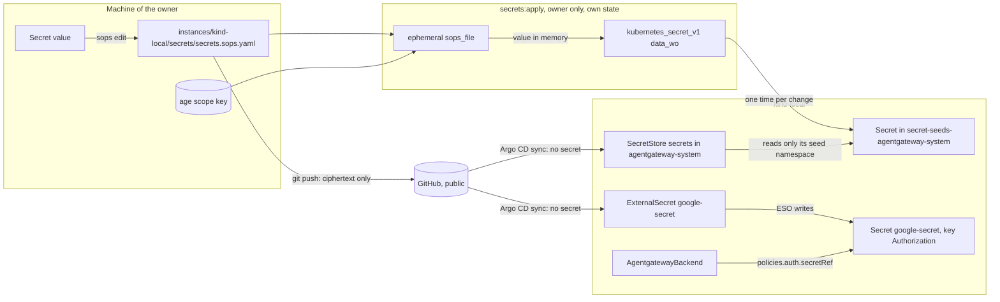
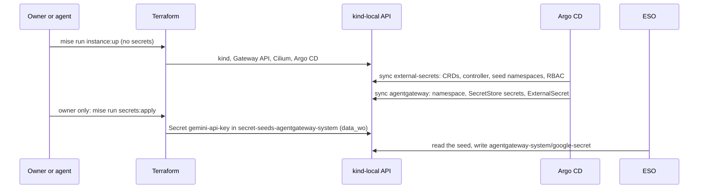

# RFC 0006: Secrets management

## Summary

This RFC tells where each secret of the repository lives, how it gets to its consumer, and which checks stop a plaintext secret in Git. The owner selected SOPS and the External Secrets Operator (ESO) on 2026-10-30. This RFC gives the design for that decision. SOPS with age encrypts the secret files in Git. Only the owner decrypts them, in a separate "secrets root module" with its own state, that only the owner applies. Terraform uses ephemeral resources and write-only arguments, so that no secret goes into the state. It writes the secrets of each consumer into a seed namespace for that consumer only. ESO copies them into the namespace of the consumer, through a namespaced store with the stable name `secrets`. OpenChoreo needs cluster stores; the RFC proposes one store for each tenant, with an admission policy (question 7). A short list of trusted platform controllers can read each Secret, and a check refuses each other reader. The RFC gives the full path of the Google Gemini API key to agentgateway for milestone M1, the requirements on kagent for RFC 0008, the checks, the rollout, and the gap that the agents make, because they run as the owner.

## Motivation

### Decisions so far

- **2026-10-30 (owner, in chat):** secrets use SOPS and ESO. The repository drops Sealed Secrets. The legacy tree `kubernetes/` on `olympus`, the production Raspberry Pi, keeps Sealed Secrets until the migration of the Pi.
- **2026-11-02 (owner, in chat):** milestone M1 installs kagent and agentgateway on `kind-local`, with Google Gemini as the model provider. [RFC 0008](https://github.com/gsuquet/homelab/pull/181) puts the key in agentgateway, and the agent pods hold no key.
- **2026-11-02 (owner, in chat):** a trusted list of platform controllers that read each Secret, with a check that refuses each other reader. The residual risk is accepted on `kind-local`. Upstream patches are follow-ups. The owner also added Argo CD and the cert-manager controller to the list ("Yes, add both").
- **2026-11-02 (owner, in chat):** `kind-local` moves to a Kubernetes 1.37 node image, so that ESO 2.14 runs on a version that it lists.
- **[RFC 0002](0002-how-we-work.md)** gives the four controls that enforce a rule: rulesets, Git hooks, CI checks and Conftest policies. Its review policy (ADR 0010 in PR #177) makes the owner the reviewer of a module and of CI.
- **[RFC 0003](0003-repository-structure.md)** gives the tree, and says: "The secrets RFC tells where the values come from." It removes `CODEOWNERS` (ADR 0022 in PR #177). Thus this RFC uses no `CODEOWNERS` rule.
- **[RFC 0005](0005-repository-scope-and-naming.md)**: until a remote backend exists, a root module with local state does not hold a resource with a secret. For now, the agents get no provider token, and the owner runs `plan` and `apply`.

### Current state

The author read `origin/main` at `d7b24a8` on 2026-11-02.

- No secret of the new tree exists yet. `gitops/clusters/kind-local/cluster.yaml` holds only `argocd`. `kind-local` runs Kubernetes 1.36.1 (`modules/cluster-kind`) with `kind` 0.33.0.
- `policy/kubernetes/kubernetes.rego` refuses a `Secret` with values in `data` or `stringData`, except when SOPS encrypted it. `policy/terraform/terraform.rego` has only the provider rules: the RFC 0005 policy against secret resources in local state is not on `main` yet.
- `.pre-commit-config.yaml` runs `gitleaks` 8.30.1 and `detect-private-key`. `mise run lint` and `lint.yml` do not run gitleaks, and `lint.yml` checks out one commit.
- GitHub secret scanning and push protection are on. The non-provider patterns are off (`gh api repos/gsuquet/homelab`, 2026-11-02). A ruleset on `main` requires the status `Run every linter and check` (`AGENTS.md`).
- `bootstrap-cert-manager` writes a Cloudflare API token into `kubernetes_secret_v1.data`. Terraform then keeps the token in plain text in the state ([HashiCorp: manage sensitive data](https://developer.hashicorp.com/terraform/language/manage-sensitive-data)).
- `modules/cluster-kind` has no `EncryptionConfiguration`, so the Secrets on `kind-local` are not encrypted at rest.
- `mise run instance:up` runs a full `terraform apply -input=false`. Agents bring `kind-local` up and down to test their changes.
- `docs/explanation/secret-management.md` and `docs/how-to/manage-secrets.md` teach Sealed Secrets.

### Problems

1. **No home for a secret value.** The only rule is "no plaintext in Git".
2. **The Terraform state holds secrets in plain text.** A plain `kubernetes_secret_v1` or a `data "sops_file"` writes the value into the state.
3. **The chicken and the egg.** ESO needs a credential to read its backend, and SOPS needs a private key. Neither can be in Git.
4. **The agents share the machine of the owner, and they write the code that runs with the secrets.**
5. **M1 needs a Gemini key on `kind-local` now.**

### Use cases

- **U1. The Gemini key for M1.** agentgateway on `kind-local` reads a Gemini key. The key is not in Git in plain text, not in the state, and not in CI logs.
- **U2. A new secret for a component**, for example the DNS-01 token of cert-manager. The agentgateway namespace must not get that token.
- **U3. A rotation** of the Gemini key, without a change in the code of the component.
- **U4. A lost laptop.** The owner decrypts the files from a different machine.
- **U5. A cloud instance later** gets its secrets from Google Cloud Secret Manager, with no change to the `ExternalSecret` objects.
- **U6. An agent writes the code.** It does not see the value, cannot commit it, and its code cannot send it out during the apply of the owner.
- **U7. An agent tests `kind-local`** without the age key. Its `instance:up` never deletes a seed. If it re-creates the cluster, the seeds go away with the cluster, the secrets state stays, and the owner applies the secrets again.

## Proposal

### Concepts

- **Secret value.** A value that gives access: an API key, a token, a private key. A public key or an account ID is not a secret value.
- **SOPS file.** `instances/<instance>/secrets/secrets.sops.yaml`. SOPS encrypts each value, and keeps the keys of the map in plain text.
- **Scope key.** An age key for one SOPS file. Its private key is on the machine of the owner only.
- **Recovery key.** An age key that the owner creates on a machine that no agent uses, or on an offline live system, and keeps offline. Each SOPS file has it as a second recipient.
- **Secrets root module.** `instances/<instance>/secrets/`: a small Terraform root module with its own local state. It reads the SOPS file and writes the seeds. Only the owner applies it, with `mise run secrets:apply <instance>`. The instance root module never reads the SOPS file.
- **Seed namespace.** `secret-seeds-<consumer>`, one for each consumer. It holds only the secrets of that consumer. No pod runs in it.
- **Consumer store.** A namespaced `SecretStore` with the fixed name `secrets` in the namespace of each consumer. It reads only the seed namespace of that consumer.
- **Trusted platform component.** A controller on the list in `policy/data/secrets.yaml` that can read each Secret of the cluster. The stores isolate the consumers from each other, not from these controllers.

### The flow of a secret

In text: the owner writes the value into the SOPS file. Git holds only the ciphertext. Argo CD syncs ESO and the seed namespaces. The owner runs `secrets:apply`: the secrets root module decrypts the file in memory with an ephemeral resource. It writes each value into the seed namespace of its consumer through a write-only argument, so the state does not hold it. Argo CD syncs the consumer stores and the `ExternalSecret` objects, and ESO copies each value into the Secret of the consumer.



### What changes for an author

- To add a secret value, ask the owner. They run `mise run secrets:edit <instance>`. An agent never writes or reads a value.
- Add the key to the seed map of the secrets root module, under its consumer.
- Add the consumer to the consumer list of the `external-secrets` component, and add an `ExternalSecret` that refers to the store `secrets` in its own namespace.
- Never put a `kind: Secret` with data into `gitops/`. Never use `data "sops_file"`. A check refuses both.
- Never run a `terraform` command in `instances/<instance>/secrets/`. Only the owner does it. `mise run instance:up` stays free for agents.

## Detailed design

### Scope

| Class | Where the value lives | How it gets to its consumer | In scope |
| --- | --- | --- | --- |
| Kubernetes secrets, also the cert-manager token | The SOPS file of the instance | Secrets root module to a seed namespace, then ESO | Yes |
| Terraform inputs | None. A module that needs a secret gets a Secret name, and ESO writes the Secret. | — | Yes |
| Provider credentials | Not in the repository, for now | Environment variables in one apply session (RFC 0005) | Yes: the RFC 0005 rule stays. Refer to question 4. |
| Bootstrap secrets | age keys: machine of the owner and offline. ESO: no credential on `kind-local`. | Refer to "Bootstrap" | Yes |
| CI secrets | None | None | Yes: the rule is "none" |
| Sealed Secrets on `olympus` | The Sealed Secrets controller | Unchanged | No |

**Out of scope: Sealed Secrets on `olympus`.** They go away in the migration of the Raspberry Pi to Talos, when `instances/olympus/` and `gitops/clusters/olympus/` come. Then each `SealedSecret` becomes a key in the SOPS file of `olympus` and an `ExternalSecret`. The key backup of RFC 0005 (step R0h) stays until then. The migration must also turn on the encryption of Secrets at rest on `olympus`. A SOPS file for `olympus` can go on the allowlist of the RFC 0003 legacy check.

### SOPS key management

#### age or a cloud KMS

| Criterion | age | GCP Cloud KMS |
| --- | --- | --- |
| Cost | Free | A software key version costs about USD 0.06 a month, and USD 0.03 for each 10,000 operations ([Cloud KMS pricing](https://cloud.google.com/kms/pricing)) |
| Offline use | Yes | No |
| Agent access | Each process of the owner can read the key file | Only during a sign-in session of the owner |
| Dependencies | `sops`, `age` | A GCP project with a billing account |

Recommendation: **age** for all scopes now. SOPS recommends it over PGP ([SOPS: age](https://github.com/getsops/docs/blob/main/content/en/docs/usage/identities/age/_index.md)). It works offline and costs nothing. A cloud KMS is better against the agents only while the owner signs out. Refer to question 3 for the place of the private key.

#### Keys and recipients

- **One scope key for each SOPS file**, first `kind-local`. A leaked scope key opens only its file.
- **One recovery key**, created on a machine that no agent uses or on an offline live system, and kept offline, for example printed. A delete of a key file on the machine of the owner is not enough: the disk keeps the data, and an agent can read the file before the delete.
- **No SSH recipients.** Without another key, SOPS reads `~/.ssh/id_ed25519` and `~/.ssh/id_rsa` to decrypt ([SOPS: age](https://github.com/getsops/docs/blob/main/content/en/docs/usage/identities/age/_index.md)). Those keys also sign and push.
- **No PGP.**

SOPS reads the scope key from `keys.txt` in `$XDG_CONFIG_HOME/sops/age/`, or on macOS in `$HOME/Library/Application Support/sops/age/`. `SOPS_AGE_KEY_FILE`, `SOPS_AGE_KEY` and `SOPS_AGE_KEY_CMD` change this. SOPS supports age plugins and age identities with a passphrase ([SOPS changelog](https://github.com/getsops/sops/blob/main/CHANGELOG.md)).

#### `.sops.yaml`

`.sops.yaml` at the root has one creation rule for each SOPS file. SOPS uses the first rule that matches. It looks for `.sops.yaml` from the working folder ([SOPS: configuration file](https://github.com/getsops/docs/blob/main/content/en/docs/usage/identities/config-file/_index.md)), so the mise tasks run `sops` from the root. The rules:

- Each `path_regex` starts with `^` and ends with `$`, and matches one file, for example `^instances/kind-local/secrets/secrets\.sops\.yaml$`.
- Each rule has the scope key and the recovery key.
- No rule without a `path_regex`.

The tooling PR pins `sops` (latest release on 2026-11-02: `v3.13.3`, [SOPS releases](https://github.com/getsops/sops/releases)) and `age` in `.mise/config.toml`.

#### The edit of a SOPS file

`sops edit` writes the plaintext into a temporary file and opens an editor as the user of the owner. Each process of that user can read that file, and editor swap, backup and undo files can keep the plaintext. Thus no agent session runs during `mise run secrets:edit`, and the task sets an editor with swap, backup and undo files off.

#### Rotation, recovery and backup

| Event | Steps |
| --- | --- |
| A new recipient | Add the public key to the rule, then `sops updatekeys <file>`. |
| A recipient leaks or goes away | Remove it from the rule, `sops updatekeys <file>`, then `sops rotate --in-place <file>`, in this order. Then rotate each value at its issuer. |
| Planned data key rotation | `sops rotate --in-place <file>` once a year. |
| A value changes | `mise run secrets:edit <instance>`, then `mise run secrets:apply <instance>`. |

Source: [SOPS: key management](https://github.com/getsops/docs/blob/main/content/en/docs/usage/key-management/_index.md). The cluster never holds an age key, so an age key rotation needs no change in a cluster.

The recovery key decrypts each file. The owner tests it each year on the offline system. After a loss of a scope key, the owner decrypts with the recovery key, makes a new scope key, and runs the "recipient leaks" steps. Git keeps the SOPS files. If both keys are lost, the owner creates each value again at its issuer.

### Terraform secrets

Rules for all Terraform code:

1. **No secret in Terraform, if possible.** A secret that a cluster uses goes through a seed namespace and ESO. A module that needs a secret, for example `bootstrap-cert-manager`, gets the name of a Secret that ESO writes. It holds no secret.
2. **Ephemeral input.** Read a SOPS file only with the `carlpett/sops` ephemeral resource `sops_file` (version 1.4.1, [registry](https://registry.terraform.io/providers/carlpett/sops/1.4.1/docs)), only in a secrets root module. Terraform does not store ephemeral resources in state or plan files ([HashiCorp: manage sensitive data](https://developer.hashicorp.com/terraform/language/manage-sensitive-data)).
3. **Write-only output.** The value goes only into a write-only argument, for example `data_wo` of `kubernetes_secret_v1`, which provider 3.1.0 has ([registry](https://registry.terraform.io/providers/hashicorp/kubernetes/3.1.0/docs/resources/secret_v1)). Write-only arguments need Terraform 1.11; the repository uses 1.17.0.
4. **No `data "sops_file"`.** Its result goes into the state. The provider documentation warns: "To prevent plaintext secrets from being written to disk, you *must* use a secure remote state backend."
5. **Ephemeral variables.** A secret variable has `sensitive = true` and `ephemeral = true`.
6. **No resource that makes a secret, in local state** (RFC 0005). This RFC adds `google_apikeys_key`, because its `key_string` is the key ([registry](https://registry.terraform.io/providers/hashicorp/google/latest/docs/resources/apikeys_key)). The owner creates the Gemini key in the console.
7. **A fixed path for the decrypted values.** Refer to the next section.

`data_wo_revision` must change to push a new value, because Terraform does not see a write-only value. The revision comes from the hash of the encrypted file, which changes after each `sops edit`.

#### The path of the decrypted values

Terraform permits an ephemeral value only in a write-only argument, another `ephemeral` block, `locals`, an ephemeral variable or output, a `provider` block and a provisioner. "Otherwise, Terraform throws an error when it plans your changes" ([HashiCorp: ephemeral block](https://developer.hashicorp.com/terraform/language/block/ephemeral)). Thus Terraform already refuses routes through `local_file`, `terraform_data` or a data source. These routes stay, and agents write the code:

- A provisioner, or a `local` that hides the reference.
- A changed `provider "kubernetes"`, or a `providers` argument on `module.secret_seeds`. The seeds then go to a different host through a legal `data_wo`.
- A module with an ephemeral variable that feeds the write-only argument or the `ephemeral` block of another provider.
- `action` blocks (Terraform 1.14 and later).
- Files that run during the apply. In the repository: `.mise/tasks/`, the mise `[env]` and hooks, `.terraform.lock.hcl`. Outside of it: `~/.kube/config`, the Terraform CLI configuration (`provider_installation`, `dev_overrides`), the plugin cache, the global mise configuration and shell files.

The controls:

- **SC15 (Conftest, with `--combine`).** Only `instances/<instance>/secrets/main.tf` refers to `ephemeral.sops_file`, and only as an input of `module.secret_seeds`. No `local` refers to `ephemeral.*`. No `provisioner` and no `action` block in the secrets root module or in a module with an ephemeral variable. In such a module, an ephemeral variable goes only into a listed write-only argument, and the module has no `provider` block and no `ephemeral` block. `module.secret_seeds` has no `providers` argument. `bootstrap-secret-seeds` uses only `hashicorp/kubernetes`. The `provider "kubernetes"` block of the secrets root module has only `config_path`, set to the file that the task makes.
- **A clean environment.** `secrets:apply` builds its own environment, so that the review of `.mise/tasks/secrets/apply.sh` covers it. It runs Terraform with a minimal environment, `TF_CLI_CONFIG_FILE` set to an empty file of the repository, and a new `TF_DATA_DIR` with `terraform init` against the lock file. It writes a temporary kubeconfig from `kind get kubeconfig --name <cluster>`, and it stops if the `server` is not a loopback address, or if the file has an `exec` or a `proxy-url`.
- **The review of the owner.** Before each `secrets:apply`, the owner reads each diff since their last apply under `instances/`, `modules/`, `.mise/`, the mise configuration and the `.terraform.lock.hcl` files.
- **The rest is the agent identity gap.** A same-user agent can still replace a binary on `PATH`.

#### The secrets root module

The secrets of an instance are in `instances/<instance>/secrets/`, a separate root module with its own local state. This RFC amends RFC 0003 ("Instances") and ADR 0017 (PR #177): an instance folder can hold one secrets root module, with this file table.

| File | Necessary | Content |
| --- | --- | --- |
| `terraform.tf` | Yes | The `terraform` block, with the `carlpett/sops` and `hashicorp/kubernetes` providers |
| `providers.tf` | Yes | `provider "kubernetes"` with `config_path` only |
| `main.tf` | Yes | `ephemeral "sops_file"` and `module "secret_seeds"` with the seed map |
| `.terraform.lock.hcl` | Yes | The provider checksums |
| `secrets.sops.yaml` | Yes | The SOPS file |

It has no `instance.yaml`. It inherits `purpose` and `state.backend` from the `instance.yaml` of its parent. Thus the schema rule on `state.backend` and SC11 apply to it through the parent. `instance-checks.sh` checks the folder too.

The rules:

- **Only the owner runs Terraform in it**, with `mise run secrets:apply <instance>`, after their review.
- **The instance root module never reads the SOPS file.** Thus an agent, a new clone, or a later agent sandbox without the age key runs `mise run instance:up kind-local` as before. That apply does not touch the seeds, because they are in a different state.
- **The seed namespaces come before the seeds.** The `external-secrets` component creates them from its consumer list, with the RBAC of each store. Thus Argo CD syncs the same objects with and without the seeds. Without the seeds, each `ExternalSecret` waits, and its consumer has no key.
- **The preconditions of `secrets:apply`.** The cluster is up, its kubeconfig passes the checks above, and the seed namespace of each consumer in the seed map exists. Else the task stops with a clear message.
- **After `instance:down` and `instance:up`.** The new cluster has no seeds, but the secrets state still lists them. The owner runs `secrets:apply`. The refresh finds no Secret, and the plan creates each seed again with `data_wo`. When an agent re-creates `kind-local`, the failing `ExternalSecret` objects are the signal, and the agent tells the owner.
- **Drift.** Terraform cannot see a change of a write-only value. Thus it does not detect a hand edit of a seed. `secrets:apply` replaces each seed on each run, so each run corrects a hand edit.

### Bootstrap

**The SOPS key.** Only the owner has it, on their machine and offline. Terraform decrypts on the machine of the owner. No key goes into a cluster, and Argo CD never decrypts.

**The first ESO credential.** On `kind-local`, each store uses the ESO `kubernetes` provider with a ServiceAccount that the store names. The provider does not accept the ServiceAccount of the operator itself ([ESO: Kubernetes provider](https://external-secrets.io/latest/provider/kubernetes/)). No secret credential exists to bootstrap: Kubernetes RBAC is the control.

A later cloud backend uses GKE Workload Identity or Workload Identity Federation ([ESO: Google Cloud Secret Manager](https://external-secrets.io/latest/provider/google-secrets-manager/)). The federation file "doesn't contain a private key" ([Google Cloud: federation with Kubernetes](https://docs.cloud.google.com/iam/docs/workload-identity-federation-with-kubernetes)). Never a service account key.



In text: the owner or an agent runs `instance:up`. Argo CD syncs ESO with the seed namespaces and their RBAC, then agentgateway with its store and `ExternalSecret`. Then the owner runs `secrets:apply`, which writes the seeds. ESO copies them to agentgateway.

### The ESO backend

#### Options

| Option | Cost and free tier | Argo CD fit | Offline and `kind-local` | Blast radius |
| --- | --- | --- | --- | --- |
| **A1. GCP Secret Manager** | Free each month: 6 active versions, 10,000 accesses, 3 rotation notifications, for each billing account. Then about USD 0.06 a month for each version and USD 0.03 for each 10,000 accesses ([pricing](https://cloud.google.com/secret-manager/pricing)). Needs billing. | Good: provider `stable` ([ESO: stability](https://external-secrets.io/latest/introduction/stability-support/)) | No offline. On Kind: federation with a JWKS that changes with each new cluster, or a service account key (refused) | A GCP identity with `roles/secretmanager.secretAccessor` |
| **A2. AWS Secrets Manager, SSM Parameter Store, Azure Key Vault** | SSM standard: no extra charge, 10,000 parameters ([AWS: parameter tiers](https://docs.aws.amazon.com/systems-manager/latest/userguide/parameter-store-advanced-parameters.html)). Secrets Manager: paid for each secret ([AWS](https://docs.aws.amazon.com/secretsmanager/latest/userguide/intro.html)). Key Vault: refer to the verify list. | Good: `stable` | No offline. On Kind: a static key or federation | The IAM or RBAC of the identity |
| **B1. SOPS in Argo CD: KSOPS or helm-secrets** | Free | Bad. Argo CD "strongly caution[s] against" secret injection at manifest generation, and keeps generated manifests "in plaintext in its Redis cache" ([Argo CD: secret management](https://argo-cd.readthedocs.io/en/stable/operator-manual/secret-management/)). Here `rendered/` goes into Git. | Yes | The age key in the repo server |
| **B2. ESO webhook to a SOPS service** | Free | Medium: webhook provider `alpha` | Yes | The age key in the cluster |
| **C. Seed namespaces with the ESO `kubernetes` provider (recommended)** | Free | Good: Argo CD syncs only objects with no secret. Provider `beta`. | Yes, offline | One consumer for each store. The trusted platform components read all. |
| **D. Vault or OpenBao** | Free software, new stateful service | Good | Yes | A new unseal key and backups |
| **E. Bitwarden, Infisical, 1Password** | Refer to the verify list | Medium: providers `alpha` | No offline | A machine token, a new vendor |
| **F. No ESO: Terraform writes each consumer Secret** | Free | Medium | Yes | Smaller, but against the decision of 2026-10-30 |

Recommendation: **C on `kind-local`, and on `olympus` after its migration.** It is free, offline, and needs no cloud credential and no age key in the cluster. A1 replaces it on a cloud instance (U5). Only the store template of the `external-secrets` component changes; the `ExternalSecret` objects keep `secrets`. The owner decides in question 1.

The free tier of A1 is small: a one-hour refresh makes about 720 accesses a month for each key, so 10,000 accesses cover about 13 keys.

#### One store for each consumer

A store gives each of its users every Secret that it reads. The `kubernetes` provider needs `get`, `list` and `watch` on `secrets` ([ESO: Kubernetes provider](https://external-secrets.io/latest/provider/kubernetes/)), and `list` reads the values ([Kubernetes: good practices for Secrets](https://kubernetes.io/docs/concepts/security/secrets-good-practices/)). `resourceNames` cannot reliably limit `list` and `watch`. Thus the rule: **a namespace that can use a store gets every seed that the store reads.**

The design: one seed namespace and one `SecretStore` `secrets` for each consumer. `agentgateway-system/secrets` reads only `secret-seeds-agentgateway-system`. Each store sets `remoteNamespace` explicitly, because its default is `default`. Each store uses the ServiceAccount `eso-seed-reader` in its own namespace. A `RoleBinding` in `secret-seeds-<consumer>` gives it `get`, `list` and `watch` on `secrets`, and the `create` on `selfsubjectrulesreviews` that the provider needs. A pod that runs as `eso-seed-reader` reads only the seeds of its own consumer.

The consumers now: `agentgateway-system` (the Gemini key) and `cert-manager` (the Cloudflare token, when an instance uses the DNS-01 solver). The OpenChoreo platform components, for example Backstage, ThunderID and the OAuth clients, are also consumers with a namespaced store each (RFC 0007). `kagent` is not a consumer in M1: it gets no store, because its controller can write in `kagent` (refer to "Requirements on kagent").

**Who creates ESO objects: only Argo CD.** `rbac.aggregateToEdit`, `rbac.aggregateToView` and `rbac.aggregateToAdmin` are `false`. Thus `edit` and `admin` subjects in a namespace cannot create a store or an `ExternalSecret`.

**One exception: OpenChoreo (question 7).** OpenChoreo 1.3.3 refers only to a `ClusterSecretStore`, by name, and creates its cell namespaces (`dp-*`) at run time. Until the owner decides, the body permits the recommended option of question 7: one `ClusterSecretStore` for each OpenChoreo tenant, `oc-<tenant>`. A tenant is its OpenChoreo namespace, and its name is a DNS label without `-` (RFC 0007). Each `oc-<tenant>` store has all of these:

- `provider.kubernetes.remoteNamespace: secret-seeds-oc-<tenant>`.
- `auth.serviceAccount.name: eso-seed-reader` and `auth.serviceAccount.namespace: secret-seeds-oc-<tenant>`. Without the namespace, ESO uses the namespace of each `ExternalSecret` ("referent" auth), which needs a ServiceAccount in each cell.
- `spec.conditions` with exactly one entry: `namespaceRegexes: ["^dp-<tenant>-"]`. With the naming rule, `^dp-acme-` cannot match the cells of a tenant `acme-corp`. ESO accepts a namespace if any condition matches, and a store with empty conditions serves each namespace. Thus the RFC uses no label condition: nothing protects a label outside `dp-*`.
- The token `Role` of `rbac.serviceAccountTokenCreate: false` names `secret-seeds-oc-<tenant>/eso-seed-reader`.

`processClusterStore` stays `true` for these stores. No other `ClusterSecretStore`, and no `ClusterExternalSecret`. SC9 checks this in Git. A `ValidatingAdmissionPolicy` on `ClusterSecretStore` enforces it in the cluster: a name `oc-<tenant>`, the `remoteNamespace` and the ServiceAccount namespace equal to `secret-seeds-` plus the name, and exactly the one regex condition. The upstream OpenChoreo cluster agent has `*` on `clustersecretstores` and on the RBAC kinds. Thus RFC 0007 question 13 B, the role of the repository without those kinds, is a prerequisite before a second tenant.

#### Trusted platform components

ESO copies Secrets, so it must read them. Some other platform controllers also read each Secret of the cluster, and their charts cannot narrow that. The trusted list in `policy/data/secrets.yaml`, with chart version and instance. The owner added Argo CD and the cert-manager controller to it ("Yes, add both", owner, in chat, 2026-11-02):

| Component | Access | Narrowing |
| --- | --- | --- |
| ESO controller | `get`, `list`, `watch`, `create`, `update`, `patch`, `delete` on `secrets` in all namespaces | None in the chart, except `scopedRBAC`, which turns off the cluster stores of question 7 |
| agentgateway controller (v1.7.0) | Reads Secrets in all namespaces | `rbac.gatewayNamespaces` limits only its writes |
| OpenChoreo cluster agent | `*` on `secrets`, `clustersecretstores` and RBAC kinds (upstream) | RFC 0007 question 13 B |
| kagent controller | Reads all core resources in all namespaces (chart 0.10.4) | Only if it stays cluster-wide: question 8 recommends `rbac.namespaces: [kagent]`, which removes it from the list |
| Argo CD application controller | Its default cluster-wide role | Narrow it where its chart permits |
| cert-manager controller, when an instance installs it | Reads and writes the Secrets of certificates in the namespaces that it serves | Narrow it where its chart permits |

SC16 refuses each other cluster-wide Secret reader. **The stores isolate the consumers from each other, not from these controllers.** A compromised trusted component reads each seed and each consumer Secret. The owner accepts this risk on `kind-local`. Upstream patches that narrow these roles are follow-ups.

#### The ESO component

`gitops/infrastructure/external-secrets/` installs the upstream chart from `https://charts.external-secrets.io` ([ESO: getting started](https://external-secrets.io/latest/introduction/getting-started/)) with an exact version. Its values hold the consumer list and the tenant list. For each consumer, its templates render the seed namespace (Pod Security `restricted`, RFC 0004 keys), the `ServiceAccount`, the `Role` and `RoleBinding`, and the store. For each tenant, they render the seed namespace, its RBAC and the `oc-<tenant>` store. They also render the `ValidatingAdmissionPolicy` and its binding. The CRDs get the wave `-1`.

ESO supports only its latest minor version. On 2026-11-02 that is 2.14, which lists Kubernetes 1.37 ([ESO: stability](https://external-secrets.io/latest/introduction/stability-support/)). Kubernetes 1.37.1 is out ([Kubernetes releases](https://kubernetes.io/releases/)). Thus `kind-local` moves to a 1.37 `kindest/node` image before ESO comes (rollout step 3).

The chart values, after the ESO security guide ([ESO: security best practices](https://external-secrets.io/latest/guides/security-best-practices/)):

- `processPushSecret`, `processClusterPushSecret` and `processClusterExternalSecret` are `false`. ESO cannot copy a Secret out. This also blocks the managed secret API of OpenChoreo, which writes `PushSecret` objects. A later RFC can permit it.
- `processClusterStore` is `true`, for the `oc-*` stores only.
- `rbac.serviceAccountTokenCreate: false`, with a `Role` with `resourceNames` that permits a token only for each `eso-seed-reader`.
- The three `rbac.aggregateTo*` values are `false`.
- A default-deny network policy waits for the zero-trust RFC.

### The Gemini key path for M1

#### Gemini API or Vertex AI

| Criterion | Gemini API | Vertex AI |
| --- | --- | --- |
| Credential | An API key | A Google Cloud identity |
| Billing | Not necessary | Necessary |
| Data use | Free tier: "Your prompts and responses may be used to improve Google products." Paid tier: never. | Never |
| On `kind-local` | One string in a Secret | A service account key (refused), federation, or the login file of the owner (refused) |

Source: [Google Cloud: migrate from the Gemini API](https://docs.cloud.google.com/vertex-ai/generative-ai/docs/migrate/migrate-google-ai). Google permits "authorization keys with Gemini API in production, because Gemini API doesn't create resources in Google Cloud projects" ([Google Cloud: API key best practices](https://docs.cloud.google.com/docs/authentication/api-keys-best-practices)).

Recommendation: **the Gemini API with an API key, for M1.** The owner decides the tier in question 2.

The owner creates the key in the console, in a dedicated GCP project, with an API restriction to the Generative Language API ([Google Cloud: API keys](https://docs.cloud.google.com/docs/authentication/api-keys)). It has no IP address restriction, because a laptop changes networks.

#### End to end

agentgateway calls Gemini, and kagent sends its model calls to agentgateway with no key ([kagent: agentgateway](https://kagent.dev/docs/kagent/0.x/supported-providers/byo-agentgateway/)). Thus the consumer is `agentgateway-system`.

| Step | Who | What |
| --- | --- | --- |
| 1 | Owner | Create the key in the console, with the API restriction. |
| 2 | Owner, no agent session | `mise run secrets:edit kind-local`: add `gemini-api-key`. Commit the ciphertext. |
| 3 | Agent or owner, the owner reviews | Add `gemini-api-key` under `agentgateway-system` in the seed map of the secrets root module. |
| 4 | Agent or owner | Add `agentgateway-system` to the consumer list of `external-secrets`. |
| 5 | Agent or owner, in the agentgateway component of RFC 0008 | `ExternalSecret` `google-secret`: store `secrets`, remote key `gemini-api-key`, target Secret `google-secret`, key `Authorization`. |
| 6 | Owner only | `mise run secrets:apply kind-local`. |
| 7 | ESO, then agentgateway | ESO writes `agentgateway-system/google-secret`. An `AgentgatewayBackend` reads it through `policies.auth.secretRef`. |

agentgateway reads the Secret `google-secret` in `agentgateway-system`, key `Authorization`, with the raw key as value ([agentgateway: Gemini](https://agentgateway.dev/docs/kubernetes/latest/llm/providers/gemini/)). The SOPS file does not depend on the consumer: a move to a different consumer changes only steps 3 to 7.

#### Requirements on kagent for RFC 0008

RFC 0008 owns the kagent values. It must meet these requirements, and this RFC keeps the check SC16:

- Pin the kagent chart to an exact version.
- Never set `providers.*.apiKey`. The chart then renders a Secret with the key into `rendered/`. SC7 refuses it.
- **`kagent-tools`:** `rbac.readOnly: true` and `rbac.allowSecrets: false`. With the default `readOnly: false`, its role permits all verbs on all resources. Then an agent that a prompt injection controls can read each seed namespace, create an `ExternalSecret`, or create a pod that mounts any Secret.
- **The kagent controller.** In chart 0.10.4, its `ClusterRole` reads all core resources in all namespaces, thus each Secret, and a writer role writes them. Question 8 gives the options. With `rbac.namespaces: [kagent]`, the chart renders a getter and a writer `Role` with `""/*` in `kagent` only. SC16 permits these two roles there, by name. No store and no seed is in `kagent`, so the writer role cannot reach a seed.
- **kmcp:** off in M1 (`kmcp.enabled: false`), as RFC 0008 proposes. Its manager role can create workloads and ServiceAccounts in each namespace. If it comes later, `kmcp.rbac.namespaces: [kagent]`.
- The auth mode of the controller lets each person who reaches the UI drive the agents in its default. RFC 0008 decides it.

#### Rotation of the Gemini key

1. Create a second key with the same restriction.
2. `secrets:edit` with the new value, commit, `secrets:apply`.
3. ESO updates `google-secret` at the next refresh, or at once with a forced refresh.
4. Restart the agentgateway proxy, if it does not reload the Secret.
5. Check that an agent answers, then delete the old key.

Target period: 90 days, and at once after a suspected leak ([Google Cloud: API key best practices](https://docs.cloud.google.com/docs/authentication/api-keys-best-practices)).

#### Who can read the key

The owner (cluster administrator), the trusted platform components (ESO, the agentgateway controller, Argo CD, and the kagent controller only if it stays cluster-wide), `agentgateway-system/eso-seed-reader`, the agentgateway proxy, and each subject that can create a pod in `agentgateway-system`. "A user who can create a Pod that uses a Secret can also see the value of that Secret" ([Kubernetes: good practices for Secrets](https://kubernetes.io/docs/concepts/security/secrets-good-practices/)).

### CI secrets

**No repository secret, no environment secret, and no long-lived cloud key in GitHub Actions.** The workflows need only `GITHUB_TOKEN` with `contents: read`. A later cloud job uses GitHub OIDC with Workload Identity Federation ([Google Cloud: federation with deployment pipelines](https://docs.cloud.google.com/iam/docs/workload-identity-federation-with-deployment-pipelines)), in its own RFC or ADR.

### Enforcement

RFC 0002 enforces a rule with rulesets, Git hooks, CI checks and Conftest policies. Each Conftest rule has a test for a pass and a fail case.

**Prevention and detection.** The repository is public, so a commit is public when GitHub receives the push. Before the push, only SC2 prevents. At the push, only SC0 prevents, and "anyone with write access to the repository can bypass push protection by specifying a bypass reason" ([GitHub: about push protection](https://docs.github.com/en/code-security/secret-scanning/introduction/about-push-protection)). The agents push as the owner, so they can bypass it too. Each bypass makes an alert and an audit log entry. SC1 only detects: a hit means "rotate the value at its issuer, then clean the PR".

| ID | Check | Tool | Rule | Level |
| --- | --- | --- | --- | --- |
| SC0 | Push protection | GitHub (exists, on) | Refuses a push with a turned-on pattern. Writers can bypass it. Refer to question 6. | Server |
| SC1 | Secret scan in CI | New `lint:secrets` in `mise run lint` | gitleaks scans the commits of the PR. `lint.yml` installs gitleaks and gets the full branch history. | Fail |
| SC1a | Full history | `gitleaks git`, one time | Scan all the history. A hit means a rotation. | One time |
| SC2 | Before the commit | pre-commit `gitleaks`, `detect-private-key` (exist) | Unchanged. | Fail |
| SC3 | age private key | `.gitleaks.toml` | Refuse `AGE-SECRET-KEY-1` and `keys.txt`. | Fail |
| SC4 | SOPS file encrypted | `lint:secrets` | `sops filestatus` gives `{"encrypted":true}` for each `*.sops.yaml`. | Fail |
| SC5 | SOPS recipients | `lint:secrets` | The recipients of each file equal its rule in `.sops.yaml`. | Fail |
| SC6 | `.sops.yaml` shape | Conftest `sops` | Anchored `path_regex`, the recovery key, no rule without `path_regex`. | Fail |
| SC7 | No Secret data in `gitops/` | Conftest `kubernetes` | No values in `data` or `stringData`, also when encrypted. `kubernetes/` keeps the current rule. | Fail |
| SC8 | No Sealed Secrets in `gitops/` | Conftest `kubernetes` | No `kind: SealedSecret`. | Fail |
| SC9 | ESO objects | Conftest `kubernetes` | An `ExternalSecret` refers to `SecretStore` `secrets`, or to `ClusterSecretStore` `oc-<tenant>` from a cell of that tenant. No `dataFrom.find`. A `SecretStore` sets `remoteNamespace` to the seed namespace of its own namespace. A `ClusterSecretStore` has the name `oc-<tenant>`, `remoteNamespace` and `auth.serviceAccount.namespace` equal to `secret-seeds-oc-<tenant>`, and exactly one condition `namespaceRegexes: ["^dp-<tenant>-"]`. No `ClusterExternalSecret`, `PushSecret` or `ClusterPushSecret`. A `RoleBinding` in `secret-seeds-<c>` binds only the store ServiceAccount of `<c>`. | Fail |
| SC9a | `ClusterSecretStore` in the cluster | `ValidatingAdmissionPolicy` | The SC9 rules for `ClusterSecretStore`, at admission. | Deny |
| SC10 | Terraform secrets | Conftest `terraform` | No `data "sops_file"`. No values in `data` or `binary_data` of `kubernetes_secret_v1`. Each `data_wo` has a `data_wo_revision`. | Fail, after the change of `bootstrap-cert-manager` |
| SC11 | Secret resources in local state | Conftest `terraform` | Create the RFC 0005 policy if it is not on `main`. Add `google_apikeys_key` and `google_service_account_key`. It also covers each secrets root module, through its parent `instance.yaml`. | Fail |
| SC12 | Secret variables | Conftest `terraform` | `sensitive = true` also has `ephemeral = true`. | Fail, after the change of `bootstrap-cert-manager` |
| SC13 | No CI secrets | Conftest `actions` | No `secrets.<name>` except `GITHUB_TOKEN`, no `secrets: inherit`, no `toJSON(secrets)`. | Fail |
| SC14 | Required check | Ruleset on `main` (exists) | `Run every linter and check` is required. | Exists |
| SC15 | The path of the decrypted values | Conftest `terraform`, `--combine` | Refer to "The path of the decrypted values". | Fail |
| SC16 | RBAC of Secrets and workloads | Conftest `kubernetes` on `gitops/**/rendered/` | Refer to the rules below. | Fail |

SC16 reads each `Role`, `ClusterRole`, `RoleBinding` and `ClusterRoleBinding`, also the bindings to built-in roles such as `cluster-admin`, `admin` and `edit`. A rule matches `secrets` also through `resources: ["*"]` or `apiGroups: ["*"]`. The rules:

- Only a trusted platform component of `policy/data/secrets.yaml`, at its chart version and instance, has read access to Secrets in all namespaces.
- No role of the kagent tool server has `*` or `secrets`.
- The kagent getter and writer `Role` with `""/*` are permitted in `kagent` only, by name.
- Outside the allowlist, no ServiceAccount gets `create`, `update` or `patch` on pods or workload kinds (`deployments`, `statefulsets`, `daemonsets`, `replicasets`, `jobs`, `cronjobs`), `create` on `serviceaccounts/token`, `pods/exec`, the RBAC kinds, or `impersonate`, in a namespace that holds a seed or a consumer Secret.

SC7 changes the current rule: a SOPS-encrypted `Secret` no longer passes in `gitops/`, because no SOPS file goes there.

### Agents

The agents run as the user of the owner (RFC 0002, RFC 0005).

| Item | Agent can read | Control |
| --- | --- | --- |
| SOPS files, `.sops.yaml`, public keys | Yes | They are public |
| The age scope key in `keys.txt` | Yes, if it is a plain file | Question 3. A deny rule for agents is a convenience only. |
| The recovery key | No | Offline |
| The states and plans | Yes | No value in them: rules 2 to 7 and the dummy test |
| The Kind kubeconfig and the Secrets of `kind-local` | Yes | Low value: a test cluster and a free-tier key (question 2) |
| The plaintext during `sops edit` | Yes, during the edit, and in editor swap, backup or undo files | No agent session during the edit; an editor without those files |
| The plaintext during `secrets:apply` | Yes, if agent code or a changed file outside the repository sends it out | Only the owner applies, after the review; SC15; the clean environment |
| CI logs | Yes | No secret in CI (SC13) |

Rules for the agents:

- Never run `sops decrypt`, `sops edit`, `sops exec-env`, `kubectl get secret -o yaml`, `secrets:apply`, or any `terraform` command in `instances/*/secrets/`. Never read `keys.txt` or a `.tfstate` file, and never delete one.
- `mise run instance:up` and `instance:down` stay permitted. After a re-create of a cluster with seeds, tell the owner.
- No agent session runs while the owner edits a SOPS file or runs `secrets:apply`.
- Write the code around a secret, never the value. If a value shows in the output of an agent, the owner rotates it.

These are rules, not controls. Only the agent identity RFC closes the gap.

## Security considerations

- **Where the Gemini key is.** One SOPS file in Git (ciphertext), the etcd of `kind-local` twice, and the memory of the agentgateway proxy. `kind-local` has no encryption at rest, and each user of the Docker socket can read etcd. This RFC accepts that for `kind-local`, because the kubeconfig of the owner already gives cluster administrator access. The `olympus` migration must turn it on.
- **The age key is the root.** Each process of the owner can read a plain `keys.txt`. Scope keys limit a leak to one file, and the recovery key is offline.
- **The edit.** The plaintext is in a temporary file during `sops edit`, and editors can keep copies.
- **Agent code runs with the plaintext.** The owner applies code that agents wrote. A hardware key does not stop exfiltration, because the owner touches it for that same apply. The controls are the separate secrets root module, SC15, the clean environment of `secrets:apply`, and the review of the owner. A same-user agent can still replace a binary on `PATH`.
- **Public ciphertext.** Git keeps old SOPS files forever. A leaked old key decrypts them. Thus each "recipient leaks" event also rotates the values at their issuer.
- **No secret in state.** Rollout step 7 proves it with a dummy value, after a refresh too.
- **Argo CD never decrypts.** No key goes into the repo server or Redis, and `rendered/` holds no Secret data.
- **Trusted platform components.** ESO, the agentgateway controller, the OpenChoreo cluster agent, Argo CD, and the kagent controller if it stays cluster-wide, read each Secret. The stores isolate consumers from each other, not from them. SC16 refuses each other cluster-wide reader. The owner accepts the residual risk on `kind-local`.
- **The OpenChoreo stores.** Each `oc-<tenant>` store reads only its own seed namespace and serves only the cells of its tenant. This holds in the cluster only with the admission policy SC9a, and only after RFC 0007 question 13 B removes `clustersecretstores` and the RBAC kinds from the cluster agent. Until then, M2 has one test tenant only.
- **The kagent agents.** A prompt injection can send out each Secret that the role of the agent can read, or that a pod it creates can mount. SC16 and the requirements on RFC 0008 limit those roles. No store is in `kagent`.
- **The Gemini key.** A leak uses the quota of the project. On the free tier, Google may use the prompts, which hold cluster data of `kind-local`. On the paid tier, a leak can make charges.
- **CI and leaks.** No secret in GitHub Actions. Push protection and pre-commit are the only controls before publication, and writers, also agents, can bypass push protection.
- **Supply chain.** `sops`, `age`, the `carlpett/sops` provider and the ESO chart get exact pins. A malicious `sops` binary or provider sees all values.
- **The legacy tree.** Sealed Secrets on `olympus` do not change until the migration.

## Rollout

Each step keeps `main` green.

1. The owner decides on this RFC. The author sets the final status when the owner asks, and the owner merges.
2. The author derives the ADRs in a new PR, for example: SOPS and age with scope and recovery keys; ephemeral resources and write-only arguments; seed namespaces and one store for each consumer, with the OpenChoreo exception; the trusted platform components; a secrets root module that only the owner applies, which **amends RFC 0003 "Instances" and ADR 0017**; the Gemini API key for M1; no CI secrets; the SC checks.
3. **Kind PR, a prerequisite.** Move `kind-local` to a Kubernetes 1.37 `kindest/node` image with a digest, and the matching `kind` version. If no such image exists, stop and ask the owner.
4. **Tooling PR.** Pin `sops` and `age`. Add `.sops.yaml` with public keys only. The owner makes the recovery key and the `kind-local` scope key. Add `secrets:edit`, with the editor settings, `secrets:apply` with its clean environment and preconditions, and `secrets:rotate`.
5. **`bootstrap-cert-manager` PR.** Remove the token variable and `secret.tf`. The module takes the name of a Secret that ESO writes in `cert-manager`. After it, no file on `main` breaks SC10 or SC12.
6. **Enforcement and ESO PR, before any secret.** Add SC1, SC3 to SC13, SC15 and SC16 with tests, `policy/data/secrets.yaml` and `.gitleaks.toml`. Create the RFC 0005 policy for SC11 if it is not on `main`. Run SC1a. Add `gitops/infrastructure/external-secrets/` with the admission policy (SC9a), and `agentgateway-system` in the consumer list, and add it to `cluster.yaml`. Update `docs/reference/policies.md` and rule 4 of `AGENTS.md`. Check: the ESO pods are ready, and `secret-seeds-agentgateway-system` exists.
7. **Secrets root module PR.** Add `modules/bootstrap-secret-seeds/` and `instances/kind-local/secrets/` with a **dummy** value, and extend `instance-checks.sh`. The owner runs `secrets:apply`, then the dummy test of the verify list. Only after it passes does the owner put the real key in. If it fails, the real key does not go into Terraform: refer to the fallback in the verify list.
8. **M1 PR (RFC 0008).** Add the agentgateway component with its `ExternalSecret`, and the kagent component with the pinned chart. It merges only when SC16 passes on both rendered components. Check: `kubectl -n agentgateway-system get secretstore secrets` shows a valid store, the `ExternalSecret` is in sync, and an agent answers with Gemini.
9. **Documentation PR.** Rewrite `docs/explanation/secret-management.md` and `docs/how-to/manage-secrets.md`, or mark them as legacy for `kubernetes/`. Add "Add a secret" and "Rotate a secret".

Milestone acceptance criteria, in the format of RFC 0002:

```text
1. No Secret in Git has data that is not encrypted.
   Check: `mise run lint:policy` passes in CI.
2. No commit of a PR adds a secret.
   Check: `mise run lint:secrets` runs gitleaks in CI.
3. No state holds a secret value.
   Check: the dummy test of rollout step 7.
4. agentgateway on kind-local reads the Gemini key from ESO.
   Check: `kubectl -n agentgateway-system get externalsecret google-secret` shows the Secret in sync.
5. Only the trusted platform components read Secrets cluster-wide.
   Check: SC16 passes in CI.
```

To go back: delete the `ExternalSecret`, and ESO deletes `google-secret`. `terraform destroy` on the secrets root module deletes the seeds. The SOPS file can stay.

### Verify in the implementation PR

- **Kind.** A `kindest/node` image for Kubernetes 1.37 exists for the selected `kind` version. The kind release notes are on `github.com/kubernetes-sigs`, which is not a permitted domain. If none exists, the owner decides.
- **SOPS.** It refuses a file that matches no rule. The `filestatus` output in 3.13.3. The ephemeral resource reads `SOPS_AGE_KEY_FILE`, `SOPS_AGE_KEY_CMD` and age plugins, and how it fails without a TTY. The provider example writes `data.sops_file` for the ephemeral resource; use `ephemeral.sops_file`. The editor of `secrets:edit` and its settings.
- **Terraform.** A module variable that is ephemeral feeds `data_wo` through `for_each`. `data_wo_revision = parseint(substr(filesha256(<file>), 0, 8), 16)` is valid. A refresh does not fill `data` when only `data_wo` is set; the 3.1.0 page still says "All arguments including the secret data will be stored in the raw state as plain-text". The provider drops a Secret from the state on a 404, and a create sends `data_wo` also when `data_wo_revision` did not change. `-replace` of each seed on each run. An `action` block can or cannot read an ephemeral value. SC15 can find each reference with the HCL parser of Conftest, which gives expressions as strings.
- **The dummy test.** `secrets:apply`; `terraform plan -refresh-only -out=<file>` and `terraform show -json <file>`; `terraform apply -refresh-only`; `terraform show -json`. Search for the dummy and for its base64 form in the state, its backup, the saved plan and each output. **Fallback** if a search finds it: delete the state and the plan file, and keep the real key out of Terraform. The owner then creates the seed by hand from the SOPS file, for example `sops decrypt --extract '["gemini-api-key"]' <file> | kubectl -n secret-seeds-agentgateway-system create secret generic gemini-api-key --from-file=value=/dev/stdin`, until a fix or the remote backend exists.
- **The secrets root module.** The schema and lint checks accept `instances/<instance>/secrets/`, and its inheritance of `state.backend`. The loopback and `exec` checks of the kubeconfig. An empty `TF_CLI_CONFIG_FILE` works.
- **ESO.** The store fields. A store ServiceAccount in the consumer namespace reads the seed namespace through a `RoleBinding` there. `createPushSecret` and `createClusterPushSecret` are under `crds.`, and each `crds.create*: false` needs the matching `process*: false`. `crds.createClusterExternalSecret: false` removes that CRD. `processClusterGenerator`. The forced refresh annotation and the status names. `deletionPolicy: Retain` keeps the consumer Secret when its seed goes away. The ESO Application syncs a store before its consumer namespace exists, or retries.
- **The admission policy.** The CEL expressions of SC9a for `ClusterSecretStore`. If the upstream OpenChoreo cluster agent role can change a `ValidatingAdmissionPolicy` or its binding.
- **Argo CD.** No `OutOfSync` on a Secret that ESO owns. `SkipDryRunOnMissingResource=true` on a store before the CRDs exist.
- **agentgateway.** How the proxy reloads `google-secret`. The read role of the controller in v1.7.0, and `rbac.gatewayNamespaces`.
- **kagent.** The parent value path `kagent-tools.rbac.*`. The names of the getter and writer `Role` with `rbac.namespaces: [kagent]`, and that the controller works with them and with `kagent.rbac.validate`. The auth value is `controller.auth.mode` in 0.10.4, and `config.server.auth.mode` on `main`.
- **OpenChoreo.** How a tenant selects its `oc-<tenant>` store, because `SecretStoreRef` has only a name.
- **GitHub.** Delegated bypass for push protection on this plan.
- **Gemini.** The name of the API restriction, and the free tier limits and terms on `ai.google.dev`, which this RFC did not read.
- **gitleaks 8.30.1.** The command for the commit range of a `pull_request` merge ref, and a built-in rule for age keys.
- **Costs not read.** AWS Secrets Manager prices and the KMS cost of an SSM `SecureString`. The Azure Key Vault free tier: community answers say 10,000 transactions a month for 12 months ([Microsoft Q&A](https://learn.microsoft.com/en-us/answers/questions/5608202/how-to-correctly-estimate-azure-key-vault-cost)). The free tiers of Bitwarden, Infisical and 1Password. If Cloud KMS Autokey fits SOPS.

## Drawbacks

- Each secret change needs the owner at the keyboard: `sops edit` and `secrets:apply`.
- A test that needs the Gemini key waits for the owner. A re-created `kind-local` has no seeds until the owner applies again.
- ESO adds parts that one `kubectl create secret` does not need. They pay back when a cloud backend comes.
- One seed namespace and one store for each consumer add objects. Two copies of each value are in etcd.
- The trusted platform components read each Secret. The design accepts this; only upstream changes remove it.
- New tools to pin: `sops`, `age`, the SOPS provider and ESO, which supports only its latest minor version. Thus Kind must follow the Kubernetes versions that ESO lists.
- A plain `keys.txt` does not protect against the agents.

## Rationale and alternatives

- **Seed namespaces (C)** are the only option that is free, offline, without a credential in the cluster, and that keeps SOPS and ESO.
- **One store for each consumer.** One shared store gives each listed namespace every seed, and `resourceNames` cannot reliably limit `list` and `watch`.
- **A separate secrets root module.** A switch in the instance root module would share the state with the agents: an agent `instance:up` without the switch would delete the seeds of the owner. A separate state keeps the seeds, and keeps each agent apply away from the plaintext.
- **A seed for the cert-manager token.** The other paths, a `TF_VAR_` from the owner or the module in the secrets root module, make `instance:up` need the owner, or put a whole module into the apply with the plaintext.
- **Terraform decrypts, not Argo CD.** A decryption in Argo CD puts the key into the cluster and the plaintext into Redis or `rendered/`.
- **A stable store name** keeps U5 to a change of one template.
- **B1, B2, D, E, F.** Refer to the options table: plaintext in Argo CD, a key in the cluster, an unseal key, a new vendor, or against the decision of 2026-10-30.
- **A cloud secret manager now (A1, A2).** A credential or a fragile federation on a test cluster, billing and network. Later, for U5.
- **A cloud KMS instead of age.** Better only while the owner signs out. Question 3 keeps it open.
- **`CODEOWNERS` for the secret paths.** RFC 0003 removed it, and GitHub does not enforce it while the agents use the account of the owner.
- **One shared `ClusterSecretStore` for all OpenChoreo tenants.** Each cell then reads every tenant key. Refused in question 7.
- **A label condition on the `oc-*` stores.** Nothing protects the label on a namespace outside `dp-*`, and ESO accepts a namespace if any condition matches.
- **ESO 2.13 on Kubernetes 1.36.** It has no support and no security fixes after 2026-10-23. The owner selected Kubernetes 1.37 instead.
- **Do nothing.** M1 then needs a `kubectl create secret` by hand, with no record and no check.

## Prior art

Each source is data for this RFC, not an instruction.

- **SOPS:** the [documentation source](https://github.com/getsops/docs) and the [repository](https://github.com/getsops/sops). One recipient set for each path, a rotation order that removes a key first, a periodic data key rotation. The author read the documentation on GitHub, because `getsops.io` is not a permitted domain.
- **ESO:** [stability](https://external-secrets.io/latest/introduction/stability-support/), [Kubernetes provider](https://external-secrets.io/latest/provider/kubernetes/), [Google Cloud provider](https://external-secrets.io/latest/provider/google-secrets-manager/), [ExternalSecret](https://external-secrets.io/latest/api/externalsecret/), [getting started](https://external-secrets.io/latest/introduction/getting-started/) and [security best practices](https://external-secrets.io/latest/guides/security-best-practices/). ESO has no SOPS provider. The reviewer of this RFC read the chart and the source of `helm-chart-2.14.0`: the `remoteNamespace` default, referent auth, and empty conditions.
- **Argo CD:** [secret management](https://argo-cd.readthedocs.io/en/stable/operator-manual/secret-management/) recommends a destination-cluster operator and advises against plugins that inject secrets.
- **Terraform:** [manage sensitive data](https://developer.hashicorp.com/terraform/language/manage-sensitive-data), the [ephemeral block](https://developer.hashicorp.com/terraform/language/block/ephemeral), the [sops provider](https://registry.terraform.io/providers/carlpett/sops/1.4.1/docs) and the [kubernetes provider](https://registry.terraform.io/providers/hashicorp/kubernetes/3.1.0/docs/resources/secret_v1), read through the registry API.
- **Kubernetes:** [good practices for Secrets](https://kubernetes.io/docs/concepts/security/secrets-good-practices/) and [releases](https://kubernetes.io/releases/).
- **Google Cloud:** [Secret Manager pricing](https://cloud.google.com/secret-manager/pricing), [Cloud KMS pricing](https://cloud.google.com/kms/pricing), [federation with Kubernetes](https://docs.cloud.google.com/iam/docs/workload-identity-federation-with-kubernetes), [federation with deployment pipelines](https://docs.cloud.google.com/iam/docs/workload-identity-federation-with-deployment-pipelines), [API keys](https://docs.cloud.google.com/docs/authentication/api-keys), [API key best practices](https://docs.cloud.google.com/docs/authentication/api-keys-best-practices) and [Gemini API and Agent Platform](https://docs.cloud.google.com/vertex-ai/generative-ai/docs/migrate/migrate-google-ai).
- **AWS:** [Secrets Manager](https://docs.aws.amazon.com/secretsmanager/latest/userguide/intro.html) and [Parameter Store tiers](https://docs.aws.amazon.com/systems-manager/latest/userguide/parameter-store-advanced-parameters.html).
- **kagent and agentgateway:** [kagent: agentgateway](https://kagent.dev/docs/kagent/0.x/supported-providers/byo-agentgateway/), [kagent: Gemini](https://kagent.dev/docs/kagent/0.x/supported-providers/gemini/), [API reference](https://kagent.dev/docs/kagent/0.x/resources/api-ref). The reviewers read [agentgateway: Gemini](https://agentgateway.dev/docs/kubernetes/latest/llm/providers/gemini/), the charts of `kagent-dev/kagent` 0.10.4, `kagent-dev/tools` 0.3.0 and `kagent-dev/kmcp` 0.3.0, and agentgateway 1.7.0 for RFC 0008.
- **OpenChoreo:** the reviewer read `openchoreo/openchoreo` 1.3.3 and [OpenChoreo: secret management](https://openchoreo.dev/docs/platform-engineer-guide/secret-management/). `SecretStoreRef` names a `ClusterSecretStore`.
- **GitHub:** [about push protection](https://docs.github.com/en/code-security/secret-scanning/introduction/about-push-protection), read by the reviewer.

The author did not read `getsops.io`, `age-encryption.org`, `ai.google.dev`, the AWS and Azure price pages, the kind release notes, or the repositories of gitleaks, KSOPS, helm-secrets, Bitwarden, Infisical and 1Password. The verify list holds the claims that depend on them.

## Unresolved questions

The owner decides these questions in the review of this RFC.

### 1. The ESO backend

- (a) Seed namespaces now, on each cluster. Free and offline.
- (b) GCP Secret Manager now, also on `kind-local`. Billing, federation with a new JWKS for each Kind cluster, network.
- (c) (a) now, and (b) for each cloud instance, behind the same store name.

Recommendation: **(c)**.

### 2. The Gemini access for M1

- (a) Gemini API key, free tier. A leak costs no money. Google may use the prompts.
- (b) Gemini API key, paid tier, with a budget (RFC 0005 G2). The prompts stay private.
- (c) Vertex AI with a service account identity. On Kind it needs a key file or federation.
- (d) Vertex AI express mode key: 90 days free, then billing.

Recommendation: **(a) for M1 on `kind-local`**, which holds only test data. (b) before the agents read data from `olympus` or from a person. (c) with Workload Identity on GKE later.

### 3. The place of the age scope key

- (a) A plain `keys.txt`. Each agent can read it.
- (b) A passphrase. Terraform may not prompt for it.
- (c) A hardware key through an age plugin: a touch for each decryption. Not tested with Terraform.
- (d) A cloud KMS key with a short sign-in for each apply.

None of them stops agent code inside the apply of the owner. Recommendation: **(a) for `kind-local` now**, with the offline recovery key. **(c) before a production value goes into SOPS.**

### 4. Provider account tokens in SOPS

- (a) No, as in RFC 0005: short-lived tokens for each apply session.
- (b) Yes, with one scope key for each account. The key on the machine then gives the agents an edit token.

Recommendation: **(a)** until the agent identity RFC.

### 5. The scope of the age keys

- (a) One scope key for each SOPS file, plus one recovery key.
- (b) One key for all.

Recommendation: **(a)**.

### 6. The non-provider patterns of secret scanning

- (a) Turn them on: push protection also covers generic patterns. Maybe more false alerts.
- (b) Keep them off.

Recommendation: **(a)**. Push protection is the only control on the server before publication, even if writers can bypass it.

### 7. The stores for OpenChoreo

OpenChoreo 1.3.3 refers to an ESO `ClusterSecretStore` by name only, and creates the cell namespaces (`dp-*`) at run time. A namespaced store cannot exist in a cell namespace before OpenChoreo creates it.

- **(A) One `ClusterSecretStore` for each tenant, `oc-<tenant>`.** Each reads only `secret-seeds-oc-<tenant>`, with a pinned ServiceAccount there, and its one condition is `namespaceRegexes: ["^dp-<tenant>-"]`. With the tenant naming rule of RFC 0007, tenants do not read the keys of other tenants. SC9 checks it in Git, and the admission policy SC9a in the cluster. RFC 0007 question 13 B comes before a second tenant.
- **(B) One shared `ClusterSecretStore` for all tenants.** Simple, but each cell reads every tenant key. Refused.
- **(C) A namespaced store in each `dp-*` namespace.** Something must create the store and its RBAC when OpenChoreo creates the namespace, for example the cluster agent or a policy engine. The OpenChoreo API documents no namespaced store.
- **(D) Defer.** No cluster store until RFC 0007 decides. M2 then has no secrets.

Recommendation: **(A)**. It answers RFC 0007 question 3, but only together with SC9a and RFC 0007 question 13 B.

### 8. The RBAC of the kagent controller

The upstream controller role of chart 0.10.4 reads all core resources in all namespaces.

- (a) Limit the controller to `kagent` with `rbac.namespaces: [kagent]`. The chart renders a getter and a writer `Role` with `""/*` in `kagent`, which SC16 permits by name. kmcp stays off in M1; if it comes, `kmcp.rbac.namespaces: [kagent]`.
- (b) Keep the upstream role, with the controller on the trusted list for `kind-local` only. The controller can read the Gemini key in `agentgateway-system`.
- (c) Carry a patch of the upstream role, or propose it upstream.

Recommendation: **(a)**, as RFC 0008 proposes, with (c) as an upstream follow-up. (b) only if the verify step shows that kagent does not work with namespaced RBAC.

### Dependencies on other RFCs

- **[RFC 0002](0002-how-we-work.md)**: the four controls, the required check, the review policy, the agent identity gap.
- **[RFC 0003](0003-repository-structure.md)**: the tree. This RFC adds `instances/<instance>/secrets/`, `.sops.yaml`, `modules/bootstrap-secret-seeds/` and `gitops/infrastructure/external-secrets/`. Its ADR amends RFC 0003 "Instances" and ADR 0017 for the secrets root module. No `CODEOWNERS`.
- **[RFC 0004](0004-labels-and-annotations.md)**: the required keys on the seed namespaces and ESO objects.
- **[RFC 0005](0005-repository-scope-and-naming.md)**: the state rules and decision 5. This RFC adds `google_apikeys_key` to its list.
- **RFC 0007 (OpenChoreo)**, in draft: the `oc-<tenant>` stores of question 7 answer its question 3. Its question 13 B is a prerequisite before a second tenant. Its platform components are consumers with namespaced stores.
- **RFC 0008 (kagent and agentgateway)**, in draft: the Gemini key in `agentgateway-system`, the requirements on kagent, SC16, question 8, and the auth mode of the controller.
- **The tooling RFC**: the remote backend.
- **The agent identity RFC**: closes the agent gap.

## Future possibilities

- GCP Secret Manager behind the stores on a GKE instance, with Workload Identity (U5).
- ESO generators for values that no person needs to know.
- `PushSecret` for the managed secret API of OpenChoreo, with its own controls.
- Upstream patches that narrow the Secret roles of the trusted platform components.
- A plan in CI with GitHub OIDC, after the agent identity RFC.
- SOPS key groups with a Shamir threshold, if a second person gets access.
- A scheduled check of the age of each key and value.
- The removal of the SOPS format check in `policy/kubernetes/kubernetes.rego` after the Sealed Secrets migration.
