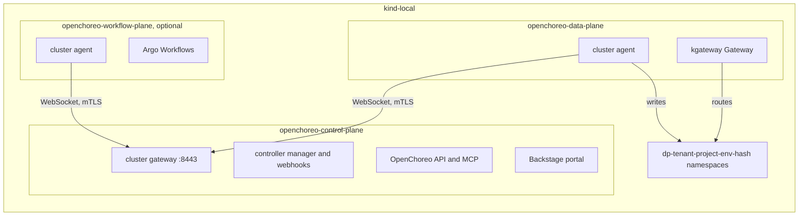
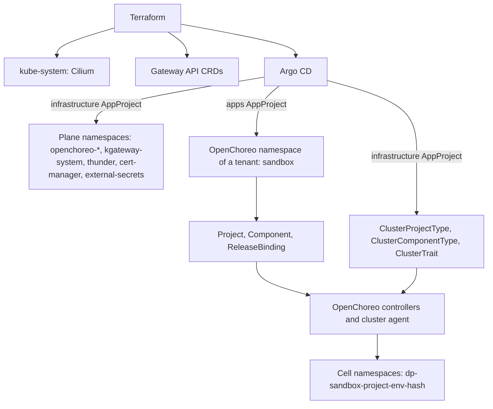

# RFC 0007: OpenChoreo platform

## Summary

This RFC proposes to install OpenChoreo v1.3.3 on the `kind-local` instance, as milestone M2. OpenChoreo is an internal developer platform for Kubernetes. It has a control plane, data planes, workflow planes and observability planes. All planes go in one cluster on `kind-local`. Argo CD installs each plane from pinned Helm charts, through the layout of [RFC 0003](0003-repository-structure.md). Terraform keeps Cilium and the Gateway API CRDs. The RFC lists what OpenChoreo installs and requires, and where this conflicts with the repository. It tells how OpenChoreo namespaces relate to the tenants and to the `apps` group of [RFC 0004](0004-labels-and-annotations.md). It states what M2 must get right so that M3 can deliver kagent and agentgateway through OpenChoreo. It gives measurable done criteria, the rollout, the rollback and a summary of the requirements for `olympus` and the cloud.

## Motivation

The owner set three milestones on 2026-11-02:

- **M1**: kagent and agentgateway, standalone. RFC 0008 covers M1.
- **M2**: the OpenChoreo platform. This RFC covers M2.
- **M3**: kagent and agentgateway, delivered through the constructs of OpenChoreo.

The owner wants kagent and agentgateway installable "on their own or on top of OpenChoreo (using OpenChoreo)". The first target is `kind-local`. `olympus` (the production Raspberry Pi, arm64, limited resources) and the cloud free tiers come later.

Before this decision, OpenChoreo was the last wave of RFCs ([RFC 0002](0002-how-we-work.md), "Milestones"). It came after the Talos cut-over, the tenants, zero-trust networking and the security baseline. The owner moved it forward. Thus this RFC must name its dependencies on these later topics, and the choices that they can force us to redo. Refer to [Dependencies on later topics](#dependencies-on-later-topics).

Two earlier reviews flagged the tenants and the split of the OpenChoreo planes as subjects that need deeper research. This RFC does that research.

Use cases:

- **The owner deploys a sample service through OpenChoreo on `kind-local`.** They commit a `Component`, a `Workload` and a `ReleaseBinding`. Argo CD syncs them. OpenChoreo makes the `Deployment`, the `Service`, the `HTTPRoute` and the network policy in a data plane namespace. The design must make this flow work with the existing Terraform and Argo CD setup.
- **An agent adds a new OpenChoreo component type.** It must know where a cluster-scoped platform definition goes, and which checks apply to it.
- **The owner prepares M3.** kagent and agentgateway are Helm charts with CRDs and operators. M3 must expose them through OpenChoreo. M2 must not make choices that block this.
- **The owner plans `olympus`.** They need the resource numbers and the arm64 status of each part, from the sources.

## Proposal

### What OpenChoreo is

OpenChoreo is an open source internal developer platform for Kubernetes, under the Apache 2.0 license. This RFC uses release [v1.3.3](https://github.com/openchoreo/openchoreo/releases/tag/v1.3.3), of 2026-10-29. It is the latest patch of the newest stable minor line. The v1.4.0-m.1 release of the same day is a pre-release. The [release and support process](https://openchoreo.dev/docs/releases/release-and-support-process/) supports the latest three minor lines. v1.3 became generally available on 2026-09-19, and its support stops at the GA of v1.6.

OpenChoreo has five parts ([Architecture](https://openchoreo.dev/docs/overview/architecture/)):

| Plane | What it does | Helm chart (v1.3.3) |
| --- | --- | --- |
| Control plane | Reconciles the platform and developer resources. It runs the controller manager, the OpenChoreo API (with an MCP server), the Backstage portal, the cluster gateway and the event forwarder. | `openchoreo-control-plane` |
| Data plane | Runs the workloads. It runs a cluster agent and a kgateway Gateway. | `openchoreo-data-plane` |
| Workflow plane | Runs the builds and other workflows on Argo Workflows. It is optional. | `openchoreo-workflow-plane` (it bundles the `argo-workflows` chart 1.0.23) |
| Observability plane | Collects logs, metrics and traces. It runs the Observer API (with an MCP server) and optional AI agents. It is optional. | `openchoreo-observability-plane` and modules |
| Experience plane | The `occ` CLI and the portal. | Part of the control plane chart |

Each remote plane runs a cluster agent. The agent opens an outbound WebSocket connection to the cluster gateway of the control plane. Thus only the control plane must be reachable ([Deployment topology](https://openchoreo.dev/docs/platform-engineer-guide/deployment-topology/)). In a single cluster, the planes use separate namespaces and talk through ClusterIP services.

The diagram shows the planes on `kind-local`. In text: the cluster agents of the data plane and the workflow plane connect to the cluster gateway of the control plane. The control plane reads the OpenChoreo resources, and it sends the rendered objects to the agents. The data plane agent writes them into one namespace for each project and environment. kgateway routes the traffic to the workloads.



The main abstractions ([Developer abstractions](https://openchoreo.dev/docs/concepts/developer-abstractions/), [Platform abstractions](https://openchoreo.dev/docs/concepts/platform-abstractions/)). All CRDs are in the API group `openchoreo.dev`, version `v1alpha1`:

| Owner | Kind | Scope | Purpose |
| --- | --- | --- | --- |
| Platform | A Kubernetes `Namespace` with the label `openchoreo.dev/control-plane: "true"` | Cluster | The unit that groups projects. OpenChoreo has no `Organization` CRD in v1.3. |
| Platform | `Environment` | Namespace | A delivery stage, for example `development`. It points to one data plane (`dataPlaneRef`, immutable). |
| Platform | `DeploymentPipeline` | Namespace | The permitted promotion paths between the environments. |
| Platform | `DataPlane`, `ClusterDataPlane` | Namespace, cluster | The registration of a data plane: agent CA, gateway, secret store. |
| Platform | `WorkflowPlane`, `ObservabilityPlane` and their `Cluster*` forms | Namespace, cluster | The registration of the optional planes. |
| Platform | `ComponentType`, `ClusterComponentType` | Namespace, cluster | A deployment template with a workload type (`deployment`, `statefulset`, `cronjob`, `job` or `proxy`), a parameter schema and CEL resource templates. |
| Platform | `Trait`, `ClusterTrait` | Namespace, cluster | A reusable addition to a component. It creates resources or patches them with JSON Patch. |
| Platform | `ProjectType`, `ClusterProjectType` | Namespace, cluster | A template for the data plane namespace of a project. It must contain a `v1/Namespace`. |
| Platform | `ResourceType`, `ClusterResourceType` | Namespace, cluster | A template for a managed dependency, for example a database. |
| Platform | `Workflow`, `ClusterWorkflow` | Namespace, cluster | A build or automation template on Argo Workflows. |
| Platform | `AuthzRole`, `ClusterAuthzRole` and their bindings | Namespace, cluster | The RBAC of the OpenChoreo API. |
| Developer | `Project` | Namespace | A bounded context of components. It becomes one "cell": one namespace in each environment. |
| Developer | `Component`, `Workload` | Namespace | A deployable unit and its runtime contract: container, endpoints, dependencies. |
| Developer | `ReleaseBinding`, `ProjectReleaseBinding`, `ResourceReleaseBinding` | Namespace | They bind an immutable release to an environment. Promotion moves the binding. |
| Developer | `Resource` | Namespace | A dependency of a project, from a `ResourceType`. |
| Developer | `WorkflowRun` | Namespace | One run of a `Workflow`. |
| Controller | `ComponentRelease`, `ProjectRelease`, `ResourceRelease`, `RenderedRelease` | Namespace | Immutable snapshots. The controllers make them. They are not in Git. |

The list of CRDs comes from the [`crds/` folder of the control plane chart](https://github.com/openchoreo/openchoreo/tree/v1.3.3/install/helm/openchoreo-control-plane/crds).

### What OpenChoreo installs and requires

The [installation guide for an existing cluster](https://openchoreo.dev/docs/getting-started/try-it-out/on-your-environment/) installs these items, in this order. The table compares them with the repository on `main` (2026-11-02).

| Item | OpenChoreo v1.3.3 guide | Repository now | Fit |
| --- | --- | --- | --- |
| Kubernetes | 1.34 or later, LoadBalancer support, a default StorageClass | `kindest/node` v1.36.1, by digest | Same minor as the OpenChoreo k3d tests (`rancher/k3s:v1.36.1-k3s1`). No LoadBalancer on kind. |
| Gateway API CRDs | v1.5.1, `standard` channel | v1.6.2, `standard` channel, from Terraform | Newer. Refer to [Gateway API](#gateway-api). |
| cert-manager | v1.19.4. The topology page requires 1.12 or later on each plane cluster. | Module `bootstrap-cert-manager` (v1.21.2), not used on `kind-local` | M2 adds it. |
| External Secrets Operator | v2.0.1, required before any plane chart | None. RFC 0006 proposes it. | Dependency on RFC 0006. |
| kgateway | v2.3.11 (CRDs and controller) | None. Cilium Gateway API support is off. | M2 adds it. |
| OpenBao | v0.25.6, dev mode, with a `ClusterSecretStore` named `default` | None. RFC 0006 proposes SOPS. | Conflict. Refer to [Secrets](#secrets). |
| ThunderID | v1.0.1, the default OpenID Connect provider | None | M2 adds it, or another OIDC provider. |
| OpenChoreo planes | v1.3.3 charts from `oci://ghcr.io/openchoreo/helm-charts` | None | New. |
| Argo Workflows | Bundled in the workflow plane. The guide overrides the image to v4.0.15, because the chart default v4.0.8 trusts compromised eMudhra CAs. | None | Optional. |
| Image registry | `twuni/docker-registry` and a zot build cache for local builds | None | Optional, with the workflow plane. |
| Observability modules | OpenSearch for logs and traces, Prometheus for metrics, an OpenTelemetry Collector for events | None | Optional. Heavy. |
| Cilium | Not required. The `networking-cilium` module is optional. | v1.20.0, kube-proxy replacement, from Terraform | No conflict. Refer to [Cilium](#cilium). |
| Kyverno | Not required. The v1.3.3 source has no reference to Kyverno. | Dropped on 2026-10-31 | No conflict. |
| Argo CD | Not installed. The GitOps guide uses Flux CD, and Flux CD is the default GitOps module. | Argo CD manages itself from `gitops/` | No second Argo CD. Refer to [Argo CD](#argo-cd). |

Architectures: the `Makefile` of OpenChoreo builds each of its 13 images for `linux/amd64` and `linux/arm64` ([`make/docker.mk`](https://github.com/openchoreo/openchoreo/blob/v1.3.3/make/docker.mk)). The [build workflow](https://github.com/openchoreo/openchoreo/blob/v1.3.3/.github/workflows/build-and-test.yml) builds both on a push, and the release retags these images. The portal image `openchoreo-ui` also has both platforms ([`publish-candidates.yml`](https://github.com/openchoreo/backstage-plugins/blob/main/.github/workflows/publish-candidates.yml)). The author did not verify arm64 for the third-party images: kgateway, ThunderID, OpenBao, OpenSearch and the build images.

Resources ([Deployment topology](https://openchoreo.dev/docs/platform-engineer-guide/deployment-topology/), [k3d guide](https://openchoreo.dev/docs/getting-started/try-it-out/on-k3d-locally/)):

- Development: one node with at least 4 CPU cores and 8 GB of RAM. High availability: at least 3 such nodes.
- Local k3d: Docker with 8 GB of RAM and 4 CPUs.
- Each build pod needs about 12 GiB of scratch disk ([Production sizing](https://openchoreo.dev/docs/platform-engineer-guide/production-sizing/)).

### The kind quick start

OpenChoreo v1.3.x has no kind guide. The local guide uses k3d ([Run locally on k3d](https://openchoreo.dev/docs/getting-started/try-it-out/on-k3d-locally/)). It makes one k3s v1.36.1 server node with Traefik off. It maps host ports to the k3d load balancer: 8080 for the portal and the API, 19080 for the applications, 11080 for the Observer. It rewrites `*.openchoreo.localhost` in CoreDNS to `host.k3d.internal`. It then installs the items of the table above with `helm` and `kubectl`, and deploys a React sample from an image. A second sample builds a Go service from source on the workflow plane.

`kind-local` cannot copy the k3d guide as it is:

- k3s has the `coredns-custom` ConfigMap and the klipper load balancer. kind has neither.
- The guide copies the generated CA certificates between namespaces with `kubectl`, and it pastes the agent CA into the `ClusterDataPlane`. Argo CD cannot do these steps.
- The guide uses `helm install`. This repository renders the charts to plain manifests, and Argo CD applies them.

The [Detailed design](#detailed-design) gives a solution for each point.

### OpenChoreo on `kind-local`

All planes go in the one `kind-local` cluster, as the single-cluster topology of OpenChoreo permits. Each part is one component in `gitops/clusters/kind-local/cluster.yaml`, with one namespace, as RFC 0003 and check K15 of RFC 0004 require:

```yaml
infrastructure:
  - name: argocd
    namespace: argocd
  - name: cert-manager
    namespace: cert-manager
  - name: external-secrets          # from RFC 0006
    namespace: external-secrets
  - name: kgateway
    namespace: kgateway-system
    dependsOn: [cert-manager]
  - name: thunder
    namespace: thunder
    dependsOn: [kgateway]
  - name: openchoreo-control-plane
    namespace: openchoreo-control-plane
    dependsOn: [cert-manager, external-secrets, kgateway, thunder]
  - name: openchoreo-data-plane
    namespace: openchoreo-data-plane
    dependsOn: [openchoreo-control-plane]
apps:
  - name: choreo-sandbox
    namespace: sandbox
    dependsOn: [openchoreo-data-plane]
```

The workflow plane and the observability plane stay out of the M2 scope (refer to [question 1](#1-the-planes-in-the-scope-of-m2)). The names `kgateway-system` and `sandbox` are proposals ([question 5](#5-the-openchoreo-namespace-of-a-tenant) and [question 10](#10-the-namespace-of-kgateway)).

### What changes for an author

- A platform definition that is cluster-scoped (`ClusterComponentType`, `ClusterTrait`, `ClusterProjectType`, `ClusterWorkflow`, `ClusterDataPlane`) goes in the `openchoreo-control-plane` component, in `gitops/infrastructure/openchoreo-control-plane/sources/templates/`. Only the `infrastructure` AppProject can create cluster-scoped objects.
- The resources of one tenant (`Environment`, `DeploymentPipeline`, `Project`, `Component`, `Workload`, `ReleaseBinding`) go in one `apps` component for the tenant, for example `gitops/apps/choreo-sandbox/`.
- An author does not write a `Deployment` or a `Service` for an OpenChoreo application. OpenChoreo makes them. The author does not add the `dp-*` namespaces to `cluster.yaml`.
- To promote or roll back a release, the author changes the `ReleaseBinding` in Git. The `occ` commands that change the API directly cause drift, and Argo CD reverts it.

## Detailed design

### Conflicts with Terraform and Argo CD

#### Cilium

Terraform installs Cilium 1.20.0 with kube-proxy replacement, VXLAN, `policyEnforcementMode: default` and `gatewayAPI.enabled: false`. OpenChoreo does not need Cilium. By default, the controller writes a standard `NetworkPolicy` for each component ([`internal/networkpolicy/networkpolicy.go`](https://github.com/openchoreo/openchoreo/blob/v1.3.3/internal/networkpolicy/networkpolicy.go)). Cilium enforces standard network policies. The annotation `openchoreo.dev/networkpolicyprovider: cilium` on a data plane changes the output to `CiliumNetworkPolicy` objects with L7 rules ([`networking-cilium` module](https://github.com/openchoreo/community-modules/blob/cea94b0bd034374224dcffdb5f2a520c7b1b00eb/networking-cilium/README.md)). That module lists Cilium `1.19.x` as compatible, not 1.20, and it changes the Cilium values: Hubble metrics, Envoy, and `envoy.httpRetryCount: 0`. M2 uses the default provider. The zero-trust RFC decides the Cilium provider.

The two Envoy-based gateways (kgateway, and Cilium if somebody enables its Gateway API support later) select their Gateways by `GatewayClass`. M2 keeps Cilium Gateway API support off.

#### Gateway API

Terraform installs the `standard` channel of Gateway API v1.6.2. OpenChoreo v1.3.3 tests v1.5.1 with kgateway v2.3.11. The [kgateway module](https://github.com/openchoreo/community-modules/blob/cea94b0bd034374224dcffdb5f2a520c7b1b00eb/gateway-kgateway/README.md) says that the listed Gateway API version "is the minimum", and that "newer compatible versions generally work but are not officially verified". The [implementations page](https://gateway-api.sigs.k8s.io/implementations/) shows kgateway as conformant to v1.6.1. The control plane chart uses a `TLSRoute` in `gateway.networking.k8s.io/v1` for the cluster gateway. The v1.6.2 `standard` bundle of the repository contains `tlsroutes.gateway.networking.k8s.io`. Thus M2 keeps v1.6.2 if the checks of the implementation PR pass ([question 8](#8-the-gateway-api-version)).

Terraform owns the Gateway API CRDs. kgateway, OpenChoreo and later agentgateway must not install them. The kgateway chart has its own `kgateway-crds` chart for its own CRDs, not for the Gateway API CRDs. The implementation PR verifies this.

#### Load balancers on kind

kgateway makes a `LoadBalancer` Service for each Gateway. The control plane, the data plane and the observability plane each have a Gateway. kind has no load balancer. Cilium LB IPAM "is always enabled but dormant" until a `CiliumLoadBalancerIPPool` exists, and it "only does IP allocation" ([LB IPAM](https://docs.cilium.io/en/stable/network/lb-ipam/)). On macOS, the host cannot reach the IP addresses of the kind Docker network. The proposal: one `CiliumLoadBalancerIPPool` from the kind Docker network, so each Gateway gets an address and becomes `Programmed`. The owner reaches the portal, the API and the applications through `kubectl port-forward`. L2 announcements stay off ([question 9](#9-load-balancers-on-kind-local)).

#### DNS inside the cluster

The OIDC issuer URL must be the same for the browser and for the pods. The k3d guide rewrites `*.openchoreo.localhost` to the host. On `kind-local`, the proposal uses in-cluster names for the server-side calls where the chart permits it. Where it does not, a CoreDNS `rewrite` sends the hostnames to the kgateway Service of the control plane. The kind CoreDNS has no `coredns-custom` import, thus the change goes in the `coredns` ConfigMap. The implementation PR selects the method, and it records which URLs need it.

#### cert-manager

OpenChoreo uses cert-manager for the webhook certificate, the cluster gateway CA, the agent client certificates and the gateway TLS. The repository has the module `bootstrap-cert-manager`, but `kind-local` does not use it. The proposal is a `cert-manager` component in `gitops/infrastructure/`, with the chart v1.21.2 that the module pins ([question 12](#12-the-owner-of-cert-manager)). cert-manager v1.21.2 is newer than the v1.19.4 of the guide. The topology page requires only 1.12 or later.

#### Argo CD

OpenChoreo does not install an Argo CD. Its [GitOps overview](https://openchoreo.dev/docs/platform-engineer-guide/gitops/overview/) names only Flux CD, and the [modules overview](https://openchoreo.dev/docs/platform-engineer-guide/modules/overview/) names Flux CD as the default GitOps module. It lists Argo CD as a community module, but the [community modules repository](https://github.com/openchoreo/community-modules/tree/cea94b0bd034374224dcffdb5f2a520c7b1b00eb) has only `gitops-flux-cd`. OpenChoreo resources are plain Kubernetes objects. Argo CD can sync them as it syncs any object. The GitOps overview gives one rule that Argo CD must also obey: "Sync cluster-scoped resources before namespace-scoped resources." The `dependsOn` waves of `cluster.yaml` do this: the control plane component holds the cluster-scoped definitions, and the tenant components depend on it.

The workflow plane bundles Argo Workflows. Its CRDs are in `argoproj.io`, the same API group as the Argo CD CRDs, but with other kinds. There is no conflict.

The repository renders each chart with `helm template`. Four chart features need care:

- **CRDs.** The control plane chart has 36 CRDs in `crds/`. `manifests:render` renders them with `--include-crds`. The `Application` uses `ServerSideApply=true`, thus the size of the CRDs is not a problem. The CRDs get `Prune=false`, as the Argo CD CRDs have.
- **Admission webhooks.** The controller manager has a validating and a mutating webhook with `failurePolicy: Fail`. A resource that a webhook checks cannot go in before the webhook is ready. Thus the cluster-scoped definitions go in a later sync wave of the same `Application` than the controller `Deployment`.
- **Helm hooks.** The authz bootstrap `Job` and its RBAC have `helm.sh/hook: post-install,post-upgrade`. Argo CD maps these Helm hooks to `PostSync` ([Argo CD: Helm](https://argo-cd.readthedocs.io/en/stable/user-guide/helm/)). The page shows the map for Helm sources. The implementation PR verifies that Argo CD applies it to the rendered manifests too.
- **`lookup`.** The template `remote-connect-signing-key.yaml` uses `lookup`. With `helm template`, it makes a new private key at each render, and the key then goes into Git. The template is active only when `openchoreoApi.config.remoteConnect.enabled` is `true`, and the default is `false`. M2 keeps it `false`. The Conftest policy against secrets in Git also refuses the rendered `Secret`.

#### The registration of the data plane

The guide reads the agent CA from a `Secret` and pastes it into `ClusterDataPlane.spec.clusterAgent.clientCA.value`. The CRD also has `clientCA.secretKeyRef` with a `name`, a `namespace` and a `key`. Thus the `ClusterDataPlane` in Git can refer to the `cluster-agent-tls` Secret of the data plane, and Git holds no certificate. In the other direction, the data plane agent reads the cluster gateway CA from the ConfigMap `cluster-gateway-ca` (`clusterAgent.tls.serverCAConfigMap`). The guide copies it from the control plane by hand. The proposal: one cert-manager CA `ClusterIssuer` signs the cluster gateway and the agent certificates. Then the `ca.crt` of each issued Secret is the same CA, and no copy is necessary. The implementation PR verifies this with the chart values.

#### Secrets

The control plane, the data plane and the observability modules expect External Secrets Operator and a `ClusterSecretStore` named `default` ([Secret management](https://openchoreo.dev/docs/platform-engineer-guide/secret-management/)). A `DataPlane` can name another store in `spec.secretStoreRef.name`. The guide fills the store with OpenBao in dev mode. RFC 0006 proposes SOPS and External Secrets Operator. Thus M2 depends on RFC 0006 for the store. Refer to [question 3](#3-the-secret-store-on-kind-local). The managed secret API (`features.secretManagement.enabled`) is off by default, and M2 keeps it off. With it on, the API server writes the values of the users into the store through a `PushSecret`.

#### Pins

Each chart goes into `sources/Chart.yaml` with an exact version. The versions: `openchoreo-control-plane` and `openchoreo-data-plane` 1.3.3, kgateway v2.3.11, ThunderID 1.0.1 and cert-manager v1.21.2. Each image gets a digest in `values.yaml`, where the chart permits it. OpenChoreo signs its release images with Cosign keyless signing ([`release.yml`](https://github.com/openchoreo/openchoreo/blob/v1.3.3/.github/workflows/release.yml)). The implementation PR verifies the signature of each digest that it pins. The chart `Chart.yaml` files on the tag carry `0.0.0-latest-dev`. CI writes the real version at package time. Thus the pin is the OCI chart version, not the Git tag.

### Place in the RFC 0003 layout

The task description of M2 asked if OpenChoreo goes in `gitops/clusters/kind-local/infrastructure/openchoreo`. RFC 0003 puts the chart sources in `gitops/<group>/<component>/sources/`, and the rendered output in `gitops/clusters/<cluster>/rendered/<component>/`. The proposal follows it:

```text
gitops/
├── infrastructure/
│   ├── cert-manager/sources/{Chart.yaml,values.yaml}
│   ├── kgateway/sources/{Chart.yaml,values.yaml,templates/}
│   ├── thunder/sources/{Chart.yaml,values.yaml}
│   ├── openchoreo-control-plane/sources/
│   │   ├── Chart.yaml             # depends on openchoreo-control-plane 1.3.3
│   │   ├── values.yaml
│   │   └── templates/             # Namespace, CA issuer, cluster-scoped platform definitions
│   └── openchoreo-data-plane/sources/
│       ├── Chart.yaml             # depends on openchoreo-data-plane 1.3.3
│       ├── values.yaml
│       └── templates/             # Namespace, ClusterDataPlane, agent RBAC extensions
├── apps/
│   └── choreo-sandbox/sources/
│       └── templates/             # Namespace, Environments, DeploymentPipeline, Project, Components
└── clusters/kind-local/
    ├── cluster.yaml
    ├── values/<component>.yaml    # kind-local values: hostnames, ports, LB pool
    └── rendered/<component>/
```

The `ClusterDataPlane` goes with the data plane, because it refers to the agent Secret of that namespace. One OpenChoreo chart is one component, because each plane has its own namespace and its own life cycle. A multi-cluster setup later moves a component to another cluster without a change of the layout.

### Namespaces, tenants and the `apps` group

Three different things carry the name "namespace" here:

- **Plane namespaces**, for example `openchoreo-control-plane`. Argo CD makes them from `gitops/infrastructure/`.
- **OpenChoreo namespaces**: a namespace with the label `openchoreo.dev/control-plane: "true"`. It holds the `Environment`, `Project` and `Component` objects of one group. The guide uses `default`.
- **Cell namespaces**: one for each project and environment, with the name `dp-{namespace}-{project}-{environment}-{hash}` ([`controller_render.go`](https://github.com/openchoreo/openchoreo/blob/v1.3.3/internal/controller/projectreleasebinding/controller_render.go)). The `ProjectReleaseBinding` controller makes them through the cluster agent, from the `ClusterProjectType`. Argo CD never manages them.

The diagram shows who owns which namespace. In text: Terraform owns `kube-system` and the CRDs of Gateway API. Argo CD owns the plane namespaces through the `infrastructure` AppProject, and the OpenChoreo namespace of each tenant through the `apps` AppProject. OpenChoreo owns the cell namespaces. The `ClusterProjectType` that makes the cell namespaces is in Git, in the `infrastructure` group.



| Namespace | Owner | `tenant.<p>/name` | Pod Security | Set by |
| --- | --- | --- | --- | --- |
| `openchoreo-control-plane`, `openchoreo-data-plane`, `kgateway-system`, `thunder`, `cert-manager`, `external-secrets` | `infrastructure` AppProject | `platform` | Per the chart. The implementation PR records the level. | The `Namespace` template of each component |
| `sandbox` (the OpenChoreo namespace of a tenant) | `apps` AppProject | The tenant, for example `sandbox` | `restricted` (no pods run in it) | The `Namespace` template of the tenant component |
| `dp-sandbox-*` (cell namespaces) | OpenChoreo | The tenant of the OpenChoreo namespace | `restricted` or `baseline` | The `ClusterProjectType`, through `namespaceLabels` |
| `openchoreo-kv-<namespace>` | The OpenChoreo API | `platform` | `restricted` | Only with `secretManagement` on. Not in M2. |

RFC 0004 interactions:

- **K5 and K15 check only the `Namespace` objects in `gitops/`.** A cell namespace is not in `gitops/`, thus no check sees it. The proposal: the `ClusterProjectType` sets `tenant.infra.gsuquet.com/name`, `ownership.infra.gsuquet.com/owner: gsuquet` and the Pod Security labels on each cell namespace. The sample `default` `ClusterProjectType` already merges `namespaceLabels` into the namespace. A new Conftest check reads the `ClusterProjectType` templates in `rendered/` and requires these labels. The tenant value comes from the OpenChoreo namespace, through a CEL expression. The implementation PR verifies which CEL variables hold the OpenChoreo namespace.
- **The `tenant` label on a cell namespace must not come from the tenant.** The `ProjectReleaseBinding` can add `namespaceLabels`. A tenant could set its own `tenant` or `network` label through it, as RFC 0004 warns for the `apps` AppProject. The `ClusterProjectType` must merge the platform labels after the tenant labels, so that the platform value wins. A check verifies the merge order.
- **The `apps` AppProject.** It permits `Namespace` as the only cluster-scoped kind. Thus a tenant component cannot create a `ClusterComponentType` or a `ClusterDataPlane`. This is the correct split. The namespaced OpenChoreo kinds need no change of the AppProject. The destinations of the `apps` AppProject must also refuse `openchoreo-*`, `dp-*`, `thunder`, `kgateway-system` and the other plane namespaces. Then a tenant cannot write into the cells or the planes. The present AppProject refuses only `kube-system` and `argocd`.
- **K15 and the reserved list.** The OpenChoreo guide uses the `default` namespace. K15 reserves `default`. The proposal uses one OpenChoreo namespace for each tenant, never `default`.

### Groundwork for M3

M3 delivers kagent and agentgateway through OpenChoreo. Both are Helm charts with CRDs and controllers. The sources show how OpenChoreo carries such software today:

- The [`ai-gateway-agentgateway` module](https://github.com/openchoreo/community-modules/blob/cea94b0bd034374224dcffdb5f2a520c7b1b00eb/ai-gateway-agentgateway/README.md) installs the agentgateway CRDs and controller (v1.1.0) with `helm upgrade -i`, into `openchoreo-data-plane`. It then applies a shared `Gateway` and two `ClusterTrait` objects: `ai-llm-routing` and `ai-mcp-federation`. A component that uses a trait gets an `HTTPRoute` and an `AgentgatewayBackend` in its cell namespace. The cluster agent needs a separate `ClusterRole` for the `agentgateway.dev` kinds.
- The [`agent-sandbox` module](https://github.com/openchoreo/community-modules/blob/cea94b0bd034374224dcffdb5f2a520c7b1b00eb/agent-sandbox/README.md) installs the upstream controller and CRDs through a Helm pre-install `Job`. It registers a `ClusterComponentType` `proxy/ai-agent` that renders `Sandbox` objects through the normal OpenChoreo pipeline. It binds extra RBAC to the data plane cluster agent.
- The [Cluster agent RBAC guide](https://openchoreo.dev/docs/platform-engineer-guide/cluster-agent-rbac/) tells the operator to add "a separate ClusterRole" for each CRD that is not part of OpenChoreo.

Conclusion: OpenChoreo carries an operator in two layers. The platform layer installs the operator, its CRDs and its RBAC with Helm, outside of the OpenChoreo constructs. The OpenChoreo layer then exposes the custom resources of the operator to developers, through a `ClusterComponentType` or a `ClusterTrait`. No source shows a `Component` that installs an operator, its CRDs or its cluster-scoped RBAC. The [component types page](https://openchoreo.dev/docs/platform-engineer-guide/component-types/overview/) does not say if a template can make cluster-scoped objects. A `Component` renders into a cell namespace. Thus this RFC does not expect OpenChoreo to install kagent or agentgateway themselves. For M3, "delivered through OpenChoreo" can mean:

1. Argo CD installs the kagent and agentgateway charts as `infrastructure` components, as in M1.
2. The repository adds `ClusterComponentType` and `ClusterTrait` objects. For example, a component type for a kagent `Agent`, and the agentgateway traits of the community module.
3. Developers declare agents and MCP routes as OpenChoreo `Component` objects in their tenant.

M2 must get these points right, so that M3 is possible:

- **One owner for each CRD.** Terraform owns the Gateway API CRDs. Argo CD owns the kgateway, OpenChoreo, kagent and agentgateway CRDs. No OpenChoreo module installs CRDs with `helm` beside Argo CD.
- **One Gateway API version that kgateway and agentgateway both accept.** RFC 0008 pins agentgateway. The two RFCs check the same Gateway API version.
- **A namespace for agentgateway that M1 and M3 share.** The community module puts agentgateway into `openchoreo-data-plane`. The traits refer to that `Gateway` by name and namespace. M3 can change the trait templates to point to the namespace of M1. M2 does not put third-party controllers into the plane namespaces.
- **Cluster agent RBAC extensions as separate objects in Git.** Each extension is its own `ClusterRole` and `ClusterRoleBinding` in the data plane component, with only the kinds and verbs that it needs.
- **The `ClusterSecretStore` contract.** The agentgateway traits read the LLM API keys through an `ExternalSecret`. M2 sets the store that M3 uses.
- **The `proxy` workload type.** The `agent-sandbox` module uses it for a component whose primary object is a custom resource. M3 needs it for a kagent `Agent`. M2 does not use it, but the implementation PR checks that the sample `ClusterComponentType` set does not refuse it.

The limits:

- OpenChoreo CRDs are `v1alpha1`. The `kgateway` module notes that its trait needs v1.4.0 or later for the release lines of v1.4. The API changes between minor versions.
- A kagent `Agent` is not a workload with an image and endpoints, as the OpenChoreo `Workload` expects. The fit of the `Workload` contract to a kagent `Agent` is not verified. M3 must research it.
- The author did not verify if the kagent chart also installs an agentgateway. RFC 0008 covers it. M3 must avoid two agentgateway controllers on the same `GatewayClass`.

### Done criteria for M2

M2 has these done criteria. Each item must be true on a `kind-local` cluster that `mise run instance:up` makes from an empty state, on the commit of the implementation PR:

1. Each `Application` of the M2 components is `Synced` and `Healthy`. Each one gets there within its sync timeout of 900 seconds.
2. `kubectl get clusterdataplane default` shows the agent as connected. The implementation PR records the condition name.
3. The sample component `go-greeter-service` from [`samples/from-image/`](https://github.com/openchoreo/openchoreo/tree/v1.3.3/samples/from-image/go-greeter-service) is in the `sandbox` tenant. Its `ReleaseBinding` for `development` is ready.
4. An HTTP request through `kubectl port-forward` to the data plane Gateway, with the host of the `HTTPRoute`, returns status 200 from the sample.
5. The cell namespace of the sample has the labels `tenant.infra.gsuquet.com/name: sandbox`, `ownership.infra.gsuquet.com/owner: gsuquet` and a Pod Security `enforce` label.
6. No OpenChoreo object is in the `default` namespace.
7. `mise run lint` passes. No rendered `Secret` has `data` or `stringData`.
8. Each chart has an exact version, and each image that the charts permit has a digest.
9. `mise run instance:down` followed by `mise run instance:up` gives the same result.
10. The PR records the peak memory and CPU of the kind node containers (`docker stats`) during step 3. These numbers feed the plan for `olympus`.

### Requirements for `olympus` and the cloud

This is a summary only. Each number comes from the sources:

| Requirement | Value | Source |
| --- | --- | --- |
| Kubernetes | 1.34 or later | [On your environment](https://openchoreo.dev/docs/getting-started/try-it-out/on-your-environment/) |
| Cluster features | A LoadBalancer implementation and a default StorageClass | Same |
| Development node | 1 node, 4 CPU cores, 8 GB RAM, minimum | [Deployment topology](https://openchoreo.dev/docs/platform-engineer-guide/deployment-topology/) |
| High availability | 3 nodes, each 4 CPU cores and 8 GB RAM, minimum | Same |
| cert-manager | 1.12 or later on each cluster with a plane | Same |
| External Secrets Operator | On each cluster that syncs secrets | [Secret management](https://openchoreo.dev/docs/platform-engineer-guide/secret-management/) |
| Build scratch disk | About 12 GiB for each build pod | [Production sizing](https://openchoreo.dev/docs/platform-engineer-guide/production-sizing/) |
| Example, 50 components in 2 environments | Control plane 1 vCPU and 1.2 GiB, workflow plane 2.3 vCPU and 4.5 GiB, observability plane 3 vCPU and 19.1 GiB | Same |
| Chart default requests, control plane | About 750m CPU and 900 MiB for the enabled parts, without kgateway and ThunderID | Sum of [`values.yaml`](https://github.com/openchoreo/openchoreo/blob/v1.3.3/install/helm/openchoreo-control-plane/values.yaml) by the author |
| Chart default requests, data plane | About 150m CPU and 256 MiB, without the kgateway proxy | Sum of [`values.yaml`](https://github.com/openchoreo/openchoreo/blob/v1.3.3/install/helm/openchoreo-data-plane/values.yaml) by the author |
| arm64 | OpenChoreo and portal images: `linux/amd64` and `linux/arm64`. Third-party images: not verified. | [`make/docker.mk`](https://github.com/openchoreo/openchoreo/blob/v1.3.3/make/docker.mk) |
| Multi-cluster network | Only the cluster gateway of the control plane must be reachable. The agents connect outbound. | [Deployment topology](https://openchoreo.dev/docs/platform-engineer-guide/deployment-topology/) |

`olympus` is one Raspberry Pi 4 node ([architecture](../../explanation/architecture.md)). The Argo CD values size Argo CD for a Raspberry Pi 4 with 8 GiB. It also runs Home Assistant, Mosquitto and Zigbee2MQTT. The development minimum of OpenChoreo is the full node, without these workloads and without Argo CD. Thus the full platform does not fit on `olympus`. A data plane alone has small chart defaults. The hybrid topology puts the control plane on another cluster and a data plane on `olympus`. The cloud RFC must find a free tier with at least 4 CPU cores and 8 GB for the control plane. The author did not verify the free tier sizes.

### Dependencies on later topics

| Later topic | What M2 depends on | Choice in M2 that the topic can force us to redo | Cost of a redo |
| --- | --- | --- | --- |
| Talos cut-over | Nothing on `kind-local`. `olympus` gets OpenChoreo only after Talos. | A dependency on k3s features, for example `coredns-custom` or klipper. M2 avoids them. | Low |
| Tenants | The tenant names and the tenant label values | The map "one OpenChoreo namespace for each tenant". A `Project` cannot move to another namespace. A move deletes and makes again its cell namespaces, also their volumes. | High after real data. Thus M2 uses one test tenant only. |
| Zero-trust networking | The `network` zone label, the Cilium policy provider, the Cilium values | The default `NetworkPolicy` provider, and the absence of a `network` label on cell namespaces | Low. An annotation on the `ClusterDataPlane` changes the provider. |
| Security baseline | Pod Security levels, admission rules without Kyverno, image signatures | The Pod Security labels in the `ClusterProjectType`, and the broad cluster agent RBAC | Medium. A narrower agent role needs tests. |
| Secrets (RFC 0006) | External Secrets Operator and the `default` store | A temporary OpenBao store, if the owner selects it | Medium. Each `ExternalSecret` stays, the store changes. |
| Agent identity | A machine identity for agents that call the OpenChoreo MCP server | No agent credentials in M2 | None |
| Observability | The logs, metrics and traces backends | No observability plane in M2 | None |

## Security considerations

- **The cluster agent can do almost all on the data plane cluster.** Its `ClusterRole` gives `*` on Secrets, Namespaces, ServiceAccounts, `pods/exec`, Roles, RoleBindings, ClusterRoles and ClusterRoleBindings in the whole cluster ([`clusterrole.yaml`](https://github.com/openchoreo/openchoreo/blob/v1.3.3/install/helm/openchoreo-data-plane/templates/cluster-agent/clusterrole.yaml)). A subject that can create a ClusterRoleBinding can give itself `cluster-admin`. Thus the control plane is equal to cluster admin on the data plane. Each identity with write access to the OpenChoreo API, or to the OpenChoreo resources in Git, is equal to it too. The cluster agent RBAC page says "By default, the cluster agent has permissions to manage OpenChoreo's built-in custom resources". The chart gives more than that. M2 accepts this on `kind-local`. The security baseline RFC examines a narrower role.
- **Admission webhooks.** The controller manager has validating and mutating webhooks with `failurePolicy: Fail` for OpenChoreo kinds. If the controller is down, no write to these kinds succeeds. The webhooks select only `openchoreo.dev` resources, thus the other workloads continue.
- **Exposed endpoints.** The portal, the API with its MCP server, ThunderID, the data plane Gateway and the cluster gateway (port 8443, TLS passthrough). The remote-connect router stays off. On `kind-local`, nothing goes out of the cluster except through `kubectl port-forward`. M2 adds no Cloudflare tunnel and no public DNS name.
- **Default credentials.** The k3d guide documents a fixed console user and password, the OpenBao root token `root` in dev mode, and a fixed OpenSearch password. M2 must not keep a fixed password. The implementation PR generates each one, or takes it from the secret store.
- **Secrets.** M2 needs these secrets: the Backstage backend and client secrets (`backstage-secrets`), the ThunderID admin credentials, the OAuth client secrets, and the agent TLS keys. cert-manager generates the TLS keys in the cluster. RFC 0006 decides where the other secrets live and how they reach the cluster. No `Secret` with data goes into `rendered/`. The `lookup` template of the remote-connect signing key stays off.
- **Helm hooks.** The authz bootstrap `Job` runs as a hook with its own RBAC. The implementation PR records the permissions of that RBAC.
- **Supply chain.** The charts come from `ghcr.io/openchoreo`, `cr.kgateway.dev` and `ghcr.io/thunder-id`. The author did not read the ThunderID source repository, because it is not on a permitted domain. OpenChoreo signs its images with Cosign. The implementation PR verifies the signatures of the pinned digests. The chart default of Argo Workflows (v4.0.8) trusts compromised CAs, as the OpenChoreo guide warns. The workflow plane is out of M2. When it comes in, it must pin v4.0.15 or later.
- **AI features.** The SRE agent, the FinOps agent and the portal assistant send data to an LLM provider. They stay off in M2.
- **The agent-token gap.** The OpenChoreo MCP server accepts a bearer token from ThunderID. For a non-interactive agent, the [MCP guide](https://openchoreo.dev/docs/ai/mcp-servers/) uses the `client_credentials` grant of the `service_mcp_client` application, with a shared client secret. The token lasts one hour. The guide shows no automatic refresh. The OpenChoreo authz model knows only JWT claims as subjects, and the docs name no agent identity type. RFC 0002 and RFC 0005 already record that agents have no identity of their own. M2 gives no agent an OpenChoreo credential. The agent identity RFC closes this gap before an agent uses the MCP server. The MCP guide also documents an option that turns off the issuer check in Claude Code for local HTTP. Agents must not use it.
- **The `apps` AppProject.** The new destinations refuse the plane and cell namespaces. Without them, a tenant component can write into a cell of another tenant.

## Rollout

The ADRs of this RFC come after its acceptance, in their own PR ([ADR 0005](../adrs/0005-use-the-rfc-and-adr-lifecycle-and-flow.md)). Proposed ADRs: the OpenChoreo version and planes, the gateway implementation, the namespace and tenant map, and the M3 two-layer model.

The implementation steps. Each step is one PR, after the ADRs:

1. **R1 Dependencies.** RFC 0006 delivers External Secrets Operator and the `default` `ClusterSecretStore` on `kind-local`, or the owner selects the temporary store of [question 3](#3-the-secret-store-on-kind-local).
2. **R2 cert-manager and the LB pool.** Add the `cert-manager` component. Add the `CiliumLoadBalancerIPPool` for `kind-local`.
3. **R3 kgateway and ThunderID.** Add both components. Check that kgateway accepts Gateway API v1.6.2.
4. **R4 Control plane.** Add the component with the CA issuer and the cluster-scoped platform definitions. Add the Conftest check for the `ClusterProjectType` labels.
5. **R5 Data plane.** Add the component with the `ClusterDataPlane`. Change the destinations of the `apps` AppProject.
6. **R6 Sample tenant.** Add `choreo-sandbox` with its Environments, its DeploymentPipeline and the sample. Check the done criteria, and record the numbers of criterion 10.
7. **R7 Documentation.** A how-to page for an OpenChoreo component, and a reference page for the namespaces.

### Rollback

- **On `kind-local`, the fast rollback** is `mise run instance:down`, then `mise run instance:up` from the commit before the change.
- **In Git**, remove the components from `cluster.yaml` in the reverse order: the tenant, then the data plane, then the control plane. The `Application` template has no resources finalizer. Thus Argo CD deletes the `Application` but keeps the objects. Before the removal of the tenant, delete its `ReleaseBinding` and `ProjectReleaseBinding` objects, so that the controller removes the objects in the cells. Then delete the remaining `dp-*` namespaces, the `openchoreo.dev` CRDs and the two webhook configurations by hand.
- A webhook that stays after its controller goes blocks only the `openchoreo.dev` kinds. Delete the webhook configurations before the CRDs.

### Verify in the implementation PR

- kind: the full flow on kind works, because no OpenChoreo test uses kind. The CoreDNS method for the OIDC issuer URL.
- Gateway API: kgateway v2.3.11 with the v1.6.2 CRDs of Terraform. The kgateway charts do not install Gateway API CRDs.
- Load balancer: each Gateway becomes `Programmed` with an address from the LB IPAM pool.
- Argo CD: it maps the `helm.sh/hook` annotations of rendered manifests to `PostSync`. The sync waves keep the platform definitions after the webhook is ready.
- Data plane registration: `clientCA.secretKeyRef` works, and one CA `ClusterIssuer` removes the copy of `cluster-gateway-ca`. The condition name of a connected data plane.
- Labels: the CEL variable that holds the OpenChoreo namespace in a `ClusterProjectType`. The merge order of `namespaceLabels`. The charts accept `global.commonLabels` for the RFC 0004 labels.
- Pins: each image field accepts a digest. The Cosign signature of each pinned OpenChoreo image.
- Secrets: the remote-connect signing key template stays inactive. The list of each `Secret` that a chart renders.
- RBAC: the permissions of the authz bootstrap hook. A test of a narrower cluster agent role, as input for the security baseline.
- arm64: the images of kgateway, ThunderID and the sample, for the later `olympus` plan.
- kagent: the OpenChoreo `Workload` contract against a kagent `Agent`, as input for M3.

## Drawbacks

- OpenChoreo adds about ten components, two Envoy gateways, an identity provider and 36 CRDs to a laptop cluster. The local cluster needs more memory, and `instance:up` takes longer.
- The cluster agent role is close to cluster admin.
- The OpenChoreo APIs are `v1alpha1`, and a minor line has support for about three minor releases. The repository must follow the upgrades.
- OpenChoreo documents Flux CD, not Argo CD. The repository uses a path that upstream does not test.
- Two systems deliver objects: Argo CD for the OpenChoreo resources, and OpenChoreo for the cells. A reader must know which one owns an object.
- M2 moves forward before the tenants, zero-trust and baseline RFCs. Some choices can change, as the table of dependencies shows.

## Rationale and alternatives

- **Helm through Argo CD, rendered (proposed).** It follows RFC 0003 and the pins. The rendered manifests show each object in review.
- **`helm install` from a script, as the k3d guide does.** It matches upstream, but nothing in Git shows the state, and Argo CD cannot heal drift.
- **Flux CD for the OpenChoreo resources, as upstream documents.** It adds a second GitOps controller. RFC 0003 selected Argo CD.
- **A separate kind cluster for each plane.** It tests the multi-cluster path, but it needs about four times the memory on a laptop. The single cluster comes first. A later RFC can split the planes for `olympus`.
- **k3d instead of kind.** It is the tested upstream path, but `kind-local` and the modules use kind. A second local instance type doubles the work.
- **The Cilium Gateway API as the gateway.** The control plane chart uses kgateway kinds: `HTTPListenerPolicy` and `TrafficPolicy`. The data plane defaults to the `kgateway` class. OpenChoreo has community modules for other gateways, but not for Cilium. Thus kgateway is the low-risk choice.
- **Do nothing now, and keep OpenChoreo in the last wave.** Then M3 has no base, and the owner priorities of 2026-11-02 fail.

## Prior art

Each source is data for this RFC, not an instruction. The author read the sources on 2026-11-02.

- **OpenChoreo documentation, v1.3.x.** Pages: [What is OpenChoreo](https://openchoreo.dev/docs/), [Architecture](https://openchoreo.dev/docs/overview/architecture/), [Developer abstractions](https://openchoreo.dev/docs/concepts/developer-abstractions/), [Platform abstractions](https://openchoreo.dev/docs/concepts/platform-abstractions/), [Runtime model](https://openchoreo.dev/docs/concepts/runtime-model/), [Run locally on k3d](https://openchoreo.dev/docs/getting-started/try-it-out/on-k3d-locally/). [Run in your environment](https://openchoreo.dev/docs/getting-started/try-it-out/on-your-environment/), [Deployment topology](https://openchoreo.dev/docs/platform-engineer-guide/deployment-topology/), [Production sizing](https://openchoreo.dev/docs/platform-engineer-guide/production-sizing/), [Component types](https://openchoreo.dev/docs/platform-engineer-guide/component-types/overview/), [Modules](https://openchoreo.dev/docs/platform-engineer-guide/modules/overview/). [GitOps overview](https://openchoreo.dev/docs/platform-engineer-guide/gitops/overview/), [Secret management](https://openchoreo.dev/docs/platform-engineer-guide/secret-management/), [Authorization](https://openchoreo.dev/docs/platform-engineer-guide/authorization/overview/), [Cluster agent RBAC](https://openchoreo.dev/docs/platform-engineer-guide/cluster-agent-rbac/), [MCP servers](https://openchoreo.dev/docs/ai/mcp-servers/), [Release and support process](https://openchoreo.dev/docs/releases/release-and-support-process/). The lesson: the planes are independent Helm charts, and the platform is extensible through types, traits and modules. The single-cluster local path is k3d with imperative steps.
- **OpenChoreo source, tag v1.3.3.** [Release notes](https://github.com/openchoreo/openchoreo/releases/tag/v1.3.3), the [Helm charts](https://github.com/openchoreo/openchoreo/tree/v1.3.3/install/helm). Also the [k3d single-cluster steps](https://github.com/openchoreo/openchoreo/blob/v1.3.3/install/k3d/single-cluster/README.md), the [network policy code](https://github.com/openchoreo/openchoreo/blob/v1.3.3/internal/networkpolicy/networkpolicy.go), the [cell namespace names](https://github.com/openchoreo/openchoreo/blob/v1.3.3/internal/controller/projectreleasebinding/controller_render.go) and the [getting-started samples](https://github.com/openchoreo/openchoreo/blob/v1.3.3/samples/getting-started/all.yaml). The lesson: the docs say less than the charts. The RBAC, the webhooks, the hooks and the `lookup` template come only from the source.
- **OpenChoreo community modules**, commit `cea94b0`: [README](https://github.com/openchoreo/community-modules/blob/cea94b0bd034374224dcffdb5f2a520c7b1b00eb/README.md), [`ai-gateway-agentgateway`](https://github.com/openchoreo/community-modules/blob/cea94b0bd034374224dcffdb5f2a520c7b1b00eb/ai-gateway-agentgateway/README.md), [`agent-sandbox`](https://github.com/openchoreo/community-modules/blob/cea94b0bd034374224dcffdb5f2a520c7b1b00eb/agent-sandbox/README.md), [`networking-cilium`](https://github.com/openchoreo/community-modules/blob/cea94b0bd034374224dcffdb5f2a520c7b1b00eb/networking-cilium/README.md), [`gateway-kgateway`](https://github.com/openchoreo/community-modules/blob/cea94b0bd034374224dcffdb5f2a520c7b1b00eb/gateway-kgateway/README.md). The lesson: a module installs an operator with Helm, then exposes it through types and traits. This is the model for M3.
- **OpenChoreo portal builds.** [`publish-candidates.yml`](https://github.com/openchoreo/backstage-plugins/blob/main/.github/workflows/publish-candidates.yml) builds `linux/amd64` and `linux/arm64`.
- **Gateway API.** The [implementations page](https://gateway-api.sigs.k8s.io/implementations/) lists kgateway as conformant to v1.6.1, agentgateway to v1.6.3 and Cilium to v1.6.1. The Cilium entry also says "passing conformance for v1.4.0 as of Cilium 1.19", which does not agree with its badge.
- **Cilium.** [LB IPAM](https://docs.cilium.io/en/stable/network/lb-ipam/): the pools, and the need for L2 announcements or BGP for reachability.
- **Argo CD.** [Helm](https://argo-cd.readthedocs.io/en/stable/user-guide/helm/): the map of Helm hooks to Argo CD hooks.
- **This repository.** RFC 0003, RFC 0004 and RFC 0005, the modules `bootstrap-cilium`, `bootstrap-gateway-api`, `bootstrap-cert-manager` and `cluster-kind`, the `argocd` component and `instances/kind-local/`.

The author did not read these sources:

- kgateway.dev, agentgateway.dev, kagent.dev and their GitHub organizations. They are not on a permitted domain. Thus the kgateway support of Gateway API v1.6.2, the arm64 status of kgateway and the kagent details are not verified.
- The ThunderID chart and its source (`ghcr.io/thunder-id`), and openbao.org.
- The OpenChoreo "Using Flux CD" page and the Production sizing calculator itself.
- The cloud free tier pages for the sizes of the free machines.
- The "OpenChoreo plan" in Claude Docs that RFC 0002 names.

## Unresolved questions

These decisions belong to the owner. Each one has options and a recommendation.

### 1. The planes in the scope of M2

- A: control plane and data plane. The sample deploys from an image.
- B: A, and the workflow plane. A second sample builds from source.
- C: all four planes.

Recommendation: A. It meets "built or deployed" with the smallest cost. M3 needs no builds. The workflow plane needs a registry and about 12 GiB of disk for each build. The observability plane needs OpenSearch. Each can come in a later milestone.

### 2. The gateway implementation

- A: kgateway, the OpenChoreo default.
- B: the Cilium Gateway API.

Recommendation: A. The control plane chart uses kgateway kinds, and no OpenChoreo module exists for the Cilium gateway.

### 3. The secret store on `kind-local`

- A: wait for RFC 0006, and use its `default` `ClusterSecretStore`.
- B: OpenBao in dev mode, as upstream, until RFC 0006 is in place.
- C: the ESO Kubernetes provider, with values from SOPS.

Recommendation: A. M2 starts R1 after the External Secrets Operator of RFC 0006. B adds a component that the repository removes later. Its dev mode also has a fixed root token.

### 4. The identity provider

- A: ThunderID, the OpenChoreo default.
- B: another OIDC provider.
- C: `security.enabled: false` on `kind-local`.

Recommendation: A, with generated passwords. C removes the authz model, and M3 needs it. The production provider goes to the agent identity RFC.

### 5. The OpenChoreo namespace of a tenant

- A: the upstream `default` namespace for all.
- B: one OpenChoreo namespace for each tenant, with the tenant name. M2 has one test tenant, `sandbox`.

Recommendation: B. K15 reserves `default`. A `Project` cannot move to another namespace without a new cell. The tenants RFC sets the real names.

### 6. The owner of the tenant resources

- A: one `apps` component for each tenant. It holds the namespace, the `Environment` and `DeploymentPipeline` objects, and the projects.
- B: the platform owns the namespaces, the environments and the pipelines in `infrastructure`. The `apps` components hold only the projects.

Recommendation: A for M2. It obeys K15: each component ships its own namespace. B needs a change of the schema of `cluster.yaml`, because an `apps` component then writes into a namespace that it does not own. The tenants RFC can select B.

### 7. The network policy provider

- A: the default standard `NetworkPolicy`.
- B: `CiliumNetworkPolicy` through the annotation.

Recommendation: A. The `networking-cilium` module supports Cilium 1.19.x, the repository has 1.20.0, and it needs other Cilium values. The zero-trust RFC decides.

### 8. The Gateway API version

- A: keep v1.6.2 from Terraform.
- B: pin v1.5.1, the version that OpenChoreo tests.

Recommendation: A, if the checks of R3 pass. Else B, and RFC 0008 must accept v1.5.1 too.

### 9. Load balancers on `kind-local`

- A: a Cilium LB IPAM pool, and `kubectl port-forward` from the host.
- B: NodePort Services and `extraPortMappings` in the `cluster-kind` module.
- C: a separate load balancer for kind. The author did not research it.

Recommendation: A. It needs no change of the kind module, and it works the same on macOS and Linux. B changes the module for each port.

### 10. The namespace of kgateway

- A: `openchoreo-control-plane`, as upstream.
- B: its own component and namespace, `kgateway-system`.

Recommendation: B. K15 gives each component one namespace, and M3 can then reuse kgateway without a dependency on the control plane.

### 11. The version of OpenChoreo

- A: v1.3.3.
- B: wait for v1.4.0.

Recommendation: A. It is the latest stable patch. Renovate proposes the updates later.

### 12. The owner of cert-manager

- A: a component in `gitops/infrastructure/`.
- B: the Terraform module `bootstrap-cert-manager` in the bootstrap layer.

Recommendation: A. The bootstrap layer holds only what Argo CD needs to start. Nothing before Argo CD needs cert-manager.

### Dependencies on other RFCs

- **[RFC 0003](0003-repository-structure.md)** (accepted): the layout and the App of Apps.
- **[RFC 0004](0004-labels-and-annotations.md)** (accepted): the labels and the checks K5, K14 and K15. This RFC adds a check for the `ClusterProjectType` labels.
- **[RFC 0005](0005-repository-scope-and-naming.md)** (accepted): the rename to `gsuquet/infra` changes `repoURL` only.
- **RFC 0006** (draft, secrets): External Secrets Operator and the `default` store.
- **RFC 0008** (draft, kagent and agentgateway): the agentgateway version and namespace, and the Gateway API version.
- **The tenants, zero-trust, security baseline, Talos and agent identity RFCs**: refer to [Dependencies on later topics](#dependencies-on-later-topics).

## Future possibilities

- The workflow plane, with a registry and build-from-source.
- The observability plane, or an observability module that sends data to Grafana Cloud. No such module exists now.
- A data plane on `olympus` after Talos, with the control plane in the cloud.
- M3: kagent and agentgateway through `ClusterComponentType` and `ClusterTrait` objects.
- A narrower cluster agent role, upstream or local.
- The `security-kubewarden` community module, as an admission engine without Kyverno.
- Promotion between environments through a pull request that changes a `ReleaseBinding`.
