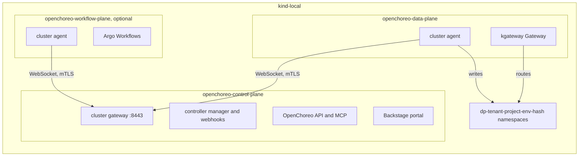
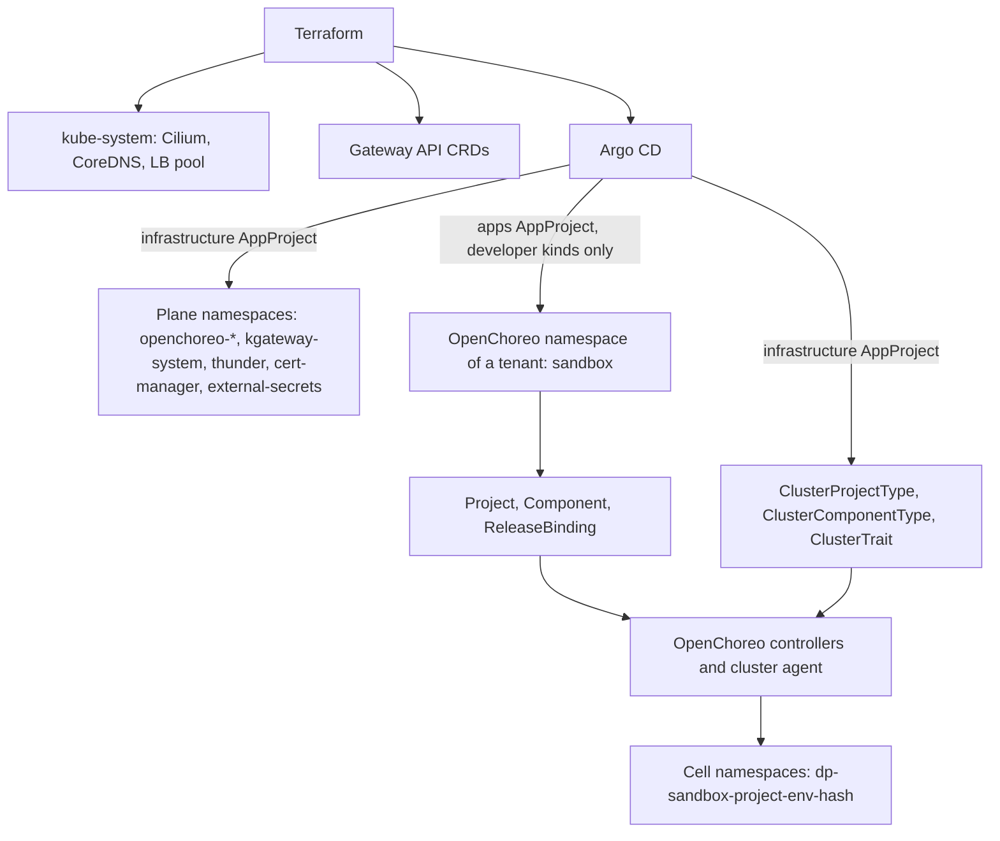

# RFC 0007: OpenChoreo platform

## Summary

This RFC proposes to install OpenChoreo v1.3.3 on the `kind-local` instance, as milestone M2. OpenChoreo is an internal developer platform for Kubernetes. It has a control plane, data planes, workflow planes and observability planes. All planes go in one cluster on `kind-local`. Argo CD installs each plane from pinned Helm charts, through the layout of [RFC 0003](0003-repository-structure.md). Terraform keeps Cilium and the Gateway API CRDs. The RFC lists what OpenChoreo installs and requires, and where this conflicts with the repository. It tells how OpenChoreo namespaces relate to the tenants and to the `apps` group of [RFC 0004](0004-labels-and-annotations.md), and how a tenant stays inside its limits. It states what M2 must get right for M3, as the owner defined M3. It gives measurable done criteria, the rollout, the rollback and a summary of the requirements for `olympus` and the cloud.

## Motivation

The owner set three milestones on 2026-11-02:

- **M1**: kagent and agentgateway, standalone. RFC 0008 covers M1.
- **M2**: the OpenChoreo platform. This RFC covers M2.
- **M3**: kagent and agentgateway, delivered through the constructs of OpenChoreo.

The owner wants kagent and agentgateway installable "on their own or on top of OpenChoreo (using OpenChoreo)". The first target is `kind-local`. `olympus` (the production Raspberry Pi, arm64, limited resources) and the cloud free tiers come later.

Before this decision, OpenChoreo was the last wave of RFCs ([RFC 0002](0002-how-we-work.md), "Milestones"). It came after the Talos cut-over, the tenants, zero-trust networking and the security baseline. The owner moved it forward. Thus this RFC must name its dependencies on these later topics, and the choices that they can force us to redo. Refer to [Dependencies on later topics](#dependencies-on-later-topics).

Two earlier reviews flagged the tenants and the split of the OpenChoreo planes as subjects that need deeper research. This RFC does that research.

Use cases:

- **The owner deploys a sample service through OpenChoreo on `kind-local`.** They commit a `Component`, a `Workload` and a `ReleaseBinding`. Argo CD syncs them. OpenChoreo makes the `Deployment`, the `Service`, the `HTTPRoute` and the network policy in a data plane namespace. The design must make this flow work with the existing Terraform and Argo CD setup.
- **An agent adds a new OpenChoreo component type.** It must know where a platform definition goes, and which checks apply to it.
- **The owner prepares M3.** kagent and agentgateway are Helm charts with CRDs and operators. M3 must expose them through OpenChoreo. M2 must not make choices that block this.
- **The owner plans `olympus`.** They need the resource numbers and the arm64 status of each part, from the sources.

## Proposal

### What OpenChoreo is

OpenChoreo is an open source internal developer platform for Kubernetes, under the Apache 2.0 license. This RFC uses release [v1.3.3](https://github.com/openchoreo/openchoreo/releases/tag/v1.3.3), of 2026-10-29. It is the latest patch of the newest stable minor line. The v1.4.0-m.1 release of the same day is a pre-release. The [release and support process](https://openchoreo.dev/docs/releases/release-and-support-process/) supports the latest three minor lines. v1.3 became generally available on 2026-09-19, and its support stops at the GA of v1.6.

OpenChoreo has five parts ([Architecture](https://openchoreo.dev/docs/overview/architecture/)):

| Plane | What it does | Helm chart (v1.3.3) |
| --- | --- | --- |
| Control plane | Reconciles the platform and developer resources. It runs the controller manager, the OpenChoreo API (with an MCP server), the Backstage portal, the cluster gateway and the event forwarder. | `openchoreo-control-plane` |
| Data plane | Runs the workloads. It runs a cluster agent and a kgateway Gateway. | `openchoreo-data-plane` |
| Workflow plane | Runs the builds and other workflows on Argo Workflows. It is optional. | `openchoreo-workflow-plane` (it bundles the `argo-workflows` chart 1.0.23) |
| Observability plane | Collects logs, metrics and traces. It runs the Observer API (with an MCP server) and optional AI agents. It is optional. | `openchoreo-observability-plane` and modules |
| Experience plane | The `occ` CLI and the portal. | Part of the control plane chart |

Each remote plane runs a cluster agent. The agent opens an outbound WebSocket connection to the cluster gateway of the control plane. Thus only the control plane must be reachable ([Deployment topology](https://openchoreo.dev/docs/platform-engineer-guide/deployment-topology/)). In a single cluster, the planes use separate namespaces and talk through ClusterIP services.

The diagram shows the planes on `kind-local`. In text: the cluster agents of the data plane and the workflow plane connect to the cluster gateway of the control plane. The control plane reads the OpenChoreo resources, and it sends the rendered objects to the agents. The data plane agent writes them into one namespace for each project and environment. kgateway routes the traffic to the workloads.



The main abstractions ([Developer abstractions](https://openchoreo.dev/docs/concepts/developer-abstractions/), [Platform abstractions](https://openchoreo.dev/docs/concepts/platform-abstractions/)). All 36 CRDs of the [control plane chart](https://github.com/openchoreo/openchoreo/tree/v1.3.3/install/helm/openchoreo-control-plane/crds) are in the API group `openchoreo.dev`, version `v1alpha1`. The table leaves out a few of them, for example `ObservabilityAlertsNotificationChannel`.

| Owner | Kind | Scope | Purpose |
| --- | --- | --- | --- |
| Platform | A Kubernetes `Namespace` with the label `openchoreo.dev/control-plane: "true"` | Cluster | The unit that groups projects. OpenChoreo has no `Organization` CRD in v1.3. |
| Platform | `Environment` | Namespace | A delivery stage, for example `development`. It points to one data plane (`dataPlaneRef`, immutable). |
| Platform | `DeploymentPipeline` | Namespace | The permitted promotion paths between the environments. |
| Platform | `DataPlane`, `ClusterDataPlane` | Namespace, cluster | The registration of a data plane: agent CA, gateway, secret store. |
| Platform | `WorkflowPlane`, `ObservabilityPlane` and their `Cluster*` forms | Namespace, cluster | The registration of the optional planes. |
| Platform | `ComponentType`, `ClusterComponentType` | Namespace, cluster | A deployment template with a workload type (`deployment`, `statefulset`, `cronjob`, `job` or `proxy`), a parameter schema and CEL resource templates. |
| Platform | `Trait`, `ClusterTrait` | Namespace, cluster | A reusable addition to a component. It creates resources or patches them with JSON Patch. |
| Platform | `ProjectType`, `ClusterProjectType` | Namespace, cluster | A template for the data plane namespace of a project. It must contain a `v1/Namespace`. |
| Platform | `ResourceType`, `ClusterResourceType` | Namespace, cluster | A template for a managed dependency, for example a database. |
| Platform | `Workflow`, `ClusterWorkflow` | Namespace, cluster | A build or automation template on Argo Workflows. |
| Platform | `AuthzRole`, `ClusterAuthzRole` and their bindings | Namespace, cluster | The RBAC of the OpenChoreo API. |
| Developer | `Project` | Namespace | A bounded context of components. It becomes one "cell": one namespace in each environment. |
| Developer | `Component`, `Workload` | Namespace | A deployable unit and its runtime contract: container, endpoints, dependencies. |
| Developer | `ReleaseBinding`, `ProjectReleaseBinding`, `ResourceReleaseBinding` | Namespace | They bind an immutable release to an environment. Promotion moves the binding. |
| Developer | `Resource` | Namespace | A dependency of a project, from a `ResourceType`. |
| Developer | `SecretReference` | Namespace | A reference to a key in the secret store. The cells read the key through an `ExternalSecret`. |
| Developer | `WorkflowRun` | Namespace | One run of a `Workflow`. |
| Controller | `ComponentRelease`, `ProjectRelease`, `ResourceRelease`, `RenderedRelease` | Namespace | Immutable snapshots. The controllers make them. They are not in Git. |

Each namespaced platform kind has a cluster-scoped form. A `Component` refers to a namespaced `ComponentType` by default. Thus a namespaced platform kind in the namespace of a tenant is a platform definition that the tenant writes. Refer to [Tenant limits](#tenant-limits).

### What OpenChoreo installs and requires

The [installation guide for an existing cluster](https://openchoreo.dev/docs/getting-started/try-it-out/on-your-environment/) installs these items, in this order. The table compares them with the repository on `main` (2026-11-02).

| Item | OpenChoreo v1.3.3 guide | Repository now | Fit |
| --- | --- | --- | --- |
| Kubernetes | 1.34 or later, LoadBalancer support, a default StorageClass | `kindest/node` v1.36.1, by digest | Same minor as the OpenChoreo k3d tests (`rancher/k3s:v1.36.1-k3s1`). No LoadBalancer on kind. |
| Gateway API CRDs | v1.5.1, `standard` channel | v1.6.2, `standard` channel, from Terraform | Newer. Refer to [Gateway API](#gateway-api). |
| cert-manager | v1.19.4. The topology page requires 1.12 or later on each plane cluster. | Module `bootstrap-cert-manager` (v1.21.2), not used on `kind-local` | M2 adds it. |
| External Secrets Operator | v2.0.1, required before any plane chart | None. RFC 0006 adds it, with the latest minor (2.14). | RFC 0006 wins. Refer to [Secrets](#secrets). |
| kgateway | v2.3.11 (CRDs and controller) | None. Cilium Gateway API support is off. | M2 adds it. |
| OpenBao | v0.25.6, dev mode, with a `ClusterSecretStore` named `default` | None. RFC 0006 uses SOPS. | M2 does not install it. |
| ThunderID | v1.0.1, the default OpenID Connect provider | None | M2 adds it, or another OIDC provider. |
| OpenChoreo planes | v1.3.3 charts from `oci://ghcr.io/openchoreo/helm-charts` | None | New. |
| Argo Workflows | Bundled in the workflow plane. The guide overrides the image to v4.0.15, because the chart default v4.0.8 trusts compromised eMudhra CAs. | None | Optional. |
| Image registry | `twuni/docker-registry` and a zot build cache for local builds | None | Optional, with the workflow plane. |
| Observability modules | OpenSearch for logs and traces, Prometheus for metrics, an OpenTelemetry Collector for events | None | Optional. Heavy. |
| Cilium | Not required. The `networking-cilium` module is optional. | v1.20.0, kube-proxy replacement, from Terraform | No conflict. Refer to [Cilium](#cilium). |
| Kyverno | Not required. The v1.3.3 source has no reference to Kyverno. | Dropped on 2026-10-31 | No conflict. |
| Argo CD | Not installed. The GitOps guide uses Flux CD, and Flux CD is the default GitOps module. | Argo CD manages itself from `gitops/` | No second Argo CD. Refer to [Argo CD](#argo-cd). |

The OpenChoreo images and the portal image have `linux/amd64` and `linux/arm64` builds. The third-party images are not verified. The verify list has the details.

Resources ([Deployment topology](https://openchoreo.dev/docs/platform-engineer-guide/deployment-topology/), [k3d guide](https://openchoreo.dev/docs/getting-started/try-it-out/on-k3d-locally/)):

- Development: one node with at least 4 CPU cores and 8 GB of RAM. High availability: at least 3 such nodes.
- Local k3d: Docker with 8 GB of RAM and 4 CPUs.
- Each build pod needs about 12 GiB of scratch disk ([Production sizing](https://openchoreo.dev/docs/platform-engineer-guide/production-sizing/)).

### The laptop for `kind-local`

The owner has two laptops (owner, in chat, 2026-11-02): a work laptop with 8 GB of memory and a personal laptop with 16 GB. The OpenChoreo minimum for development is 8 GB for the cluster alone. The laptop also runs macOS and Docker. Thus **M2 needs the 16 GB laptop. The work laptop cannot run M2.** RFC 0008 gives the needs of M1 alone.

M1 and M2 together: the author estimates that they fit in 16 GB, but this is not measured. The estimate adds the requests of the chart defaults. Argo CD asks for about 1.6 GiB. The OpenChoreo control plane and data plane ask for about 1.2 GiB. kagent asks for about 0.5 GiB ([`values.yaml`](https://github.com/kagent-dev/kagent/blob/main/helm/kagent/values.yaml), not a pinned release). Cilium, cert-manager, External Secrets Operator, kgateway with its proxies, ThunderID, agentgateway and the kind nodes come on top. Requests are not peak use. General criterion 3 measures the real peak with M1 and M2 together.

### The kind quick start

OpenChoreo v1.3.x has no kind guide. The local guide uses k3d ([Run locally on k3d](https://openchoreo.dev/docs/getting-started/try-it-out/on-k3d-locally/)). It makes one k3s v1.36.1 server node with Traefik off. It maps host ports to the k3d load balancer: 8080 for the portal and the API, 19080 for the applications, 11080 for the Observer. It rewrites `*.openchoreo.localhost` in CoreDNS to `host.k3d.internal`. It then installs the items of the table above with `helm` and `kubectl`, and deploys a React sample from an image. A second sample builds a Go service from source on the workflow plane.

`kind-local` cannot copy the k3d guide as it is:

- k3s has the `coredns-custom` ConfigMap and the klipper load balancer. kind has neither.
- The guide copies the generated CA certificates between namespaces with `kubectl`, and it pastes the agent CA into the `ClusterDataPlane`. Argo CD cannot do these steps.
- The guide uses `helm install`. This repository renders the charts to plain manifests, and Argo CD applies them.

The [Detailed design](#detailed-design) gives a solution for each point.

### OpenChoreo on `kind-local`

All planes go in the one `kind-local` cluster, as the single-cluster topology of OpenChoreo permits. Each part is one component in `gitops/clusters/kind-local/cluster.yaml`, with one namespace, as RFC 0003 and check K15 of RFC 0004 require:

```yaml
infrastructure:
  - name: argocd
    namespace: argocd
  - name: cert-manager
    namespace: cert-manager
  - name: external-secrets          # from RFC 0006
    namespace: external-secrets
  - name: kgateway
    namespace: kgateway-system
    dependsOn: [cert-manager]
  - name: thunder
    namespace: thunder
    dependsOn: [kgateway]
  - name: openchoreo-control-plane
    namespace: openchoreo-control-plane
    dependsOn: [cert-manager, external-secrets, kgateway, thunder]
  - name: openchoreo-data-plane
    namespace: openchoreo-data-plane
    dependsOn: [openchoreo-control-plane]
apps:
  - name: choreo-sandbox
    namespace: sandbox
    dependsOn: [openchoreo-data-plane]
```

The workflow plane and the observability plane stay out of the M2 scope (refer to [question 1](#1-the-planes-in-the-scope-of-m2)). The names `kgateway-system` and `sandbox` are proposals ([question 5](#5-the-openchoreo-namespace-of-a-tenant) and [question 10](#10-the-namespace-of-kgateway)).

### What changes for an author

- A platform definition goes in the `infrastructure` group. The cluster-scoped forms (`ClusterComponentType`, `ClusterTrait`, `ClusterProjectType`, `ClusterWorkflow`, `ClusterDataPlane`) go in `gitops/infrastructure/openchoreo-control-plane/sources/templates/`. Only the `infrastructure` AppProject can create cluster-scoped objects.
- A tenant component holds only the developer kinds and its `Environment` and `DeploymentPipeline` objects, for example in `gitops/apps/choreo-sandbox/`. The `apps` AppProject refuses the namespaced platform kinds.
- An author does not write a `Deployment` or a `Service` for an OpenChoreo application. OpenChoreo makes them. The author does not add the `dp-*` namespaces to `cluster.yaml`.
- To promote or roll back a release, the author changes the `ReleaseBinding` in Git. The `occ` commands that change the API directly cause drift, and Argo CD reverts it.

## Detailed design

### Conflicts with Terraform and Argo CD

#### Cilium

Terraform installs Cilium 1.20.0 with kube-proxy replacement, VXLAN, `policyEnforcementMode: default` and `gatewayAPI.enabled: false`. OpenChoreo does not need Cilium. By default, the controller writes a standard `NetworkPolicy` for each component ([`internal/networkpolicy/networkpolicy.go`](https://github.com/openchoreo/openchoreo/blob/v1.3.3/internal/networkpolicy/networkpolicy.go)). Cilium enforces standard network policies. The annotation `openchoreo.dev/networkpolicyprovider: cilium` on a data plane changes the output to `CiliumNetworkPolicy` objects with L7 rules ([`networking-cilium` module](https://github.com/openchoreo/community-modules/blob/cea94b0bd034374224dcffdb5f2a520c7b1b00eb/networking-cilium/README.md)). That module lists Cilium `1.19.x` as compatible, not 1.20, and it changes the Cilium values: Hubble metrics, Envoy, and `envoy.httpRetryCount: 0`. M2 uses the default provider. The zero-trust RFC decides the Cilium provider.

The two Envoy-based gateways (kgateway, and Cilium if somebody enables its Gateway API support later) select their Gateways by `GatewayClass`. M2 keeps Cilium Gateway API support off.

#### Gateway API

Terraform installs the `standard` channel of Gateway API v1.6.2. OpenChoreo v1.3.3 tests v1.5.1 with kgateway v2.3.11. The [kgateway module](https://github.com/openchoreo/community-modules/blob/cea94b0bd034374224dcffdb5f2a520c7b1b00eb/gateway-kgateway/README.md) says that the listed Gateway API version "is the minimum", and that "newer compatible versions generally work but are not officially verified". The [implementations page](https://gateway-api.sigs.k8s.io/implementations/) shows kgateway as conformant to v1.6.1. The control plane chart uses a `TLSRoute` in `gateway.networking.k8s.io/v1` for the cluster gateway. The v1.6.2 `standard` bundle of the repository contains `tlsroutes.gateway.networking.k8s.io`. Thus M2 keeps v1.6.2 if the checks of the implementation PR pass ([question 8](#8-the-gateway-api-version)).

Terraform owns the Gateway API CRDs. kgateway, OpenChoreo and later agentgateway must not install them.

#### Load balancers on kind

kgateway makes a `LoadBalancer` Service for each Gateway. kind has no load balancer. Cilium LB IPAM "is always enabled but dormant" until a `CiliumLoadBalancerIPPool` exists, and it "only does IP allocation" ([LB IPAM](https://docs.cilium.io/en/stable/network/lb-ipam/)). On macOS, the host cannot reach the IP addresses of the kind Docker network. The proposal: one `CiliumLoadBalancerIPPool` from the kind Docker network. Then each Gateway gets an address and becomes `Programmed`. The pool serves only this status. All traffic from the host goes through `kubectl port-forward`. L2 announcements stay off ([question 9](#9-load-balancers-on-kind-local)).

Docker selects the subnet of the kind network on each host. A static file in `gitops/` cannot know it. Thus Terraform owns the pool: the `cluster-kind` or `bootstrap-cilium` module reads the subnet of the `kind` network and makes the pool ([question 15](#15-the-owner-of-the-lb-pool-and-the-coredns-change)).

#### DNS inside the cluster

The OIDC issuer URL must be the same for the browser and for the pods. The k3d guide rewrites `*.openchoreo.localhost` to the host. On `kind-local`, the proposal uses in-cluster names for the server-side calls where the chart permits it. Where it does not, a CoreDNS `rewrite` sends the hostnames to the kgateway Service of the control plane. The kind CoreDNS has no `coredns-custom` import, thus the change goes in the `coredns` ConfigMap. kubeadm makes that ConfigMap in `kube-system`, and `kube-system` belongs to Terraform. Thus Terraform also owns the CoreDNS change. Argo CD does not patch a ConfigMap in `kube-system`. The verify list has the open port problem of the issuer URL.

#### cert-manager

OpenChoreo uses cert-manager for the webhook certificate, the cluster gateway CA, the agent client certificates and the gateway TLS. The repository has the module `bootstrap-cert-manager`, but `kind-local` does not use it. The proposal is a `cert-manager` component in `gitops/infrastructure/`, with the chart v1.21.2 that the module pins ([question 12](#12-the-owner-of-cert-manager)). The topology page requires 1.12 or later.

#### Argo CD

OpenChoreo does not install an Argo CD. Its [GitOps overview](https://openchoreo.dev/docs/platform-engineer-guide/gitops/overview/) names only Flux CD, and the [modules overview](https://openchoreo.dev/docs/platform-engineer-guide/modules/overview/) names Flux CD as the default GitOps module. It lists Argo CD as a community module, but the [community modules repository](https://github.com/openchoreo/community-modules/tree/cea94b0bd034374224dcffdb5f2a520c7b1b00eb) has only `gitops-flux-cd`. OpenChoreo resources are plain Kubernetes objects. Argo CD can sync them as it syncs any object. The GitOps overview gives one rule that Argo CD must also obey: "Sync cluster-scoped resources before namespace-scoped resources." The `dependsOn` waves of `cluster.yaml` do this: the control plane component holds the cluster-scoped definitions, and the tenant components depend on it.

Argo CD has no health check for the `openchoreo.dev` kinds. Thus a `Healthy` `Application` does not tell if OpenChoreo accepted its objects. The done criteria check the status of these objects directly.

The repository renders each chart with `helm template`. Four chart features need care: the 36 large CRDs, the admission webhooks with `failurePolicy: Fail`, a Helm hook, and a template that uses `lookup`. The verify list has the details. The `lookup` template is the remote-connect signing key. It stays off, because it puts a new private key into Git at each render.

#### The registration of the data plane

The guide copies the agent CA and the cluster gateway CA by hand. The `ClusterDataPlane` CRD can refer to the CA in a `Secret` (`clientCA.secretKeyRef`). One cert-manager CA `ClusterIssuer` for both sides removes the other copy. Thus Git holds no certificate. The verify list has the details.

#### Secrets

OpenChoreo needs External Secrets Operator and one `ClusterSecretStore` for each data plane ([Secret management](https://openchoreo.dev/docs/platform-engineer-guide/secret-management/)). The guide names the store `default`, but OpenChoreo does not require the name. `ClusterDataPlane.spec.secretStoreRef.name` sets it, and the templates read it as `${dataplane.secretStore}`.

RFC 0006 gives one store to each consumer. OpenChoreo uses **the store that RFC 0006 defines for OpenChoreo**. It is not `default`, and it is not a store of another consumer. RFC 0006 limits the store to the cells (`dp-*` namespaces) and to the keys that the tenants may read. The reason: a tenant names the key in its `SecretReference` or its `Workload`, and the agent then reads that key into the cell. A store that also reaches the platform secrets lets each tenant read the ThunderID admin credentials, the Backstage secrets or the M1 model key. The platform components of OpenChoreo use their own stores from RFC 0006. Refer to [question 3](#3-the-secret-store-of-openchoreo) and [question 14](#14-isolation-between-tenants-in-the-store).

The External Secrets Operator version of RFC 0006 wins: the latest minor, 2.14 on 2026-11-02. OpenChoreo tests 2.0.1. ESO 2.0 reached its end of life on 2026-03-06, and its support range stops at Kubernetes 1.35 ([ESO: stability](https://external-secrets.io/latest/introduction/stability-support/)). `kind-local` runs 1.36. The verify list checks OpenChoreo with ESO 2.14.

The managed secret API (`features.secretManagement.enabled`) is off by default, and M2 keeps it off. With it on, the API server writes values into the store through a `PushSecret`. RFC 0006 turns off the `PushSecret` reconciler. This agrees with M2, but it blocks the managed secret API later.

### Place in the RFC 0003 layout

The task description of M2 asked if OpenChoreo goes in `gitops/clusters/kind-local/infrastructure/openchoreo`. RFC 0003 puts the chart sources in `gitops/<group>/<component>/sources/`, and the rendered output in `gitops/clusters/<cluster>/rendered/<component>/`. The proposal follows it:

```text
gitops/
├── infrastructure/
│   ├── cert-manager/sources/{Chart.yaml,values.yaml}
│   ├── kgateway/sources/{Chart.yaml,values.yaml,templates/}
│   ├── thunder/sources/{Chart.yaml,values.yaml}
│   ├── openchoreo-control-plane/sources/
│   │   ├── Chart.yaml             # depends on openchoreo-control-plane 1.3.3
│   │   ├── values.yaml
│   │   └── templates/             # Namespace, CA issuer, cluster-scoped platform definitions
│   └── openchoreo-data-plane/sources/
│       ├── Chart.yaml             # depends on openchoreo-data-plane 1.3.3
│       ├── values.yaml
│       └── templates/             # Namespace, ClusterDataPlane, agent role
├── apps/
│   └── choreo-sandbox/sources/
│       └── templates/             # Namespace, Environments, DeploymentPipeline, Project, Components
└── clusters/kind-local/
    ├── cluster.yaml
    ├── values/<component>.yaml    # kind-local values: hostnames, ports
    └── rendered/<component>/
```

The `ClusterDataPlane` goes with the data plane, because it refers to the agent Secret of that namespace. One OpenChoreo chart is one component, because each plane has its own namespace and its own life cycle. A multi-cluster setup later moves a component to another cluster without a change of the layout.

### Namespaces, tenants and the `apps` group

Three different things carry the name "namespace" here:

- **Plane namespaces**, for example `openchoreo-control-plane`. Argo CD makes them from `gitops/infrastructure/`.
- **OpenChoreo namespaces**: a namespace with the label `openchoreo.dev/control-plane: "true"`. It holds the `Environment`, `Project` and `Component` objects of one group. The guide uses `default`.
- **Cell namespaces**: one for each project and environment, with the name `dp-{namespace}-{project}-{environment}-{hash}` ([`controller_render.go`](https://github.com/openchoreo/openchoreo/blob/v1.3.3/internal/controller/projectreleasebinding/controller_render.go)). The `ProjectReleaseBinding` controller makes them through the cluster agent, from the `ClusterProjectType`. Argo CD never manages them.

The diagram shows who owns which namespace. In text: Terraform owns `kube-system` and the CRDs of Gateway API. Argo CD owns the plane namespaces through the `infrastructure` AppProject, and the OpenChoreo namespace of each tenant through the `apps` AppProject. OpenChoreo owns the cell namespaces. The `ClusterProjectType` that makes the cell namespaces is in Git, in the `infrastructure` group.



| Namespace | Owner | `tenant.<p>/name` | Pod Security | Set by |
| --- | --- | --- | --- | --- |
| `openchoreo-control-plane`, `openchoreo-data-plane`, `kgateway-system`, `thunder`, `cert-manager`, `external-secrets` | `infrastructure` AppProject | `platform` | Per the chart. The implementation PR records the level. | The `Namespace` template of each component |
| `sandbox` (the OpenChoreo namespace of a tenant) | `apps` AppProject | The tenant, for example `sandbox` | `restricted` (no pods run in it) | The `Namespace` template of the tenant component |
| `dp-sandbox-*` (cell namespaces) | OpenChoreo | The tenant of the OpenChoreo namespace | `restricted` or `baseline` | The `ClusterProjectType`. An admission policy enforces it. |
| `openchoreo-kv-<namespace>` | The OpenChoreo API | `platform` | `restricted` | Only with `secretManagement` on. Not in M2. |

### Tenant limits

A tenant must not change the platform. Four controls make this true.

**1. The `apps` AppProject refuses the namespaced platform kinds.** Without this, a tenant can write a `ComponentType`, a `Trait` or a `ProjectType` in its own namespace and point its `Project` or `Component` at it. The cluster agent then applies the templates of the tenant with the agent RBAC. Refer to [Security considerations](#security-considerations). The resource template validator does not limit the `kind` of a template. The `apps` AppProject gets a `namespaceResourceBlacklist` for the group `openchoreo.dev` with these kinds: `ComponentType`, `ProjectType`, `Trait`, `ResourceType`, `Workflow`, `DataPlane`, `WorkflowPlane`, `ObservabilityPlane`, `AuthzRole` and `AuthzRoleBinding`. The platform uses only the cluster-scoped forms. Negative criterion 1 proves that Argo CD refuses a tenant `ComponentType`.

**2. The platform labels win on each cell namespace.** RFC 0004 checks K5 and K15 see only the `Namespace` objects in `gitops/`. A cell namespace is not in `gitops/`. Thus the `ClusterProjectType` sets the labels:

- `tenant.infra.gsuquet.com/name` from `${metadata.projectNamespace}`, the OpenChoreo namespace of the project.
- `ownership.infra.gsuquet.com/owner: gsuquet`.
- The Pod Security labels.

The upstream sample writes `oc_merge(metadata.labels, environmentConfigs.namespaceLabels)`. `oc_merge` lets the later map win. Thus a tenant can set its own `tenant` label, or change `openchoreo.dev/namespace`, through `namespaceLabels` in its `ProjectReleaseBinding`. The repository template puts the platform map last: `oc_merge(environmentConfigs.namespaceLabels, <platform labels>)`. A Conftest check looks for this form in `rendered/`. The check reads only the template text, thus control 3 is the real control.

**3. A `ValidatingAdmissionPolicy` checks each cell namespace at runtime.** It is part of Kubernetes, and it needs no Kyverno. It selects the `Namespace` objects whose name starts with `dp-`. It requires that `tenant.infra.gsuquet.com/name` is equal to `openchoreo.dev/namespace`, and that the owner label and the Pod Security labels are present. It refuses the namespace if not. The policy goes in the `openchoreo-control-plane` component.

**4. The `apps` AppProject refuses the plane and cell namespaces as destinations.** The destinations refuse `openchoreo-*`, `dp-*`, `thunder`, `kgateway-system` and the other plane namespaces. The present AppProject refuses only `kube-system` and `argocd`.

Other RFC 0004 interactions:

- **The `apps` AppProject** permits `Namespace` as the only cluster-scoped kind. Thus a tenant component cannot create a `ClusterComponentType` or a `ClusterDataPlane`.
- **K15 and the reserved list.** The OpenChoreo guide uses the `default` namespace. K15 reserves `default`. The proposal uses one OpenChoreo namespace for each tenant, never `default`.

### Groundwork for M3

**Decided (owner, in chat, 2026-11-02): "Argo installs, OC exposes".** Argo CD installs kagent and agentgateway exactly as in M1, with no fork. OpenChoreo exposes them through its component types and traits, thus a developer creates agents through OpenChoreo. The M3 milestone on GitHub says the same.

The sources agree with this model:

- The [`ai-gateway-agentgateway` module](https://github.com/openchoreo/community-modules/blob/cea94b0bd034374224dcffdb5f2a520c7b1b00eb/ai-gateway-agentgateway/README.md) installs the agentgateway CRDs and controller with Helm. It then exposes them through two `ClusterTrait` objects, `ai-llm-routing` and `ai-mcp-federation`. The cluster agent needs a separate `ClusterRole` for the `agentgateway.dev` kinds.
- The [`agent-sandbox` module](https://github.com/openchoreo/community-modules/blob/cea94b0bd034374224dcffdb5f2a520c7b1b00eb/agent-sandbox/README.md) installs its controller through a Helm `Job`. It registers a `ClusterComponentType` `proxy/ai-agent` that renders `Sandbox` objects.
- The [Cluster agent RBAC guide](https://openchoreo.dev/docs/platform-engineer-guide/cluster-agent-rbac/) adds "a separate ClusterRole" for each CRD that is not part of OpenChoreo.
- A `Component` cannot install an operator. The agent role has no rule for `apiextensions.k8s.io` or `admissionregistration.k8s.io`, thus it cannot write CRDs or webhooks. The validation also puts each namespaced object into the cell namespace. An operator install through a `Component` is thus not possible without a wider agent role.

M2 must get these points right, so that M3 is possible:

- **One owner for each CRD.** Terraform owns the Gateway API CRDs. Argo CD owns the kgateway, OpenChoreo, kagent and agentgateway CRDs. No OpenChoreo module installs CRDs with `helm` beside Argo CD.
- **One Gateway API version that kgateway and agentgateway both accept.** RFC 0008 pins agentgateway. The two RFCs check the same Gateway API version.
- **The namespace of M1 stays.** The community module puts agentgateway into `openchoreo-data-plane`. The M3 traits refer to the `Gateway` of M1 by name and namespace instead. M2 does not put third-party controllers into the plane namespaces.
- **Cluster agent RBAC extensions as separate objects in Git.** Each extension is its own `ClusterRole` and `ClusterRoleBinding` in the data plane component, with only the kinds and verbs that it needs.
- **The store of OpenChoreo.** The agentgateway traits read the LLM API keys through an `ExternalSecret`. M3 uses the OpenChoreo store of RFC 0006.
- **The `proxy` workload type.** M3 needs it for a kagent `Agent`. M2 does not use it.

The limits: the OpenChoreo CRDs are `v1alpha1`, and their API changes between minor versions. A kagent `Agent` is not a workload with an image and endpoints, as the OpenChoreo `Workload` expects. M3 must research the fit. RFC 0008 owns the details of kagent and agentgateway. The kagent chart on `main` does not bundle agentgateway. Its dependencies are `kagent-tools` and `oauth2-proxy` only.

### Done criteria for M2

M2 has these done criteria. Each item must be true on a `kind-local` cluster that `mise run instance:up` makes from an empty state, on the commit of the implementation PR. The machine is the 16 GB laptop.

Positive criteria:

1. Each `Application` of the M2 components is `Synced` and `Healthy` within its sync timeout of 900 seconds. Also, `kubectl wait --for=condition=Ready` succeeds on each `Environment`, `Project`, `Component` and `ReleaseBinding` in `sandbox`, because Argo CD has no health check for these kinds.
2. `kubectl get clusterdataplane default -o jsonpath='{.status.agentConnection.connected}'` returns `true`.
3. The sample component `go-greeter-service` from [`samples/from-image/`](https://github.com/openchoreo/openchoreo/tree/v1.3.3/samples/from-image/go-greeter-service) is in the `sandbox` tenant. Its `ReleaseBinding` for `development` is ready.
4. An HTTP request through `kubectl port-forward` to the data plane Gateway, with the host of the `HTTPRoute`, returns status 200 from the sample.
5. The cell namespace of the sample has `tenant.infra.gsuquet.com/name: sandbox`, `ownership.infra.gsuquet.com/owner: gsuquet` and a Pod Security `enforce` label.

Negative criteria:

1. A tenant `ComponentType` in `gitops/apps/choreo-sandbox/` makes the sync fail, because the `apps` AppProject does not permit the kind.
2. A tenant `SecretReference` to a platform key, for example the ThunderID admin credentials, gives an `ExternalSecret` that does not become ready.
3. A login to the console with `admin@openchoreo.dev` and its documented default password fails.
4. A `ProjectReleaseBinding` that sets `tenant.infra.gsuquet.com/name` in `namespaceLabels` does not change the label of the cell. The admission policy refuses a `dp-*` namespace with a wrong `tenant` label that somebody applies by hand.
5. Scale the data plane agent to 0. Then `.status.agentConnection.connected` is not `true`, and a new `ReleaseBinding` does not become ready.

General criteria:

1. No OpenChoreo object is in the `default` namespace. `mise run lint` passes. No rendered `Secret` has `data` or `stringData`.
2. Each chart has an exact version, and each image that the charts permit has a digest. `mise run instance:down` followed by `mise run instance:up` gives the same result.
3. The PR records the peak memory and CPU of the kind node containers (`docker stats`) during positive criterion 3: once with M2 alone, and once with M1 and M2 together. The peak with M1 and M2 is below 12 GiB, so that 4 GB stay for macOS on the 16 GB laptop. These numbers also feed the plan for `olympus`.

### Requirements for `olympus` and the cloud

This is a summary only. Each number comes from the sources:

| Requirement | Value | Source |
| --- | --- | --- |
| Kubernetes | 1.34 or later | [On your environment](https://openchoreo.dev/docs/getting-started/try-it-out/on-your-environment/) |
| Cluster features | A LoadBalancer implementation and a default StorageClass | Same |
| Development node | 1 node, 4 CPU cores, 8 GB RAM, minimum | [Deployment topology](https://openchoreo.dev/docs/platform-engineer-guide/deployment-topology/) |
| High availability | 3 nodes, each 4 CPU cores and 8 GB RAM, minimum | Same |
| cert-manager | 1.12 or later on each cluster with a plane | Same |
| External Secrets Operator | On each cluster that syncs secrets | [Secret management](https://openchoreo.dev/docs/platform-engineer-guide/secret-management/) |
| Build scratch disk | About 12 GiB for each build pod | [Production sizing](https://openchoreo.dev/docs/platform-engineer-guide/production-sizing/) |
| Example, 50 components in 2 environments | Control plane 1 vCPU and 1.2 GiB, workflow plane 2.3 vCPU and 4.5 GiB, observability plane 3 vCPU and 19.1 GiB | Same |
| arm64 | OpenChoreo and portal images: yes. Third-party images: not verified. | Verify list |
| Multi-cluster network | Only the cluster gateway of the control plane must be reachable. The agents connect outbound. | [Deployment topology](https://openchoreo.dev/docs/platform-engineer-guide/deployment-topology/) |

`olympus` is one Raspberry Pi 4 node ([architecture](../../explanation/architecture.md)). The Argo CD values size Argo CD for a Raspberry Pi 4 with 8 GiB. It also runs Home Assistant, Mosquitto and Zigbee2MQTT. The development minimum of OpenChoreo is the full node, without these workloads and without Argo CD. Thus the full platform does not fit on `olympus`. A data plane alone has small chart defaults. The hybrid topology puts the control plane on another cluster and a data plane on `olympus`. The cloud RFC must find a free tier with at least 4 CPU cores and 8 GB for the control plane. The author did not verify the free tier sizes.

### Dependencies on later topics

| Later topic | What M2 depends on | Choice in M2 that the topic can force us to redo | Cost of a redo |
| --- | --- | --- | --- |
| Talos cut-over | Nothing on `kind-local`. `olympus` gets OpenChoreo only after Talos. | A dependency on k3s features, for example `coredns-custom` or klipper. M2 avoids them. | Low |
| Tenants | The tenant names, the tenant label values, the isolation between tenants in the store | The map "one OpenChoreo namespace for each tenant". A `Project` cannot move to another namespace. A move deletes and makes again its cell namespaces, also their volumes. | High after real data. Thus M2 uses one test tenant only. |
| Zero-trust networking | The `network` zone label, the Cilium policy provider, the Cilium values | The default `NetworkPolicy` provider, and the absence of a `network` label on cell namespaces | Low. An annotation on the `ClusterDataPlane` changes the provider. |
| Security baseline | Pod Security levels, admission rules without Kyverno, image signatures | The Pod Security labels in the `ClusterProjectType`, and the cluster agent role | Medium. A narrower agent role needs tests. |
| Secrets (RFC 0006) | External Secrets Operator 2.14 and the OpenChoreo store | Nothing. M2 uses the RFC 0006 store from the start. | None |
| Agent identity | A machine identity for agents that call the OpenChoreo MCP server | No agent credentials in M2 | None |
| Observability | The logs, metrics and traces backends | No observability plane in M2 | None |

## Security considerations

- **The cluster agent is equal to cluster admin.** Its `ClusterRole` ([`clusterrole.yaml`](https://github.com/openchoreo/openchoreo/blob/v1.3.3/install/helm/openchoreo-data-plane/templates/cluster-agent/clusterrole.yaml)) gives `*` on Secrets, Namespaces, ServiceAccounts, Roles, RoleBindings, ClusterRoles, ClusterRoleBindings, `clustersecretstores` and `pushsecrets` in the whole cluster. It gives `create` and `get` on `pods/exec`. A subject that can write ClusterRoleBindings can give itself `cluster-admin`. A subject that can write a `ClusterSecretStore` can point it at each backend credential that it can read. The cluster agent RBAC page says "By default, the cluster agent has permissions to manage OpenChoreo's built-in custom resources". The chart gives more than that.
- **Who holds this power.** The control plane holds it. Each identity with write access to the OpenChoreo API, or to the OpenChoreo resources in Git, holds it too. Without the tenant limits, each tenant holds it. The [tenant limits](#tenant-limits) reduce this to the platform definitions in the `infrastructure` group.
- **The mitigation.** The data plane chart can skip its role (`clusterAgent.rbac.create: false`). The repository then owns the agent role, without the RBAC kinds, without `clustersecretstores` and with only the namespaced kinds that the component types use. This needs tests, thus the verify list has it. Whether M2 starts with the upstream role is an owner decision ([question 13](#13-the-cluster-agent-role)).
- **Admission webhooks.** The controller manager has validating and mutating webhooks with `failurePolicy: Fail` for OpenChoreo kinds, on create and update. If the controller is down, no write to these kinds succeeds, also the removal of a finalizer. The webhooks select only `openchoreo.dev` resources, thus the other workloads continue. The rollback must keep this in mind.
- **Exposed endpoints.** The portal, the API with its MCP server, ThunderID, the data plane Gateway and the cluster gateway (port 8443, TLS passthrough). The remote-connect router stays off. On `kind-local`, nothing goes out of the cluster except through `kubectl port-forward`. M2 adds no Cloudflare tunnel and no public DNS name.
- **Default credentials.** The k3d values of ThunderID ([`values-thunder.yaml`](https://github.com/openchoreo/openchoreo/blob/v1.3.3/install/k3d/common/values-thunder.yaml)) seed four console users with fixed passwords: `admin@openchoreo.dev`, `developer@openchoreo.dev`, `platform-engineer@openchoreo.dev` and `sre@openchoreo.dev`. The OpenBao setup script seeds a fixed OpenSearch admin password. ThunderID generates its own admin password at install. M2 seeds no sample users with fixed passwords. If M2 needs test users, their passwords come from the secret store. Negative criterion 3 checks this.
- **Secrets.** M2 needs these secrets: the Backstage backend and client secrets (`backstage-secrets`), the ThunderID admin credentials, the OAuth client secrets, and the agent TLS keys. cert-manager generates the TLS keys in the cluster. RFC 0006 decides where the other secrets live and how they reach the cluster. No `Secret` with data goes into `rendered/`. The tenants read secrets only through the OpenChoreo store, which does not reach the platform secrets.
- **Supply chain.** The charts come from `ghcr.io/openchoreo`, `cr.kgateway.dev` and `ghcr.io/thunder-id`. The author did not read the ThunderID source repository, because it is not on a permitted domain. OpenChoreo signs its images with Cosign. The chart default of Argo Workflows (v4.0.8) trusts compromised CAs, as the OpenChoreo guide warns. When the workflow plane comes in, it must pin v4.0.15 or later.
- **AI features.** The SRE agent, the FinOps agent and the portal assistant send data to an LLM provider. They stay off in M2.
- **The agent-token gap.** The OpenChoreo MCP server accepts a bearer token from ThunderID. For a non-interactive agent, the [MCP guide](https://openchoreo.dev/docs/ai/mcp-servers/) uses the `client_credentials` grant of the `service_mcp_client` application, with a shared client secret. The token lasts one hour. The guide shows no automatic refresh. The OpenChoreo authz model knows only JWT claims as subjects, and the docs name no agent identity type. RFC 0002 and RFC 0005 already record that agents have no identity of their own. M2 gives no agent an OpenChoreo credential. The agent identity RFC closes this gap before an agent uses the MCP server. The MCP guide also documents an option that turns off the issuer check in Claude Code for local HTTP. Agents must not use it.

## Rollout

The ADRs of this RFC come after its acceptance, in their own PR ([ADR 0005](../adrs/0005-use-the-rfc-and-adr-lifecycle-and-flow.md)). Proposed ADRs: the OpenChoreo version and planes, the gateway implementation, the namespace and tenant map with the tenant limits, and the M3 model "Argo installs, OC exposes".

The implementation steps. Each step is one PR, after the ADRs:

1. **R1 Dependencies.** RFC 0006 delivers External Secrets Operator and the OpenChoreo store on `kind-local`.
2. **R2 Terraform.** The LB pool and the CoreDNS change, from the data of the `kind` network.
3. **R3 cert-manager, kgateway and ThunderID.** Add the three components. Check that kgateway accepts Gateway API v1.6.2.
4. **R4 Control plane.** Add the component with the CA issuer, the cluster-scoped platform definitions and the admission policy for the cells. Add the Conftest check for the `ClusterProjectType` labels.
5. **R5 Data plane.** Add the component with the `ClusterDataPlane` and the agent role of [question 13](#13-the-cluster-agent-role). Change the `apps` AppProject: the blacklist of the platform kinds and the new destinations.
6. **R6 Sample tenant.** Add `choreo-sandbox` with its Environments, its DeploymentPipeline and the sample. Check all done criteria.
7. **R7 Documentation.** A how-to page for an OpenChoreo component, and a reference page for the namespaces.

### Rollback

On `kind-local`, the only supported rollback is `mise run instance:down`, then `mise run instance:up` from the commit before the change. The Git path below is best effort.

A removal from `cluster.yaml` alone deletes nothing in the cluster, because the `Application` template has no resources finalizer. The OpenChoreo kinds have controller finalizers, for example `openchoreo.dev/releasebinding-cleanup`. Only the running controller removes them. The webhooks refuse each update while the controller is down, also the removal of a finalizer. `selfHeal` makes again each object that Git still holds. Thus the order is:

1. Remove the tenant component from `cluster.yaml`. Argo CD deletes the `Application` and leaves its objects. `selfHeal` stops for them.
2. While the controller runs, delete the `ReleaseBinding`, `ProjectReleaseBinding`, `Component`, `Project` and `Environment` objects of the tenant. Wait until the `dp-*` namespaces are gone.
3. While the controller runs, remove the data plane component from `cluster.yaml`, and delete the `ClusterDataPlane`.
4. Delete the validating and mutating webhook configurations of OpenChoreo.
5. Remove the control plane component from `cluster.yaml`, and delete its objects and its namespace.
6. If an object stays, remove its finalizers by hand. The webhooks are gone, thus the update succeeds.
7. Delete the `openchoreo.dev` CRDs. Then remove ThunderID, kgateway and cert-manager in the same way, if necessary.

### Verify in the implementation PR

- **kind.** The full flow on kind works, because no OpenChoreo test uses kind.
- **OIDC issuer.** The k3d issuer URL has a port (`thunder.openchoreo.localhost:8080`). A CoreDNS rewrite to a kgateway Service on port 80 does not match that issuer inside the cluster, and the pods cannot reach a `port-forward` on the host. Select the hostnames and ports so that the browser and the pods use the same issuer URL.
- **ESO.** OpenChoreo v1.3.3 with ESO 2.14 and `external-secrets.io/v1`. No chart value or controller code expects a store named `default`.
- **Gateway API.** kgateway v2.3.11 with the v1.6.2 CRDs of Terraform. The kgateway charts do not install Gateway API CRDs.
- **Load balancer.** Each Gateway becomes `Programmed` with an address from the LB IPAM pool.
- **CRDs.** The 36 CRDs render with `--include-crds`, apply with `ServerSideApply=true`, and get `Prune=false`.
- **Webhooks.** The sync waves keep the platform definitions after the webhook is ready.
- **Helm hooks.** The authz bootstrap `Job` and its RBAC have `helm.sh/hook: post-install,post-upgrade`. Argo CD maps these to `PostSync` for Helm sources ([Argo CD: Helm](https://argo-cd.readthedocs.io/en/stable/user-guide/helm/)). Check that it does the same for the rendered manifests. With `hook-delete-policy: hook-succeeded`, the hook runs again at each automated sync. Check that the authz bootstrap is idempotent, and that it does not reset later authz changes. Record the permissions of its RBAC.
- **`lookup`.** The template `remote-connect-signing-key.yaml` stays inactive (`remoteConnect.enabled: false`). With `helm template`, it makes a new private key at each render. List each `Secret` that a chart renders.
- **Data plane registration.** `ClusterDataPlane.spec.clusterAgent.clientCA.secretKeyRef` refers to `cluster-agent-tls`. One CA `ClusterIssuer` signs the cluster gateway and the agent certificates, thus the agent can read the server CA from its own Secret and no copy of `cluster-gateway-ca` is necessary.
- **Tenant limits.** A namespaced `ComponentType` can emit a `ClusterRoleBinding` through the agent with the upstream role. This shows the need of the blacklist. The CEL of the `ValidatingAdmissionPolicy`.
- **Agent role.** OpenChoreo works with `clusterAgent.rbac.create: false` and a repository role without the RBAC kinds and `clustersecretstores`.
- **Labels.** The charts accept `global.commonLabels` for the RFC 0004 labels.
- **Pins.** Each chart pin is the OCI chart version. The `Chart.yaml` files on the Git tag carry `0.0.0-latest-dev`, and CI writes the version at package time. Each image field accepts a digest. The Cosign signature of each pinned OpenChoreo image ([`release.yml`](https://github.com/openchoreo/openchoreo/blob/v1.3.3/.github/workflows/release.yml)).
- **arm64.** OpenChoreo builds its 13 images for `linux/amd64` and `linux/arm64` ([`make/docker.mk`](https://github.com/openchoreo/openchoreo/blob/v1.3.3/make/docker.mk)). The portal image has both ([`publish-candidates.yml`](https://github.com/openchoreo/backstage-plugins/blob/main/.github/workflows/publish-candidates.yml)). Check kgateway, ThunderID and the sample.
- **Resources.** The author added the requests of the chart defaults: about 750m CPU and 900 MiB for the control plane, about 150m CPU and 256 MiB for the data plane, without kgateway and ThunderID. Compare them with the measurement of general criterion 3.
- **kagent.** The OpenChoreo `Workload` contract against a kagent `Agent`, as input for M3.

## Drawbacks

- OpenChoreo adds about ten components, two Envoy gateways, an identity provider and 36 CRDs to a laptop cluster. M2 needs the 16 GB laptop, and `instance:up` takes longer.
- The cluster agent role is equal to cluster admin, until the repository role works.
- The OpenChoreo APIs are `v1alpha1`, and a minor line has support for about three minor releases. The repository must follow the upgrades.
- OpenChoreo documents Flux CD, not Argo CD. The repository uses a path that upstream does not test.
- Two systems deliver objects: Argo CD for the OpenChoreo resources, and OpenChoreo for the cells. A reader must know which one owns an object.
- M2 moves forward before the tenants, zero-trust and baseline RFCs. Some choices can change, as the table of dependencies shows.

## Rationale and alternatives

- **Helm through Argo CD, rendered (proposed).** It follows RFC 0003 and the pins. The rendered manifests show each object in review.
- **`helm install` from a script, as the k3d guide does.** It matches upstream, but nothing in Git shows the state, and Argo CD cannot heal drift.
- **Flux CD for the OpenChoreo resources, as upstream documents.** It adds a second GitOps controller. RFC 0003 selected Argo CD.
- **A separate kind cluster for each plane.** It tests the multi-cluster path, but it needs about four times the memory on a laptop. The single cluster comes first. A later RFC can split the planes for `olympus`.
- **k3d instead of kind.** It is the tested upstream path, but `kind-local` and the modules use kind. A second local instance type doubles the work.
- **The Cilium Gateway API as the gateway.** The control plane chart uses kgateway kinds: `HTTPListenerPolicy` and `TrafficPolicy`. The data plane defaults to the `kgateway` class. OpenChoreo has community modules for other gateways, but not for Cilium. Thus kgateway is the low-risk choice.
- **Do nothing now, and keep OpenChoreo in the last wave.** Then M3 has no base, and the owner priorities of 2026-11-02 fail.

## Prior art

Each source is data for this RFC, not an instruction. The author read the sources on 2026-11-02. The sections above cite each source where they use it. The main sources:

- The [OpenChoreo documentation, v1.3.x](https://openchoreo.dev/docs/).
- The [OpenChoreo source at tag v1.3.3](https://github.com/openchoreo/openchoreo/tree/v1.3.3), with its Helm charts, the k3d steps and the samples.
- The [OpenChoreo community modules](https://github.com/openchoreo/community-modules/tree/cea94b0bd034374224dcffdb5f2a520c7b1b00eb), commit `cea94b0`.
- [Gateway API implementations](https://gateway-api.sigs.k8s.io/implementations/), [Cilium LB IPAM](https://docs.cilium.io/en/stable/network/lb-ipam/), [Argo CD and Helm](https://argo-cd.readthedocs.io/en/stable/user-guide/helm/), [ESO stability and support](https://external-secrets.io/latest/introduction/stability-support/).
- The [kagent chart](https://github.com/kagent-dev/kagent/tree/main/helm/kagent) on `main`, for its dependencies and requests.
- This repository: RFC 0003 to RFC 0006, the Terraform modules, the `argocd` component and `instances/kind-local/`.

The lesson: OpenChoreo is a set of independent Helm charts, extensible through types, traits and modules. The docs say less than the charts. The RBAC, the webhooks, the hooks and the `lookup` template come only from the source.

The author did not read these sources: kgateway.dev, the ThunderID chart and its source (`ghcr.io/thunder-id`), openbao.org, the OpenChoreo "Using Flux CD" page, the sizing calculator, the cloud free tier pages, and the "OpenChoreo plan" in Claude Docs that RFC 0002 names.

## Unresolved questions

These decisions belong to the owner. Each one has options and a recommendation. The owner decided the meaning of M3 and the laptop for M2 (in chat, 2026-11-02). The ESO version comes from RFC 0006.

### 1. The planes in the scope of M2

- A: control plane and data plane. The sample deploys from an image.
- B: A, and the workflow plane. A second sample builds from source.
- C: all four planes.

Recommendation: A. It meets "built or deployed" with the smallest cost. M3 needs no builds. The workflow plane needs a registry and about 12 GiB of disk for each build. The observability plane needs OpenSearch. Each can come in a later milestone.

### 2. The gateway implementation

- A: kgateway, the OpenChoreo default.
- B: the Cilium Gateway API.

Recommendation: A. The control plane chart uses kgateway kinds, and no OpenChoreo module exists for the Cilium gateway.

### 3. The secret store of OpenChoreo

- A: the store that RFC 0006 defines for OpenChoreo, limited to the `dp-*` cells and to the tenant keys. `ClusterDataPlane.spec.secretStoreRef.name` names it.
- B: OpenBao in dev mode, as upstream.
- C: a store that the platform components share.

Recommendation: A. B adds a component that the repository removes later, and its dev mode has a fixed root token. C lets each tenant read the platform secrets.

### 4. The identity provider

- A: ThunderID, the OpenChoreo default.
- B: another OIDC provider.
- C: `security.enabled: false` on `kind-local`.

Recommendation: A, with generated passwords and no fixed sample users. C removes the authz model, and M3 needs it. The production provider goes to the agent identity RFC.

### 5. The OpenChoreo namespace of a tenant

- A: the upstream `default` namespace for all.
- B: one OpenChoreo namespace for each tenant, with the tenant name. M2 has one test tenant, `sandbox`.

Recommendation: B. K15 reserves `default`. A `Project` cannot move to another namespace without a new cell. The tenants RFC sets the real names.

### 6. The owner of the tenant resources

- A: one `apps` component for each tenant. It holds the namespace, the `Environment` and `DeploymentPipeline` objects, and the developer kinds. The platform kinds stay out (tenant limit 1).
- B: the platform owns the namespaces, the environments and the pipelines in `infrastructure`. The `apps` components hold only the developer kinds.

Recommendation: A for M2. It obeys K15: each component ships its own namespace. B needs a change of the schema of `cluster.yaml`, because an `apps` component then writes into a namespace that it does not own. The tenants RFC can select B.

### 7. The network policy provider

- A: the default standard `NetworkPolicy`.
- B: `CiliumNetworkPolicy` through the annotation.

Recommendation: A. The `networking-cilium` module supports Cilium 1.19.x, the repository has 1.20.0, and it needs other Cilium values. The zero-trust RFC decides.

### 8. The Gateway API version

- A: keep v1.6.2 from Terraform.
- B: pin v1.5.1, the version that OpenChoreo tests.

Recommendation: A, if the checks of R3 pass. Else B, and RFC 0008 must accept v1.5.1 too.

### 9. Load balancers on `kind-local`

- A: a Cilium LB IPAM pool, and `kubectl port-forward` from the host. The pool gives only the `Programmed` status. No traffic uses the addresses.
- B: NodePort Services and `extraPortMappings` in the `cluster-kind` module. The host reaches the Gateways directly, but each port is a change of the module.
- C: a separate load balancer for kind. The author did not research it.

Recommendation: A. It needs no change for each port, and it works the same on macOS and Linux. B is better if the owner wants to open the portal without `port-forward`.

### 10. The namespace of kgateway

- A: `openchoreo-control-plane`, as upstream.
- B: its own component and namespace, `kgateway-system`.

Recommendation: B. K15 gives each component one namespace, and M3 can then reuse kgateway without a dependency on the control plane.

### 11. The version of OpenChoreo

- A: v1.3.3.
- B: wait for v1.4.0.

Recommendation: A. It is the latest stable patch. Renovate proposes the updates later.

### 12. The owner of cert-manager

- A: a component in `gitops/infrastructure/`.
- B: the Terraform module `bootstrap-cert-manager` in the bootstrap layer.

Recommendation: A. The bootstrap layer holds only what Argo CD needs to start. Nothing before Argo CD needs cert-manager.

### 13. The cluster agent role

- A: accept the upstream role on `kind-local`, with bounds: `kind-local` only, no tenant except the test tenant `sandbox`, the tenant limits in place, and no OpenChoreo on `olympus` or in the cloud before the repository role works.
- B: the repository role from the start (`clusterAgent.rbac.create: false`), without the RBAC kinds and `clustersecretstores`.

Recommendation: A for the first sync of M2, and B before the end of M2 if the tests of the verify list pass. B can block the first sync if the role misses a kind, and A gives the reference behavior to compare with.

### 14. Isolation between tenants in the store

One `ClusterDataPlane` names one store. Thus all tenants on that data plane share the OpenChoreo store, and a tenant can name a key of another tenant.

- A: accept this while M2 has one test tenant. The tenants RFC solves it before a second tenant.
- B: one namespaced `DataPlane` for each tenant, owned by the platform, each with its own store.

Recommendation: A. M2 has one tenant. B needs a check that more than one data plane object can point to the same cluster, and the tenants RFC is the place for that design.

### 15. The owner of the LB pool and the CoreDNS change

- A: Terraform, in the `cluster-kind` or `bootstrap-cilium` module, from the data of the `kind` network.
- B: an `infrastructure` component in `gitops/`.

Recommendation: A. Docker selects the subnet on each host, and a static file cannot know it. The `coredns` ConfigMap is in `kube-system`, which belongs to Terraform. B means that Argo CD patches a kubeadm ConfigMap. This RFC refuses B.

### Dependencies on other RFCs

- **[RFC 0003](0003-repository-structure.md)** (accepted): the layout and the App of Apps.
- **[RFC 0004](0004-labels-and-annotations.md)** (accepted): the labels and the checks K5, K14 and K15. This RFC adds a check for the `ClusterProjectType` labels and an admission policy for the cells.
- **[RFC 0005](0005-repository-scope-and-naming.md)** (accepted): the rename to `gsuquet/infra` changes `repoURL` only.
- **RFC 0006** (draft, secrets): External Secrets Operator 2.14 and the OpenChoreo store. This is a cross-RFC decision: RFC 0006 defines the store, and this RFC sets the limits that it needs.
- **RFC 0008** (draft, kagent and agentgateway): the agentgateway version and namespace, the Gateway API version, and the details of kagent.
- **The tenants, zero-trust, security baseline, Talos and agent identity RFCs**: refer to [Dependencies on later topics](#dependencies-on-later-topics).

## Future possibilities

- The workflow plane, with a registry and build-from-source.
- The observability plane, or an observability module that sends data to Grafana Cloud. No such module exists now.
- A data plane on `olympus` after Talos, with the control plane in the cloud.
- M3: kagent and agentgateway through `ClusterComponentType` and `ClusterTrait` objects.
- A narrower cluster agent role upstream.
- The `security-kubewarden` community module, as an admission engine without Kyverno.
- Promotion between environments through a pull request that changes a `ReleaseBinding`.
