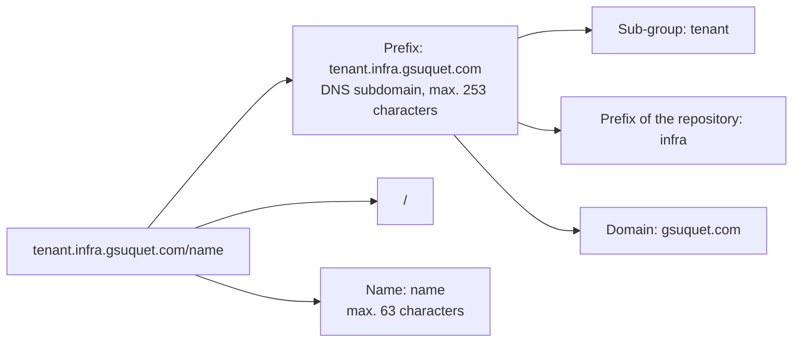
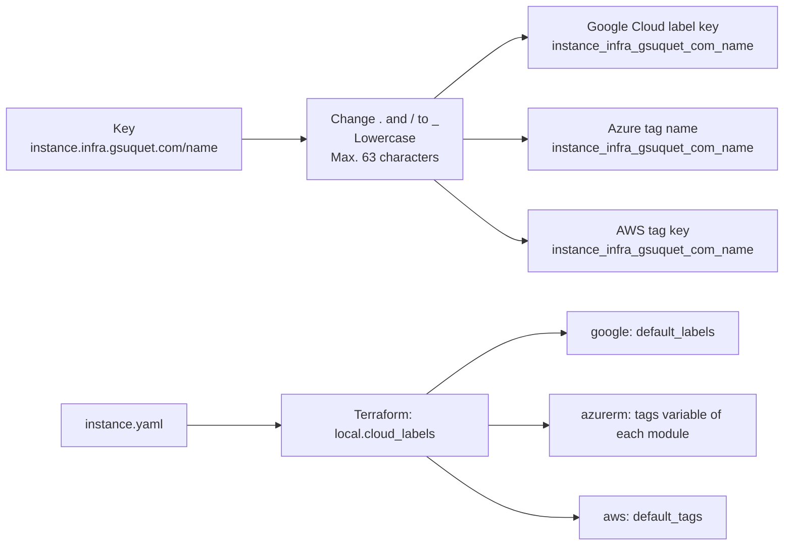
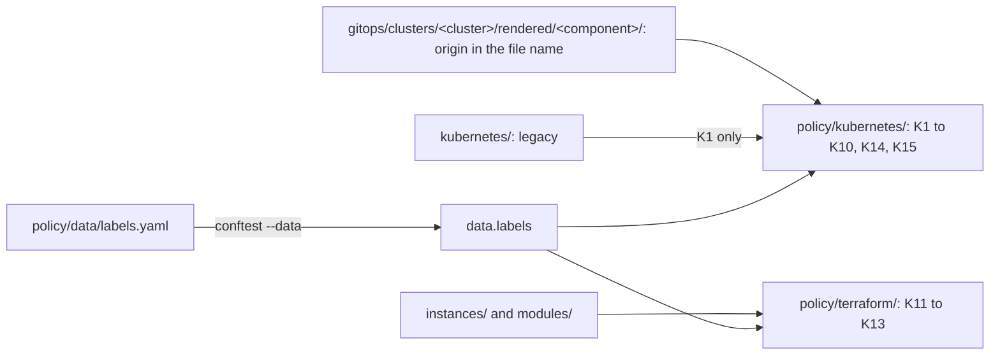

# Labels and annotations

This page lists the rules for the Kubernetes label and annotation keys, the cloud label and tag keys, and their checks. The reasons are in [Labels and annotations (explanation)](../explanation/labels-and-annotations.md). In this page, `
` is the prefix of the repository, `infra.gsuquet.com`.

## Label or annotation

| Need | Use |
| --- | --- |
| A selector, a network policy, a query, a report | A label |
| A setting for a controller, for example Argo CD sync options | An annotation |
| A URL, a contact, a long text, JSON | An annotation |

If no tool and no person selects or queries objects by a key, the key is an annotation. This is the rule of the [Helm best practices](https://helm.sh/docs/chart_best_practices/labels/).

## Anatomy of a key

The diagram shows the parts of a key of the repository. In text: the key `tenant.infra.gsuquet.com/name` has the prefix `tenant.infra.gsuquet.com` and the name `name`. The prefix has three parts: the sub-group `tenant`, the word `infra`, and the domain `gsuquet.com`.

- The keys of the repository have the form `<subgroup>.infra.gsuquet.com/<name>`.
- The API group `infra.gsuquet.com/v1alpha1` of `cluster.yaml`, `instance.yaml` and `module.yaml` does not change.

## Syntax rules

Kubernetes applies the same key rules to labels and to annotations ([labels](https://kubernetes.io/docs/concepts/overview/working-with-objects/labels/), [annotations](https://kubernetes.io/docs/concepts/overview/working-with-objects/annotations/)).

| Part | Rule |
| --- | --- |
| Key prefix | Optional. A DNS subdomain: DNS labels with dots between them, max. 253 characters, then `/`. A DNS subdomain contains only lowercase letters, digits, `-` and `.`, and starts and ends with a letter or a digit ([Kubernetes: names](https://kubernetes.io/docs/concepts/overview/working-with-objects/names/)). |
| Key name | Mandatory. Max. 63 characters. It starts and ends with a letter or a digit (`[a-z0-9A-Z]`). Between them: letters, digits, `-`, `_` and `.`. |
| Reserved prefixes | `kubernetes.io/` and `k8s.io/` are for the Kubernetes core components. |
| Label value | Max. 63 characters, or empty. If not empty, it starts and ends with a letter or a digit. Between them: letters, digits, `-`, `_` and `.`. |
| Annotation value | Any string. The total size of all the annotation keys and values on one object is max. 256 KiB. |
| Type | Keys and values are strings. Quote numbers and booleans in YAML, for example `"-2"` or `"true"`. |

The repository adds two rules for its own keys:

- The key name uses lowercase letters, digits and `-` only. No `_` and no `.`. Thus the mapping to cloud keys has no collision.
- The label values use lowercase letters, digits and `-` only. Thus the values are valid Google Cloud label values too.

## Families of keys

| Family | Prefixes | Defined by | The repository sets it |
| --- | --- | --- | --- |
| Kubernetes core | `kubernetes.io/`, `k8s.io/` and their subdomains, but not `app.kubernetes.io/` | Kubernetes | Only the keys that Kubernetes documents for users, for example the Pod Security labels. Only from the K2 allowlist. |
| Recommended labels | `app.kubernetes.io/` | Shared convention | Yes, in the hand-written charts |
| Tools | `helm.sh/`, `argocd.argoproj.io/`, `cert-manager.io/`, `gateway.networking.k8s.io/`, Cilium keys | The tool | Only the documented settings |
| Repository | `<subgroup>.infra.gsuquet.com/` | This repository | Yes |
| No prefix | None | The user | No. New keys without a prefix are not permitted. |

## Sub-groups of the repository

| Sub-group | Subject | Keys | Type | Reader | Required |
| --- | --- | --- | --- | --- | --- |
| `tenant` | The tenant that owns a namespace | `name` | Label, on `Namespace` only | Network policies, quotas, reports | Now |
| `instance` | The instance that owns a cloud resource | `name`, `purpose`, `lifecycle`, `ttl`, `type` | Label, on cloud resources | Clean-up jobs, cost reports | Now |
| `ownership` | The person or the team to contact | `owner` (label), `contact` (annotation) | Both, on `Namespace` | Persons, alerts | `owner` now. `contact` is optional. |
| `network` | The trust zone and the exposure | `zone`, `exposure` | Label, on `Namespace` only | `CiliumNetworkPolicy`, Conftest | With the zero-trust design |
| `backup` | The backup policy of a volume or a namespace | `policy` (label), `retention` (annotation) | Both | The backup tool | With the backup design |
| `cost` | The cost center | `center` | Label, on cloud resources | Cloud billing reports | With the cost field of `instance.yaml` |

- The sub-group names are singular nouns, as `node`, `topology` and `notice` in Kubernetes and Argo CD.
- `data.labels` defines all six sub-groups now. K4 refuses a wrong key of each sub-group, also before a key is required.
- `network`, `backup` and `cost` become required in the PR that gives their values. That PR adds them to [Required keys](#required-keys) and to `data.labels`.
- The `tenant` and `network` keys go only on a `Namespace`, never on a pod template. Cilium reads the labels of the `Namespace` through `io.cilium.k8s.namespace.labels.*`.
- `ownership.
/owner` has the fixed value `gsuquet`, the GitHub account name.
- The word "lifecycle" has one meaning only: the `lifecycle.type` of `instance.yaml`. No `lifecycle` sub-group exists.

### Instance keys

The instance keys copy or derive the facts of `instances/<name>/instance.yaml`. They add no new facts.

| Key | Source in `instance.yaml` | Values |
| --- | --- | --- |
| `instance.
/name` | `name` | DNS label, max. 40 characters, for example `kind-local` |
| `instance.
/purpose` | `purpose` | `production`, `test`, `demo` |
| `instance.
/lifecycle` | `lifecycle.type` | `long-lived`, `ephemeral` |
| `instance.
/ttl` | `lifecycle.ttl`, only for an ephemeral instance | For example `24h` or `7d` |
| `instance.
/type` | The first module of `layers.cluster.modules`, without `cluster-` | For example `kind`, `talos`, `gke` |

- `type` always tells the cluster distribution. It does not read the `substrate` layer. Its value set is the set of `cluster-*` modules in `modules/`. The schema of `instance.yaml` does not change.
- No end-date label exists. A clean-up job computes the end from `ttl` and the creation time of the cloud resource.

## Required keys

| Kind | Required labels | Required annotations |
| --- | --- | --- |
| `Namespace` in `gitops/` | `pod-security.kubernetes.io/enforce`, `audit` and `warn`. `tenant.
/name`. `ownership.
/owner: gsuquet`. | `argocd.argoproj.io/sync-wave: "-2"` |
| `CustomResourceDefinition` in `gitops/` | None | `argocd.argoproj.io/sync-wave: "-1"` |
| Pod template of a workload in a hand-written chart | `app.kubernetes.io/name`, `app.kubernetes.io/instance`, `app.kubernetes.io/part-of` | None |
| Other objects of a hand-written chart | `app.kubernetes.io/name`, `app.kubernetes.io/instance`, `app.kubernetes.io/managed-by` | None |
| Cloud resource that supports labels or tags | The cloud form of `instance.
/name`, `purpose`, `lifecycle` and `type`. `instance.
/ttl` for an ephemeral instance. | Not applicable |

- The namespaces of the `infrastructure` components use the reserved tenant value `platform`. The namespaces of the `apps` components use the tenant of the component in `data.labels`, and that tenant is not `platform`.
- A Kubernetes object does not need the `instance` keys, because each cluster is one instance. The `tenant` keys go only on a `Namespace`, not on cloud resources.
- A missing key fails the check on a `Namespace` in `gitops/` and on a hand-written object. It gives only a warning on a rendered upstream object.
- The rendered objects keep `app.kubernetes.io/managed-by: Helm`, although Argo CD applies them.

## Recommended labels and Helm labels

| Key | Meaning | Example | Helm | Stable at an upgrade |
| --- | --- | --- | --- | --- |
| `app.kubernetes.io/name` | The name of the application | `argocd-server` | Recommended | Yes |
| `app.kubernetes.io/instance` | A unique name of the instance of the application. Helm uses the release name. | `argocd` | Recommended | Yes |
| `app.kubernetes.io/version` | The version of the application | `v3.5.6` | Optional | No |
| `app.kubernetes.io/component` | The component in the architecture | `server` | Optional | Yes |
| `app.kubernetes.io/part-of` | The higher-level application | `argocd` | Optional | Yes |
| `app.kubernetes.io/managed-by` | The tool that manages the operation of the application | `Helm` | Recommended | Yes |
| `helm.sh/chart` | The chart name and version: `{{ .Chart.Name }}-{{ .Chart.Version }}` | `argo-cd-10.11.6` | Recommended | No |

Sources: [Kubernetes: recommended labels](https://kubernetes.io/docs/concepts/overview/working-with-objects/common-labels/), [Helm: labels and annotations](https://helm.sh/docs/chart_best_practices/labels/).

- The selector of a `Deployment`, a `StatefulSet` or a `DaemonSet` is immutable. A selector uses only stable keys: `app.kubernetes.io/name` and `app.kubernetes.io/instance`. Check K8 refuses `app.kubernetes.io/version` and `helm.sh/chart` in a selector.
- The pod templates keep `app.kubernetes.io/version` and `helm.sh/chart` for now. The zero-trust design decides what to do with them.
- Helm annotations: `helm.sh/hook`, `helm.sh/hook-weight`, `helm.sh/hook-delete-policy` and `helm.sh/resource-policy`. Argo CD maps the Helm hooks to its own hook phases, and `helm.sh/hook-weight` to `argocd.argoproj.io/sync-wave`. When an object has an Argo CD hook, Argo CD ignores all the Helm hooks ([Argo CD: Helm](https://argo-cd.readthedocs.io/en/stable/user-guide/helm/)).

## Argo CD keys

**Tracking.** The setting is `application.resourceTrackingMethod` in the `argocd-cm` ConfigMap ([Argo CD: resource tracking](https://argo-cd.readthedocs.io/en/stable/user-guide/resource_tracking/)).

| Method | Key | Problem |
| --- | --- | --- |
| `label` | `app.kubernetes.io/instance`, or the key in `application.instanceLabelKey` | Max. 63 characters. Helm and operators also write `app.kubernetes.io/instance`, thus Argo CD can find the wrong Application that manages the object. |
| `annotation` | `argocd.argoproj.io/tracking-id`, value `<app>:<group>/<kind>:<namespace>/<name>` | None of the label problems. |
| `annotation+label` | Both | The label is for information only. |

- The repository uses `annotation`, set explicitly. The values of the `argocd` component, `gitops/infrastructure/argocd/sources/values.yaml`, will set `application.resourceTrackingMethod: annotation` in the `configs.cm` values of the chart (#225).
- Since Argo CD 3.0, the default method is `annotation` ([Argo CD: upgrade from 2.14 to 3.0](https://argo-cd.readthedocs.io/en/stable/operator-manual/upgrading/2.14-3.0/)). A change of the method makes Argo CD write new tracking keys at the next sync.
- The legacy Argo CD v3.3.7 in `kubernetes/bootstrap/argo-cd/` sets `application.instanceLabelKey: argocd.argoproj.io/instance`, but no method. It is out of scope. The migration removes it.

**Sync options.** The annotation `argocd.argoproj.io/sync-options` holds a list of options with `,` between them ([Argo CD: sync options](https://argo-cd.readthedocs.io/en/stable/user-guide/sync-options/)).

| Option | Effect | Use in the repository |
| --- | --- | --- |
| `Prune=false` | Argo CD does not prune the object. | The `argocd` Namespace, the Argo CD CRDs, `argocd-secret` |
| `Delete=false` | Argo CD keeps the object when it deletes the `Application`. | The `argocd` Namespace, `argocd-secret` |
| `Prune=confirm`, `Delete=confirm` | A person must confirm the prune or the delete. | None |
| `ServerSideApply=true` | Argo CD uses server-side apply for the object. | The Argo CD CRDs, and each `Application` at the `Application` level |
| `SkipDryRunOnMissingResource=true` | Argo CD skips the dry run when the CRD is not in the cluster yet. | None |
| `Replace=true`, `Force=true` | Argo CD replaces or deletes and creates the object again. These options can destroy data. | None. K10 forbids them. |
| `PruneLast=true` | Argo CD prunes the object at the end of the sync. | None |
| `Validate=false` | Argo CD skips the validation of the object. | None |
| `FailOnSharedResource=true` | Argo CD fails a sync when another `Application` already applied the same object. | Each `Application` (#226) |

**Sync waves and hooks.** The annotation `argocd.argoproj.io/sync-wave` holds an integer as a string. It can be negative. The default is `"0"`. Argo CD sorts by phase, then wave, then kind, then name ([Argo CD: sync waves](https://argo-cd.readthedocs.io/en/stable/user-guide/sync-waves/)). The repository uses `"-2"` for a `Namespace`, `"-1"` for a CRD, `"0"` for the other objects and `"1"` or more for the `Application` objects. The annotation `argocd.argoproj.io/hook` holds the phase of a hook: `PreSync`, `Sync`, `Skip`, `PostSync`, `SyncFail`, `PreDelete` or `PostDelete`.

**Other Argo CD keys.** `argocd.argoproj.io/compare-options`, `argocd.argoproj.io/refresh`, `argocd.argoproj.io/skip-reconcile`, the `link.argocd.argoproj.io/*` and `notice.argocd.argoproj.io/*` annotations, and the label `argocd.argoproj.io/secret-type` on the repository and cluster Secrets.

## Cilium identity

Cilium gives a security identity to each set of pods with the same identity-relevant labels ([Cilium: identity-relevant labels](https://docs.cilium.io/en/stable/operations/performance/scalability/identity-relevant-labels/)). By default, all the labels of a pod are relevant, except a default list of exclusions: `kubernetes.io`, `k8s.io`, `topology.kubernetes.io`, `pod-template-hash`, `controller-revision-hash` and `controller-uid`. The `labels` setting of `cilium-config`, or the `labels` Helm value, adds patterns. A pattern with `!` excludes keys. With one pattern without `!`, Cilium keeps only the matching keys and a default list: `reserved:.*`, `io.kubernetes.pod.namespace`, `io.cilium.k8s.namespace.labels`, `io.cilium.k8s.policy.cluster`, `io.cilium.k8s.policy.serviceaccount` and `app.kubernetes.io`.

A Cilium policy selects pods by their labels, by their namespace (`k8s:io.kubernetes.pod.namespace`), by the labels of their namespace (`io.cilium.k8s.namespace.labels.<key>`) and by their service account (`io.cilium.k8s.policy.serviceaccount`) ([Cilium: Kubernetes policies](https://docs.cilium.io/en/stable/security/policy/kubernetes/)).

| Label on a pod | Stable | Effect on Cilium |
| --- | --- | --- |
| `app.kubernetes.io/name`, `instance`, `component`, `part-of` | Yes | Good for policy selectors. |
| `app.kubernetes.io/version` | No. It changes at each upgrade. | A new identity at each upgrade. Do not select on it. |
| `helm.sh/chart` | No. It changes at each chart upgrade. | A new identity at each chart upgrade. Do not select on it. |
| `tenant.
/name`, `network.
/zone` | Yes | Not on pods. They go on the `Namespace`, and Cilium reads them through `io.cilium.k8s.namespace.labels.*`. |
| `pod-template-hash`, `controller-revision-hash` | No | Excluded by default. |

If the zero-trust design adds an inclusive pattern to the Cilium `labels` setting, it must examine the namespace labels with the custom prefix. Not verified: if the inclusive patterns filter `io.cilium.k8s.namespace.labels.*`.

## Node labels

The NodeRestriction admission plugin lets a kubelet set these labels on its own `Node` object ([Kubernetes: admission controllers](https://kubernetes.io/docs/reference/access-authn-authz/admission-controllers/)):

- `kubernetes.io/hostname`, `kubernetes.io/arch`, `kubernetes.io/os`.
- `beta.kubernetes.io/instance-type`, `node.kubernetes.io/instance-type`.
- `failure-domain.beta.kubernetes.io/region` and `failure-domain.beta.kubernetes.io/zone` (deprecated), `topology.kubernetes.io/region`, `topology.kubernetes.io/zone`.
- The keys with the prefix `kubelet.kubernetes.io/` or `node.kubernetes.io/`.

The plugin forbids two prefixes to kubelets: `node-restriction.kubernetes.io/`, for administrators to label nodes for workload isolation, and `node-role.kubernetes.io/`. It also disallows most other keys under `kubernetes.io` and `k8s.io`.

- A node label for isolation, for example the nodes that can run the internet-facing pods, uses `node-restriction.kubernetes.io/`, not the custom prefix.
- An administrator identity sets it after the node joins, for example `kubectl` or the Terraform `kubernetes` provider. The node configuration does not set it. The Talos `machine.nodeLabels` docs tell that worker nodes cannot set labels with some prefixes ([Talos configuration](https://docs.siderolabs.com/talos/v1.11/reference/configuration/v1alpha1/config)).
- Not verified: the behavior of Kind.

## Other keys of the stack

| Key | Type | Defined by | Use |
| --- | --- | --- | --- |
| `pod-security.kubernetes.io/enforce`, `audit`, `warn` | Label on `Namespace` | Kubernetes | Pod Security level: `privileged`, `baseline` or `restricted`. A check exists. |
| `pod-security.kubernetes.io/enforce-version`, `audit-version`, `warn-version` | Label on `Namespace` | Kubernetes | The version of the Pod Security Standards: `latest` or a Kubernetes minor version. Not used. |
| `kubernetes.io/metadata.name` | Label on `Namespace` | Kubernetes | The API server sets it to the name of the namespace. Network policies select namespaces with it. |
| `kubernetes.io/os` | Node label, used in `nodeSelector` | Kubernetes | The upstream charts select `linux` nodes. |
| `kubectl.kubernetes.io/default-container` | Annotation on a pod | kubectl | The default container for `kubectl logs` and `kubectl exec`. |
| `cert-manager.io/cluster-issuer`, `cert-manager.io/issuer` | Annotation on `Gateway` or `Ingress` | cert-manager | The issuer of the certificate ([cert-manager: annotations](https://cert-manager.io/docs/reference/annotations/)). |
| `gateway.networking.k8s.io/bundle-version`, `gateway.networking.k8s.io/channel` | Annotation on the Gateway API CRDs | Gateway API | The version and the release channel of the CRD bundle ([CRD management guide](https://gateway-api.sigs.k8s.io/guides/crd-management/)). |
| `gateway.networking.k8s.io/policy` | Annotation on the Gateway API policy CRDs | Gateway API | The value in the repository is `Direct`. Information only. |
| `controller-gen.kubebuilder.io/version` | Annotation on CRDs | Kubebuilder | Information only. |
| `io.cilium/app` | Label on Cilium pods | Cilium | Used in the anti-affinity of the Cilium operator. |

## Reference table

| Key | Type | Kinds | Values | Set by | Required | Stable |
| --- | --- | --- | --- | --- | --- | --- |
| `app.kubernetes.io/name` | Label | All | Name of the application | Chart | Yes | Yes |
| `app.kubernetes.io/instance` | Label | All | Release name | Chart | Yes | Yes |
| `app.kubernetes.io/part-of` | Label | All | Higher-level application | Chart | Pod templates | Yes |
| `app.kubernetes.io/component` | Label | All | Role in the architecture | Chart | No | Yes |
| `app.kubernetes.io/managed-by` | Label | All | `Helm` in the rendered objects | Chart | Objects other than pod templates | Yes |
| `app.kubernetes.io/version` | Label | All | Version of the application | Chart | No | No |
| `helm.sh/chart` | Label | All | `<chart>-<version>` | Chart | No | No |
| `pod-security.kubernetes.io/enforce`, `audit`, `warn` | Label | `Namespace` | `privileged`, `baseline`, `restricted` | Repository | Yes | Yes |
| `node-restriction.kubernetes.io/<name>` | Label | `Node` | Lowercase, digits, `-` | An administrator, after the node joins | No | Yes |
| `tenant.
/name` | Label | `Namespace` | The tenant of the component in `data.labels`. `platform` for the `infrastructure` components. | Repository | Yes | Yes |
| `ownership.
/owner` | Label | `Namespace` | `gsuquet` | Repository | Yes | Yes |
| `ownership.
/contact` | Annotation | `Namespace` | An `https://` URL or an address with `@` | Repository | No | Not applicable |
| `network.
/zone` | Label | `Namespace` | From the zero-trust design | Repository | From the zero-trust design | Yes |
| `network.
/exposure` | Label | `Namespace` | From the zero-trust design | Repository | From the zero-trust design | Yes |
| `backup.
/policy` | Label | `Namespace`, `PersistentVolumeClaim` | From the backup design | Repository | From the backup design | Yes |
| `backup.
/retention` | Annotation | `Namespace`, `PersistentVolumeClaim` | From the backup design | Repository | No | Not applicable |
| `cost.
/center` | Label | Cloud resources | Lowercase, digits, `-` | Instance, after the cost field of `instance.yaml` | From that change | Yes |
| `instance.
/name` | Label | Cloud resources | `name` of `instance.yaml` | Instance | Yes | Yes |
| `instance.
/purpose` | Label | Cloud resources | `production`, `test`, `demo` | Instance | Yes | Yes |
| `instance.
/lifecycle` | Label | Cloud resources | `long-lived`, `ephemeral` | Instance | Yes | Yes |
| `instance.
/ttl` | Label | Cloud resources | For example `24h`, `7d` | Instance | Ephemeral instances | Yes |
| `instance.
/type` | Label | Cloud resources | The `cluster-*` module of `instance.yaml`, for example `kind`, `talos`, `gke` | Instance | Yes | Yes |
| `argocd.argoproj.io/sync-wave` | Annotation | All | Integer as a string | Repository | `Namespace`, CRD | Not applicable |
| `argocd.argoproj.io/sync-options` | Annotation | All | Options with `,` between them | Repository | No | Not applicable |
| `argocd.argoproj.io/tracking-id` | Annotation | All | `<app>:<group>/<kind>:<namespace>/<name>` | Argo CD | Not applicable | Not applicable |
| `helm.sh/hook`, `helm.sh/hook-weight`, `helm.sh/hook-delete-policy` | Annotation | Hook objects | Helm values | Chart | No | Not applicable |
| `cert-manager.io/cluster-issuer` | Annotation | `Gateway` | Name of a `ClusterIssuer` | Repository | No | Not applicable |

## Cloud labels and tags

| Rule | Kubernetes label | Google Cloud label | Azure tag | AWS tag |
| --- | --- | --- | --- | --- |
| Max. count on one resource | No limit in the label docs | 64 | 50 (15 on some resource types) | 50 user tags |
| Key length | Prefix 253, name 63 | 1 to 63 | 512 (128 on storage accounts) | 1 to 128 |
| Key characters | Letters, digits, `-`, `_`, `.`, one `/` | Lowercase letters, digits, `_`, `-`, international characters | All except `<`, `>`, `%`, `&`, `\`, `?`, `/` | Letters, digits, spaces and `_ . : / = + - @`. Some services accept fewer characters. |
| Key start | Letter or digit | Lowercase letter or international character | Some types refuse a digit, for example Azure DNS and Traffic Manager | AWS keeps the prefix `aws:` for its own tags |
| Case | Keys and values are case-sensitive | Lowercase only | Names are not case-sensitive in operations, values are case-sensitive | Keys and values are case-sensitive |
| Value length | 63, can be empty | 63, can be empty | 256 | 0 to 256 |
| Value characters | Letters, digits, `-`, `_`, `.` | Lowercase letters, digits, `_`, `-`, international characters | All | The same as the keys |
| Sensitive data | Not for secrets | Do not put sensitive data | Tags are plain text. Do not put sensitive values. | Do not put PII or sensitive data |

Sources: [Google Cloud: labels](https://docs.cloud.google.com/resource-manager/docs/labels-overview), [Azure: tags](https://learn.microsoft.com/en-us/azure/azure-resource-manager/management/tag-resources), [AWS: tagging best practices](https://docs.aws.amazon.com/tag-editor/latest/userguide/best-practices-and-strats.html). Azure Front Door and Traffic Manager refuse `:` and `#`. Azure DNS tag names do not support "special and Unicode characters", and the page does not tell if `_` and `-` are special characters. Azure Automation, Azure Content Delivery Network, Azure public and private DNS (zones and A records) and Log Analytics saved searches accept only 15 tags. Google Cloud Resource Manager tags are out of scope: this page covers only labels.

### The mapping rule

The diagram shows the mapping and how the cloud labels reach the resources. In text: the rule changes `instance.infra.gsuquet.com/name` to `instance_infra_gsuquet_com_name`. Google Cloud, Azure and AWS use the same key. Each instance builds one map of cloud labels from `instance.yaml`. Terraform gives it to `default_labels` on Google Cloud, to the `tags` variables on Azure and to `default_tags` on AWS. The map does not go to the Kubernetes objects.

1. Change each `.` and `/` to `_`.
2. Change all letters to lowercase.
3. The result has a maximum of 63 characters, the limit of Google Cloud. A Conftest check refuses a longer key.
4. The value stays the same. The value rules of the repository already give valid Google Cloud, Azure and AWS values.

| Kubernetes key | Cloud key |
| --- | --- |
| `app.kubernetes.io/part-of` | `app_kubernetes_io_part-of` |
| `instance.infra.gsuquet.com/name` | `instance_infra_gsuquet_com_name` |
| `instance.infra.gsuquet.com/purpose` | `instance_infra_gsuquet_com_purpose` |

- The same cloud key form applies to the Cloudflare and Grafana Cloud tags. On a Cloudflare DNS record, a tag is `<cloud key>:<value>` in `tags`, for example `instance_infra_gsuquet_com_name:olympus`. On a `grafana_cloud_stack`, the key goes in `labels`.
- The rule can give the same cloud key for two keys of other tools, for example `foo.io/bar_baz` and `foo.io.bar/baz`. The keys of the repository have no `_`, no `.` and no uppercase letter in the name, so they do not collide. K13 refuses two keys with the same cloud form in one map.
- The permitted key set of K13 keeps keys with other values, for example `app.kubernetes.io/version` with `2.0.22`, out of the map of cloud labels.

### Terraform

- The root module of each instance builds one map in a local value, for example `local.cloud_labels`, from `yamldecode(file("${path.module}/instance.yaml"))`.
- The map does not go to the Kubernetes objects. The Kubernetes labels come from the chart sources in `gitops/`.

| Provider | Mechanism | Notes |
| --- | --- | --- |
| `hashicorp/google` | `default_labels` in the `provider` block | Applies to each resource with a top-level `labels` field, or a `labels` field in a top-level `metadata` field. A label on the resource overrides the default. The plan shows them in `terraform_labels` and `effective_labels`. The provider also adds `goog-terraform-provisioned = true` by default (`add_terraform_attribution_label`) ([provider reference](https://registry.terraform.io/providers/hashicorp/google/latest/docs/guides/provider_reference)). |
| `hashicorp/azurerm` | None at the provider level | Version 5.12.0 has no default tags ([provider docs](https://registry.terraform.io/providers/hashicorp/azurerm/latest/docs)). Each module takes a `tags` variable and gives it to each resource. Resources do not get the tags of their resource group. Azure Policy can copy them. |
| `hashicorp/aws` | `default_tags { tags = ... }` in the `provider` block | Applies to each resource with `tags`, except `aws_autoscaling_group`. A tag on the resource overrides the default with the same key, but a resource cannot remove a default tag. The read-only attribute `tags_all` shows all the tags. Version 6.71.0 ([provider docs](https://registry.terraform.io/providers/hashicorp/aws/latest/docs), [resource tagging guide](https://registry.terraform.io/providers/hashicorp/aws/latest/docs/guides/resource-tagging)). |
| `hashicorp/kubernetes` | None | `ignore_labels` and `ignore_annotations` ignore keys that other tools add ([provider docs](https://registry.terraform.io/providers/hashicorp/kubernetes/latest/docs)). The modules `bootstrap-cilium` and `bootstrap-cert-manager` have a `common_labels` variable for the chart values. |

On GKE, two sets of labels exist, and they do not share labels ([GKE: cluster labels](https://docs.cloud.google.com/kubernetes-engine/docs/how-to/creating-managing-labels)). The Google Cloud labels of the cluster and the node pools go on the cloud resources. The Kubernetes labels of a node pool go on the `Node` objects, and the Kubernetes rules apply to them.

- GKE copies the cluster labels to the nodes, the Compute Engine instances and the attached persistent disks, once each hour. Thus a label can arrive up to one hour after the VM, and a clean-up job must allow for this delay. GKE does not copy the labels to load balancer rules, IP addresses or disks that are not attached. Node pool labels override the cluster labels.
- `google_container_cluster` puts the provider `default_labels` in `terraform_labels`, with its `resource_labels`.
- `node_config.resource_labels` is a nested field. The provider docs show no `terraform_labels` for it, thus the provider `default_labels` do not reach it. A module sets node pool labels only to override a cluster label, or to stop the delay.

## Checks

The checks are in `policy/kubernetes/kubernetes.rego` and `policy/terraform/terraform.rego`, with a test for each case that must pass and each case that must fail. `policy/data/labels.yaml` holds the reference table: the sub-groups, the keys, their type, their kinds and their permitted values. It also holds the allowlists of K2, K3, K4, K10, K14 and K15, a map from each component to its permitted `tenant` and `network` values, and the required keys of each kind. `conftest --data` loads it as `data.labels`.

The diagram shows the inputs of the checks. In text: `conftest --data` loads `policy/data/labels.yaml` as `data.labels`. The `kubernetes` policies read the objects in `gitops/` and `kubernetes/`, and the `terraform` policies read `instances/` and `modules/`. The render step keeps the origin of each rendered object in its file name.

| Check | Input | Rule | Level |
| --- | --- | --- | --- |
| K1 Syntax | Each object in `gitops/` and `kubernetes/` | Each label key, label value and annotation key matches the syntax rules ([OPA: regex](https://www.openpolicyagent.org/docs/policy-reference/builtins/regex)). | `deny` |
| K2 Reserved prefixes | Hand-written objects in `gitops/` | No key with the prefix `kubernetes.io/`, `k8s.io/` or one of their subdomains, except the allowlist: `app.kubernetes.io/`, the Pod Security labels, `kubernetes.io/metadata.name`, `kubernetes.io/os`, `kubectl.kubernetes.io/default-container`, `node-restriction.kubernetes.io/` and `gateway.networking.k8s.io/` (for hand-written Gateway API objects). | `deny` |
| K3 No prefix | Hand-written objects in `gitops/` | No key without a prefix, except the allowlist. Conftest has no earlier state, so the check refuses all keys without a prefix, not only new keys. | `deny` |
| K3w No prefix in upstream charts | Upstream objects in `gitops/` | The same rule as K3. | `warn` |
| K4 Custom keys | All objects in `gitops/`, with an allowlist for upstream exceptions | Each key with the custom prefix uses one of the six sub-groups and a name from `data.labels`, on a permitted kind, with a permitted value. This also applies to the keys that are not required yet. `tenant` and `network` only on a `Namespace`, with the one `tenant` value and the permitted `network` values of the component. | `deny` |
| K5 Required keys | `Namespace` objects in `gitops/` | The required labels of [Required keys](#required-keys). `tenant.
/name` is `platform` for an `infrastructure` component, and the tenant of the component in `data.labels` for an `apps` component, not `platform`. `ownership.
/owner` is `gsuquet`. | `deny`. Now `warn`, until #224. |
| K6 Required keys of workloads | Hand-written objects and pod templates in `gitops/` | The required `app.kubernetes.io/*` labels. | `deny`. Now `warn`, until #224. |
| K7 Required keys in upstream charts | Rendered upstream objects | The same keys as K6. | `warn` |
| K8 Stable selectors | `spec.selector.matchLabels` of workloads, and `spec.selector` of a `Service` | No `app.kubernetes.io/version` and no `helm.sh/chart`. | `deny` |
| K9 Argo CD tracking | The rendered `argocd-cm` ConfigMap | `application.resourceTrackingMethod` is `annotation`. | `deny`. Now `warn`, until #225. |
| K10 Sync options | All rendered objects and `Application` objects in `gitops/`, with an allowlist for upstream exceptions | No `Replace=true` and no `Force=true`, in `argocd.argoproj.io/sync-options` and in `spec.syncPolicy.syncOptions` of an `Application`. | `deny` |
| K11 Cloud defaults | `provider "google"` and `provider "aws"` blocks and module calls in `instances/` | `default_labels`, `default_tags.tags` and each `tags` argument of a module call are exactly `local.cloud_labels`. A `merge()` that overrides keys fails. | `deny` |
| K12 Cloud tags | `azurerm` resources in `modules/` with a `tags` argument | The argument comes from the `tags` variable of the module. Azure DNS resources can need an exemption. | `deny` |
| K13 Cloud keys | The keys of the `cloud_labels` local in `instances/` | The required cloud keys of `data.labels` are present: the `instance` keys now, and `cost.
/center` after the cost field. Each key is in the permitted set. Each cloud form has max. 63 characters. No two keys have the same cloud form. | `deny` |
| K14 Pod Security of applications | `Namespace` objects of the components in `apps` | `pod-security.kubernetes.io/enforce` is `restricted` or `baseline`, except the allowlist. | `deny` |
| K15 Namespace of a component | All `Namespace` objects in `rendered/<component>/`, and `cluster.yaml` | `metadata.name` is the `namespace` of the component in `cluster.yaml`. Each namespace in `cluster.yaml` is unique. An `apps` namespace is not in the reserved list: `default`, `kube-*`, `argocd` and the namespaces that Terraform creates (now `cert-manager`). A second `Namespace` from an upstream chart needs an allowlist entry. | `deny` |

Rules of the checks:

- The checks of the hand-written objects read the rendered objects in `rendered/<component>/`, because Helm templates are not YAML before they render. The path gives the component, and `cluster.yaml` tells if it is in `infrastructure` or in `apps`.
- The render step keeps the origin of each object in the file name, with the prefix `upstream--`. An object is upstream only when the second segment of its `# Source:` path is `charts`. Thus a hand-written file in `sources/templates/charts/` stays hand-written.
- Git tracks no file in `gitops/*/*/sources/charts/`, and each `dependencies[].repository` starts with `https://` or `oci://`. Else a copied chart could pass as a dependency.
- The duplicate guard of the render step stays on the kind and the name, not on the file name.
- K2, K3 and K6 apply to the hand-written objects. K5 applies to all `Namespace` objects in `gitops/`. The legacy files in `kubernetes/` get only K1.
- K1 to K7 read the keys in `metadata.labels` and `metadata.annotations`, also in pod templates. They do not read selectors, for example `nodeSelector` or `namespaceSelector`. Only K8 reads `spec.selector`.
- A check starts as `warn` for one PR if the existing files fail it. Then it changes to `deny`.
- The checks fail when `data.labels` is not loaded, or when a key that a check reads is missing, has the wrong type, or is an empty list. Thus a check cannot pass in silence.
- K11 to K13 come with the first Google Cloud, Azure or AWS instance.
- The existing checks stay: the Pod Security labels on a `Namespace`, the sync waves, no `CreateNamespace=true` in an `Application`, and no `resources-finalizer.argocd.argoproj.io` finalizer.
- `policy/data/` holds the data files of the policies, not the policies of one type of input.

## Security rules

- Labels, annotations, cloud labels and cloud tags are plain text. Persons with read access, cost reports and logs can see them. They do not hold secrets, credentials or personal data.
- An `apps` component can create a `Namespace` with any name and any labels. K14 limits its Pod Security level, K4 limits its `tenant` and `network` values, and K15 limits its name. `FailOnSharedResource=true` on each `Application` stops a component from taking a `Namespace` that another `Application` manages. It does not protect the namespaces that no `Application` manages, for example `default`, `kube-system` or the namespaces that Terraform creates.
- K10 forbids `Replace=true` and `Force=true`, because they can delete objects and their data.
- The registration of `gsuquet.com` and the Cloudflare account that holds its DNS stay protected. If the registration stops, another party can use the same keys with a different meaning. No tool resolves the keys as DNS names, so the only risk is a collision of names.

## Open work

| Item | Issue or PR |
| --- | --- |
| The required labels on the `argocd` Namespace and objects, then K5 and K6 to `deny` | #224 |
| The `annotation` tracking method, then K9 to `deny`. Verify the key path and the method of the legacy Argo CD. | #225 |
| `FailOnSharedResource=true` on each `Application`, with a check | #226 |
| The label checks in `docs/reference/policies.md` | #227 |
| K11 to K13 and the Azure DNS tag test, with the first cloud instance, and their verify items | #228 |
| The open points: `argocd.argoproj.io/installation-id`, the destination rules on `Namespace` objects, a stricter K8, node labels on Kind | #229 |
